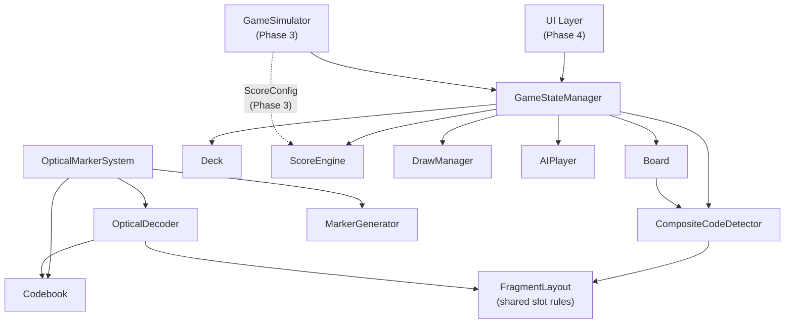

# Design Document

## Overview

The Phase 1 technical design of QRoker covers three core areas: the custom optical marker system, the game engine module, and the game simulator interface (preparation for Phase 3). Detailed browser UI implementation (Phase 4) is not included; only interface definitions are specified.

**Technology stack:**
- Language: plain TypeScript (browser-native, bundler-agnostic)
- Rendering: TypeScript with no external dependencies for the test/experiment raster, Canvas API for browser visualization
- Storage: `localStorage` (game state persistence)
- Offline: Service Worker (static asset caching)
- External dependencies: none (no accounts, servers, or paid APIs required)

**Design principles:**
- **Offline first**: All logic runs locally in the browser. No network access is required.
- **Pluggable score configuration**: The per-error reward table and the hand-empty bonus are injected through `ScoreConfig`. The table length and values are determined by simulation.
- **Invariant-centered**: The engine enforces conservation of the total card count, deck uniqueness, and scoring idempotence at the engine level.
- **Information isolation**: Hidden_Sum and other players' Guess values are excluded from the public state.

---

## Architecture

### Module Dependency Diagram



**Layer structure:**
1. **Core layer**: `Deck`, `Board`, `CardValue` — pure data and state management
2. **Logic layer**: `CompositeCodeDetector`, `ScoreEngine`, `DrawManager` — rule enforcement
3. **Coordination layer**: `GameStateManager` — turn flow, end conditions, information isolation
4. **Optical layer**: `Codebook` (frozen codebook, generation, verification), `MarkerGenerator` (fragment raster rendering), `OpticalDecoder` (detection, reading, hypothesis testing), `ReferenceCheck` (comparison against a reference, Companion only). The game engine and the optical reader share only the `FragmentLayout` rule table, and the reader does not depend on the board state.
5. **AI layer**: `AIPlayer` (strategy pattern) — local offline AI
6. **Simulator layer**: `GameSimulator` (Phase 3) — score value optimization

---

## Components and Interfaces

### Deck

**Responsibility:** Manage the 52 cards, shuffle, random dealing, draw.

**Key algorithms:**
- Fisher–Yates shuffle (using a PRNG that accepts an injected seed — simulation reproducibility)
- Dealing: 4 starting cards (board) + 4 cards × 4 players per player = 20 cards. The remaining 32 cards stay in the deck.

```typescript
interface DeckState {
  remaining: CardId[];   // ordered stack (top = last element)
  dealtCards: Set<string>; // set for guaranteeing uniqueness, in "suit-rank" format
}

interface DeckOperations {
  initialize(seed?: number): DeckState;
  deal(n: number, state: DeckState): { cards: CardId[]; newState: DeckState };
  draw(state: DeckState): { card: CardId | null; newState: DeckState };
  // if card is null, the deck is exhausted (Requirement 3.8)
}
```

---

### Board

**Responsibility:** Manage the 8×8 grid state, validate placements, track Quad_Group candidate regions.

**Placement validity conditions (Requirement 3.3, 3.11):**
1. `col ∈ [0,7]`, `row ∈ [0,7]` — within bounds
2. `board[row][col] === null` — empty
3. An existing card is present in at least one of the 4 directions (up, down, left, right) — adjacency
4. `orientation ∈ {0, 180}` — 90°/270° rejected

```typescript
type GridPosition = { row: number; col: number }; // row: 1–8, col: A–H (0-indexed)

interface PlacedCard {
  card: CardId;
  orientation: 0 | 180;
}

interface BoardState {
  grid: (PlacedCard | null)[][];  // 8×8
  cardCount: number;              // for invariant tracking
}

interface BoardOperations {
  place(pos: GridPosition, card: PlacedCard, state: BoardState): 
    { success: boolean; newState: BoardState; affectedQuads: GridPosition[] };
  isValid(pos: GridPosition, card: PlacedCard, state: BoardState): boolean;
  getAdjacent(pos: GridPosition, state: BoardState): GridPosition[];
  getCandidateQuads(pos: GridPosition): GridPosition[]; // returns the top-left corners of up to 4 2×2 regions
}
```

**Candidate Quad computation:** The top-left corners of the 2×2 regions that contain position (r, c) are those among `{r-1,c-1}, {r-1,c}, {r,c-1}, {r,c}` that lie within bounds.

---

### CompositeCodeDetector

**Responsibility:** Detect Quad_Groups, verify the Inward_Corner based on Fragment_Layout + Card_Orientation, prevent duplicate scoring.

**Inward_Corner mapping (Requirement 14.3):**

| Position within 2×2 | Inward_Corner |
|------------|--------------|
| Top-left (TL)  | BR           |
| Top-right (TR)  | BL           |
| Bottom-left (BL)  | TR           |
| Bottom-right (BR)  | TL           |

**Fragment_Layout fragment positions (Requirement 14.1):**

| Suit | Fragment positions at 0° | Fragment positions at 180° | Symmetry type    |
|------|------------|--------------|------------|
| ♥ Heart      | TL + BR    | TL + BR      | 180° point symmetry  |
| ♦ Diamond | TR + BL    | TR + BL      | 180° point symmetry  |
| ♣ Club      | TR + BR    | TL + BL      | horizontal-axis reflection    |
| ♠ Spade   | TL + BL    | TR + BR      | horizontal-axis reflection    |

**Per-slot participation conditions (derived from Fragment_Layout and Inward_Corner):**

| Slot | ♥ | ♦ | ♣ | ♠ |
|------|---|---|---|---|
| TL | 0°/180° | not possible | 0° | 180° |
| TR | not possible | 0°/180° | 180° | 0° |
| BL | not possible | 0°/180° | 0° | 180° |
| BR | 0°/180° | not possible | 180° | 0° |

Each card contributes fragments to exactly 2 of the 4 surrounding vertices. What is observed optically follows Section 5 of the [Optical Marker System](#optical-marker-system).

**Validity check algorithm:**
```
function isValidQuadMember(card, boardPos, orientation):
  fragments = getFragmentCorners(card.suit, orientation)
  inward = getInwardCorner(boardPos)
  return fragments.includes(inward)
```

**Duplicate scoring prevention:**
- Quad_Group unique identifier: string serialization of the set of the 4 card IDs in sorted order
  - Example: `"C-A|D-K|H-7|S-Q"` (sorted alphabetically by suit-rank)
- `scoredGroups: Set<string>` — the set of identifiers that have already been scored
- During detection, if `scoredGroups.has(id)` is true, scoring is skipped
- Cards are never moved or removed after placement, so the same set of 4 cards can hold at only one vertex. The `scoredGroups` check defensively verifies this invariant.

```typescript
interface CompositeCodeResult {
  cards: [CardId, CardId, CardId, CardId];
  positions: [GridPosition, GridPosition, GridPosition, GridPosition];
  hiddenSum: number;
  groupId: string;        // serialization of the sorted card ID set
  isNew: boolean;         // for duplicate scoring prevention
}

interface CompositeCodeDetector {
  detect(pos: GridPosition, board: BoardState, scoredGroups: Set<string>): CompositeCodeResult[];
  computeGroupId(cards: CardId[]): string;
}
```

---

### ScoreEngine

**Responsibility:** Collect prediction batches, information isolation, simultaneous reveal, score calculation.

**Score function (Requirement 2.1–2.4):**
```
score(guess, hiddenSum, config):
  e = |guess − hiddenSum|
  return e < config.rewardByError.length ? config.rewardByError[e] : 0
```

Configuration validation: `rewardByError` must have length at least 1, every value must be a finite number greater than or equal to 0, `rewardByError[0] > 0`, and the table must be non-increasing. `handEmptyBonus` is a finite number greater than or equal to 0. A configuration that violates these conditions is rejected. The table length and values are **TBD — determined by simulation**, and Phase 3 compares candidates such as linear decay, geometric decay, and step-shaped tables.

**Multiple Composite Codes (Requirement 6.5):** All Composite Codes newly formed by a single placement action are grouped into one `PredictionBatch`. After every player has submitted predictions for all codes in the batch, they are revealed at once.

**Information isolation principles:**
- hiddenSum and submitted prediction values are kept only in the sealed store inside `GameStateManager`.
- The public `GameState` contains only whether each batch has been submitted (`boolean`).
- Once all predictions have been collected, `RevealResult` is revealed at once.

```typescript
interface ScoreConfig {
  rewardByError: number[]; // index = absolute error. TBD — determined by simulation
  handEmptyBonus: number;  // TBD — determined by simulation
}

interface PredictionBatch {
  batchId: string;
  groupIds: string[]; // groups to be predicted. hiddenSum is not included
}

interface RevealResult {
  batchId: string;
  groups: Array<{ groupId: string; hiddenSum: number }>;
  playerResults: Array<{
    playerId: string;
    earnedScore: number;     // score earned in this batch
    cumulativeScore: number; // cumulative score
    // guess values are not included
  }>;
}

interface ScoreEngineOperations {
  validateConfig(config: ScoreConfig): { ok: true } | { ok: false; reason: string };
  score(guess: number, hiddenSum: number, config: ScoreConfig): number;
  submitGuesses(batchId: string, playerId: string, guesses: Record<string, number>): boolean; // only integers in [4, 52] are accepted
  allGuessesCollected(batchId: string, playerIds: string[]): boolean;
  reveal(batchId: string, config: ScoreConfig): RevealResult;
}
```

---

### DrawManager

**Responsibility:** Enforce the draw rule (excluding the first round; draw 1 card when no Composite Code is completed).

```typescript
interface DrawManagerState {
  firstPlacementDone: Set<string>; // set of IDs of players who have completed their first placement
}

interface DrawManagerOperations {
  shouldDraw(
    playerId: string,
    completedCodes: CompositeCodeResult[],
    state: DrawManagerState
  ): boolean;
  // Returns: false if first placement or ≥1 code completed; true otherwise
  
  markFirstPlacement(playerId: string, state: DrawManagerState): DrawManagerState;
}
```

**Rules:**
- `playerId ∉ firstPlacementDone` → `shouldDraw = false` (first placement exempt), then add to `firstPlacementDone`
- `completedCodes.length >= 1` → `shouldDraw = false`
- Otherwise → `shouldDraw = true`

---

### GameStateManager

**Responsibility:** Coordinate the overall game flow, detect the end of the game, maintain invariants, manage the public state.

**Invariants (Requirement 3.2, 3.10):**
- `deck.remaining.length + board.cardCount + sum(hand.length for all players) = 52`
- `board.cardCount = placementActionCount + 4`

```typescript
type GamePhase = 
  | 'INIT'          // initialization
  | 'PLACEMENT'     // card placement phase
  | 'GUESS_COLLECT' // Guess collection phase
  | 'REVEAL'        // score reveal
  | 'ENDED';        // game ended

interface PublicGameState {
  phase: GamePhase;
  board: BoardState;
  deckRemaining: number;        // only the card count is public (contents not revealed)
  hands: Record<string, number>; // only each player's hand card count is public
  scores: Record<string, number>; // cumulative scores
  guessStatus: Record<string, boolean>; // only whether submitted is public
  lastReveal?: RevealResult;
  winner?: string[];            // when the game has ended
}

interface PlayerView {
  publicState: PublicGameState;
  myHand: CardId[];             // only the player's own hand is revealed
}
```

**Game end condition (Requirement 3.7):**
All Composite Codes scored and all Guess values collected → end declared → `ScoreConfig.handEmptyBonus` awarded.

---

### AIPlayer

**Responsibility:** Implement offline local AI strategies. Uses the Strategy Pattern.

```typescript
interface AIStrategy {
  selectPlacement(view: PlayerView, deck: CardId[]): { pos: GridPosition; card: CardId; orientation: 0 | 180 };
  submitGuess(view: PlayerView, hiddenSumRange: [number, number]): number;
}

class RandomStrategy implements AIStrategy {
  // beginner: random valid placement, uniformly distributed Guess
}

class HeuristicStrategy implements AIStrategy {
  // advanced: maximize the likelihood of completing a Quad_Group
  // evaluation function: number of Quad_Group candidates that can be completed after placement × expected score
}
```

**AI Guess information restriction (Requirement 7.4):**
The AI uses only the revealed card information in `PlayerView.publicState.board`. It cannot access other players' `myHand` or pending guesses.

**Response time limit (Requirement 7.3):**
AI decisions complete within 3 seconds as synchronous computation. For the advanced heuristic, this is guaranteed by limiting the search depth.

---

### OpticalMarkerSystem

**Responsibility:** Generate custom optical markers, manage the codebook, coordinate the decoding pipeline.

For the detailed design, see the [Optical Marker System](#optical-marker-system) section.

```typescript
type Transform = 'I' | 'R90' | 'R180' | 'R270' | 'Fh' | 'Fv' | 'Dm' | 'Da';
type Slot = 'TL' | 'TR' | 'BL' | 'BR';

interface GrayImage { width: number; height: number; data: Uint8Array; }

interface Codebook {
  version: string;
  seed: number;
  patterns: Record<string, number>; // "H-A" → 25-bit base pattern
  dId: number;   // measured minimum distance between cards
  dSelf: number; // measured minimum self-transform distance
  sha256: string;
}

interface FragmentReading {
  card: CardId;
  observedTransform: Transform; // observed transform relative to the group axes
  distance: number;             // Hamming distance to the nearest template
  centerPx: [number, number];
}

interface SlotInterpretation {
  slots: Record<Slot, { card: CardId; orientation: Orientation }>;
  reflected: boolean;
}

type OpticalDecodeResult =
  | { kind: 'IDENTIFIED';
      cards: [CardId, CardId, CardId, CardId];
      hiddenSum: number;
      reflection: 'NOT_REFLECTED' | 'REFLECTED' | 'AMBIGUOUS';
      interpretations: SlotInterpretation[]; // length 2 (reflection determined) or 4 (AMBIGUOUS)
      readings: FragmentReading[]; }
  | { kind: 'NOT_DETECTED' }                          // the marker border itself was not found
  | { kind: 'INCOMPLETE_GROUP'; detected: number }    // fewer than 4 fragments around the target vertex
  | { kind: 'CORRUPTED_FRAGMENT'; nearestDistance: number } // border found but outside the acceptance radius
  | { kind: 'DUPLICATE_CARD'; card: CardId }
  | { kind: 'INVALID_ARRANGEMENT' }                   // no consistent camera rotation hypothesis
  | { kind: 'REFERENCE_MISMATCH' };                   // Companion reference comparison mismatch

interface OpticalDecoder {
  // does not take the board state as input (Requirement 13.1)
  decode(image: GrayImage, options?: { acceptRadius?: 0 | 1 | 2 }): OpticalDecodeResult;
}

interface ReferenceCheck {
  // Scoring Companion only. On mismatch, returns REFERENCE_MISMATCH and does not substitute the expected value
  compare(result: OpticalDecodeResult, expectedCards: CardId[]): OpticalDecodeResult;
}
```

---

### GameSimulator (Phase 3 interface)

**Responsibility:** Inject ScoreConfig → repeat N games → output statistics. Implemented in Phase 3; only the signatures are defined in Phase 1.

```typescript
interface SimulationConfig {
  seed: number;             // reproducible PRNG seed
  gameCount: number;        // number of repetitions (default 1000)
  scoreConfig: ScoreConfig; // reward table and bonus candidates to test
  strategies: AIStrategy[]; // strategy of each AI player
}

interface SimulationResult {
  winRates: Record<string, number>;    // win rate per strategy
  avgGameLength: number;               // average game length (number of turns)
  predictionScoreShare: number;        // share of prediction score in total score
  handEmptyBonusImpact: number;        // frequency of rank reversals caused by the hand-empty bonus
  scoreDistribution: number[];         // final score distribution (histogram)
}

interface GameSimulator {
  run(config: SimulationConfig): SimulationResult;
  runBatch(configs: SimulationConfig[]): SimulationResult[]; // parameter sweep
}
```

---

## Data Models

### Core Types

```typescript
// Card identification
type Suit = 'H' | 'D' | 'C' | 'S'; // Heart, Diamond, Club, Spade
type Rank = 'A' | '2' | '3' | '4' | '5' | '6' | '7' | '8' | '9' | '10' | 'J' | 'Q' | 'K';
type Orientation = 0 | 180;

interface CardId {
  suit: Suit;
  rank: Rank;
}

// Card value mapping (Requirement 1.1)
const CARD_VALUE: Record<Rank, number> = {
  'A': 1, '2': 2, '3': 3, '4': 4, '5': 5, '6': 6, '7': 7,
  '8': 8, '9': 9, '10': 10, 'J': 11, 'Q': 12, 'K': 13,
};

// Board position (0-indexed)
interface GridPosition {
  row: number; // 0–7 (corresponds to 1–8)
  col: number; // 0–7 (corresponds to A–H)
}

// Role within a 2×2 group on the board
type QuadRole = 'TL' | 'TR' | 'BL' | 'BR'; // position within the 2×2
type CornerPosition = 'TL' | 'TR' | 'BL' | 'BR'; // card corner

// Fragment_Layout: suit × orientation → set of fragment positions
const FRAGMENT_LAYOUT: Record<Suit, Record<Orientation, CornerPosition[]>> = {
  H: { 0: ['TL', 'BR'], 180: ['TL', 'BR'] }, // point symmetry — invariant
  D: { 0: ['TR', 'BL'], 180: ['TR', 'BL'] }, // point symmetry — invariant
  C: { 0: ['TR', 'BR'], 180: ['TL', 'BL'] }, // horizontal-axis reflection
  S: { 0: ['TL', 'BL'], 180: ['TR', 'BR'] }, // horizontal-axis reflection
};

// Inward_Corner: position within the 2×2 → corner facing the group center
const INWARD_CORNER: Record<QuadRole, CornerPosition> = {
  TL: 'BR',
  TR: 'BL',
  BL: 'TR',
  BR: 'TL',
};

// Placed card
interface PlacedCard {
  card: CardId;
  orientation: Orientation;
}

// Player
interface Player {
  id: string;
  isAI: boolean;
  strategy?: AIStrategy; // if AI
}

// Quad_Group result
interface CompositeCodeResult {
  cards: [CardId, CardId, CardId, CardId];
  positions: [GridPosition, GridPosition, GridPosition, GridPosition];
  hiddenSum: number;         // sum value
  groupId: string;           // serialization of the sorted card ID set
  isNew: boolean;            // whether detected for the first time (duplicate prevention)
}

// Score configuration — follows ScoreConfig in the ScoreEngine section (values TBD — determined by simulation)

// Optical types (Transform, Slot, GrayImage, Codebook, FragmentReading, OpticalDecodeResult) follow the OpticalMarkerSystem component definition.
```

---

## Optical Marker System

This section replaces the earlier 6-bit codebook design. The 6-bit design does not hold, for the reasons given in subsection 1 below.

### 1. Identification bits versus physical marker length

- The information needed to distinguish 52 cards is log₂52 ≈ 5.70 bits, so 6 bits are enough to **represent** a card ID.
- Single-bit error correction (d_min ≥ 3) is subject to the Hamming bound M·(n+1) ≤ 2ⁿ. For n = 6, M ≤ 64/7 ≈ 9.1, and the known maximum is A(6,3) = 8. 52 codewords are impossible.
- Fragments are observed after being rotated and reflected by the camera (subsections 4–5). The codebook must therefore guarantee distance among 52 × 8 = 416 Fragment_Templates, not among 52 codewords.

### 2. Marker structure (adopted: 5×5 data grid)

- Data: 5×5 = 25 binary cells. The bit index of cell (r, c) is i = 5r + c (row-major, with r = 0 at the top of the card).
- Border: a black border 1 module wide surrounds the data grid → 7×7 modules. It is used only for detection and perspective correction and carries no orientation information.
- Margin: a white quiet margin of at least 1 module outside the border → occupied area of 9×9 modules.
- Candidate physical dimensions: module of 1.5–2.0 mm (occupied area of about 13.5–18 mm). The marker is placed inward from the corner to avoid the card's rounded corner and printing tolerance. The values are to be fixed by actual printing and photographing experiments (unverified).

Grid size comparison (the 52-card guaranteed lower bound is calculated with the greedy argument in subsection 6):

| Data grid | n | Including border | 52-card guarantee | Assessment |
|---|---|---|---|---|
| 4×4 | 16 | 6×6 modules | d = 3; after the balance and self-distance filters, lower bound 41 (exhaustive enumeration) < 52 → 52 cards not guaranteed | Limited to 1-bit correction, rejected |
| 5×5 | 25 | 7×7 modules | d = 5; after the filters, lower bound 198 (exhaustive enumeration, subsection 6) | **Adopted** |
| 6×6 | 36 | 8×8 modules | d = 9; lower bound 209.5 without the filters. The value after the filters was not enumerated (unverified) | Alternative. At the same area the module shrinks to 7/8, which is disadvantageous for blur and low resolution |

The reasons for choosing 5×5 are not only the theoretical lower bound. (a) It guarantees d = 5 with a margin of about 3.8 times the 52 cards even after the filters (lower bound 198), (b) at the same printed area the module is about 14% larger than with 6×6, and (c) with an acceptance radius of 1, misidentification requires errors of at least 4 bits per fragment. If recall or the misidentification margin proves insufficient in synthetic experiments, the design moves up to 6×6.

### 3. Transform definition (2D symmetry group D4)

Cell map for cell coordinates (r, c), r, c ∈ {0, …, 4}, of the 5×5 grid:

| Symbol | Meaning | (r, c) → |
|---|---|---|
| I | Identity | (r, c) |
| R90 | 90° clockwise rotation | (c, 4−r) |
| R180 | 180° rotation | (4−r, 4−c) |
| R270 | 270° clockwise rotation | (4−c, r) |
| Fh | Horizontal-axis reflection (top↔bottom) | (4−r, c) |
| Fv | Vertical-axis reflection (left↔right) | (r, 4−c) |
| Dm | Main-diagonal reflection | (c, r) |
| Da | Anti-diagonal reflection | (4−c, 4−r) |

The result of applying a transform g to a pattern P is defined as (g·P)[g(x)] = P[x]. Each g is implemented as a bit-index permutation π_g(5r + c) = 5r′ + c′. This permutation is generated directly from the cell map above, so it equals the 2D transform by definition. The equivalence is confirmed in Property 21 by an exhaustive raster test over 52 × 8. In row-major indexing, R180 equals i → 24 − i (reversal of bit order), but Fh, Fv, and R90 are not a simple reversal or a half swap.

### 4. Printed fragment definition and symmetry

Let P = P_c be the base pattern of card c in card coordinates with the card upright at 0°. The printed content is then as follows. The other two corners carry no fragment.

| Suit | Base corner | Derived corner | Derived content | Symmetry of the card's fragment layer |
|---|---|---|---|---|
| ♥ | TL: P | BR | R180·P | Pixel-wise invariant under 180° card rotation |
| ♦ | TR: P | BL | R180·P | Pixel-wise invariant under 180° card rotation |
| ♣ | TR: P | BR | Fh·P | Pixel-wise invariant under card horizontal-axis reflection |
| ♠ | TL: P | BL | Fh·P | Pixel-wise invariant under card horizontal-axis reflection |

Proof (♥): rotating the card by 180° moves the P at TL to BR, where it becomes R180·P, equal to the printed BR; the R180·P at BR moves to TL, where it becomes R180·R180·P = P. ♦ is the same. ♣: the card's horizontal-axis reflection swaps TR↔BR and applies Fh to the content, so P and Fh·P are exchanged. ♠ is the same. The two fragments belong to the D4 orbit of the same P, so they are identified as the same card.

Distinction between physical rotation and camera rotation:
- **Physical rotation** (Card_Orientation) allows only 0°/180°. For a card placed at 180°, the content visible at a placed corner X is R180 · (the printed content of the opposite corner opp(X)).
- **Camera rotation** (Camera_Rotation) is an arbitrary-angle rotation applied to the whole image. After perspective correction only a residual rotation by a multiple of 90° remains, and template matching and the orientation hypothesis check (subsection 7) handle it.

### 5. Valid combinations per slot and observed content (board axes, camera rotation 0)

The card in slot s ∈ {TL, TR, BL, BR} around a vertex must have its fragment at the Inward_Corner (TL→BR, TR→BL, BL→TR, BR→TL). The valid combinations computed from the definition in subsection 4, and the content observed at the vertex in each case:

| Slot | Required corner | ♥ | ♦ | ♣ | ♠ |
|---|---|---|---|---|---|
| TL | BR | 0°/180°: R180·P | Impossible | 0°: Fh·P | 180°: R180·P |
| TR | BL | Impossible | 0°/180°: R180·P | 180°: R180·P | 0°: Fh·P |
| BL | TR | Impossible | 0°/180°: P | 0°: P | 180°: Fv·P |
| BR | TL | 0°/180°: P | Impossible | 180°: Fv·P | 0°: P |

Properties mathematically derived from this table:
1. The observed transform always belongs to V = {I, R180, Fh, Fv}.
2. ♥ can participate only in the TL and BR slots, and ♦ only in the TR and BL slots (regardless of orientation). ♣ and ♠ can participate in every slot, but each slot allows exactly one orientation.
3. A placed card supplies fragments to exactly 2 of the 4 vertices around it. Every fragment on the board faces exactly one vertex, so the Inward fragment check is equivalent to "4 fragments have gathered at that vertex."
4. **180° ambiguity**: rotating an entire valid 2×2 arrangement by 180° also yields a valid arrangement of the same 4 cards (the table is closed under the slot swaps TL↔BR and TR↔BL and the transform change g → R180∘g). The image alone therefore determines the slot assignment only up to the 180° ambiguity, while the card set and the sum are the same under every interpretation.
5. Rotating the camera by 90° moves the observed transforms to R90∘V = {R90, R270, Dm, Da}, which does not overlap V. Camera rotation is therefore determined up to a multiple of 180°.
6. **Reflection (mirror image) discrimination**: if the image contains a reflection, the rotation/reflection character of the observed transform flips for every fragment. In a valid arrangement, ♥ and ♦ fragments are always observed only as rotations (I or R180), so the presence of even one ♥ or ♦ in the group determines whether the image is reflected (2 passing hypotheses, all with the same reflection status). If the group consists only of ♣ and ♠, the reflected image is also a valid arrangement, so there are 4 passing hypotheses (2 non-reflected + 2 reflected) and the reflection status cannot be determined. Exhaustive enumeration of 81 observed arrangements × 8 image transforms = 648 images gave the following: for the 520 images containing ♥/♦, reflection status is determined, and the 128 ♣/♠-only images are ambiguous. Card identification and the sum do not depend on reflection status. The probability that 4 random cards consist only of ♣ and ♠ is C(26,4)/C(52,4) ≈ 5.5%.

### 6. Codebook constraints and generation algorithm

Definitions: d(·,·) is the 25-bit Hamming distance, and the template set is T = {g·P_c : c ∈ 52 cards, g ∈ D4}.
- Inter-card distance: d_id = min_{c≠c′, g} d(P_c, g·P_{c′}) ≥ 5 (required)
- Self distance: d_self = min_{c, g≠I} d(P_c, g·P_c) ≥ 5 (required, so that the observed transform is uniquely determined within the acceptance radius)
- Consequently, all 416 templates are distinct and have pairwise distance of at least 5.
- Balance filter: the number of black cells of the base pattern satisfies w(P) ∈ [9, 16] (binarization stability).

Generation algorithm (deterministic greedy):
1. Generate 25-bit candidates in sequence with a fixed PRNG (mulberry32, fixed seed).
2. Accept only candidates that pass the balance and self-distance filters and are at distance 5 or more from every already accepted template under all 8 transforms.
3. Stop when 52 are accepted, and assign them in acceptance order to ♥A…♥K, ♦A…♦K, ♣A…♣K, ♠A…♠K.
4. Freeze the result and commit it as `codebook.v1.json` (algorithm version, seed, 52 patterns, measured d_id and d_self, SHA-256). Printing and decoding use only the frozen file, and regeneration is run only for identity verification. If the codebook version changes, the cards must be reprinted.

**Existence guarantee (classification: calculated by exhaustive enumeration. Until reproduced by repository tests, treat as a "value calculated in this design review"):**

Definition: F = { P ∈ {0,1}²⁵ : w(P) ∈ [9,16], d(P, g·P) ≥ 5 for all g ≠ I }. The distance includes all 8 elements of D4. For a candidate P to satisfy d(g·P, t) ≥ 5 for any template t of an already accepted card, it must hold that d(P, g⁻¹·t) ≥ 5; since g⁻¹·t is also a template of the same card, the condition is equivalent to "P is at distance 5 or more from all accepted templates."

Claim: when the greedy procedure that sweeps all of F stops because no candidate remains to be accepted, the number N of accepted cards satisfies N ≥ ⌈|F| / (8·V(25,4))⌉. Reasoning: at stopping, every word in F lies within distance 4 of one of the accepted templates (at most 8N of them; exactly 8 per card because the self distance is ≥ 5), so |F| ≤ 8N·V(25,4).

Exhaustive enumeration result (all 2²⁵ = 33,554,432 patterns):
- Rejected by balance: 3,615,562 (2 times Σ_{k≤8}C(25,k))
- Rejected by self distance: 7,152,896 (per transform: R90 74,624, R270 74,624, R180 647,168, Fh·Fv·Dm·Da 1,835,008 each. The per-transform sum 8,136,448 is an upper bound on the union)
- Rejected by at least one of the two: 9,456,896
- |F| = 24,097,536
- V(25,4) = 1 + 25 + 300 + 2,300 + 12,650 = 15,276 → N ≥ ⌈24,097,536 / 122,208⌉ = **198**
- The lower bound of 178 from the earlier design review was a looser value calculated from the sum of per-transform rejection counts, and it was not wrong.
- The same calculation for other criteria: d = 6 → 45, d = 7 → 7 (both below 52, so d ≥ 6 is not guaranteed). 4×4 (d = 3, filters applied) → 41.

Nature of the generator: the lower bound above is a proof that "a 52-card codebook exists," whereas the generator is a constructive procedure that draws candidates with a fixed-seed PRNG. After 51 cards are accepted, the lower bound on the probability that one random candidate is accepted is (|F| − 51·8·15,276) / 2²⁵ ≈ 0.532, so with an upper limit on the number of attempts it practically always succeeds, but this is a probabilistic explanation, not a guarantee. The generator terminates with an error if it exceeds the attempt limit. In every case the final verdict is made not by the generator but by an independent verifier (raster-based verification that shares no code with the generator). The achieved d_id and d_self are measured and recorded.

### 7. Decoding pipeline

The input is only a grayscale image, and no board state is accepted (enforced by the API signature).

1. **Marker detection**: adaptive binarization → connected components and contours → quadrilateral approximation → 4-corner homography → 7×7 sampling → check that all border cells are black. If none is found, NOT_DETECTED.
2. **Vertex clustering**: find a set of markers such that one lies in each of the four quadrants around a common center and the distances between centers match, within tolerance, a square arrangement predicted from the marker size. The set closest to the frame center is the target. If fewer than 4 markers surround the target vertex, INCOMPLETE_GROUP. Because the Central_Void exists, the procedure does not assume a connected square formed by the four fragments and uses only the marker center positions, and markers not at the target vertex (Distractor_Marker) are excluded from the cluster.
3. **Data reading**: estimate the group axis from the vectors between marker centers (ambiguous up to multiples of 90°), and read each marker's 5×5 data aligned to that axis.
4. **Template matching**: compute the distance to the 416 templates and obtain the nearest (card, transform g, distance). If the distance ≤ r_acc (default 1, configurable up to 2), accept; otherwise CORRUPTED_FRAGMENT.
5. **Duplicate check**: the 4 card IDs must all differ. Otherwise DUPLICATE_CARD.
6. **Orientation and reflection hypothesis check**: for each of the 8 elements h of D4 (4 rotations × 2 reflection states), obtain the slot and the relative transform h⁻¹∘g and compare them with the table in subsection 5. The set of passing hypotheses is judged as follows. (a) No passing hypothesis → INVALID_ARRANGEMENT. (b) 2 passing hypotheses, all non-reflected → reflection = NOT_REFLECTED. (c) 2 passing hypotheses, all reflected → REFLECTED. (d) 4 passing hypotheses (2 non-reflected + 2 reflected) → AMBIGUOUS. (e) Any other count is rejected as an internal error. The reader does not guess the reflection status. Even for REFLECTED and AMBIGUOUS, the card set and the sum are returned, and the `reflected` flag of the interpretation states the reflection assumption explicitly.
7. **Sum**: the sum of the Card_Values of the 4 identified cards.
8. **Reference comparison** (Scoring Companion only, optional): if the result differs from the card set in the board record, reject with REFERENCE_MISMATCH. The expected value does not replace the reading result.

The reading result is passed only to the ScoreEngine's sealed store and, per Requirement 6, is not shown in the UI before prediction collection ends. The reader module itself has no UI.

Error tolerance (assuming the independent bit-flip model): at distance 5, correction within radius 2 or less is guaranteed and the acceptance regions do not overlap. With r_acc = 1: 1-bit errors are guaranteed to be corrected; 2–3-bit errors fall within no template's acceptance region, so CORRUPTED_FRAGMENT rejection is guaranteed; with 4 or more bits, another card can fall within the acceptance region (misidentification is possible). With r_acc = 2: errors up to 2 bits are guaranteed to be corrected, and for 3 or more bits both rejection and misidentification are possible (no guarantee). An ambiguous observation in which two or more templates fall within the acceptance region does not occur structurally at radius ≤ 2. Cases where the cell brightness is close to the threshold and the bit decision itself is uncertain are reported separately, as cell confidence, in the fragment reading stage (task 4.2). Actual image errors (position error, blur, lighting) are not independent bit flips, so the guarantees above do not apply as they are, and only the measured values from the synthetic degradation experiments (Requirement 12.5) serve as evidence. The design does not claim that arbitrary corruption cannot produce another valid identity at any radius. The default is r_acc = 1, and the final default is fixed by the recall and misidentification rate in the synthetic experiments.

### 8. Guarantee-level classification

| Property | Basis | Verification method |
|---|---|---|
| 52 unique IDs, d_id ≥ 5, d_self ≥ 5 | Exhaustive enumeration result of subsection 6 (lower bound 198) and the generator | Exhaustive check of all pairs (86,320 pairs) of the 416 templates in the frozen codebook |
| Equivalence of bit permutation and 2D transform | Definition in subsection 3 | Exhaustive 52 × 8 raster comparison |
| ♥♦ 180° invariance, ♣♠ horizontal-axis reflection invariance | Proof in subsection 4 | Raster pixel comparison of the card fragment layer |
| Slot table, 180° ambiguity, number of passing hypotheses ∈ {0, 2} | Derivation in subsection 5 | Exhaustive over slot × suit × orientation, synthetic group tests |
| Reflection discrimination (groups containing ♥/♦ are determined, ♣/♠-only groups are ambiguous) | Derivation in subsection 5, calculated by exhaustive enumeration in this review | Exhaustive test of 648 images (Property 26) |
| Correction and detection within the acceptance radius | Calculation in subsection 7 | Fixed-seed bit-flip test |
| Deterministic regeneration | Fixed algorithm and seed | Byte comparison of the regenerated result with the frozen file |
| Detection rate, tolerance to blur, noise, perspective, and lighting, false positives from 3 fragments | Not guaranteed | Synthetic degradation experiments (Requirement 12.5) |
| Print quality, gloss, focus, module size, real camera | Unverified | Experiments with real printed cards and phone photography (recorded separately) |
| 0 misidentifications in synthetic tests | A finite-sample observation, not a guarantee. 95% one-sided upper bound on the per-trial probability: 1 − 0.05^(1/n) | Record n and the observed count per condition in `robustness.json` (task 7) |
| Show-through of the back-side marker at the empty front corner | Unverified | Physical print test (task 8, Requirement 16.10) |

---

## Physical Card Geometry

This section addresses whether the markers hold up in a 2×2 arrangement of real playing cards placed edge to edge with no gap. The codebook and Fragment_Layout are not changed.

### 1. Baseline parameters

| Parameter | Baseline value | Notes |
|---|---|---|
| Card size | 63.5 × 88.9 mm | Matches exactly the prototype 40 × 56 module grid at 1.5875 mm per module |
| Corner_Radius | 3.175 mm | About 3–3.6 mm in commercial print-vendor material. Not confirmed against a standard specification |
| Marker_Inset | 1 module (1.5875 mm) | Between the outer corner of the marker footprint and the card edge |
| White quiet margin | 1 module | A renderer setting, not part of the codebook structure, so it can be increased without changing the codebook |
| Module size | 1.5875 mm | Experiment range 1.4–2.0 mm |
| Intended seam gap | 0 mm | No gap is required |
| Background (table) brightness | Test both dark and light values | |

### 2. Analytic containment calculation (value calculated in this review; unreproduced until reproduced by repository tests)

Whether a point P at (a, a) mm diagonally from the card corner lies inside a rounded corner of radius r is as follows: if r ≤ a it is always inside, and if r > a it is inside when the radial clearance to the arc, c = r − √2·(r − a), is 0 or more. The outer corner of the marker footprint's white quiet margin has a = Marker_Inset, and the corner of the black border has a = Marker_Inset + margin.

- Baseline geometry (r = 3.175 mm, Marker_Inset 1 module): the clearance from the outer corner of the margin to the arc is **0.93 mm**. The corner of the black border has a = 3.175 mm = r, so it lies on the boundary of the rounded region and does not meet the arc.
- The maximum radius at which the entire margin stays inside the card is r_max = a·√2/(√2 − 1): Marker_Inset 0.5 module → 2.71 mm, 1 module → 5.42 mm, 1.5 modules → 8.13 mm, 2 modules → 10.84 mm. With Marker_Inset 0.5 module at the baseline radius, the margin corner goes outside the card (clearance −0.19 mm). Marker_Inset 1 module is satisfied up to a radius of 5 mm (clearance 0.17 mm) and is not satisfied at 6 mm (clearance −0.24 mm).
- Comparison of clearance at the outer corner of the margin (Marker_Inset 1 module / 1.5 modules): at r = 3.175 mm, 0.93 / 2.05 mm; at r = 3.6 mm, 0.75 / 1.88 mm; at r = 4 mm, 0.59 / 1.71 mm.
- The Central_Void area is 4(1 − π/4)·r²: r = 2 mm → 3.43 mm², 3.175 mm → 8.65 mm², 4 mm → 13.73 mm², 5 mm → 21.46 mm². It has the shape of four horns, each extending r from the center along the seams.
- Distance between the Central_Void and the corner of the black border. Here a is the offset of the black-border corner from each card edge, a = Marker_Inset + margin (baseline: 2 modules = 3.175 mm at Marker_Inset 1 module and margin 1 module), and r is the Corner_Radius. Two quantities are distinguished, named as in `markerContainment` (`src/optical/testing/physical-card.ts`):
  - `voidTipToBorderCornerMm` is the distance from the horn tip of the Central_Void (the arc tangent point on the card edge, at distance r from the vertex along the seam) to the black-border corner: √((a − r)² + a²). It is a reference value only.
  - `voidToBorderCornerMm` is the true minimum Euclidean distance from any point of the Central_Void to the black-border corner. This is the quantity Requirement 15.4 asks the experiment to report.
  - r = 0: the card corner is square, there is no Central_Void, and no void distance is defined. Neither quantity is reported for r = 0: the experiment records the literal value "No Central_Void" (in code the value is `null`).
  - 0 < r ≤ a: the nearest void point is the horn tip, so `voidToBorderCornerMm` = `voidTipToBorderCornerMm` = √((a − r)² + a²), which is at least a.
  - r > a: the nearest void point lies on the arc, on the line from the arc centre (r, r) through the border corner (a, a). The distance is `voidToBorderCornerMm` = r − √2·(r − a), which is less than `voidTipToBorderCornerMm` and less than a. This holds while the value is 0 or more, that is r ≤ a·√2/(√2 − 1) (10.84 mm at a = 3.175 mm); beyond that the border corner lies outside the rounded card and the marker is not contained (see the containment calculation above).

  Values at a = 3.175 mm (Marker_Inset 1 module, margin 1 module), recomputed from the formulas above and consistent with `docs/optical/results/m5-4-physical-card.md`:

  | r (mm) | Case | `voidTipToBorderCornerMm` (mm) | `voidToBorderCornerMm` (mm) |
  |---|---|---|---|
  | 0 | No Central_Void | not defined (code: `null`) | not defined (code: `null`) |
  | 2.0 | r ≤ a | 3.39 | 3.39 |
  | 3.0 | r ≤ a | 3.18 | 3.18 |
  | 3.175 (baseline) | r = a | 3.175 | 3.175 |
  | 3.6 | r > a | 3.20 | 3.00 |
  | 4.0 | r > a | 3.28 | 2.83 |
  | 5.0 | r > a | 3.66 | 2.42 |
  | 6.0 | r > a | 4.25 | 2.00 |

  The horn-tip value alone is not the minimum for r > a: it rises with r while the true minimum falls. The previously tabulated horn-tip values (3.39, 3.17, 3.28, 3.66, 4.25 mm for r = 2, 3.175, 4, 5, 6 mm) are correct as horn-tip distances. At r = 6 mm with Marker_Inset 1 module the margin is outside the card (invalid, clearance −0.24 mm), so that row is a distance for the border corner only and not a valid geometry.
- For every 0 < r < 10.84 mm, the true minimum distance is greater than 0, so the void does not touch the black border at a = 3.175 mm. For r ≤ 3.175 mm the void is at least 2 modules (3.175 mm) from the border corner, with the white quiet margin and Marker_Inset between them. For r ≥ 3.6 mm the void is closer than 2 modules (3.00, 2.83, 2.42 and 2.00 mm at r = 3.6, 4, 5 and 6 mm), so the arc enters the band occupied by the white quiet margin and Marker_Inset.
- The white gap between the black squares on the two sides of a seam (clearance 0) is 2(Marker_Inset + margin) modules: Marker_Inset 1 module → 4 modules = 6.35 mm, 1.5 modules → 5 modules = 7.94 mm.
- Not included in the calculation: card cutting tolerance, print registration error, edge gloss and shadow, seam gap, card warp. Whether the baseline clearance of 0.93 mm is larger than the actual cutting and registration errors is not known.

### 3. Markers as they appear in the image

- 4 inward markers surround the center vertex of a 2×2 group, and the same image shows the outward fragment of each card and the fragments around other vertices (Distractor_Marker). On a large board, the two fragments of one card face different vertices. A cluster is accepted as a group only when exactly 4 gather around one vertex (Requirement 15.6).
- `detect.ts` detects per marker and does not assume a connected square formed by the four fragments, so the Central_Void is designed not to affect the detection input. This assumption is to be confirmed by experiment (task 5.5).
- If the table background is dark, it becomes a dark component in global binarization, but it is separated from the marker by the white quiet margin and Marker_Inset. This is also to be confirmed by experiment.

### 4. Simulation synthesizer (test support code, not production code)

- `renderPhysicalCard(card, orientation, geometry)`: places a rounded-corner mask (anti-aliased) and the markers on a raster in mm coordinates, and fills the area outside the mask with the background.
- `composeBoard(placements, geometry, errors)`: joins the cards with clearance 0 and applies per-card translation and rotation errors.
- The existing `render.ts` is not modified, and `renderMarker` and `placedFragments` are reused. The containment-clearance function `markerContainment(geometry)` implements the analytic formula above (including `voidTipToBorderCornerMm` and `voidToBorderCornerMm`) and is compared with the raster result.
- Double-sided cards take a `face: 'FRONT' | 'BACK'` parameter, and the design models printed content (`printLayers(card)`: the front and back layers in the Body_Frame) separately from observation (`observeFace(card, face, orientation, flip?)`: the view from above). The front-to-back print registration error `duplexRegistration { dxMm, dyMm, rotDeg }` and the cut-outline error are taken as geometry parameters.

### 5. Incremental optimization order and decision rule

The baseline geometry (standard rounded corner) is evaluated first. If reliability is insufficient, improve only in this order: (1) fragment position and Marker_Inset (1 → 1.5 → 2 modules), (2) marker size and margin, (3) detection and geometric-correction algorithm, (4) evaluation of physical alignment tolerance, (5) only if necessary, reduce Corner_Radius in steps. The geometry is not changed because of a single failure case, and each step decides after recording per-condition aggregates (correct recognition rate, rejection kinds, misidentification count, failure causes) and the geometry parameters.

Hypothesis (unverified): analytically, the containment clearance at the baseline radius is positive and the true minimum distance from the Central_Void to the black border (`voidToBorderCornerMm`) is 3.175 mm, which is 2 modules, so it is possible that no radius reduction is needed. The 2-module statement holds only for Corner_Radius ≤ 3.175 mm at Marker_Inset 1 module and margin 1 module (a = 3.175 mm). It does not hold for r ≥ 3.6 mm, where `voidToBorderCornerMm` is 3.00 mm or less. The horn-tip distance must not be used as the minimum. The Task 5.6 radius sweep must therefore record `voidToBorderCornerMm` (the true minimum), and may record `voidTipToBorderCornerMm` only as an additional reference column. For r = 0 the sweep records the literal value "No Central_Void" (in code `null`) in both columns. The risks are the small clearance of 0.93 mm and the cutting and registration errors, and Marker_Inset of 1.5 modules (clearance 2.05 mm) is the first improvement candidate to test. There is no evidence for either hypothesis until experiments are run.

### 6. Where the experiments are

Synthetic combination experiments are in tasks 5.4–5.6 (the double-sided and flip equivalence tests are in task 5.5), coupling with degradation conditions is in task 7, and real print and cutting-error measurement is in task 8.

### 7. Double-sided markers and flip equivalence

**Coordinate system.** The Body_Frame is fixed to the card body with its origin at the upper-left as seen from the front. Let the front layer be F(x, y); the back print is described as B(x, y), the view of it seen through toward the front in the same frame.

**Derivation.** A vertical-axis (left-right) flip maps body x to W − x. The view seen directly from the back after the flip is V(x′, y) = B(W − x′, y). The requirement is "the observation after the flip is the same as the front" (V = F), so B(x, y) = F(W − x, y); that is, the back layer in Body_Frame coordinates is the left-right mirror of the front layer, and the pixel content of the fragments is also mirrored (as a cell map, Fv). Seen directly from the back, it looks the same as the front. This derivation was checked by hand in this review and is unconfirmed until reproduced by repository tests (to be confirmed in task 5.5).

**Print file convention.** If the same raster is printed unchanged in the Body_Frame on both sides, the observation after the flip is the left-right mirror of the front, and the corner positions and bits are wrong. The back print file must be specified as "the same appearance as the front when viewed from the back." Whether a duplex printer or print shop automatically mirrors the back page is not known, and it must be confirmed by a physical flip test (task 8).

**Corner sets.** Front: ♥ {TL, BR}, ♦ {TR, BL}, ♣ {TR, BR}, ♠ {TL, BL}. In the Body_Frame, the back is its left-right mirror: ♥ {TR, BL}, ♦ {TL, BR}, ♣ {TL, BL}, ♠ {TR, BR}, and for every suit it does not overlap the front set. The footprints of the two faces therefore do not overlap each other. However, this also means that each face's markers lie directly beneath the empty corners of the opposite face. The empty corners of the front (for example TR and BL of ♥) are the same corners, in body coordinates, where the back markers are printed. If a back marker showing through the paper looks like a faint marker at an empty front corner, a card whose inward corner is empty (a card placed in the wrong slot) may appear to have a marker, the number of Distractor_Markers may increase, or the white quiet margin may darken. The degree of show-through has not been calculated and there is no synthetic simulation plan; it is to be confirmed by the physical test of milestone 8 (Requirement 16.10).

**Flip kinds.** A vertical-axis flip does not change the observation. A horizontal-axis flip equals a vertical-axis flip plus an in-plane 180° rotation, so the observation equals the observation at an allowed orientation (0°, 180°) for every suit (no change for ♥ and ♦, the 180° arrangement for ♣ and ♠). A 90° observation never arises from any flip.

**Containment and registration.** Because the corner footprint is left-right symmetric, the containment clearance of the back is the same as that of the front (same radius, inset, and margin). The front-to-back print registration error and the cut-outline error consume containment clearance by the size of the error in the worst case. The baseline clearance is 0.93 mm (inset 1 module) and 2.05 mm for an inset of 1.5 modules, and the actual registration and cutting errors are not known. Registration error shifts the marker position after the flip from its ideal position, but because reading is independent per marker, the effect is expected to be limited to the position tolerance of the cluster (unverified).

**Text and artwork (coordinate convention).** Readable text and artwork must appear correctly oriented (not mirrored) when each printed face is viewed directly. Artwork is therefore authored in the Face_Local_Frame of its face: the frame in which that face is viewed directly, with the origin at the top-left of the face as the viewer sees it. The Body_Frame is a single physical-body frame shared by both faces, and the optical marker layer is defined in it. The back marker layer is the horizontal mirror of the front marker layer in the Body_Frame (B(x, y) = F(W − x, y), unchanged and approved). This mirroring is a Body_Frame statement and applies to the marker layer only. It is not applied to artwork.

When the print file of a face is produced, the Face_Local_Frame of the FRONT face equals the Body_Frame, and the Face_Local_Frame of the BACK face is the Body_Frame mirrored horizontally (u = W − x). The face-local raster of the back marker layer is then B(W − u, y) = F(u, y), which is the raster a viewer of the back actually sees and is identical to the front marker raster. Artwork authored in the Face_Local_Frame of either face needs no marker-style mirroring and is unaffected. This is consistent with the derivation above (the view seen directly from the back is V(x′, y) = B(W − x′, y) = F(x′, y)), with the vertical-axis flip leaving the observed marker layer unchanged, and with the horizontal-axis flip, which gives F(W − x, H − y) and equals the permitted 180° placement. The synthesizer handles the marker layer and an asymmetric probe artwork (for example a text raster, authored face-locally) separately, and tests that the marker mirroring is not applied to the artwork. The real print-file convention (whether a duplex printer or print shop mirrors the back page) is verified only in Milestone 8 (task 8). Synthetic tests do not claim it.

**Hidden-information limit (game security).** On either face, a marker encoding the card ID is visible. The back-side marker reveals the identity of cards held in hand and of cards placed face down to anyone with a reader. The rule that the app does not display the sum it reads before prediction collection (Requirement 6.1) is a software display-timing rule and does not make the printed identity secret. The marker geometry is not changed, and the following operational safeguards are proposed separately (none is implemented or verified): (1) a rule not to read the opponent's cards, and a procedure in which the Companion app requests a scan only when the cards placed on the board are revealed (a rule-level measure, not technically enforced), (2) a card holder or screen that hides the hand, (3) placing cards face up so that board cards are treated as public information, (4) a per-deck secret substitution is not recommended because the mapping table is exposed as the number of known cards grows, so it only delays disclosure. If real secrecy is needed, the physical design itself must change, which is outside the scope of this directive.

---

## Correctness Properties

*A property is a characteristic or behavior that should hold true across all valid executions of a system — essentially, a formal statement about what the system should do. Properties serve as the bridge between human-readable specifications and machine-verifiable correctness guarantees.*

---

### Property 1: Card_Value range invariant

*For any* valid card (within the 52-card deck), `Card_Value(card) ∈ [1, 13]`, and the mapping by Rank matches the fixed table (A=1, 2–10=face value, J=11, Q=12, K=13).

**Validates: Requirements 1.1**

---

### Property 2: Hidden_Sum range and order independence

*For any* valid Quad_Group (4 distinct card IDs), `Hidden_Sum ∈ [4, 52]`, and for the same 4 cards it always returns the same Hidden_Sum regardless of the order in which the cards are arranged.

**Validates: Requirements 1.2, 1.4, 1.5**

---

### Property 3: Quad_Group card uniqueness

*For any* Quad_Group returned by `CompositeCodeDetector`, the 4 card IDs are pairwise distinct (no identical suit+rank combination).

**Validates: Requirements 1.3**

---

### Property 4: Score function symmetry and monotonicity

*For any* valid `ScoreConfig`, `hiddenSum ∈ [4, 52]`, and error e, `score(hiddenSum + e) == score(hiddenSum − e)` (when both values are within range), the score does not increase as |e| grows, and the score is 0 if |e| ≥ `rewardByError.length`. A configuration with negative values, an increasing segment, or an empty table is rejected.

**Validates: Requirements 2.1, 2.2, 2.3, 2.4**

---

### Property 5: Guess range validation

*For any* attempted Guess input, an integer or non-integer value with `guess ∉ [4, 52]` is always rejected, and an integer with `guess ∈ [4, 52]` is always accepted.

**Validates: Requirements 2.8, 11.3**

---

### Property 6: Guess not included when scores are revealed

*For any* set of players and any set of Guesses, each `playerResult` in the `RevealResult` returned by `ScoreEngine.reveal()` does not contain the raw guess value.

**Validates: Requirements 2.7, 6.2, 6.3**

---

### Property 7: Card dealing uniqueness invariant

*For any* game initialization, the card set `board_cards ∪ all_player_hands` consists of exactly 20 distinct cards, all belonging to the standard 52-card deck.

**Validates: Requirements 3.2**

---

### Property 8: Board card count increase invariant

*For any* valid placement action, `board.cardCount(after) == board.cardCount(before) + 1` holds.

**Validates: Requirements 3.10**

---

### Property 9: Placement validity check completeness

*For any* placement attempt `(pos, card, orientation, boardState)`, the action is rejected if any one of the following applies: out-of-bounds, occupied cell (occupied), non-adjacent (non-adjacent), or 90°/270° orientation. Conversely, the action is accepted if all four conditions are satisfied.

**Validates: Requirements 3.3, 3.11**

---

### Property 10: Draw rule — symmetry according to whether a Composite Code is completed

*For any* non-first placement action:
- If the action completes one or more new Composite Codes → no draw
- If the action does not complete a Composite Code → the hand increases by 1 card if the deck is not empty

**Validates: Requirements 3.5, 3.6**

---

### Property 11: Scoring idempotence

*For any* board state, running `CompositeCodeDetector.detect()` repeatedly on the same board state does not add any new group with `isNew == true` (identifiers already registered in `scoredGroups` are excluded from re-scoring).

**Validates: Requirements 4.3, 4.5**

---

### Property 12: Fragment_Layout symmetry invariant

*For any* heart (♥) or diamond (♦) card `c`, `FRAGMENT_LAYOUT[c.suit][0]` and `FRAGMENT_LAYOUT[c.suit][180]` return the same corner set.

*For any* club (♣) or spade (♠) card `c`, `FRAGMENT_LAYOUT[c.suit][180]` returns the opposite-side corner set of `FRAGMENT_LAYOUT[c.suit][0]` (TR+BR ↔ TL+BL).

**Validates: Requirements 3.11, 5.4, 5.5, 14.5, 14.6**

---

### Property 13: Template distance

For the 416 Fragment_Templates in the frozen codebook, the Hamming distance between any two distinct templates is at least 5, and the number of black cells in every base pattern lies in [9, 16]. (Exhaustive check)

**Validates: Requirements 5.3**

---

### Property 14: Fragment symmetry and identification invariance

*For any* card c, for ♥ and ♦ the result of rotating the card's fragment-layer raster by 180° is pixel-for-pixel identical to the original, and for ♣ and ♠ the result of reflecting it about the horizontal axis is identical to the original. Reading each of the two fragments returns the same card ID. Mirror-flipping the entire image does not change the identified card ID. However, whether the image is reflected is reported separately according to Property 26.

**Validates: Requirements 5.2, 5.4, 5.5, 13.5**

---

### Property 15: Optical error rejection

*For any* valid 2×2 composite image: (a) removing one or more fragments returns INCOMPLETE_GROUP; (b) replacing one fragment with the same card as another slot returns DUPLICATE_CARD; (c) flipping at least r_acc + 1 and at most 4 − r_acc bits in one fragment returns CORRUPTED_FRAGMENT (the interval is non-empty only when r_acc = 1); (d) composing a fragment with an observation transform not in the Section 5 table (for example, a 90°-rotated fragment, or placing ♥ fragment content in the TR slot) returns INVALID_ARRANGEMENT. IDENTIFIED is never returned in any of these cases. Physically placing ♥ in the TR slot corresponds to (a), because there is no fragment at that corner.

**Validates: Requirements 5.7, 13.4, 13.6**

---

### Property 16: Inward_Corner ∩ Fragment — Quad_Group validity

*For any* card `c` placed at role `role` within a 2×2 with orientation `orientation`, if `FRAGMENT_LAYOUT[c.suit][orientation]` contains `INWARD_CORNER[role]`, it is a valid Quad_Group member, and if it does not contain it, it is invalid.

**Validates: Requirements 3.12, 14.4**

---

### Property 17: AI action validity

*For any* game state, every `PlacementAction` generated by an AI player passes `Board.isValid()`.

**Validates: Requirements 7.2**

---

### Property 18: Public state — Guess information not included

*For any* game state `s` in which Guess collection is not complete, `s.publicState` does not contain `hiddenSum`. The `publicState` of every player does not contain the pending guess values of other players.

**Validates: Requirements 6.1, 6.3**

---

### Property 19: Final ranking tie handling

*For any* final score distribution after the game ends, if `score(player_i) == score(player_j)` then `rank(player_i) == rank(player_j)` (shared rank).

**Validates: Requirements 3.9, 11.4**

---

### Property 20: Read-out sum correctness

*For any* IDENTIFIED result, `hiddenSum` equals the sum of the Card_Values of the 4 identified cards, and this value equals the result of a reference implementation independent of the reader (a sum of card-value table lookups). Comparison against the board record follows Property 25.

**Validates: Requirements 13.2**

---

### Property 21: Equivalence of bit permutation and 2D transform

For all 52 base patterns × 8 transforms, the result of the bit permutation π_g equals the result of rendering the pattern to a raster, applying the 2D pixel transform, and then resampling.

**Validates: Requirements 5.2, 13.5**

---

### Property 22: Deterministic codebook regeneration

A codebook regenerated with the same algorithm version and seed is byte-for-byte identical to the frozen file.

**Validates: Requirements 5.3, 12.7**

---

### Property 23: Slot interpretation and sum correctness

*For any* valid 2×2 placement (4 distinct cards) drawn with a fixed seed from the Section 5 table and any camera rotation angle, the reader returns IDENTIFIED; if the group contains ♥ or ♦, there are exactly 2 interpretations (180° apart, with the same reflected value); if the group consists only of ♣ and ♠, there are 4 (2 non-reflected + 2 reflected); the card set equals the actual placement; and hiddenSum equals the independently computed reference value.

**Validates: Requirements 5.6, 13.1, 13.2, 13.6, 14.3, 14.4**

---

### Property 24: Acceptance radius

*For any* fragment: (a) flipping 0 to r_acc bits (r_acc ≤ 2) still identifies the original card (guaranteed at distance ≥ 5). (b) If r_acc = 1, flipping 2–3 bits always yields CORRUPTED_FRAGMENT (guaranteed). (c) If r_acc = 2, there is no guaranteed rejection interval. (d) Outside the guaranteed intervals (4 or more flipped bits at r_acc = 1, 3 or more flipped bits at r_acc = 2), misidentification as another card is possible; the test does not assert on this and instead measures and records its frequency. A configuration with r_acc > 2 is rejected.

**Validates: Requirements 13.4**

---

### Property 25: No substitution of expected values

The reader API does not take the board state as input. If the card set differs in the reference comparison, it returns REFERENCE_MISMATCH and does not use the expected value as the result.

**Validates: Requirements 5.7, 13.3**

---

### Property 26: Reflection reporting

*For any* valid placement drawn from the Section 5 table and any of the 8 image transforms h, if the group contains ♥ or ♦, reflection matches whether h is a reflection (NOT_REFLECTED or REFLECTED), and if the group consists only of ♣ and ♠, it is always AMBIGUOUS. A REFLECTED image is never reported as NOT_REFLECTED, and AMBIGUOUS is never asserted as NOT_REFLECTED or REFLECTED.

**Validates: Requirements 13.9**

---

### Property 27: Agreement between the analytic containment margin and the raster

*For any* sweep grid of Corner_Radius, Marker_Inset, margin, and module size, when the margin computed by `markerContainment` is 0 or greater, every printed pixel of the marker footprint lies inside the rounded-corner mask, and when it is less than 0, a pixel outside the mask exists (the boundary tolerates an error of 1 pixel at the supersampling resolution).

**Validates: Requirements 15.3**

---

### Property 28: Distractor invariance

*For any* valid 2×2 composite placement, adding neighboring cards (including their outer fragments) does not change the read-out result of the center-vertex group (card set, sum), and a vertex where exactly 4 markers do not gather is not reported as a group.

**Validates: Requirements 15.4, 15.6**

---

### Property 29: Flip equivalence

*For any* of the 52 cards and any allowed orientation (0°, 180°), under ideal conditions the back-face observation computed by `observeFace` (after a vertical-axis flip) is pixel-for-pixel identical to the front-face observation in the marker layer, and the two observations have the same corner positions, bit patterns, and read card ID. The observation after a horizontal-axis flip is pixel-for-pixel identical to the front-face observation of the same card placed in the opposite allowed orientation.

**Validates: Requirements 16.3, 16.4**

---

### Property 30: Flip necessity and no substitute fragments

*For any* card, a model that prints the same raster unchanged on both sides in the Body_Frame has a post-flip observation that differs from the front face (in corner positions or bits). The back-face layer is a function of that card's front-face layer only and does not take neighboring cards or board state as input. The front-face corner set and its left-right mirrored set do not overlap. Only the marker layer is inverted; the artwork probe is not inverted.

**Validates: Requirements 16.2, 16.5, 16.6, 16.7**

---

### Property 31: Two-sided containment and registration error

*For any* sweep grid (radius, inner margin, margin, module size) and both faces, the margin computed by `markerContainment` is the same for the front and back faces, the margin decreases by the magnitude of the front-back registration and cutting errors, and when the margin is 0 or greater, every printed pixel on both faces lies inside the rounded-corner mask.

**Validates: Requirements 16.7, 16.8, 15.3**

---

## Error Handling

### Placement errors

| Error condition | Handling | User feedback |
|-------------------|--------------------|-------------------------------|
| Out-of-bounds position | Action rejected, state unchanged | "유효하지 않은 위치" (Invalid position) |
| Occupied cell | Action rejected, state unchanged | "이미 카드가 있는 위치" (Position already has a card) |
| Non-adjacent position | Action rejected, state unchanged | "기존 카드와 인접해야 합니다" (Must be adjacent to an existing card) |
| Invalid orientation (90°) | Action rejected | "90°/270° 배치는 지원하지 않습니다" (90°/270° placement is not supported) |
| Card not in hand | Action rejected | "손패에 없는 카드" (Card not in hand) |

### Guess errors

| Error condition | Handling |
|-------------------|--------------------|
| Out of range (`< 4` or `> 52`) | Input rejected |
| Non-integer | Input rejected |
| Duplicate submission | First submission kept, resubmission rejected |

### Optical decoding errors

Every error is returned and distinguished by `OpticalDecodeResult.kind` (NOT_DETECTED, INCOMPLETE_GROUP, CORRUPTED_FRAGMENT, DUPLICATE_CARD, INVALID_ARRANGEMENT, REFERENCE_MISMATCH). A detection failure (NOT_DETECTED) and an identification failure (CORRUPTED_FRAGMENT) are distinct results. On error, the Scoring Companion switches to manual input and does not substitute the expected value.

### Deck exhaustion

When a draw is required while the deck is empty, `Deck.draw()` returns `null`. `DrawManager` detects this and skips the draw (hand unchanged).

### Game state recovery

`GameStateManager` saves the serialized `GameState` to `localStorage` after each action. It is restored on page refresh.

---

## Testing Strategy

### Unit Tests

Target modules and cases:

- **`CardValue`**: exact value mapping for each of the 13 Ranks. Verify that jokers are not included.
- **`CompositeCodeDetector`**: valid/invalid Quad_Group cases (fixtures based on the example table in 14.4).
- **`ScoreEngine`**: configuration validation (reject negative values, increasing segments, empty tables), table boundaries (e = length − 1, length, length + 1), batch reveal of multiple codes placed together.
- **`DrawManager`**: first-placement exemption, no draw when a Composite Code is completed, skip when the deck is exhausted.
- **`Deck`**: initializing twice with the same seed gives the same shuffle result.
- **`OpticalDecoder`**: a rejection test for each of NOT_DETECTED, INCOMPLETE_GROUP, CORRUPTED_FRAGMENT, DUPLICATE_CARD, INVALID_ARRANGEMENT, REFERENCE_MISMATCH.

### Integration Tests

- Complete game loop (init → place → guess → reveal → end), 2–3 scenarios
- Optical fragment generation → 2×2 composition → read-out round trip (synthetic images, fixed seed)
- Service Worker caching (offline access after the first load)

### Property-Based Tests (PBT)

**Test runner**: Vitest (`vitest --run`), Node environment. The optical tests use a pure TypeScript raster, so no browser is required.

**Test categories**: (1) Exhaustive checks of mathematical properties — Property 13, 14, 21, 22. (2) Fixed-seed PBT and synthetic-image tests — Property 15, 23, 24. (3) Synthetic degradation measurement experiments — Requirement 12.5, recording measured values rather than pass/fail. (4) Experiments with real printed cards and phone cameras — recorded separately, not yet performed.

**PBT library**: `fast-check` (native TypeScript, browser-compatible)

**Test configuration**: each property test runs at least 100 iterations. Each test includes a tag comment in the following format:

```
// Feature: qroker-game, Property N: <property_text>
```

List of property tests to implement (one-to-one with Property numbers):

| Property | Target function | Generator |
|---------|---------|------|
| 1 | `getCardValue` | `fc.constantFrom(...ALL_CARDS)` |
| 2 | `computeHiddenSum` | `fc.array(fc.constantFrom(...ALL_CARDS), {minLength:4, maxLength:4})` + permutation generator |
| 3 | `detectQuadGroup` | random board state generator |
| 4 | `calculateScore`, `validateScoreConfig` | arbitrary non-increasing table generator × guess × hiddenSum |
| 5 | `validateGuess` | `fc.integer({min:-100,max:200})` |
| 6 | `revealResults` | random player + guess set generator |
| 7 | `initializeGame` | `fc.integer()` (seed) |
| 8 | `placeCard` | valid board state + valid placement generator |
| 9 | `placeCard` (rejection cases) | invalid position/orientation generator |
| 10 | `processTurn` | random board state + placement action generator |
| 11 | `detectQuadGroup` (idempotence) | random board state generator |
| 12 | `FRAGMENT_LAYOUT` lookup | `fc.constantFrom('H','D','C','S')` |
| 13 | codebook verifier | exhaustive (all pairs of the 416 templates) |
| 14 | `renderCardLayer`, `decodeFragment` | all 52 cards exhaustive + mirrored images |
| 15 | `opticalDecode` (error cases) | fixed-seed synthetic group + error injection |
| 16 | `isValidQuadMember` | card × role × orientation generator |
| 17 | `AIPlayer.selectPlacement` | random valid game state generator |
| 18 | `getPublicState` | state-during-Guess-collection generator |
| 19 | `computeRanking` | `fc.array(fc.integer({min:0}), {minLength:4,maxLength:4})` |
| 20 | `opticalDecode` (sum comparison) | valid 4-fragment generator |
| 21 | `applyTransform` vs raster transform | 52 × 8 exhaustive |
| 22 | `generateCodebook` | fixed seed |
| 23 | `opticalDecode` | slot-table-based valid placement generator × camera angle |
| 24 | `matchTemplate` | card × flipped-bit set generator |
| 25 | `ReferenceCheck.compare` | mismatched card set generator |
| 26 | `opticalDecode` (reflection) | slot-table-based valid placements exhaustive × 8 image transforms |
| 27 | `markerContainment` vs render mask | radius × Marker_Inset × module size sweep grid |
| 28 | `opticalDecode` (distractor) | 2×2 placement + neighbor-card 3×3 board generator |
| 29 | `observeFace` (flip) | 52 cards × orientation × flip axis |
| 30 | `printLayers` | all 52 cards exhaustive + artwork probe |
| 31 | `markerContainment` (both faces, registration error) | radius × inner margin × registration error sweep |

---

## Open Technical Questions

The following items are currently undecided and will be determined through prototype experiments or simulation.

1. **Marker print face and information hiding (game design decision required)**
   - Markers can be read by anyone who has a reader. If a card is placed face up, the sum can also be calculated by eye. If cards are placed face down and flipped later (Requirement 6.4) and the markers are on the back face, then not only the board cards but also the back faces of opponents' hands could be read.
   - The scope of hiding in Requirement 6 can be finalized only after deciding which face carries the markers and which face up cards are placed. The previous review assumed face-up placement, and this assumption has not been verified.

2. **Center starting group**
   - 4 random cards may not satisfy the slot conditions (for example, ♥ in the TR slot). How the orientation of the starting ♣ and ♠ is decided, and whether this group is scored, are undefined.

3. **Acceptance radius default**
   - Choose between r_acc = 1 (conservative) and 2 (recall-first) based on the recall and misidentification rates from the synthetic degradation experiments.

4. **Physical dimensions and card front layout**
   - Module size, corner inner margin, spacing between cards, and corner rounding require real measurement.
   - On standard cards the rank and suit indexes are typically at TL and BR, which overlap with the ♥ (TL·BR), ♣ (BR), and ♠ (TL) fragments. A dedicated card layout is required.

5. **Real-device recognition**
   - Glare, focal distance, and lighting conditions will be measured with real printed cards and phones. They are not replaced by synthetic experiment results.

6. **Game impact of the vertex constraint**
   - A card participates in only 2 of its 4 vertices, and the slots of ♥ and ♦ are restricted. The frequency with which Composite Codes form and the game length will be measured by Phase 3 simulation.

7. **Score table and hand-empty bonus**
   - The table length and values and `handEmptyBonus` are **TBD — determined by simulation** (Phase 3).

8. **Definition of the first round**
   - Requirement 3.5: "each player's first placement"
   - Current design: `DrawManager.firstPlacementDone` tracks each player's first placement individually.
   - Clarification needed: whether the first N placements of the whole game are exempt, or each player's first placement is exempt.

9. **Reflection ambiguity (♣·♠-only groups)**
   - About 5.5% of random 4-card sets consist only of ♣ and ♠, so whether the image is reflected cannot be determined. Card identification and the sum are not affected, but when displaying the slot arrangement in the UI, AMBIGUOUS must be shown as is. If needed, requiring the user to re-photograph (with camera orientation guidance) will be decided in the Companion design.
   - Game design decisions (marker print face, handling of the starting cards, etc.) are tracked separately in `docs/open-decisions.md`. The initial standalone optical prototype proceeds independently of these decisions.

10. **Actual values of physical geometry parameters**
   - The actual card cutting error, print registration error, and vendor-specific Corner_Radius (appears to be in the range of about 3–3.6 mm) are unknown. Real (physical) measurement is needed to determine whether the containment margin of the reference geometry (0.93 mm) is larger than these errors.
   - Even if synthetic experiments show the reference geometry to be reliable, real camera performance is not guaranteed.

11. **Real-print risks of two-sided markers**
   - Print file convention: it is unknown whether the back-side page is automatically mirrored in duplex printing, and which coordinate convention the print shop uses. This will be confirmed with a real (physical) flip test.
   - Front-back print registration error, cutting error, and paper show-through (show-through) have not been measured. Show-through is judged by whether a false marker is visible at an empty corner of the front face, and is verified in task 8 (Requirement 16.10).
   - Two-sided markers expose the identity of cards in hand and of cards placed face down to the reader. Operational safeguards are only proposed and have not been verified.
