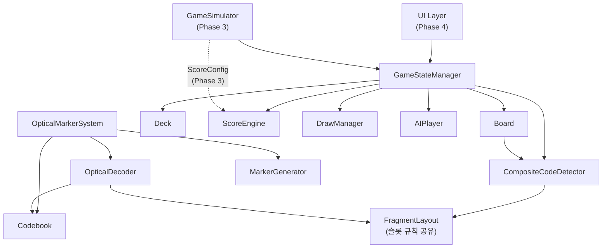

# Design Document

## Overview

QRoker의 Phase 1 기술 설계는 세 가지 핵심 영역을 다룬다: 커스텀 광학 마커 시스템, 게임 엔진 모듈, 게임 시뮬레이터 인터페이스(Phase 3 준비). 브라우저 UI 상세 구현(Phase 4)은 포함하지 않으며, 인터페이스 정의 수준만 명세한다.

**기술 스택:**
- 언어: 순수 TypeScript (브라우저 네이티브, 번들러 무관)
- 렌더링: 테스트·실험용 래스터는 외부 의존성 없는 TypeScript, 브라우저 시각화는 Canvas API
- 저장: `localStorage` (게임 상태 영속성)
- 오프라인: Service Worker (정적 자산 캐싱)
- 외부 의존성: 없음 (계정·서버·유료 API 불필요)

**설계 원칙:**
- **오프라인 우선**: 모든 로직은 브라우저 로컬 실행. 네트워크 접근 불필요.
- **플러그인 가능한 점수 설정**: 오차별 보상 테이블과 손패 소진 보너스를 `ScoreConfig`로 주입한다. 테이블 길이와 수치는 시뮬레이션으로 결정한다.
- **불변성 중심**: 카드 총합 보존, 덱 고유성, 채점 멱등성을 엔진 레벨에서 강제.
- **정보 격리**: Hidden_Sum과 타 플레이어 Guess는 공개 상태에서 제외.

---

## Architecture

### 모듈 의존성 다이어그램



**계층 구조:**
1. **코어 레이어**: `Deck`, `Board`, `CardValue` — 순수 데이터 및 상태 관리
2. **로직 레이어**: `CompositeCodeDetector`, `ScoreEngine`, `DrawManager` — 규칙 집행
3. **조율 레이어**: `GameStateManager` — 턴 흐름, 종료 조건, 정보 격리
4. **광학 레이어**: `Codebook`(동결 코드북·생성·검증), `MarkerGenerator`(조각 래스터 렌더링), `OpticalDecoder`(탐지·판독·가설 검사), `ReferenceCheck`(Companion 전용 대조). 게임 엔진과 광학 판독기는 `FragmentLayout` 규칙 테이블만 공유하며, 판독기는 보드 상태에 의존하지 않는다.
5. **AI 레이어**: `AIPlayer` (전략 패턴) — 로컬 오프라인 AI
6. **시뮬레이터 레이어**: `GameSimulator` (Phase 3) — 점수 수치 최적화

---

## Components and Interfaces

### Deck

**책임:** 52장 카드 관리, 셔플, 무작위 배분, 드로우.

**주요 알고리즘:**
- Fisher–Yates 셔플 (seed 주입 가능 PRNG 사용 — 시뮬레이션 재현성)
- 배분: 시작 4장(보드) + 플레이어당 4장 × 4명 = 20장. 나머지 32장은 덱에 잔류.

```typescript
interface DeckState {
  remaining: CardId[];   // 순서 있는 스택 (top = 마지막 요소)
  dealtCards: Set<string>; // "suit-rank" 형식의 고유성 보장용 집합
}

interface DeckOperations {
  initialize(seed?: number): DeckState;
  deal(n: number, state: DeckState): { cards: CardId[]; newState: DeckState };
  draw(state: DeckState): { card: CardId | null; newState: DeckState };
  // card가 null이면 덱 고갈 (Requirement 3.8)
}
```

---

### Board

**책임:** 8×8 격자 상태 관리, 배치 유효성 검증, Quad_Group 후보 영역 추적.

**배치 유효성 조건 (Requirement 3.3, 3.11):**
1. `col ∈ [0,7]`, `row ∈ [0,7]` — 경계 내
2. `board[row][col] === null` — 비어 있음
3. 상하좌우 4방향 중 하나 이상에 기존 카드 존재 — 인접성
4. `orientation ∈ {0, 180}` — 90°/270° 거부

```typescript
type GridPosition = { row: number; col: number }; // row: 1–8, col: A–H (0-indexed)

interface PlacedCard {
  card: CardId;
  orientation: 0 | 180;
}

interface BoardState {
  grid: (PlacedCard | null)[][];  // 8×8
  cardCount: number;              // 불변성 추적용
}

interface BoardOperations {
  place(pos: GridPosition, card: PlacedCard, state: BoardState): 
    { success: boolean; newState: BoardState; affectedQuads: GridPosition[] };
  isValid(pos: GridPosition, card: PlacedCard, state: BoardState): boolean;
  getAdjacent(pos: GridPosition, state: BoardState): GridPosition[];
  getCandidateQuads(pos: GridPosition): GridPosition[]; // 최대 4개 2×2 영역의 좌상 모서리 반환
}
```

**Candidate Quad 계산:** 위치 (r, c)를 포함하는 2×2 영역의 좌상 모서리는 `{r-1,c-1}, {r-1,c}, {r,c-1}, {r,c}` 중 경계 내에 있는 것.

---

### CompositeCodeDetector

**책임:** Quad_Group 탐지, Fragment_Layout + Card_Orientation 기반 Inward_Corner 검증, 중복 채점 방지.

**Inward_Corner 매핑 (Requirement 14.3):**

| 2×2 내 위치 | Inward_Corner |
|------------|--------------|
| 좌상 (TL)  | BR           |
| 우상 (TR)  | BL           |
| 좌하 (BL)  | TR           |
| 우하 (BR)  | TL           |

**Fragment_Layout 조각 위치 (Requirement 14.1):**

| 무늬 | 0° 조각 위치 | 180° 조각 위치 | 대칭 유형    |
|------|------------|--------------|------------|
| ♥ 하트      | TL + BR    | TL + BR      | 180° 점대칭  |
| ♦ 다이아몬드 | TR + BL    | TR + BL      | 180° 점대칭  |
| ♣ 클럽      | TR + BR    | TL + BL      | 수평 반사    |
| ♠ 스페이드   | TL + BL    | TR + BR      | 수평 반사    |

**슬롯별 참여 가능 조건 (Fragment_Layout과 Inward_Corner에서 도출):**

| 슬롯 | ♥ | ♦ | ♣ | ♠ |
|------|---|---|---|---|
| TL | 0°/180° | 불가 | 0° | 180° |
| TR | 불가 | 0°/180° | 180° | 0° |
| BL | 불가 | 0°/180° | 0° | 180° |
| BR | 0°/180° | 불가 | 180° | 0° |

카드 한 장은 둘러싼 꼭짓점 4개 중 정확히 2개에만 조각을 제공한다. 광학적으로 관측되는 내용은 [Optical Marker System](#optical-marker-system) 5절을 따른다.

**유효성 검증 알고리즘:**
```
function isValidQuadMember(card, boardPos, orientation):
  fragments = getFragmentCorners(card.suit, orientation)
  inward = getInwardCorner(boardPos)
  return fragments.includes(inward)
```

**중복 채점 방지:**
- Quad_Group 고유 식별자: 4개 카드 ID를 정렬한 집합의 문자열 직렬화
  - 예: `"C-A|D-K|H-7|S-Q"` (무늬-숫자 알파벳순 정렬)
- `scoredGroups: Set<string>` — 이미 채점된 식별자 집합
- 탐지 시 `scoredGroups.has(id)` → true이면 채점 건너뜀
- 카드는 배치 후 이동·제거되지 않으므로 같은 4장 집합은 한 꼭짓점에서만 성립할 수 있다. `scoredGroups` 검사는 이 불변식을 방어적으로 확인한다.

```typescript
interface CompositeCodeResult {
  cards: [CardId, CardId, CardId, CardId];
  positions: [GridPosition, GridPosition, GridPosition, GridPosition];
  hiddenSum: number;
  groupId: string;        // 정렬된 카드 ID 집합 직렬화
  isNew: boolean;         // 중복 채점 방지용
}

interface CompositeCodeDetector {
  detect(pos: GridPosition, board: BoardState, scoredGroups: Set<string>): CompositeCodeResult[];
  computeGroupId(cards: CardId[]): string;
}
```

---

### ScoreEngine

**책임:** 예측 배치(batch) 수집, 정보 격리, 일괄 공개, 점수 계산.

**점수 함수 (Requirement 2.1–2.4):**
```
score(guess, hiddenSum, config):
  e = |guess − hiddenSum|
  return e < config.rewardByError.length ? config.rewardByError[e] : 0
```

설정 검증: `rewardByError`는 길이 1 이상이고, 모든 값은 유한한 0 이상 수이며, `rewardByError[0] > 0`이고 비증가여야 한다. `handEmptyBonus`는 유한한 0 이상 수다. 위반하면 설정을 거부한다. 테이블 길이와 수치는 **TBD — determined by simulation**이며, Phase 3에서 선형 감소·기하 감소·계단형 등 후보를 비교한다.

**다중 Composite Code (Requirement 6.5):** 한 배치 액션으로 새로 성립한 Composite Code 전부를 하나의 `PredictionBatch`로 묶는다. 모든 플레이어가 배치 안의 모든 코드에 대한 예측을 제출한 뒤 한 번에 공개한다.

**정보 격리 원칙:**
- hiddenSum과 제출된 예측값은 `GameStateManager` 내부 봉인 저장소에만 보관한다.
- 공개 `GameState`에는 배치별 제출 여부(`boolean`)만 포함한다.
- 모든 예측 수집이 끝나면 `RevealResult`를 한 번에 공개한다.

```typescript
interface ScoreConfig {
  rewardByError: number[]; // index = 절댓값 오차. TBD — determined by simulation
  handEmptyBonus: number;  // TBD — determined by simulation
}

interface PredictionBatch {
  batchId: string;
  groupIds: string[]; // 예측 대상 그룹. hiddenSum은 포함하지 않음
}

interface RevealResult {
  batchId: string;
  groups: Array<{ groupId: string; hiddenSum: number }>;
  playerResults: Array<{
    playerId: string;
    earnedScore: number;     // 이번 배치 획득 점수
    cumulativeScore: number; // 누적 점수
    // guess 값은 포함하지 않음
  }>;
}

interface ScoreEngineOperations {
  validateConfig(config: ScoreConfig): { ok: true } | { ok: false; reason: string };
  score(guess: number, hiddenSum: number, config: ScoreConfig): number;
  submitGuesses(batchId: string, playerId: string, guesses: Record<string, number>): boolean; // [4, 52] 정수만 허용
  allGuessesCollected(batchId: string, playerIds: string[]): boolean;
  reveal(batchId: string, config: ScoreConfig): RevealResult;
}
```

---

### DrawManager

**책임:** 드로우 규칙 집행 (첫 라운드 제외, Composite Code 미완성 시 1장 드로우).

```typescript
interface DrawManagerState {
  firstPlacementDone: Set<string>; // 첫 배치 완료한 플레이어 ID 집합
}

interface DrawManagerOperations {
  shouldDraw(
    playerId: string,
    completedCodes: CompositeCodeResult[],
    state: DrawManagerState
  ): boolean;
  // Returns: false if first placement or ≥1 code completed; true otherwise
  
  markFirstPlacement(playerId: string, state: DrawManagerState): DrawManagerState;
}
```

**규칙:**
- `playerId ∉ firstPlacementDone` → `shouldDraw = false` (첫 배치 면제), 이후 `firstPlacementDone`에 추가
- `completedCodes.length >= 1` → `shouldDraw = false`
- 그 외 → `shouldDraw = true`

---

### GameStateManager

**책임:** 전체 게임 흐름 조율, 종료 감지, 불변성 유지, 공개 상태 관리.

**불변성 (Requirement 3.2, 3.10):**
- `deck.remaining.length + board.cardCount + sum(hand.length for all players) = 52`
- `board.cardCount = placementActionCount + 4`

```typescript
type GamePhase = 
  | 'INIT'          // 초기화
  | 'PLACEMENT'     // 카드 배치 단계
  | 'GUESS_COLLECT' // Guess 수집 단계
  | 'REVEAL'        // 점수 공개
  | 'ENDED';        // 게임 종료

interface PublicGameState {
  phase: GamePhase;
  board: BoardState;
  deckRemaining: number;        // 카드 수만 공개 (내용 미공개)
  hands: Record<string, number>; // 플레이어별 손패 카드 수만 공개
  scores: Record<string, number>; // 누적 점수
  guessStatus: Record<string, boolean>; // 제출 여부만 공개
  lastReveal?: RevealResult;
  winner?: string[];            // 게임 종료 시
}

interface PlayerView {
  publicState: PublicGameState;
  myHand: CardId[];             // 자신의 손패만 공개
}
```

**게임 종료 조건 (Requirement 3.7):**
모든 Composite Code 채점 및 Guess 수집 완료 → 종료 선언 → `ScoreConfig.handEmptyBonus` 지급.

---

### AIPlayer

**책임:** 오프라인 로컬 AI 전략 구현. 전략 패턴(Strategy Pattern) 사용.

```typescript
interface AIStrategy {
  selectPlacement(view: PlayerView, deck: CardId[]): { pos: GridPosition; card: CardId; orientation: 0 | 180 };
  submitGuess(view: PlayerView, hiddenSumRange: [number, number]): number;
}

class RandomStrategy implements AIStrategy {
  // 초급: 무작위 유효 배치, 균등 분포 Guess
}

class HeuristicStrategy implements AIStrategy {
  // 고급: Quad_Group 완성 가능성 최대화
  // 평가 함수: 배치 후 완성될 수 있는 Quad_Group 후보 수 × 예상 점수
}
```

**AI Guess 정보 제한 (Requirement 7.4):**
AI는 `PlayerView.publicState.board`의 공개된 카드 정보만 사용. 다른 플레이어의 `myHand`나 pending guess에 접근 불가.

**응답 시간 제한 (Requirement 7.3):**
AI 결정은 동기 계산으로 3초 내 완료. 고급 휴리스틱의 경우 탐색 깊이 제한으로 보장.

---

### OpticalMarkerSystem

**책임:** 커스텀 광학 마커 생성, 코드북 관리, 디코딩 파이프라인 조율.

세부 설계는 [Optical Marker System](#optical-marker-system) 섹션 참조.

```typescript
type Transform = 'I' | 'R90' | 'R180' | 'R270' | 'Fh' | 'Fv' | 'Dm' | 'Da';
type Slot = 'TL' | 'TR' | 'BL' | 'BR';

interface GrayImage { width: number; height: number; data: Uint8Array; }

interface Codebook {
  version: string;
  seed: number;
  patterns: Record<string, number>; // "H-A" → 25비트 기반 패턴
  dId: number;   // 측정된 카드 간 최소 거리
  dSelf: number; // 측정된 자기 변환 최소 거리
  sha256: string;
}

interface FragmentReading {
  card: CardId;
  observedTransform: Transform; // 그룹 축 기준 관측 변환
  distance: number;             // 최근접 템플릿까지 Hamming 거리
  centerPx: [number, number];
}

interface SlotInterpretation {
  slots: Record<Slot, { card: CardId; orientation: Orientation }>;
  reflected: boolean;
}

type OpticalDecodeResult =
  | { kind: 'IDENTIFIED';
      cards: [CardId, CardId, CardId, CardId];
      hiddenSum: number;
      reflection: 'NOT_REFLECTED' | 'REFLECTED' | 'AMBIGUOUS';
      interpretations: SlotInterpretation[]; // 길이 2(반사 여부 결정) 또는 4(AMBIGUOUS)
      readings: FragmentReading[]; }
  | { kind: 'NOT_DETECTED' }                          // 마커 테두리 자체를 찾지 못함
  | { kind: 'INCOMPLETE_GROUP'; detected: number }    // 대상 꼭짓점 주변 조각 4개 미만
  | { kind: 'CORRUPTED_FRAGMENT'; nearestDistance: number } // 테두리는 찾았으나 허용 반경 밖
  | { kind: 'DUPLICATE_CARD'; card: CardId }
  | { kind: 'INVALID_ARRANGEMENT' }                   // 일관된 카메라 회전 가설 없음
  | { kind: 'REFERENCE_MISMATCH' };                   // Companion 참조 대조 불일치

interface OpticalDecoder {
  // 보드 상태를 입력으로 받지 않는다 (Requirement 13.1)
  decode(image: GrayImage, options?: { acceptRadius?: 0 | 1 | 2 }): OpticalDecodeResult;
}

interface ReferenceCheck {
  // Scoring Companion 전용. 불일치 시 REFERENCE_MISMATCH, 기대값으로 대체하지 않음
  compare(result: OpticalDecodeResult, expectedCards: CardId[]): OpticalDecodeResult;
}
```

---

### GameSimulator (Phase 3 인터페이스)

**책임:** ScoreConfig 주입 → N회 게임 반복 → 통계 출력. Phase 3에서 구현, Phase 1에서는 시그니처만 정의.

```typescript
interface SimulationConfig {
  seed: number;             // 재현 가능 PRNG 시드
  gameCount: number;        // 반복 횟수 (기본 1000)
  scoreConfig: ScoreConfig; // 테스트할 보상 테이블·보너스 후보
  strategies: AIStrategy[]; // 각 AI 플레이어 전략
}

interface SimulationResult {
  winRates: Record<string, number>;    // 전략별 승률
  avgGameLength: number;               // 평균 게임 길이 (턴 수)
  predictionScoreShare: number;        // 전체 점수 중 예측 점수 비중
  handEmptyBonusImpact: number;        // 손패 소진 보너스의 순위 역전 빈도
  scoreDistribution: number[];         // 최종 점수 분포 (히스토그램)
}

interface GameSimulator {
  run(config: SimulationConfig): SimulationResult;
  runBatch(configs: SimulationConfig[]): SimulationResult[]; // 파라미터 스윕
}
```

---

## Data Models

### 핵심 타입

```typescript
// 카드 식별
type Suit = 'H' | 'D' | 'C' | 'S'; // Heart, Diamond, Club, Spade
type Rank = 'A' | '2' | '3' | '4' | '5' | '6' | '7' | '8' | '9' | '10' | 'J' | 'Q' | 'K';
type Orientation = 0 | 180;

interface CardId {
  suit: Suit;
  rank: Rank;
}

// 카드 값 매핑 (Requirement 1.1)
const CARD_VALUE: Record<Rank, number> = {
  'A': 1, '2': 2, '3': 3, '4': 4, '5': 5, '6': 6, '7': 7,
  '8': 8, '9': 9, '10': 10, 'J': 11, 'Q': 12, 'K': 13,
};

// 보드 위치 (0-indexed)
interface GridPosition {
  row: number; // 0–7 (1–8에 대응)
  col: number; // 0–7 (A–H에 대응)
}

// 보드 위치 내 2×2 그룹 역할
type QuadRole = 'TL' | 'TR' | 'BL' | 'BR'; // 2×2 내 위치
type CornerPosition = 'TL' | 'TR' | 'BL' | 'BR'; // 카드 코너

// Fragment_Layout: 무늬 × 방향 → 조각 위치 집합
const FRAGMENT_LAYOUT: Record<Suit, Record<Orientation, CornerPosition[]>> = {
  H: { 0: ['TL', 'BR'], 180: ['TL', 'BR'] }, // 점대칭 — 불변
  D: { 0: ['TR', 'BL'], 180: ['TR', 'BL'] }, // 점대칭 — 불변
  C: { 0: ['TR', 'BR'], 180: ['TL', 'BL'] }, // 수평 반사
  S: { 0: ['TL', 'BL'], 180: ['TR', 'BR'] }, // 수평 반사
};

// Inward_Corner: 2×2 내 위치 → 그룹 중심을 향하는 코너
const INWARD_CORNER: Record<QuadRole, CornerPosition> = {
  TL: 'BR',
  TR: 'BL',
  BL: 'TR',
  BR: 'TL',
};

// 배치된 카드
interface PlacedCard {
  card: CardId;
  orientation: Orientation;
}

// 플레이어
interface Player {
  id: string;
  isAI: boolean;
  strategy?: AIStrategy; // AI인 경우
}

// Quad_Group 결과
interface CompositeCodeResult {
  cards: [CardId, CardId, CardId, CardId];
  positions: [GridPosition, GridPosition, GridPosition, GridPosition];
  hiddenSum: number;         // 합산값
  groupId: string;           // 정렬된 카드 ID 집합 직렬화
  isNew: boolean;            // 처음 탐지 여부 (중복 방지)
}

// 점수 설정 — ScoreEngine 섹션의 ScoreConfig를 따른다 (수치 TBD — determined by simulation)

// 광학 타입(Transform, Slot, GrayImage, Codebook, FragmentReading, OpticalDecodeResult)은 OpticalMarkerSystem 컴포넌트 정의를 따른다.
```

---

## Optical Marker System

이 섹션은 이전의 6비트 코드북 설계를 대체한다. 6비트 설계는 아래 1절의 이유로 성립하지 않는다.

### 1. 식별 비트 수와 물리 마커 길이의 구분

- 52장을 구별하는 정보량은 log₂52 ≈ 5.70비트이므로 카드 ID를 **표현**하는 데는 6비트면 충분하다.
- 단일 비트 오류 정정(d_min ≥ 3)에는 Hamming 한계 M·(n+1) ≤ 2ⁿ이 적용된다. n = 6이면 M ≤ 64/7 ≈ 9.1이고, 알려진 최댓값은 A(6,3) = 8이다. 52개 코드워드는 불가능하다.
- 조각은 카메라에 회전·반사된 상태로 관측된다(4–5절). 따라서 코드북은 52개 코드워드가 아니라 52 × 8 = 416개 Fragment_Template 사이의 거리를 보장해야 한다.

### 2. 마커 구조 (채택안: 5×5 데이터 격자)

- 데이터: 5×5 = 25 이진 셀. 셀 (r, c)의 비트 인덱스는 i = 5r + c(행 우선, r = 0이 카드 기준 위쪽)다.
- 테두리: 데이터 격자를 두르는 1모듈 폭 검은 테두리 → 7×7 모듈. 탐지와 원근 보정에만 쓰며 방향 정보는 담지 않는다.
- 여백: 테두리 바깥 최소 1모듈 흰 여백 → 점유 영역 9×9 모듈.
- 물리 치수 후보: 모듈 1.5–2.0mm(점유 영역 약 13.5–18mm). 카드 모서리 라운드와 인쇄 공차를 피하도록 모서리에서 안쪽으로 배치한다. 수치는 실제 인쇄·촬영 실험으로 확정한다(미검증).

격자 크기 비교 (52장 보장 하한은 6절의 탐욕 논증으로 계산):

| 데이터 격자 | n | 테두리 포함 | 52장 보장 여부 | 판단 |
|---|---|---|---|---|
| 4×4 | 16 | 6×6 모듈 | d = 3, 균형·자기 거리 필터 적용 후 하한 41(전수 열거) < 52 → 52장 보장 불가 | 1비트 정정 한계, 기각 |
| 5×5 | 25 | 7×7 모듈 | d = 5, 필터 적용 후 하한 198(전수 열거, 6절) | **채택** |
| 6×6 | 36 | 8×8 모듈 | d = 9, 필터 미적용 하한 209.5. 필터 적용 후 값은 열거하지 않음(미검증) | 대안. 같은 면적에서 모듈이 7/8로 작아져 블러·저해상도에 불리 |

5×5를 고른 근거는 이론 하한만이 아니다. (a) d = 5를 필터 적용 후에도 52장 대비 약 3.8배 여유(하한 198)로 보장하고, (b) 같은 인쇄 면적에서 6×6보다 모듈이 약 14% 크며, (c) 판정 반경을 1로 잡으면 오식별에 조각당 4비트 이상 오류가 필요하다. 합성 실험에서 재현율이나 오식별 여유가 부족하면 6×6으로 상향한다.

### 3. 변환 정의 (2차원 대칭군 D4)

5×5 격자의 셀 좌표 (r, c), r, c ∈ {0, …, 4}에 대한 셀 사상:

| 기호 | 의미 | (r, c) → |
|---|---|---|
| I | 항등 | (r, c) |
| R90 | 시계방향 90° 회전 | (c, 4−r) |
| R180 | 180° 회전 | (4−r, 4−c) |
| R270 | 시계방향 270° 회전 | (4−c, r) |
| Fh | 수평축 반사(위↔아래) | (4−r, c) |
| Fv | 수직축 반사(좌↔우) | (r, 4−c) |
| Dm | 주대각선 반사 | (c, r) |
| Da | 반대각선 반사 | (4−c, 4−r) |

패턴 P에 변환 g를 적용한 결과는 (g·P)[g(x)] = P[x]로 정의한다. 각 g는 비트 인덱스 순열 π_g(5r + c) = 5r′ + c′로 구현하며, 이 순열은 위 셀 사상에서 직접 생성하므로 정의상 2차원 변환과 같다. 동치성은 Property 21에서 52 × 8 전수 래스터 테스트로 확인한다. 행 우선 인덱스에서 R180은 i → 24 − i(비트 순서 반전)와 같지만, Fh·Fv·R90은 단순 반전이나 절반 교환이 아니다.

### 4. 인쇄 조각 정의와 대칭성

카드를 0°로 세운 카드 좌표에서 카드 c의 기반 패턴을 P = P_c라 하면 인쇄 내용은 다음과 같다. 나머지 두 코너에는 조각이 없다.

| 무늬 | 기반 코너 | 파생 코너 | 파생 내용 | 카드 조각층의 대칭 |
|---|---|---|---|---|
| ♥ | TL: P | BR | R180·P | 카드 180° 회전에 대해 픽셀 단위 불변 |
| ♦ | TR: P | BL | R180·P | 카드 180° 회전에 대해 픽셀 단위 불변 |
| ♣ | TR: P | BR | Fh·P | 카드 수평축 반사에 대해 픽셀 단위 불변 |
| ♠ | TL: P | BL | Fh·P | 카드 수평축 반사에 대해 픽셀 단위 불변 |

증명(♥): 카드를 180° 돌리면 TL의 P는 BR로 이동하면서 R180·P가 되어 인쇄된 BR과 같고, BR의 R180·P는 TL로 이동하면서 R180·R180·P = P가 된다. ♦도 같다. ♣: 카드 수평축 반사는 TR↔BR을 교환하고 내용에 Fh를 적용하므로 P와 Fh·P가 서로 바뀐다. ♠도 같다. 두 조각은 같은 P의 D4 궤도에 속하므로 같은 카드로 식별된다.

물리 회전과 카메라 회전의 구분:
- **물리 회전**(Card_Orientation)은 0°/180°만 허용한다. 180°로 놓인 카드의 놓인 코너 X에 보이는 내용은 R180 · (반대편 코너 opp(X)의 인쇄 내용)이다.
- **카메라 회전**(Camera_Rotation)은 이미지 전체에 적용되는 임의 각도 회전이다. 원근 보정 후에는 90° 배수의 잔여 회전만 남으며, 이는 템플릿 대조와 방향 가설 검사(7절)가 처리한다.

### 5. 슬롯별 유효 조합과 관측 내용 (보드 축 기준, 카메라 회전 0)

꼭짓점을 둘러싼 슬롯 s ∈ {TL, TR, BL, BR}의 카드는 Inward_Corner(TL→BR, TR→BL, BL→TR, BR→TL)에 조각이 있어야 한다. 4절 정의로 계산한 유효 조합과 그때 꼭짓점에서 관측되는 내용:

| 슬롯 | 필요 코너 | ♥ | ♦ | ♣ | ♠ |
|---|---|---|---|---|---|
| TL | BR | 0°/180°: R180·P | 불가 | 0°: Fh·P | 180°: R180·P |
| TR | BL | 불가 | 0°/180°: R180·P | 180°: R180·P | 0°: Fh·P |
| BL | TR | 불가 | 0°/180°: P | 0°: P | 180°: Fv·P |
| BR | TL | 0°/180°: P | 불가 | 180°: Fv·P | 0°: P |

이 표에서 수학적으로 도출되는 성질:
1. 관측 변환은 항상 V = {I, R180, Fh, Fv}에 속한다.
2. ♥는 TL·BR 슬롯에만, ♦는 TR·BL 슬롯에만 참여할 수 있다(방향 무관). ♣·♠는 모든 슬롯에 참여할 수 있으나 슬롯마다 가능한 방향은 정확히 하나다.
3. 놓인 카드 한 장은 둘러싼 꼭짓점 4개 중 정확히 2개에만 조각을 제공한다. 보드 위의 모든 조각은 정확히 하나의 꼭짓점을 향하므로, Inward 조각 검사는 "해당 꼭짓점에 조각 4개가 모였는가"와 같다.
4. **180° 모호성**: 유효한 2×2 배치 전체를 180° 돌린 결과도 같은 4장으로 이루어진 유효 배치다(표가 슬롯 TL↔BR·TR↔BL, 변환 g → R180∘g에 대해 닫혀 있다). 따라서 이미지만으로는 슬롯 배정을 180° 모호성 이내로만 결정할 수 있으며, 카드 집합과 합산은 모든 해석에서 같다.
5. 카메라를 90° 돌리면 관측 변환은 R90∘V = {R90, R270, Dm, Da}로 이동하며 V와 겹치지 않는다. 따라서 카메라 회전은 180° 단위까지 결정된다.
6. **반사(거울상) 판별**: 이미지에 반사가 포함되면 모든 조각의 관측 변환에서 회전/반사 성질이 뒤집힌다. 유효한 배치에서 ♥·♦ 조각은 항상 회전(I 또는 R180)으로만 관측되므로, 그룹에 ♥ 또는 ♦가 하나라도 있으면 반사 여부가 결정된다(통과 가설 2개, 반사 여부 동일). 그룹이 ♣·♠로만 이루어지면 반사된 이미지도 유효 배치가 되어 통과 가설이 4개(비반사 2 + 반사 2)이며 반사 여부를 판별할 수 없다. 관측 배치 81개 × 이미지 변환 8개 = 648개 이미지를 전수 열거한 결과: ♥/♦ 포함 520개는 반사 여부가 결정되고, ♣·♠ 전용 128개는 모호하다. 카드 식별과 합산은 반사 여부와 무관하다. 무작위 4장이 ♣·♠만으로 이루어질 확률은 C(26,4)/C(52,4) ≈ 5.5%다.

### 6. 코드북 제약과 생성 알고리즘

정의: d(·,·)는 25비트 Hamming 거리, 템플릿 집합 T = {g·P_c : c ∈ 52장, g ∈ D4}.
- 카드 간 거리: d_id = min_{c≠c′, g} d(P_c, g·P_{c′}) ≥ 5 (필수)
- 자기 거리: d_self = min_{c, g≠I} d(P_c, g·P_c) ≥ 5 (필수. 관측 변환을 판정 반경 안에서 유일하게 결정하기 위함)
- 따라서 416개 템플릿은 모두 서로 다르고 쌍별 거리가 5 이상이다.
- 균형 필터: 기반 패턴의 검은 셀 수 w(P) ∈ [9, 16] (이진화 안정성).

생성 알고리즘(결정적 탐욕):
1. 고정 PRNG(mulberry32, 고정 시드)로 25비트 후보를 차례로 생성한다.
2. 균형·자기 거리 필터를 통과하고, 이미 채택된 모든 템플릿과 8가지 변환 모두에서 거리 5 이상인 후보만 채택한다.
3. 52개를 채택하면 종료하고, 채택 순서대로 ♥A…♥K, ♦A…♦K, ♣A…♣K, ♠A…♠K에 할당한다.
4. 결과를 `codebook.v1.json`(알고리즘 버전, 시드, 52개 패턴, 측정된 d_id·d_self, SHA-256)으로 동결해 커밋한다. 인쇄와 디코딩은 동결 파일만 사용하고, 재생성은 동일성 검증 용도로만 실행한다. 코드북 버전이 바뀌면 카드를 다시 인쇄해야 한다.

**존재 보장 (분류: 전수 열거로 계산됨. 저장소 테스트로 재현되기 전까지는 "이번 설계 검토에서 계산한 값"으로 취급):**

정의: F = { P ∈ {0,1}²⁵ : w(P) ∈ [9,16], 모든 g ≠ I에 대해 d(P, g·P) ≥ 5 }. 거리는 D4의 모든 원소 8개를 포함한다. 후보 P가 이미 채택된 카드의 어떤 템플릿 t에 대해서도 d(g·P, t) ≥ 5가 되려면 d(P, g⁻¹·t) ≥ 5여야 하고, g⁻¹·t도 같은 카드의 템플릿이므로 조건은 "P가 채택된 템플릿 모두에서 거리 5 이상"과 같다.

주장: F 전체를 순회하는 탐욕 절차가 더 채택할 후보가 없어 멈췄을 때 채택된 카드 수 N은 N ≥ ⌈|F| / (8·V(25,4))⌉이다. 근거: 멈췄다면 F의 모든 단어는 채택된 템플릿(최대 8N개, 자기 거리 ≥ 5이므로 카드당 정확히 8개) 중 하나로부터 거리 4 이하에 있으므로 |F| ≤ 8N·V(25,4)다.

전수 열거 결과(2²⁵ = 33,554,432개 전부):
- 균형 탈락 3,615,562 (Σ_{k≤8}C(25,k)의 2배)
- 자기 거리 탈락 7,152,896 (변환별: R90 74,624, R270 74,624, R180 647,168, Fh·Fv·Dm·Da 각 1,835,008. 변환별 합 8,136,448은 합집합의 상한)
- 둘 중 하나라도 탈락 9,456,896
- |F| = 24,097,536
- V(25,4) = 1 + 25 + 300 + 2,300 + 12,650 = 15,276 → N ≥ ⌈24,097,536 / 122,208⌉ = **198**
- 이전 설계 검토의 하한 178은 변환별 탈락 수의 합으로 계산한 더 느슨한 값이었으며 틀리지 않았다.
- 다른 기준의 같은 계산: d = 6 → 45, d = 7 → 7 (모두 52 미만이므로 d ≥ 6은 보장되지 않음). 4×4(d = 3, 필터 적용) → 41.

생성기의 성격: 위 하한은 "52장 코드북이 존재한다"는 증명이며, 생성기는 고정 시드 PRNG로 후보를 뽑는 구성적 절차다. 51장 채택 후 무작위 후보 한 개가 채택될 확률의 하한은 (|F| − 51·8·15,276) / 2²⁵ ≈ 0.532이므로 시도 횟수 상한을 두면 사실상 항상 성공하지만, 이것은 확률적 설명이며 보장이 아니다. 생성기는 시도 횟수 상한을 넘으면 오류로 종료한다. 어떤 경우에도 최종 판정은 생성기가 아닌 독립 검증기(생성기와 코드를 공유하지 않는 래스터 기반 검증)가 내린다. 달성한 d_id·d_self는 측정해 기록한다.

### 7. 디코딩 파이프라인

입력은 그레이스케일 이미지뿐이며 보드 상태를 받지 않는다(API 시그니처로 강제).

1. **마커 탐지**: 적응형 이진화 → 연결 요소·외곽선 → 사각형 근사 → 4꼭짓점 호모그래피 → 7×7 샘플링 → 테두리 셀이 모두 검은지 확인. 하나도 없으면 NOT_DETECTED.
2. **꼭짓점 클러스터링**: 공통 중심 주위 네 사분면에 하나씩 놓이고, 중심 간 거리가 마커 크기로 예측한 정사각형 배치와 허용 오차 안에서 맞는 마커 묶음을 찾는다. 프레임 중앙에 가장 가까운 묶음을 대상으로 한다. 대상 꼭짓점 주변 마커가 4개 미만이면 INCOMPLETE_GROUP.
3. **데이터 판독**: 마커 중심 간 벡터로 그룹 축을 추정하고(90° 배수 모호), 그 축에 맞춰 각 마커의 5×5 데이터를 읽는다.
4. **템플릿 대조**: 416개 템플릿과 거리를 계산해 최근접 (카드, 변환 g, 거리)를 구한다. 거리 ≤ r_acc(기본 1, 최대 2로 설정 가능)이면 채택하고, 아니면 CORRUPTED_FRAGMENT.
5. **중복 검사**: 4장 카드 ID가 모두 달라야 한다. 아니면 DUPLICATE_CARD.
6. **방향·반사 가설 검사**: D4의 8개 원소 h(회전 4 × 반사 2)마다 슬롯과 상대 변환 h⁻¹∘g를 구해 5절 표와 대조한다. 통과한 가설 집합으로 다음과 같이 판정한다. (a) 통과 가설 없음 → INVALID_ARRANGEMENT. (b) 통과 가설 2개, 모두 비반사 → reflection = NOT_REFLECTED. (c) 통과 가설 2개, 모두 반사 → REFLECTED. (d) 통과 가설 4개(비반사 2 + 반사 2) → AMBIGUOUS. (e) 그 밖의 개수는 내부 오류로 거부한다. 판독기는 반사 여부를 추측하지 않는다. REFLECTED·AMBIGUOUS인 경우에도 카드 집합과 합산은 반환하되, 해석의 `reflected` 플래그로 반사 가정을 명시한다.
7. **합산**: 식별된 4장의 Card_Value 합.
8. **참조 대조**(Scoring Companion 전용, 선택): 보드 기록의 카드 집합과 다르면 REFERENCE_MISMATCH로 거부한다. 기대값으로 판독 결과를 대체하지 않는다.

판독 결과는 ScoreEngine의 봉인 저장소로만 전달되며, Requirement 6에 따라 예측 수집이 끝나기 전에는 UI에 표시하지 않는다. 판독기 모듈 자체는 UI를 갖지 않는다.

오류 허용 범위: d = 5, r_acc = 1이면 조각당 1비트 오류는 정정하고, 2–3비트 오류는 탐지해 거부하며, 오식별에는 같은 조각에 4비트 이상 오류가 필요하다. r_acc = 2면 2비트까지 정정하지만 3비트 오류부터 오식별 가능성이 생긴다. 기본값은 합성 실험의 재현율·오식별률로 확정한다.

### 8. 보장 수준 구분

| 성질 | 근거 | 검증 방법 |
|---|---|---|
| 52개 고유 ID, d_id ≥ 5, d_self ≥ 5 | 6절 전수 열거 결과(하한 198)와 생성기 | 동결 코드북의 416개 템플릿 전쌍(86,320쌍) 전수 검사 |
| 비트 순열과 2차원 변환의 동치 | 3절 정의 | 52 × 8 래스터 전수 비교 |
| ♥♦ 180° 불변, ♣♠ 수평축 반사 불변 | 4절 증명 | 카드 조각층 래스터 픽셀 비교 |
| 슬롯 표, 180° 모호성, 통과 가설 수 ∈ {0, 2} | 5절 도출 | 슬롯 × 무늬 × 방향 전수, 합성 그룹 테스트 |
| 반사 판별(♥/♦ 포함 그룹은 결정, ♣·♠ 전용은 모호) | 5절 도출, 이번 검토에서 전수 열거로 계산 | 648개 이미지 전수 테스트(Property 26) |
| 판정 반경 안의 정정·탐지 | 7절 계산 | 고정 시드 비트 반전 테스트 |
| 결정적 재생성 | 고정 알고리즘·시드 | 재생성 결과와 동결 파일 바이트 비교 |
| 탐지율, 블러·노이즈·원근·조명 내성, 3조각 오탐 | 보장 안 됨 | 합성 열화 실험(Requirement 12.5) |
| 인쇄 품질, 광택, 초점, 모듈 크기, 실제 카메라 | 미검증 | 실제 인쇄 카드·휴대폰 촬영 실험(별도 기록) |

---

## Correctness Properties

*A property is a characteristic or behavior that should hold true across all valid executions of a system — essentially, a formal statement about what the system should do. Properties serve as the bridge between human-readable specifications and machine-verifiable correctness guarantees.*

---

### Property 1: Card_Value 범위 불변성

*For any* 유효한 카드(52장 덱 내), `Card_Value(card) ∈ [1, 13]` 이며, Rank에 따른 매핑은 고정 테이블(A=1, 2–10=액면가, J=11, Q=12, K=13)과 일치한다.

**Validates: Requirements 1.1**

---

### Property 2: Hidden_Sum 범위 및 순서 독립성

*For any* 유효한 Quad_Group(4개 서로 다른 카드 ID), `Hidden_Sum ∈ [4, 52]` 이고, 동일한 4장 카드에 대해 카드 배치 순서와 무관하게 항상 동일한 Hidden_Sum을 반환한다.

**Validates: Requirements 1.2, 1.4, 1.5**

---

### Property 3: Quad_Group 카드 고유성

*For any* Quad_Group이 `CompositeCodeDetector`에 의해 반환될 때, 4개의 카드 ID는 쌍별로 모두 다르다 (동일한 무늬+숫자 조합 없음).

**Validates: Requirements 1.3**

---

### Property 4: 점수 함수 대칭성과 단조성

*For any* 유효한 `ScoreConfig`, `hiddenSum ∈ [4, 52]`, 오차 e에 대해 `score(hiddenSum + e) == score(hiddenSum − e)`(두 값이 모두 범위 안일 때)이고, 점수는 |e|가 커질 때 증가하지 않으며, |e| ≥ `rewardByError.length`이면 0이다. 음수·증가 구간·빈 테이블을 가진 설정은 거부된다.

**Validates: Requirements 2.1, 2.2, 2.3, 2.4**

---

### Property 5: Guess 범위 검증

*For any* Guess 입력 시도에 대해, `guess ∉ [4, 52]`인 정수 또는 비정수 값은 항상 거부되고, `guess ∈ [4, 52]`인 정수는 항상 수락된다.

**Validates: Requirements 2.8, 11.3**

---

### Property 6: 점수 공개 시 Guess 비포함

*For any* 플레이어 집합과 임의의 Guess 집합에 대해, `ScoreEngine.reveal()`이 반환하는 `RevealResult`의 각 `playerResult`에는 raw guess 값이 포함되지 않는다.

**Validates: Requirements 2.7, 6.2, 6.3**

---

### Property 7: 카드 배분 고유성 불변성

*For any* 게임 초기화에 대해, `board_cards ∪ all_player_hands`의 카드 집합은 정확히 20장의 서로 다른 카드로 구성되며, 모두 52장 표준 덱에 속한다.

**Validates: Requirements 3.2**

---

### Property 8: 보드 카드 수 증가 불변성

*For any* 유효한 배치 액션에 대해, `board.cardCount(after) == board.cardCount(before) + 1`이 성립한다.

**Validates: Requirements 3.10**

---

### Property 9: 배치 유효성 검증 완전성

*For any* 배치 시도 `(pos, card, orientation, boardState)`에 대해, 경계 외(out-of-bounds), 점유된 셀(occupied), 비인접(non-adjacent), 또는 90°/270° 방향 중 하나라도 해당하면 액션은 거부된다. 반대로 네 조건이 모두 충족되면 수락된다.

**Validates: Requirements 3.3, 3.11**

---

### Property 10: 드로우 규칙 — Composite Code 완성 여부에 따른 대칭성

*For any* 비-첫-배치 액션에 대해:
- 액션이 1개 이상의 새로운 Composite Code를 완성하면 → 드로우 없음
- 액션이 Composite Code를 완성하지 못하면 → 덱이 비어있지 않은 경우 손패 1장 증가

**Validates: Requirements 3.5, 3.6**

---

### Property 11: 채점 멱등성

*For any* 보드 상태에 대해, `CompositeCodeDetector.detect()`를 동일 보드 상태에서 반복 실행해도 `isNew == true`인 새로운 그룹이 추가되지 않는다 (이미 `scoredGroups`에 등록된 식별자는 재채점 대상 제외).

**Validates: Requirements 4.3, 4.5**

---

### Property 12: Fragment_Layout 대칭 불변성

*For any* 하트(♥) 또는 다이아몬드(♦) 카드 `c`에 대해, `FRAGMENT_LAYOUT[c.suit][0]`과 `FRAGMENT_LAYOUT[c.suit][180]`는 동일한 코너 집합을 반환한다.

*For any* 클럽(♣) 또는 스페이드(♠) 카드 `c`에 대해, `FRAGMENT_LAYOUT[c.suit][180]`는 `FRAGMENT_LAYOUT[c.suit][0]`의 반대 면 코너 집합을 반환한다 (TR+BR ↔ TL+BL).

**Validates: Requirements 3.11, 5.4, 5.5, 14.5, 14.6**

---

### Property 13: 템플릿 거리

동결 코드북의 416개 Fragment_Template에서 서로 다른 두 템플릿의 Hamming 거리는 5 이상이고, 모든 기반 패턴의 검은 셀 수는 [9, 16]에 속한다. (전수 검사)

**Validates: Requirements 5.3**

---

### Property 14: 조각 대칭과 식별 불변성

*For any* 카드 c에 대해, ♥·♦이면 카드 조각층 래스터를 180° 회전한 결과가 원본과 픽셀 단위로 같고, ♣·♠이면 수평축 반사 결과가 원본과 같다. 두 조각을 각각 판독하면 같은 카드 ID를 반환한다. 이미지 전체를 거울상으로 뒤집어도 식별된 카드 ID는 바뀌지 않는다. 단, 반사 여부 자체는 Property 26에 따라 별도로 보고된다.

**Validates: Requirements 5.2, 5.4, 5.5, 13.5**

---

### Property 15: 광학 오류 거부

*For any* 유효한 2×2 합성 이미지에서 (a) 조각을 1개 이상 제거하면 INCOMPLETE_GROUP, (b) 한 조각을 다른 슬롯과 같은 카드로 바꾸면 DUPLICATE_CARD, (c) 한 조각에 r_acc + 1 이상 4 − r_acc 이하 비트를 반전하면 CORRUPTED_FRAGMENT, (d) 5절 표에 없는 관측 변환으로 조각을 합성하면(예: 90° 회전 조각, ♥ 조각 내용을 TR 슬롯에 배치) INVALID_ARRANGEMENT를 반환한다. 어떤 경우에도 IDENTIFIED를 반환하지 않는다. 물리적으로 ♥를 TR 슬롯에 놓으면 해당 꼭짓점에 조각이 없으므로 (a)에 해당한다.

**Validates: Requirements 5.7, 13.4, 13.6**

---

### Property 16: Inward_Corner ∩ Fragment — Quad_Group 유효성

*For any* 카드 `c`를 2×2 내 역할 `role` 위치에 방향 `orientation`으로 배치할 때, `FRAGMENT_LAYOUT[c.suit][orientation]`에 `INWARD_CORNER[role]`이 포함되면 유효한 Quad_Group 멤버이고, 포함되지 않으면 무효이다.

**Validates: Requirements 3.12, 14.4**

---

### Property 17: AI 액션 유효성

*For any* 게임 상태에서 AI 플레이어가 생성하는 모든 `PlacementAction`은 `Board.isValid()`를 통과한다.

**Validates: Requirements 7.2**

---

### Property 18: 공개 상태 — Guess 정보 비포함

*For any* 게임 상태 `s`에서 Guess 수집이 완료되지 않은 경우, `s.publicState`에 `hiddenSum`이 포함되지 않는다. 모든 플레이어의 `publicState`에는 타 플레이어의 pending guess 값이 포함되지 않는다.

**Validates: Requirements 6.1, 6.3**

---

### Property 19: 최종 순위 동점 처리

*For any* 게임 종료 후 최종 점수 분포에서, `score(player_i) == score(player_j)`이면 `rank(player_i) == rank(player_j)` (공동 순위).

**Validates: Requirements 3.9, 11.4**

---

### Property 20: 판독 합산 정확성

*For any* IDENTIFIED 결과에 대해 `hiddenSum`은 식별된 4장의 Card_Value 합과 같고, 이 값은 판독기와 독립적인 참조 구현(카드 값 테이블 조회 합)의 결과와 같다. 보드 기록과의 대조는 Property 25를 따른다.

**Validates: Requirements 13.2**

---

### Property 21: 비트 순열과 2차원 변환의 동치

52개 기반 패턴 × 8개 변환 전부에서, 비트 순열 π_g의 결과와 패턴을 래스터로 렌더링해 2차원 픽셀 변환을 적용한 뒤 재샘플링한 결과가 같다.

**Validates: Requirements 5.2, 13.5**

---

### Property 22: 코드북 결정적 재생성

같은 알고리즘 버전과 시드로 재생성한 코드북은 동결 파일과 바이트 단위로 같다.

**Validates: Requirements 5.3, 12.7**

---

### Property 23: 슬롯 해석과 합산 정확성

*For any* 5절 표에서 고정 시드로 뽑은 유효 2×2 배치(서로 다른 4장)와 임의 카메라 회전 각도에 대해, 판독기는 IDENTIFIED를 반환하고, 그룹에 ♥ 또는 ♦가 있으면 해석은 정확히 2개(서로 180° 관계, reflected 값 동일)이고, ♣·♠로만 이루어진 그룹이면 4개이며(비반사 2 + 반사 2), 카드 집합은 실제 배치와 같으며, hiddenSum은 독립적으로 계산한 참조값과 같다.

**Validates: Requirements 5.6, 13.1, 13.2, 13.6, 14.3, 14.4**

---

### Property 24: 판정 반경

*For any* 조각에 0부터 r_acc개 비트를 반전하면 원래 카드로 식별되고, r_acc + 1부터 4 − r_acc개 비트를 반전하면 CORRUPTED_FRAGMENT가 되며, 어느 경우에도 다른 카드로 식별되지 않는다.

**Validates: Requirements 13.4**

---

### Property 25: 기대값 대체 금지

판독기 API는 보드 상태를 입력으로 받지 않는다. 참조 대조에서 카드 집합이 다르면 REFERENCE_MISMATCH를 반환하고 기대값을 결과로 쓰지 않는다.

**Validates: Requirements 5.7, 13.3**

---

### Property 26: 반사 보고

*For any* 5절 표에서 뽑은 유효 배치와 8개 이미지 변환 h에 대해, 그룹에 ♥ 또는 ♦가 있으면 reflection은 h가 반사인지 여부와 일치(NOT_REFLECTED 또는 REFLECTED)하고, ♣·♠로만 이루어진 그룹이면 항상 AMBIGUOUS다. 어떤 경우에도 REFLECTED 이미지를 NOT_REFLECTED로 보고하지 않으며, AMBIGUOUS를 NOT_REFLECTED나 REFLECTED로 단정하지 않는다.

**Validates: Requirements 13.9**

---

## Error Handling

### 배치 오류

| 오류 조건           | 처리               | 사용자 피드백                     |
|-------------------|--------------------|-------------------------------|
| 경계 외 위치        | 액션 거부, 상태 불변 | "유효하지 않은 위치"              |
| 점유된 셀          | 액션 거부, 상태 불변 | "이미 카드가 있는 위치"           |
| 비인접 위치        | 액션 거부, 상태 불변 | "기존 카드와 인접해야 합니다"      |
| 잘못된 방향(90°)   | 액션 거부           | "90°/270° 배치는 지원하지 않습니다" |
| 손패에 없는 카드    | 액션 거부           | "손패에 없는 카드"               |

### Guess 오류

| 오류 조건           | 처리               |
|-------------------|--------------------|
| 범위 외 (`< 4` 또는 `> 52`) | 입력 거부 |
| 비정수             | 입력 거부           |
| 중복 제출          | 최초 제출 유지, 재제출 거부 |

### 광학 디코딩 오류

모든 오류는 `OpticalDecodeResult.kind`(NOT_DETECTED, INCOMPLETE_GROUP, CORRUPTED_FRAGMENT, DUPLICATE_CARD, INVALID_ARRANGEMENT, REFERENCE_MISMATCH)로 구분해 반환한다. 탐지 실패(NOT_DETECTED)와 식별 실패(CORRUPTED_FRAGMENT)는 서로 다른 결과다. Scoring Companion은 오류 시 수동 입력으로 전환하며 기대값으로 대체하지 않는다.

### 덱 고갈

덱이 비어있는 상태에서 드로우가 필요한 경우, `Deck.draw()`는 `null`을 반환. `DrawManager`는 이를 감지하여 드로우를 건너뜀 (손패 불변).

### 게임 상태 복구

`GameStateManager`는 각 액션 후 `localStorage`에 직렬화된 `GameState`를 저장. 페이지 새로고침 시 복구.

---

## Testing Strategy

### 단위 테스트 (Unit Tests)

대상 모듈 및 케이스:

- **`CardValue`**: 13개 Rank 각각에 대한 정확한 값 매핑. 조커 미포함 검증.
- **`CompositeCodeDetector`**: 유효/무효 Quad_Group 케이스 (14.4 예시 테이블 기반 픽스처).
- **`ScoreEngine`**: 설정 검증(음수·증가 구간·빈 테이블 거부), 테이블 경계(e = 길이 − 1, 길이, 길이 + 1), 다중 코드 배치의 일괄 공개.
- **`DrawManager`**: 첫 배치 면제, Composite Code 완성 시 드로우 안 함, 덱 고갈 시 건너뜀.
- **`Deck`**: 같은 시드로 두 번 초기화하면 동일한 셔플 결과.
- **`OpticalDecoder`**: NOT_DETECTED, INCOMPLETE_GROUP, CORRUPTED_FRAGMENT, DUPLICATE_CARD, INVALID_ARRANGEMENT, REFERENCE_MISMATCH 각각의 거부 테스트.

### 통합 테스트 (Integration Tests)

- 완전한 게임 루프 (init → place → guess → reveal → end) 2–3 시나리오
- 광학 조각 생성 → 2×2 합성 → 판독 왕복 (합성 이미지, 고정 시드)
- Service Worker 캐싱 (최초 로드 후 오프라인 접근)

### Property-Based 테스트 (PBT)

**테스트 러너**: Vitest(`vitest --run`), Node 환경. 광학 테스트는 순수 TypeScript 래스터를 사용하므로 브라우저가 필요 없다.

**테스트 구분**: (1) 수학적 성질 전수 검사 — Property 13, 14, 21, 22. (2) 고정 시드 PBT·합성 이미지 테스트 — Property 15, 23, 24. (3) 합성 열화 측정 실험 — Requirement 12.5, 통과/실패가 아닌 측정값 기록. (4) 실제 인쇄 카드·휴대폰 카메라 실험 — 별도 기록, 아직 수행하지 않음.

**PBT 라이브러리**: `fast-check` (TypeScript 네이티브, 브라우저 호환)

**테스트 구성**: 각 property 테스트 최소 100회 반복. 각 테스트에 아래 형식의 태그 주석 포함:

```
// Feature: qroker-game, Property N: <property_text>
```

구현할 property 테스트 목록 (Property 번호와 1:1 대응):

| Property | 대상 함수 | 생성기 |
|---------|---------|------|
| 1 | `getCardValue` | `fc.constantFrom(...ALL_CARDS)` |
| 2 | `computeHiddenSum` | `fc.array(fc.constantFrom(...ALL_CARDS), {minLength:4, maxLength:4})` + 순열 생성기 |
| 3 | `detectQuadGroup` | 무작위 보드 상태 생성기 |
| 4 | `calculateScore`, `validateScoreConfig` | 임의 비증가 테이블 생성기 × guess × hiddenSum |
| 5 | `validateGuess` | `fc.integer({min:-100,max:200})` |
| 6 | `revealResults` | 무작위 플레이어+guess 집합 생성기 |
| 7 | `initializeGame` | `fc.integer()` (seed) |
| 8 | `placeCard` | 유효 보드 상태 + 유효 배치 생성기 |
| 9 | `placeCard` (거부 케이스) | 무효 위치/방향 생성기 |
| 10 | `processTurn` | 무작위 보드 상태 + 배치 액션 생성기 |
| 11 | `detectQuadGroup` (멱등성) | 무작위 보드 상태 생성기 |
| 12 | `FRAGMENT_LAYOUT` 조회 | `fc.constantFrom('H','D','C','S')` |
| 13 | 코드북 검증기 | 전수 (416개 템플릿 전쌍) |
| 14 | `renderCardLayer`, `decodeFragment` | 52장 전수 + 거울상 이미지 |
| 15 | `opticalDecode` (오류 케이스) | 고정 시드 합성 그룹 + 오류 주입 |
| 16 | `isValidQuadMember` | 카드 × 역할 × 방향 생성기 |
| 17 | `AIPlayer.selectPlacement` | 무작위 유효 게임 상태 생성기 |
| 18 | `getPublicState` | Guess 수집 중 상태 생성기 |
| 19 | `computeRanking` | `fc.array(fc.integer({min:0}), {minLength:4,maxLength:4})` |
| 20 | `opticalDecode` (합산 대조) | 유효 4개 조각 생성기 |
| 21 | `applyTransform` vs 래스터 변환 | 52 × 8 전수 |
| 22 | `generateCodebook` | 고정 시드 |
| 23 | `opticalDecode` | 슬롯 표 기반 유효 배치 생성기 × 카메라 각도 |
| 24 | `matchTemplate` | 카드 × 반전 비트 집합 생성기 |
| 25 | `ReferenceCheck.compare` | 불일치 카드 집합 생성기 |
| 26 | `opticalDecode` (reflection) | 슬롯 표 기반 유효 배치 전수 × 이미지 변환 8개 |

---

## Open Technical Questions

다음 항목들은 현재 미확정이며, 프로토타입 실험 또는 시뮬레이션을 통해 결정한다.

1. **마커 인쇄 면과 정보 은닉 (게임 설계 결정 필요)**
   - 마커는 판독기만 있으면 누구나 읽을 수 있다. 카드를 앞면이 보이게 놓으면 합산은 눈으로도 계산할 수 있다. 뒷면이 보이게 놓고 나중에 뒤집는 방식(Requirement 6.4)이고 마커가 뒷면에 있다면, 보드 카드뿐 아니라 상대 손패의 뒷면까지 판독될 수 있다.
   - 마커를 어느 면에 둘지, 카드를 어느 면으로 놓을지 정해야 Requirement 6의 은닉 범위를 확정할 수 있다. 이전 검토는 앞면 배치를 가정했으며 이 가정은 검증되지 않았다.

2. **중앙 시작 그룹**
   - 무작위 4장은 슬롯 조건을 만족하지 않을 수 있다(예: TR 슬롯의 ♥). 시작 ♣·♠의 방향 결정 방식과 이 그룹의 채점 여부가 정의되지 않았다.

3. **판정 반경 기본값**
   - r_acc = 1(보수적)과 2(재현율 우선) 중 합성 열화 실험의 재현율·오식별률로 결정한다.

4. **물리 치수와 카드 앞면 레이아웃**
   - 모듈 크기, 모서리 안쪽 여백, 카드 간 간격, 모서리 라운드는 실측이 필요하다.
   - 표준 카드의 숫자·무늬 인덱스는 일반적으로 TL·BR에 있어 ♥(TL·BR), ♣(BR), ♠(TL) 조각과 겹친다. 전용 카드 레이아웃이 필요하다.

5. **실기기 인식**
   - 광택 반사, 초점 거리, 조명 조건은 실제 인쇄 카드와 휴대폰으로 측정한다. 합성 실험 결과로 대체하지 않는다.

6. **꼭짓점 제약의 게임 영향**
   - 카드 한 장은 꼭짓점 4개 중 2개에만 참여하고 ♥·♦는 슬롯이 제한된다. Composite Code 성립 빈도와 게임 길이를 Phase 3 시뮬레이션으로 측정한다.

7. **점수 테이블과 손패 소진 보너스**
   - 테이블 길이·수치와 `handEmptyBonus`는 **TBD — determined by simulation** (Phase 3).

8. **첫 라운드 정의**
   - 요구사항 3.5: "각 플레이어의 첫 번째 배치"
   - 현재 설계: `DrawManager.firstPlacementDone`으로 플레이어별 첫 배치를 개별 추적한다.
   - 명확화 필요: 게임 전체의 첫 N개 배치를 면제하는지, 각 플레이어의 첫 배치를 면제하는지.

9. **반사 모호 (♣·♠ 전용 그룹)**
   - 무작위 4장의 약 5.5%는 ♣·♠로만 이루어져 반사 여부를 판별할 수 없다. 카드 식별과 합산은 영향받지 않지만, 슬롯 배치를 UI에 표시할 때는 AMBIGUOUS를 그대로 표시해야 한다. 필요하면 사용자에게 재촬영(카메라 방향 안내)을 요구하는 방식을 Companion 설계에서 결정한다.
   - 게임 설계 결정(마커 인쇄 면, 시작 카드 처리 등)은 `docs/open-decisions.md`에서 별도로 추적한다. 초기 독립 광학 프로토타입은 이 결정들과 무관하게 진행한다.
