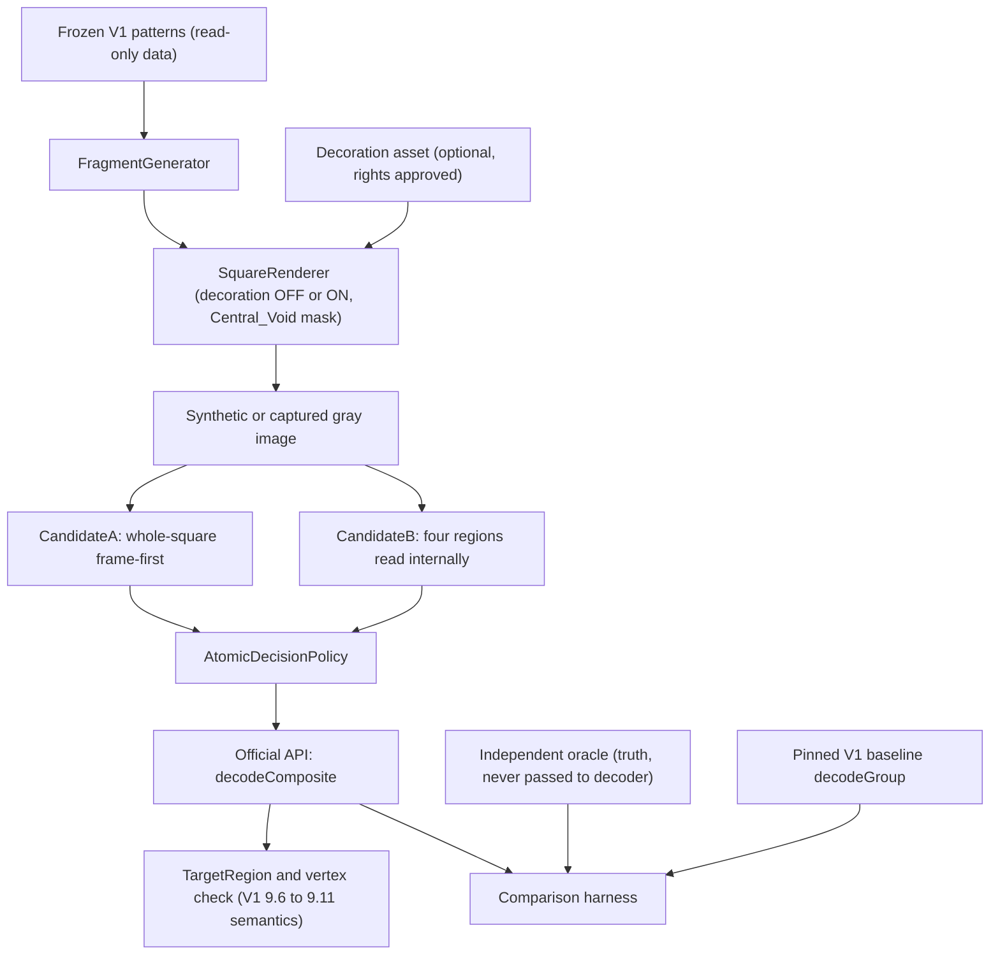
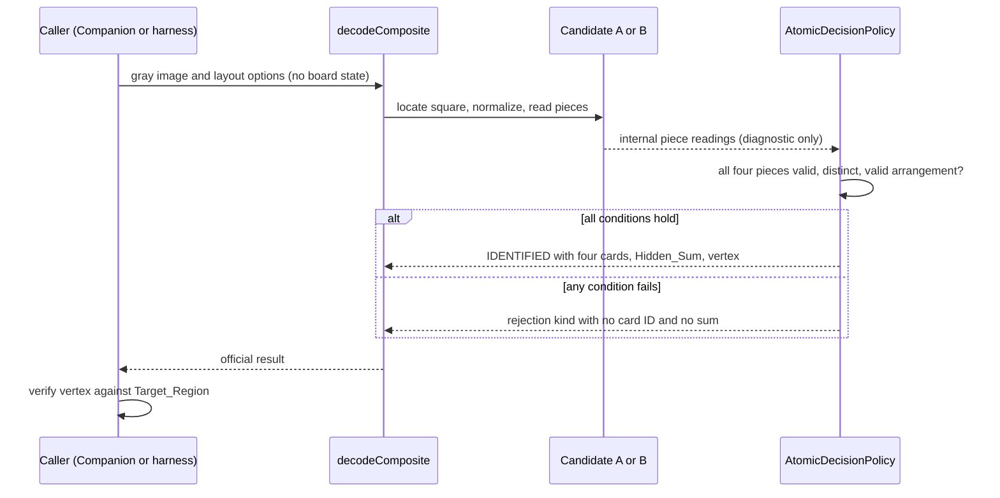
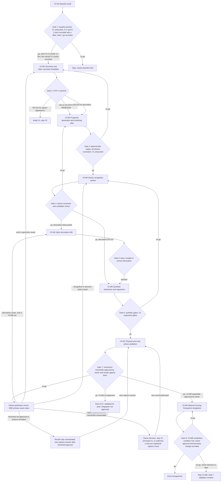

# Design Document: QRoker Optical V2 (Composite Code V2)

> **STATUS: PLANNING DRAFT. NOTHING IS IMPLEMENTED, VERIFIED OR APPROVED.**
> Every statement below is a plan, hypothesis or proposal. No V2 code, codebook, asset, test, measurement or print exists. "Proposed" file names and thresholds are not decisions. The requirements for this spec are in requirements.md; the tasks are in tasks.md.

## Overview

QRoker Optical V2 is a proposed, experimental successor track to the Optical V1 marker system. In V1 each of the four cards in a 2x2 Quad_Group carries two small, independent, square markers, and the optical reader decodes each marker separately. V2 asks a different question: can the four corner pieces printed on four existing cards assemble into ONE visually continuous SQUARE Composite Code, where the only intended empty area is the small `Central_Void` left by the rounded card corners, and can the official scanner return a result only when all four valid pieces are present?

The design is feasibility-first. The most important open question is geometric, not optical: the fixed suit-specific Fragment_Layout lets one printed piece serve two different slots (one at 0 degrees, one at 180 degrees). Whether four pieces can look identical in every valid arrangement is hypothesis HYP-1 (section "Geometric Feasibility Prerequisite") and must be settled by an independent computation in V2-M2 before any generator, detector or decoration work is planned in detail. The milestones V2-M1 to V2-M8 each end in a go/no-go gate on the previous one, and V1 stays untouched until V2 is independently validated.

### Purpose (owner-stated goals, planned only)

1. Four physical card fragments, one from each of four cards in a valid 2x2 Quad_Group, assemble into one visually continuous square Composite Code.
2. A small central opening (`Central_Void`) caused by rounded poker-card corners is the only intended empty area.
3. Successful decoding only when all four valid fragments are present. This is a result policy of the official scanner API (1 to 3 pieces never yield a success, card IDs or Hidden_Sum). It is not cryptographic secrecy.
4. The existing 52-card deck (no Joker card), the permitted rotations (0 degrees, and 180 degrees where meaningful) and the fixed suit-specific Fragment_Layout are preserved.
5. Optional integration of the user-supplied symmetric monochrome Joker artwork inside the assembled marker as decoration (not a 53rd card), simplified or removed if it harms recognition.
6. Verification of geometry, fragment arrangement, optical reliability, wrong acceptance and decoration interference.
7. Optical V1 (code, frozen codebook, tests, reports) is preserved until V2 is independently validated.

### Non-goals

- No ISO 18004 QR code, and no requirement that a standard QR scanner reads the assembled square.
- No cryptographic secrecy or claim that card identity cannot be derived from 1 to 3 pieces by other means. Static patterns remain reverse-engineerable. Printed ranks and suits remain visible. A marker on either face still reveals card identity (V1 Requirement 16.9).
- No real-camera or real-print claim. All results planned here begin as model or synthetic results.
- No change to V1 code, `src/optical/codebook.v1.json`, V1 tests, V1 reports, the game rules, the scoring values, the draw rule or the AI.
- No change to the Fragment_Layout or the frozen codebook (V1 Requirement 15.10 stays in force for V1).
- No implementation in this spec phase. This document creates no code, asset, script or codebook.

### Provenance and attribution rules

| Statement class | Where it comes from | Treatment in this document |
|---|---|---|
| Owner-stated requirement | The project owner's instructions in the planning conversation (goals 1 to 7 above) | Highest authority. Quoted as goals, not as verified facts. |
| Approved V1 specification | `.kiro/specs/qroker-game/**` and `docs/optical/OPTICAL-STATUS.md` on branch `codex/issue-9-score-table` | Baseline facts. Cited by requirement or section number. |
| PR #18 draft plan | `docs/optical/COMPOSITE-V2-PLAN.md` and `joker-four-piece-reference.svg` on `origin/docs/composite-code-v2-plan-20261116` (not on this branch) | Planning reference, NOT approved. Its thresholds are proposals. |
| AI-derived hypothesis | The orchestrator's hand derivation (HYP-1) and this document's own deductions | Labelled HYPOTHESIS and UNVERIFIED until an independent computation confirms them. |

Source-of-truth ordering: the owner's instructions > approved V1 specs on this branch > PR #18 draft plan > everything else.

Attribution: a planning document creates no Kiro implementation credit. Any future result must record who or what produced it (Kiro, Codex, ChatGPT, human), with command, commit, environment, seed and sample identifiers, and must not be attributed to a tool that did not perform the work.

Evidence discipline inherited from V1: synthetic-image results are never real-camera results. A finite-sample zero-error observation is not a guarantee. Real-device and synthetic evidence are kept separate (V1 Requirement 12.7 and 15.9).

Notation: no programming language is fixed by the owner for V2, so interfaces and algorithms use Structured Pseudocode in `pascal` blocks. All names, module paths and file names are proposals.

Spec metadata: `.kiro/specs/qroker-optical-v2/.config.kiro` is the Kiro-managed metadata file of this spec (specType and workflowType). It is required for the specification to work, carries no project configuration, and is the single non-document file this spec creates (Requirement 20.8).

---

## Baseline Facts of V1

Sources: V1 requirements 5, 9, 12 to 16, V1 design (Optical Marker System sections 1 to 8, Physical Card Geometry sections 1 to 7), V1 tasks overview, `docs/optical/OPTICAL-STATUS.md`. All V1 optical numbers are synthetic-image results.

| Topic | V1 fact |
|---|---|
| Fragments per card | Two. One base pattern P per card, the second fragment is a D4 transform of P (R180 for hearts and diamonds, Fh for clubs and spades). |
| Marker footprint | 5x5 data cells, 7x7 with a 1-module black border, 9x9 with a 1-module white quiet margin. Marker_Inset 1 module from the card edge. |
| Codebook | 52 cards, 8 D4 transforms each, 416 templates, pairwise Hamming distance >= 5, base-pattern weight in [9, 16]. Frozen as `src/optical/codebook.v1.json`, SHA256 `515ECEB318648C14A47574496788236A2B1BBDFC7062387DB09303CB717CC2D4` (matches on this branch in a read-only check on 2026-11-19). Never edited. |
| Detection and decoding | `detect.ts` finds each marker independently. `decode-fragment.ts` matches one marker to the 416 templates (default acceptance radius 1, configurable to 2). `decode-group.ts` clusters four markers around a vertex and checks 8 orientation/reflection hypotheses against the slot table. |
| Card geometry | 63.5 x 88.9 mm, 40 x 56 modules at 1.5875 mm, Corner_Radius 3.175 mm (an unconfirmed commercial value), zero intended seam gap. |
| Double-sided | Back marker layer is the left-right mirror of the front layer in the Body_Frame (B(x, y) = F(W - x, y)), including pixel content. Mirroring applies to the marker layer only, not to artwork. Duplex print-file convention and show-through are unverified (Milestone 8). |
| Central_Void in V1 | Requirement 15.4: the reader does not assume the four fragments form a seamless square and clusters four markers independently. Requirement 15.5: a white gap of at least 2(Marker_Inset + margin) modules (4 modules at the baseline) between black squares across a seam, and adjacent marker components must not merge. |
| Group rules | Exactly four markers around a vertex form a group (15.6). The reader picks the complete group whose vertex is nearest the frame center and reports that `vertex`. The caller (Scoring_Companion) checks the vertex against the Target_Region (9.6 to 9.11). |
| Result kinds in code | `IDENTIFIED`, `NOT_DETECTED`, `INVALID_MARKER`, `INCOMPLETE_GROUP`, `CORRUPTED_FRAGMENT`, `AMBIGUOUS_FRAGMENT`, `DUPLICATE_CARD`, `INVALID_ARRANGEMENT`. `REFERENCE_MISMATCH` and `INVALID_REFERENCE` come only from a separate `ReferenceCheck.compare`. The per-fragment function `decodeFragment` is also a public API. |
| Reflection | `NOT_REFLECTED`, `REFLECTED`, `AMBIGUOUS`. Groups of only clubs and spades are `AMBIGUOUS` (128 of 648 synthetic images). |
| Scoring Companion | Requirement 9: manual entry or camera scan, offline operation, Target_Group identification, vertex check, only decoded identities are used and never replaced by expected ones. Not implemented. |
| Module boundary | The optical module imports nothing from game code. `src/game` must not import `src/optical` for the practice mode. The only intended consumer is the future Scoring Companion. |
| Browser readiness | Not browser-ready: `fragments.ts` and `decode-fragment.ts` read the codebook with `node:fs` (OPTICAL-STATUS section e). |
| V1 status | Milestones 0 to 6 and Task 7.1 complete. Task 7.2 (363,000-trial sweep, 263 conditions) NOT run. Tasks 7.3, 7.4 and Milestone 8 (print and physical) NOT started. Every result is synthetic. |

### Fragment_Layout and slot table (copied from the V1 tasks overview)

- Fragment layout: hearts TL:P, BR:R180·P. Diamonds TR:P, BL:R180·P. Clubs TR:P, BR:Fh·P. Spades TL:P, BL:Fh·P. Cards are placed at 0 or 180 degrees only.
- Slot table (observed transform at the inward corner): hearts TL:R180, BR:I. Diamonds TR:R180, BL:I. Clubs TL:Fh, TR:R180, BL:I, BR:Fv. Spades TL:R180, TR:Fh, BL:Fv, BR:I.
- Inward_Corner by slot: TL to BR, TR to BL, BL to TR, BR to TL.

### Repository state observed on 2026-11-19 (after `git fetch origin`, as reported by the orchestrator; branch and codebook hash re-checked read-only)

| Item | State |
|---|---|
| Local branch | `codex/issue-9-score-table` at b34415a, clean. `origin/main` = ddad447 (includes merged PR #12). |
| PR #13 | Provisional scoring with owner-approved values. Stacked on PR #12's head. |
| PR #14 | Optical V1 improvements. Stacked on #13. Changes `src/optical/detect.ts` (about 45-degree candidate recovery) and adds print/photo validation kit scripts and `docs/optical/physical-test-protocol.md`. Does not touch `codebook.v1.json`. |
| PR #15 | Submission documentation. Stacked on #14. |
| PR #17 | Kiro steering and hooks. Not to be applied. |
| PR #18 | Optical V2 plan and Joker reference (docs only). |
| PR #21, #22 | Draw-rule experiments and draw-rule revision, siblings from PR #12's head. #22 removes the first-placement draw exemption in game Requirement 3.5. Proposals, not approved. |
| Evidence limits | Open-PR facts are inferred from `refs/pull/N/merge` refs. The repository is private, so the GitHub API and draft flags could not be read. PR #18's text calls PR #12 to #15 a draft stack, which is stale for PR #12. |

### Independence from unmerged game-branch changes

The working tree on which these V2 spec files were written is branch `codex/issue-9-score-table` (b34415a). That branch contains PR #13's provisional scoring, which is not merged to `origin/main`. The V2 spec files are untracked. They use no scoring value, no ScoreConfig, no draw rule and no game source. They define Hidden_Sum only as the sum of four Card_Values, and they depend on game facts only through the V1 specs.

The verification of this independence is the criterion that V2 documents contain no scoring value and no draw-rule statement (Requirement 19.10) together with the criterion that no V2 plan or deliverable changes anything relative to the Baseline_V1 (Requirement 20.7), both evidence class 1.

NOTE (not a requirement): committing these planning files on the PR #13 branch would tie planning documents to an unmerged scoring change. A branch based on `origin/main` is the neutral place. That is an owner action and is not performed here.

---

## V1 versus V2 Conflict Register

All entries are OPEN. "Proposed resolution" is a proposal for owner review, not a decision.

| ID | V1 text or location | V2 need | Proposed resolution | Status |
|---|---|---|---|---|
| C1 | Requirements 15.4 and 15.5: fragments are not assumed to form a seamless square. White gap of at least 2(Marker_Inset + margin) modules between adjacent markers, and adjacent components must not merge. | One continuous square. Only the Central_Void is empty. | V2 is a new format with its own geometry and quiet-zone rule, applied to the assembled square instead of each fragment. V1 requirements stay unchanged and apply to V1. V2 states its own quiet-zone rule in its requirements. | OPEN |
| C2 | Requirements 13.1 and 13.4, 12.2: each fragment is decoded independently and the API can return per-fragment identities. | Atomic result: no success, ID or sum without all four valid pieces. | The official V2 entry point returns only atomic results. Per-piece readings exist only as internal diagnostics and test-only access, never in the production export. V1 `decodeFragment` stays as is. | OPEN |
| C3 | Requirement 5.3, 15.10 and design "never edit": `codebook.v1.json` is frozen and `check:codebook` regenerates it byte for byte. | V2 may need different pattern geometry. | New formats are new, versioned and opt-in. Reuse V1 patterns read-only if possible. Create `codebook.v2.*` only if a different pattern format is proven necessary, with an explicit compatibility policy (V1 cards and V2 cards are different print runs unless proven equal). | OPEN |
| C4 | Requirement 16: the back layer is the Body_Frame mirror of the front. Mirroring applies to the marker layer only, not to artwork. | Decoration inside the marker, printed on both faces. | Decide whether decoration belongs to the "marker layer" (mirrored like data) or to "artwork" (face-local). Proposal: the decoration is part of the optical layer and is mirrored with it so that flip equivalence holds. To be checked in V2-M2 and V2-M7 (show-through). | OPEN |
| C5 | V1 design and OPTICAL-STATUS section f: `src/game` must not import `src/optical`. | A future V2 Scoring Companion needs both. | V2 stays isolated. `src/game` imports V2 only after V2-M8 is separately approved, through a thin adapter in the Companion layer. | OPEN |
| C6 | Task 7.2 sweep not run, 7.3, 7.4 and Milestone 8 not started. The Task 7 pass criterion is UNEVALUATED. | A trustworthy baseline for A/B comparison. | Record V1 as an unevaluated baseline. Owner decides whether to finish V1 7.2 and Milestone 8 first (open decision O-2). V2 must not report a V1 pass criterion as met. | OPEN |
| C7 | PR #14 changes `detect.ts`. `main` does not contain it. | Which detector is "the V1 baseline"? | V2-M1 pins one baseline explicitly (main, or PR #14 stack) with commit IDs and runs the comparison against that pin only. | OPEN |
| C8 | V1 game text says scoring values are undecided and the approved draw rule has a first-placement exemption. PR #13 supplies provisional values and PRs #21 and #22 propose draw-rule changes. | V2 is an optical track. | V2 documents contain no scoring value and no draw-rule statement and do not depend on them. Hidden_Sum is defined only as the sum of four Card_Values (A=1 to K=13). | OPEN |
| C9 | PR #17 (not applied) adds steering that restates V2 goals. | One authoritative source for V2 goals. | This spec is the authority once approved. PR #17 steering is neither applied nor relied on. Any restatement must be checked against this document. | OPEN |
| C10 | PR #18 and the owner's text differ in wording: "inside the recognition mark" (PR #18) versus "inside the assembled marker" (owner). | Unambiguous placement of the decoration. | Use "inside the assembled marker". Define the allowed decoration region by a keep-out mask computed in V2-M2 (not over data cells, frame elements needed for detection, or quiet zone). Ask the owner to confirm the wording. | OPEN |
| C11 | Open decision 5 in `docs/open-decisions.md`: the ordinary card-face index may collide with the marker position. | A larger assembled square occupies more card area. | Record the card-face artwork conflict as a V2-M2 geometry input. Do not decide the card face design here. | OPEN |

---

## Geometric Feasibility Prerequisite

This section is the central prerequisite. Everything in it is HYPOTHESIS HYP-1, derived by hand by the orchestrator from the V1 Fragment_Layout and Inward_Corner tables and re-checked by hand while writing this document. It is UNVERIFIED. V2-M2 must re-derive it by an independent computation that does not reuse generator code.

### Conventions

- Body corners of a card: TL, TR, BL, BR, in the front Body_Frame.
- A card at orientation theta in {0, 180} shows its printed body corner c at board corner rot_theta(c). rot_0 is the identity. rot_180 maps TL to BR, TR to BL, BL to TR, BR to TL.
- A placement is valid for slot s when the printed corner appears at Inward_Corner(s) (TL to BR, TR to BL, BL to TR, BR to TL).
- The piece image printed at a body corner appears rotated by theta in the board frame.
- Q_s denotes the intended appearance of quadrant s of the assembled square in the board frame (the part contributed by the card in slot s).

### The valid (suit, orientation, slot, piece) classes (hand derivation, UNVERIFIED)

| # | Suit | Orientation | Slot | Printed body corner used | Observed data transform (V1 slot table) |
|---|---|---|---|---|---|
| 1 | hearts | 0 | TL | BR | R180 |
| 2 | hearts | 180 | TL | TL | R180 |
| 3 | hearts | 0 | BR | TL | I |
| 4 | hearts | 180 | BR | BR | I |
| 5 | diamonds | 0 | TR | BL | R180 |
| 6 | diamonds | 180 | TR | TR | R180 |
| 7 | diamonds | 0 | BL | TR | I |
| 8 | diamonds | 180 | BL | BL | I |
| 9 | clubs | 0 | TL | BR | Fh |
| 10 | clubs | 180 | TR | TR | R180 |
| 11 | clubs | 0 | BL | TR | I |
| 12 | clubs | 180 | BR | BR | Fv |
| 13 | spades | 180 | TL | TL | R180 |
| 14 | spades | 0 | TR | BL | Fh |
| 15 | spades | 180 | BL | BL | Fv |
| 16 | spades | 0 | BR | TL | I |

The hand derivation gives 4 classes per suit and 16 in total. The exact count and the table must be produced by the V2-M2 computation, not taken from this document. The transform column matches the V1 slot table for every row.

### Piece sharing (HYPOTHESIS)

Each of the 8 printed (suit, body corner) pieces appears in exactly two classes, at diametrically opposite slots, once at 0 degrees and once at 180 degrees:

| Printed piece | Serves (orientation, slot) |
|---|---|
| hearts TL | (0, BR) and (180, TL) |
| hearts BR | (0, TL) and (180, BR) |
| diamonds TR | (0, BL) and (180, TR) |
| diamonds BL | (0, TR) and (180, BL) |
| clubs TR | (0, BL) and (180, TR) |
| clubs BR | (0, TL) and (180, BR) |
| spades TL | (0, BR) and (180, TL) |
| spades BL | (0, TR) and (180, BL) |

Example: a heart's TL piece is seen unrotated in slot BR at 0 degrees and rotated by 180 degrees in slot TL at 180 degrees.

### Necessary condition for an identical shared layer (HYPOTHESIS)

Let p_c be the shared (non-data) layer printed at body corner c. Natural assignment: p_c is the quadrant that c occupies when the card is at 0 degrees, so p_TL = Q_BR, p_TR = Q_BL, p_BL = Q_TR, p_BR = Q_TL. The 180-degree use of the same piece then shows R180(p_c). For this to equal the quadrant of the opposite slot:

```pascal
R180(Q_BR) = Q_TL        // heart TL piece: (0, BR) and (180, TL)
R180(Q_BL) = Q_TR        // diamond TR piece: (0, BL) and (180, TR)
```

So, for the decoration layer D (decoration, frame and outline, excluding the card-specific data cells), the necessary condition is D_TL = R180(D_BR) and D_TR = R180(D_BL). That is 180-degree point symmetry of the assembled decoration, frame and Central_Void. Under the natural assignment all 16 classes then show the same appearance (sufficiency under that assignment, to be checked by V2-M2). A mere left-right mirror symmetry, typical for a Joker face, does NOT suffice, because mirror symmetry relates TL to TR, not TL to BR. A shape that is both left-right and top-bottom mirror symmetric is point symmetric, since the two mirrors compose to R180.

The data layer is allowed to differ per card and per slot, as in V1 (the decoder expects a known transform per slot). Only the frame, decoration and outline must look continuous. The data cell positions and the frame must still respect the same symmetry (cell grid positions are symmetric under R180 even when the content is not).

### What remains unknown

| Unknown | Why it matters | Resolved by |
|---|---|---|
| Is the supplied Joker artwork 180-degree point symmetric? | The SVG is a trace of a user picture, 1536 x 1536 viewBox, no Central_Void applied, symmetry unverified. | V2-M2 raster/geometric symmetry test of the SVG (class 1 evidence), and a check against the original picture under owner supervision. |
| Is a double-headed point-symmetric redesign acceptable to the owner? | Needed for GO-WITH-REDESIGN. | Owner decision O-3. |
| Effect of double-sided mirrored printing on the decoration | The back layer is the Body_Frame mirror of the front. | V2-M2 model check, V2-M7 physical flip test. |
| Effect of seams and print registration on "one continuous square" | A zero-gap seam is a design target. Real cut and registration errors are unknown. | V2-M7 physical measurement. |
| Void area and nearest-void-point geometry | The Central_Void removes artwork at the center and approaches the nearest drawn element. | V2-M2 computation (formulas below, UNVERIFIED for V2). |
| Minimum feature size versus module size 1.5875 mm | Fine Joker detail may be below printable or resolvable size. | V2-M2 model, V2-M5 A/B, V2-M7 print. |
| Assembled square size S | Larger S allows more decoration but conflicts with neighbouring vertex squares and card-face artwork. | V2-M2 parameter study. |

### Geometric quantities to be derived (formulas are carried over from V1 design and are UNVERIFIED for V2)

- Central_Void area per corner: (1 - pi/4) r^2, about 0.2146 r^2. Total for four corners: (4 - pi) r^2, matching V1's 4(1 - pi/4) r^2 and its table value 8.65 mm^2 at r = 3.175 mm.
- Nearest void point to a corner point at offset a from both card edges (V1 formulas): if 0 < r <= a, sqrt((a - r)^2 + a^2); if r > a, r - sqrt(2)(r - a). These cover only the diagonal point (a, a). Decoration points are not on the diagonal, so V2-M2 must derive the general nearest-void-point distance itself.
- V1 reference arithmetic (derived from the 9x9 footprint and inset 1, UNVERIFIED): black squares span 2 to 9 modules from the vertex on each side, so the V1 black-square extent around a vertex is 18 x 18 modules (about 28.6 mm) with a 4-module central white gap. A V2 assembled square must choose its own size S and quiet zone.
- Upper bound on S (to be derived): squares at neighbouring vertices of a full board are 40 modules (card width) or 56 modules (card height) apart, so 2S plus the quiet zones must fit in that spacing. The exact limit depends on which pieces coexist and is for V2-M2.
- Illustrative feature-size arithmetic: if the whole 1536-unit SVG viewBox were mapped onto 18 modules (28.6 mm), a feature about 80 units wide (the approximate diameter of the small circles read from the path text) would be about 1.5 mm, about one module. This is an illustration, not a design value.

### Observations from reading the SVG path text (AI reading, no rendering or computation performed, UNVERIFIED)

- The path extents run about x 113 to 1422 and y 37 to 1498, so the bounding box is centred near (768, 768), the center of the viewBox.
- Four small circles lie near x = 768 at about y = 381, 516, 1017 and 1150. Their y values pair up to about 1531 to 1533 against 1536, which hints at an approximate vertical-axis symmetry about the horizontal midline, but a trace can deviate by several units.
- The viewBox center (768, 768) appears to lie inside a diamond shape of the central band, so a Central_Void there would remove part of that shape. The vertical seam at x = 768 passes through the circles and the diamond.
- None of this proves point symmetry or its absence. V2-M2 decides.

### V2-M2 go/no-go outcomes

| Outcome | Meaning | Consequence |
|---|---|---|
| GO | The supplied artwork, as is, satisfies the symmetry condition within tolerance, with the Central_Void and minimum features acceptable. | Plan decoration A/B with the original-based arm. |
| GO-WITH-REDESIGN | The supplied artwork fails but a point-symmetric Joker (double-headed) or a frame-only decoration satisfies it, and the owner accepts the redesign. | Plan A/B with the redesigned artwork. Record that the supplied artwork was not used as is. |
| NO-GO for decoration | No acceptable decoration satisfies the condition. | V2 continues with decoration OFF. V2-M5 is skipped. |
| NO-GO for square appearance | The geometry (even without decoration) cannot give one continuous square for every valid arrangement, as found by the V2-M2 model-level computation (Requirement 4.7). | Keep V1. Stop V2 and record the reason. A mismatch found later by the V2-M3 renderer is a Gate 3 no-go that returns to V2-M2, not a retroactive Gate 2 outcome (Requirement 7.6). |

---

## Architecture

### Principles (proposals)

1. Isolation: a new module `src/optical-v2/` (proposed name). No edit to `src/optical/**`.
2. Versioned artifacts: reuse the frozen V1 patterns read-only if possible. Create `codebook.v2.*` and an artifact schema version only when a different pattern format is proven necessary (C3).
3. Tests in their own folder under the V2 module (V1 co-locates tests, V2 proposal: `src/optical-v2/tests/`, subject to the Vitest include settings, checked in V2-M3).
4. Results in `docs/optical-v2/results/` (proposal), kept apart from V1's `docs/optical/results/`.
5. A side-by-side comparison harness uses the pinned V1 baseline as one arm. V1 is imported only by that harness, never by V2 production code.
6. Boundary rules: V2 production code must not import game code. `src/game` must not import V2 until V2-M8 is separately approved. V2 production code should not import V1 runtime modules (`fragments.ts` and `decode-fragment.ts` use `node:fs`). Reading `codebook.v1.json` as data is allowed.
7. Evidence independence: the V2-M2 feasibility computation and the correctness oracle share no code with the generator or the renderer.

### Component overview



### Candidate comparison (decided only by measurement)

| Candidate | Concept | Potential benefit | Risk to test |
|---|---|---|---|
| A. Whole-square, frame-first | Detect the outer frame and orientation reference of the full square, normalize to four quadrants, read quadrant data. | Closest match to the V2 appearance. | Seams, Central_Void, perspective and decoration may damage the frame. V1 detector reuse is limited. |
| B. Four regions read internally, then atomic validation | Reuse V1 codebook and decoding ideas on four quadrant regions, then validate the four readings together. | Reuses test assets and error handling. | A separate quiet margin per region conflicts with the square appearance (C1). The internal per-region readings must never reach the official API. |

Both candidates expose only the result of the AtomicDecisionPolicy. Neither exposes per-piece success.

### Sequence of one official decode (proposed)



---

## Components and Interfaces

All signatures are proposals.

### FragmentGenerator

Purpose: produce the fixed printed pieces of the 52 cards for V2, including the two pieces per card, the suit layout and the back-layer mirror.

```pascal
INTERFACE FragmentGenerator
  generatePieces(format: V2Format, card: CardId): PieceSet     // two pieces, body corners from FRAGMENT_LAYOUT
  backLayer(front: PieceSet): PieceSet                          // Body_Frame left-right mirror, pixel content mirrored
  assemble(arrangement: Arrangement, decoration: DecorationMode): AssembledModel
END INTERFACE
```

Responsibilities: deterministic output for fixed parameters, no change to the Fragment_Layout, no new data patterns unless the format decision (V2-M3) requires them.

### SquareRenderer

Purpose: render the assembled square of four cards as a raster, with decoration OFF or ON, with the Central_Void mask, and with physical card outline, seam and error parameters.

```pascal
INTERFACE SquareRenderer
  render(model: AssembledModel, geometry: GeometryParams, mode: DecorationMode, errors: PlacementErrors): GrayImage
  centralVoidMask(geometry: GeometryParams): Mask
  keepOutMask(geometry: GeometryParams): Mask                   // data cells, detection frame, quiet zone
END INTERFACE
```

Responsibilities: apply the void mask as a mask, never as data; keep decoration outside the keep-out mask; produce identical output for identical seeds.

### CandidateA and CandidateB

```pascal
INTERFACE Candidate
  read(image: GrayImage, options: ReadOptions): InternalReading     // diagnostics only, not exported
END INTERFACE
```

Rule: `InternalReading` is not exported from the production entry point and is reachable only from the test harness.

### AtomicDecisionPolicy

```pascal
INTERFACE AtomicDecisionPolicy
  decide(reading: InternalReading): OfficialResult
END INTERFACE
```

Result kinds (proposal): `IDENTIFIED`, `INCOMPLETE_GROUP`, `INVALID_ARRANGEMENT`, `DUPLICATE_CARD`, `CORRUPTED`, `NOT_DETECTED`, `AMBIGUOUS`. The V2 kind `AMBIGUOUS` (competing complete interpretations or insufficient confidence) is distinct from the V1 `reflection: AMBIGUOUS` value, which is carried over unchanged. Invariant: no card ID and no sum unless `IDENTIFIED`.

### TargetRegion and vertex check

```pascal
INTERFACE TargetCheck
  verify(result: OfficialResult, region: TargetRegion): TargetVerdict     // APPLY, DISCARD_OTHER_VERTEX, REQUEST_RESCAN
END INTERFACE
```

Semantics follow V1 Requirements 9.6 to 9.11: the decoder does not know the Target_Group. The caller verifies the reported `vertex`, discards results from other vertices, falls back to rescan or manual entry, and uses only decoded identities.

### Comparison harness

Runs V1 baseline, V2 decoration OFF and V2 decoration ON on identical inputs, and classifies every trial with the independent oracle (section "Atomic Recognition Policy").

---

## Data Models

```pascal
STRUCTURE V2Format
  formatVersion: String                  // e.g. "v2-draft-N", proposal
  patternSource: ENUM { V1_READONLY, V2_NEW }
  squareSizeModules: Number              // S, to be chosen in V2-M2
  quietZoneModules: Number               // around the assembled square, not between pieces
  cornerRadiusMm: Number                 // reference 3.175, varied around it
  moduleMm: Number                       // reference 1.5875
END STRUCTURE

STRUCTURE Arrangement
  slots: MAP Slot -> (card: CardId, orientation: 0 or 180)   // slots TL, TR, BL, BR
  face: FRONT or BACK
END STRUCTURE

ENUM DecorationMode { OFF, SIMPLIFIED, ORIGINAL_BASED, FRAME_ONLY }

STRUCTURE OfficialResult
  kind: ResultKind
  cards: OPTIONAL List of 4 CardId          // present only when kind = IDENTIFIED
  hiddenSum: OPTIONAL Integer               // present only when kind = IDENTIFIED
  reflection: OPTIONAL NOT_REFLECTED or REFLECTED or AMBIGUOUS
  interpretations: OPTIONAL List            // slot assignments the image alone allows (180-degree ambiguity)
  vertex: OPTIONAL Point                    // image pixels
  formatVersion: String
END STRUCTURE

STRUCTURE TrialRecord
  trialId, seed, geometryId, decorationMode, inputClass     // inputClass: VALID or NEGATIVE(kind)
  officialResult: OfficialResult
  outcome: ENUM { CORRECT, REJECTED, WRONG_ACCEPT_VALID, WRONG_ACCEPT_NEGATIVE }
  latencyMs, environmentId, evidenceClass
END STRUCTURE
```

Validation rules:

- `cards`, `hiddenSum` and `reflection` are absent when `kind` is not `IDENTIFIED`.
- Hidden_Sum is an integer from 4 to 52 (V1 Requirement 1.4). Four card IDs are pairwise distinct.
- A `TrialRecord` carries truth fields only in the oracle, never in the input to the decoder.

---

## Atomic Recognition Policy

### Definitions

- Piece: one corner region printed on one card (a V2 fragment), the part of the assembled square contributed by one slot.
- Group: four pieces, at one vertex, that together form the assembled square.
- Valid group: four pieces whose (suit, orientation, slot) combinations satisfy the slot table, with four distinct card IDs.
- Internal diagnostics: per-piece measurements available inside the decoder and to the test harness. They are not part of the official output.
- Official output: the value returned by the production entry point `decodeComposite`.

### Policy

| Situation | Official kind | Card IDs and sum |
|---|---|---|
| Four valid pieces, valid arrangement, distinct cards | IDENTIFIED | Present |
| No square or frame found | NOT_DETECTED | Absent |
| One to three valid pieces, the rest missing, blank, occluded or foreign | INCOMPLETE_GROUP | Absent |
| Four regions found, at least one unreadable within the acceptance radius | CORRUPTED | Absent |
| Four regions read, duplicate card ID | DUPLICATE_CARD | Absent |
| Four regions read, no orientation/reflection hypothesis fits the slot table | INVALID_ARRANGEMENT | Absent |
| Competing interpretations with different card sets, or confidence below a preset threshold | AMBIGUOUS | Absent |

A 1-to-3-piece scene has 14 non-empty proper subsets of a valid four-piece group (4 + 6 + 4). The empty set is the background-only case.

### Metric definitions (every metric uses these classes)

| Outcome | Definition |
|---|---|
| CORRECT | Input is a valid group, result is IDENTIFIED, and cards and sum equal the independent truth. |
| REJECTED | Result kind is not IDENTIFIED. Counted as a reject, never as correct and never as a wrong accept. For a valid input it is a false reject (reported); for a negative input it is the expected outcome. |
| WRONG_ACCEPT_VALID | Valid input, result is IDENTIFIED, cards or sum differ from the truth. |
| WRONG_ACCEPT_NEGATIVE | Negative input (missing pieces, duplicate, illegal arrangement, distractor), result is IDENTIFIED. |

The two wrong-accept classes are reported separately from rejects and from each other, with the trial count n and the observed count. The independent oracle compares after decoding. Truth is never an input to the decoder.

### Non-claims

- The policy is a result rule of the official API, not secrecy. Anyone can read the printed patterns, and a scanner variant could be written that reads fewer pieces.
- Printed ranks and suits stay visible, and a marker on either face reveals card identity (V1 Requirement 16.9).
- Finite-sample observations of zero wrong accepts are not guarantees.
- Whether `INCOMPLETE_GROUP` may carry a piece count or visibility hint is an owner question (O-6). Proposal: geometric hints only, never anything derived from card identity.

---

## Key Functions with Formal Specifications

### enumeratePlacementClasses (V2-M2, independent computation)

```pascal
FUNCTION enumeratePlacementClasses(layout, inward): List of PlacementClass
```

Preconditions:
- `layout` is the V1 Fragment_Layout per suit and `inward` the Inward_Corner map, entered independently from the V1 sources.

Postconditions:
- Returns every (suit, orientation, slot, printed corner) for which rot_theta(corner) = inward(slot).
- The count is recorded as the V2-M2 result. The hand value 16 is only a cross-check.
- Shares no code with the generator or the V1 modules.

### checkDecorationSymmetry (V2-M2)

```pascal
FUNCTION checkDecorationSymmetry(D: Raster, tolerance): SymmetryReport
```

Preconditions: `D` is the shared layer (frame, decoration, outline) of the assembled square, data cells excluded, with the Central_Void mask stated.

Postconditions: reports pixel differences of D against R180(D) and against its mirrors, the largest local deviation in modules, and whether the tolerance holds. No mutation of the input.

### decodeComposite (official entry point, planned)

```pascal
FUNCTION decodeComposite(image: GrayImage, options: LayoutOptions): OfficialResult
```

Preconditions: `image` is a grayscale raster. `options` contain layout and tuning only, never board state or expected cards.

Postconditions: returns exactly one `OfficialResult`. `cards` and `hiddenSum` exist if and only if `kind` = IDENTIFIED. IDENTIFIED requires four distinct valid pieces and a valid arrangement. No exception reveals a card ID.

### verifyTargetVertex

```pascal
FUNCTION verifyTargetVertex(result, region): TargetVerdict
```

Preconditions: `result.kind` = IDENTIFIED and `result.vertex` is defined.
Postconditions: APPLY only if the vertex lies in `region`. Otherwise the result is discarded for the Target_Group. Decoded identities are never replaced by board data.

---

## Algorithmic Pseudocode

### Feasibility check (V2-M2)

```pascal
ALGORITHM feasibility(layout, inward, artwork, geometry)
INPUT: V1 layout and inward maps, candidate artwork, geometry parameters
OUTPUT: classes, report, outcome in {GO, GO_WITH_REDESIGN, NO_GO_DECORATION, NO_GO_SQUARE}

BEGIN
  classes <- []
  FOR each suit IN {hearts, diamonds, clubs, spades} DO
    FOR each theta IN {0, 180} DO
      FOR each slot IN {TL, TR, BL, BR} DO
        FOR each corner IN layout[suit] DO
          IF rotate(theta, corner) = inward[slot] THEN
            classes.add(suit, theta, slot, corner)
          END IF
        END FOR
      END FOR
    END FOR
  END FOR

  // Frame and outline only (decoration OFF)
  reportFrame <- compareAllClasses(classes, frameOnlyModel(geometry))
  IF NOT reportFrame.allIdenticalWithinTolerance THEN
    RETURN (classes, reportFrame, NO_GO_SQUARE)
  END IF

  // Decoration
  reportArt <- checkDecorationSymmetry(artwork, geometry.tolerance)
  IF reportArt.ok AND minFeatureOk(artwork, geometry) AND voidAcceptable(artwork, geometry) THEN
    RETURN (classes, reportArt, GO)
  ELSE IF redesignAvailable(artwork) AND reportRedesign.ok THEN
    RETURN (classes, reportRedesign, GO_WITH_REDESIGN)
  END IF
  RETURN (classes, reportArt, NO_GO_DECORATION)
END
```

Preconditions: inputs entered from the V1 documents, tolerance fixed before the run.
Postconditions: outcome follows only from the recorded report. The record contains the class count, the tolerance and the computation method.
Loop invariants: every (suit, theta, slot, corner) combination visited so far is either in `classes` or violates the inward condition.

### Atomic decision

```pascal
ALGORITHM atomicDecide(reading)
INPUT: internal reading of a candidate scene
OUTPUT: OfficialResult

BEGIN
  IF reading.squareFound = false THEN RETURN result(NOT_DETECTED) END IF
  IF reading.validPieceCount < 4 THEN RETURN result(INCOMPLETE_GROUP) END IF
  IF reading.anyUnreadable THEN RETURN result(CORRUPTED) END IF
  IF hasDuplicateCard(reading.cards) THEN RETURN result(DUPLICATE_CARD) END IF
  hypotheses <- passingHypotheses(reading, SLOT_TABLE)     // 8 orientation and reflection hypotheses
  IF hypotheses.isEmpty THEN RETURN result(INVALID_ARRANGEMENT) END IF
  IF competingCardSets(hypotheses) OR reading.confidence < threshold THEN
    RETURN result(AMBIGUOUS)
  END IF
  RETURN identified(cards, sum(cards), reflection(hypotheses), interpretations(hypotheses), reading.vertex)
END
```

Postconditions: `IDENTIFIED` only after the validPieceCount = 4, distinct, hypothesis checks. Every other branch returns a result without card fields.

---

## Example Usage (planned, not executable today)

```pascal
// V2-M2: record feasibility
(classes, report, outcome) <- feasibility(V1_LAYOUT, V1_INWARD, SUPPLIED_JOKER_TRACE, GEOMETRY_BASELINE)
WRITE report TO docs/optical-v2/results/m2-geometry-feasibility.*

// V2-M5: paired A/B on identical seeds
FOR each trialSpec IN preRegisteredTrials DO
  FOR each mode IN {OFF, SIMPLIFIED, ORIGINAL_BASED} DO
    image  <- render(trialSpec.arrangement, mode, trialSpec.degradation(seed = trialSpec.seed))
    result <- decodeComposite(image, LAYOUT_ONLY_OPTIONS)
    record(classify(result, ORACLE.truth(trialSpec)), mode, latency)
  END FOR
END FOR

// V2-M8 (only after separate approval)
verdict <- verifyTargetVertex(decodeComposite(frame, OPTIONS), TARGET_REGION)
```

---

## Joker Decoration A/B Design

### Arms

| Arm | Content |
|---|---|
| OFF | Same frame, data and Central_Void, no decoration (baseline). |
| SIMPLIFIED | Reduced Joker (fewer details, minimum feature size above a threshold set in V2-M2, point symmetric if HYP-1 requires). |
| ORIGINAL_BASED | The supplied artwork, or its closest owner-approved point-symmetric redesign. |
| FRAME_ONLY (optional) | Ornament limited to the frame, used if V2-M2 returns GO-WITH-REDESIGN in that form. |

### Design

- Identical card sets, arrangements, degradation seeds, noise, blur, illumination, perspective and geometry across arms. Only the decoration layer differs. Decoration stays out of the keep-out mask (data cells, detection frame, quiet zone).
- Paired comparison per trial. Report discordant pairs and not only aggregate rates.
- Measured quantities per arm and per condition: correct, rejected with the rejection kind, WRONG_ACCEPT_VALID and WRONG_ACCEPT_NEGATIVE counted separately, and decode latency (median and p95 with the environment recorded).
- Trial counts, conditions and the meaning of "significant degradation" are fixed before running (pre-registration, see Verification).

### Removal or simplification criteria (proposals)

Remove or simplify the decoration if any of the following occurs and is not fixed:

1. A new wrong accept of either class in an arm with decoration that the OFF arm does not show on the same inputs.
2. Degradation beyond the pre-registered threshold in correct rate or rejection rate.
3. A geometry conflict (decoration inside the keep-out mask, void conflict, feature below the printable size).
4. A symmetry failure of the shared layer across the 16 classes (HYP-1 not satisfied).
5. The code does not remain complete and valid with the decoration removed.

### Rights and licensing

The original user artwork must not be uploaded or published without the owner's approval. The SVG in PR #18 is a trace of a user-supplied picture, a visual reference only, not an operational optical code and with no Central_Void applied. Commercial use rights for the artwork are unchecked.

---

## Milestones and Gating

### Mapping to PR #18 milestones

| V2 milestone | Purpose | PR #18 milestone | Difference |
|---|---|---|---|
| V2-M1 | Audit V1 and fix a technical baseline | M0 | Adds baseline pinning (C7) and unevaluated-V1 handling (C6). |
| V2-M2 | Four-piece geometry and Joker symmetry feasibility | M1 | Adds the explicit HYP-1 class enumeration and four outcomes. |
| V2-M3 | Plan V2 fragment generation and rendering | M2 | Candidate A/B image comparison moves to V2-M4. |
| V2-M4 | Plan the four-fragment atomic recognition system | M3 | Includes the A/B candidate decision. |
| V2-M5 | Plan Joker decoration A/B validation | M4 | Same. |
| V2-M6 | Plan synthetic robustness and regression testing | M5 | Same. |
| V2-M7 | Plan physical printing and smartphone camera validation | M6 | Same. |
| V2-M8 | Plan optional Scoring Companion integration | M7 | Needs separate approval. |

### Dependency and gate diagram



When V2-M2 returns NO-GO for decoration, V2-M5 is skipped and V2-M6 and V2-M7 run on the decoration OFF arm only. The Baseline_V1 arm still runs in V2-M6 on the same sample identifiers and seeds (Requirements 14.8 and 14.9). When V2-M5 ran, V2-M6 and V2-M7 use exactly the decoration modes the Gate 5 record names (`keep`: OFF plus the kept mode(s); `simplify`: OFF plus SIMPLIFIED; `remove`: OFF only), and the Baseline_V1 arm still runs in V2-M6 (Requirement 14.13 for V2-M6, synthetic; Requirement 16.17 for V2-M7, real print and phone). A mismatch found by the V2-M3 renderer between Placement_Classes is a Gate 3 no-go that returns to V2-M2 to re-run the enumeration. It is not a retroactive Gate 2 outcome (Requirements 4.7 and 7.6).

### Gate 7 failure attribution and routes

A Gate 7 no-go SHALL be accompanied by a failure-attribution record built only from Result_Records (Evidence_Class 4 frames, kept failures, Oracle classifications). The record names ONE primary cause class and the route (Requirement 16.16). Cause class names are proposals.

| Primary cause class | Typical causes | Route | Gates to re-pass |
|---|---|---|---|
| DECORATION | Decoration arm worse than OFF on the same physical sets, or decoration-related show-through false groups. | Return to V2-M5 to remove or simplify. Possible only if V2-M5 ran. When V2-M5 was skipped, this class cannot apply. | Gate 5, Gate 6, Gate 7 |
| PRINT_OR_GEOMETRY | Seam, registration, quiet zone, radius, size S, print or cut tolerance, show-through not caused by decoration. | Return to V2-M2 (parameters) and V2-M3 (format). | Gates 2 to 7, as far as the changed artifacts affect them |
| RECOGNITION_OR_DECISION_POLICY | Misread pieces, wrong accepts or false rejects that come from the detector, the candidate choice or the Atomic_Decision_Policy. | Return to V2-M4. | Gate 4, Gate 6, Gate 7 |
| THRESHOLD_NOT_APPROVED_OR_PROTOCOL_DEVIATION | No approved threshold before capture (Requirements 16.1 and 16.2), or a departure from the Pre-registration. | Not a defect. Results stay `unevaluated`. A new capture session after approval is required. | Gate 7 |
| UNDETERMINED_OR_UNREACHABLE | The cause cannot be determined from the Result_Records, or the owner judges the thresholds unreachable. | Owner decision: stop V2 and keep V1, or authorise a new pre-registered capture round. | Gate 7, after a new round |

Thresholds are never changed after seeing results for the same captures.

### Revalidation after a return to an earlier milestone

When a route returns to an earlier milestone, every later Gate decision that depends on a changed artifact (format, geometry parameters, decoration, decision policy) is superseded and the affected Gates are re-passed with NEW Result_Records. The old Result_Records are kept, marked superseded and never deleted. Failed frames and trials of earlier rounds remain in the record. The V1 regression gates (Requirement 1.7) are re-run at every re-entered Gate. Physical captures after a change are new independent captures. Each re-entry needs explicit owner authorization naming the milestone (Requirements 19.3 and 19.13). The same rule applies to the existing routes Gate 3 to V2-M2, Gate 4 to V2-M3 and Gate 6 to V2-M4.

### End states of Gate 7 and Gate 8

- A Gate 7 `go` leads to V2-M8 only when the owner separately approves V2-M8. Without that approval, V2 ends at Gate 7 with the status `validated for print, integration not approved` (Requirement 19.14).
- At Gate 8, `go` ends the programme. A `no-go` returns to the V2-M8 tasks, or stops by owner decision. It does NOT invalidate the Gate 7 validation unless a V2 artifact changed, in which case the revalidation rule above applies (Requirement 19.15).

### Deliverables per milestone (planned file names, proposals only)

| Milestone | Planned deliverables | Gate criteria (proposals) |
|---|---|---|
| V2-M1 | `docs/optical-v2/baseline.md`, `docs/optical-v2/provenance.md`, `docs/optical-v2/results/m1-baseline.*` | V1 baseline pinned to explicit commits and stack. Codebook SHA256 recorded. V1 test status and the unevaluated Task 7.2 and Milestone 8 stated. Artwork rights status recorded. O-1, O-2 and the Gate 1 `go` each recorded with a date before any V2-M2 record (Requirement 1.2). No new implementation. |
| V2-M2 | `docs/optical-v2/results/m2-geometry-feasibility.*`, independent enumeration and symmetry check script (proposed `scripts/optical-v2/`) | Class enumeration and symmetry report by independent computation. One of the four outcomes recorded. Parameter study of S, quiet zone, radius, void. |
| V2-M3 | `docs/optical-v2/format-v2.md`, module skeleton under `src/optical-v2/`, `codebook.v2.*` only if proven necessary | Deterministic generation. All classes render the same shared layer within tolerance (a mismatch is a Gate 3 no-go that returns to V2-M2). Void as mask. V1 files unchanged. |
| V2-M4 | `src/optical-v2/` decode and policy modules, `docs/optical-v2/results/m4-candidate-comparison.*` | Candidate A or B chosen by measurement. No IDENTIFIED for the 14 strict non-empty subsets or any other negative class in the pre-registered set. No per-piece success in the production export. |
| V2-M5 | `docs/optical-v2/results/m5-joker-ab.*`, decoration assets only after rights approval | Keep, simplify or remove decided by pre-registered criteria. |
| V2-M6 | `docs/optical-v2/results/m6-robustness-*`, regression report | Pre-registered synthetic gates. V1 regression gates pass. Failures and seeds preserved. |
| V2-M7 | `docs/optical-v2/physical-test-protocol.md`, `docs/optical-v2/results/m7-physical-*` | Owner-approved thresholds met, or recorded as not met. Real-device results kept separate. A Gate 7 no-go carries a failure-attribution record and follows the Gate 7 routing table. |
| V2-M8 | `docs/optical-v2/companion-integration.md`, adapter design (separate spec) | Separate owner approval. Browser compatibility plan. Boundary change approved. End-to-end real-phone check (four-card capture, correct group, all Guesses confirmed, score) recorded under Requirement 17.14. The PR #18 condition "repeatable" is `proposed, pending owner approval (O-4)`. |

---

## Verification and Evidence Plan

### Evidence classes

| Class | Kind | Examples |
|---|---|---|
| 1 | Model or geometry computation | Class enumeration, symmetry check, void and containment formulas |
| 2 | Synthetic raster in Node | Rendered squares, seeded degradations, A/B arms |
| 3 | Headless browser | Browser bundle load and decode in a worker |
| 4 | Real print and real phone | Printed cards, physical flip test, real camera |

Each reported result belongs to exactly one class and is labelled with it. Results of different classes are never merged into one rate or one claim.

### Statistical caution

- n independent trials with zero events give a one-sided 95% upper bound of 1 - 0.05^(1/n): about 2.95% at n = 100, about 0.99% at n = 300 (n >= 299 is the smallest count for a 1% bound), about 0.30% at n = 1000. Independence of trials must be argued, not assumed.
- PR #18's figures (95% correct reading in 100 independent shots per normal condition, no observed wrong card acceptance, 5 seconds end to end) are PROPOSED release thresholds, not validated, and need owner approval before testing. An observed 95 of 100 does not establish a true rate of 95%. The pre-registration computes an exact binomial interval.
- Pre-register before running: conditions, trial counts, seeds, thresholds, the definition of "significant degradation", the analysis method and the stopping rule.
- Preserve every failure with its seed and input image. Discard nothing.

### V1 regression gates

- `src/optical/codebook.v1.json` SHA256 equals `515ECEB318648C14A47574496788236A2B1BBDFC7062387DB09303CB717CC2D4`.
- No change under `src/optical/**` and in V1 tests relative to the pinned baseline.
- V1 tests run by `npm run test:ci` on a quiet machine, with the load-sensitive tests noted in OPTICAL-STATUS section c.10.
- V2 results are never reported as V1 results, and the V1 Task 7 pass criterion is not reported as met.

### Static validity enumeration

The number of valid (card set, arrangement) combinations is computed in V2-M6 and deduplicated before any claim of exhaustive coverage. V1's 81 suit-level observed arrangements and 648 image-transform cases are V1 numbers and are not reused as V2 counts.

---

## Correctness Properties

Proposed properties for later requirements and tests. None is verified.

Each property below is a proposal. The "Validates" line under each property cross-references the acceptance criteria in `requirements.md` (see its Appendix C).

### Property 1: Atomicity

*For any* image and option set, if `kind` is not IDENTIFIED, the result has no card ID, rank, suit, Card_Value or Hidden_Sum field.

**Validates: Requirements 8.2, 9.2**

### Property 2: Subset rejection

*For any* valid group and each of its 14 non-empty proper subsets of pieces, a scene with only those pieces never yields IDENTIFIED (a finite-sample observation, not a guarantee).

**Validates: Requirements 8.3, 8.4, 8.12, 10.11**

### Property 3: Placement equivalence

*For all* 16 (suit, orientation, slot) classes, the shared layer of the assembled square is identical within a stated tolerance (depends on HYP-1).

**Validates: Requirements 2.1, 2.3, 2.5, 2.12, 4.3, 4.7, 4.9, 5.4, 7.6**

### Property 4: Identity correctness

*For any* valid input with result IDENTIFIED, cards and Hidden_Sum equal the independent truth (an observed rate with a recorded bound).

**Validates: Requirements 9.7, 9.8**

### Property 5: Decoration non-interference

*For any* paired trial, the decoration arm shows no wrong accept that the OFF arm does not show on the same input.

**Validates: Requirements 12.2, 13.5**

### Property 6: V1 preservation

The codebook SHA256 and the V1 source and tests are unchanged relative to the pinned baseline.

**Validates: Requirements 1.3, 1.4, 1.7, 1.9**

### Property 7: Boundary

There is no import edge from V2 production code to game code, and none from `src/game` to V2 before V2-M8 approval.

**Validates: Requirements 6.5, 6.6, 6.7**

### Property 8: Determinism

*For any* fixed parameters and seed, generated pieces and rasters are identical across runs.

**Validates: Requirements 7.1, 7.2**

### Property 9: Flip equivalence

Under ideal conditions the observed layer after a vertical-axis flip equals the front observation, decoration included. Under the same conditions the observed layer after a top-bottom flip equals the observation of the same card at 0 or 180 degrees.

**Validates: Requirements 5.7, 5.8**

### Property 10: Metric partition

*For any* trial, the outcome is exactly one of CORRECT, REJECTED, WRONG_ACCEPT_VALID, WRONG_ACCEPT_NEGATIVE.

**Validates: Requirements 9.4, 9.5, 9.10, 9.11**

### Property 11: Void respect

No data cell and no detection-critical frame element lies inside the Central_Void mask under the nominal geometry.

**Validates: Requirements 3.5, 7.4, 7.5**

### Property 12: Target safety

*For any* result whose `vertex` lies outside the Target_Region, the result is never applied to the Target_Group.

**Validates: Requirements 10.7, 10.9**

---

## Error Handling

| Scenario | Condition | Response | Recovery |
|---|---|---|---|
| Fewer than four pieces | 1 to 3 valid pieces, or a missing quadrant | INCOMPLETE_GROUP, no identity | Companion asks for repositioning, rescan or manual entry |
| Unreadable piece | Pattern farther than the acceptance radius | CORRUPTED | Rescan or manual entry |
| Duplicate card | Same card ID twice | DUPLICATE_CARD | Manual entry |
| Illegal arrangement | No hypothesis fits the slot table (suit or orientation wrong, 90 degrees) | INVALID_ARRANGEMENT | Correct the cards, rescan |
| Frame not found | No square detected | NOT_DETECTED | Reposition the camera |
| Competing readings | Two interpretations or low confidence | AMBIGUOUS | Rescan |
| Result from another vertex | Vertex outside the Target_Region | Caller discards the result (V1 9.9) | Reposition or manual entry |
| Decoration problem | A/B removal criterion triggered | Remove or simplify the decoration | Re-run the affected milestone |
| Feasibility failure | V2-M2 returns NO-GO | Follow the outcome table | Keep V1 or ship V2 without decoration |
| Real-device failure | Gate 7 no-go | Failure-attribution record naming one primary cause class (Requirement 16.16) | Follow the Gate 7 routing table, then the revalidation rule |

---

## Testing Strategy

- Unit tests (proposed Vitest, consistent with V1): class enumeration, symmetry check on known symmetric and asymmetric rasters, atomic policy per result kind, metric partition, deterministic generation.
- Property-based tests (proposed library fast-check, as in V1): atomicity over generated images and options, subset rejection over generated groups, placement equivalence over the 16 classes, flip equivalence.
- Integration tests: render, degrade, decode, classify, with the independent oracle and the pinned V1 baseline arm.
- Negative suites: every proper subset of pieces, duplicate cards, illegal suit and orientation combinations, 90-degree pieces, distractor squares at neighbouring vertices, foreign decoration, background-only.
- Browser tests (evidence class 3) only in V2-M8 planning.
- Physical tests (evidence class 4) follow the protocol in V2-M7. Real and synthetic results stay in separate files.

---

## Performance Considerations

- V1 reference timings (Node v24.20.0, i5-10400F, synthetic): 1.1 to 1.2 ms for a flat 128 x 128 image, 5.6 to 8.6 ms for a 2x2 board raster, 10.5 to 16.2 ms for a 3x3 board raster. They are not V2 numbers, and phone CPU timings are unmeasured.
- PR #18 proposes 5 seconds end to end on a mobile device. This is a proposal that needs owner approval.
- Candidate A may need a larger working resolution to resolve fine decoration. The cost is measured in V2-M4 and V2-M6.
- Decoding in a Web Worker is a V2-M8 concern.

## Security Considerations

- The atomic policy is a result rule, not secrecy (see Non-claims). Static patterns are reverse-engineerable.
- Hidden-information limits of V1 (Requirement 16.9, open decision 2) remain and are not solved by V2.
- Untrusted image input: the decoder must not execute or interpret image content beyond pixel values, must bound memory and time, and must not log card identities for non-IDENTIFIED results.
- Artwork rights: do not publish the original picture without approval.
- Steering and hooks from PR #17 are not applied. Repository automation must not commit V2 results or artwork on its own.

## Dependencies

- V1 frozen patterns (`codebook.v1.json`, read-only data) and V1 documents as specifications.
- Proposed tooling consistent with V1: TypeScript, Node 24, Vitest, fast-check. No new runtime dependency is planned. Browser bundling for V2-M8 needs a codebook loading path without `node:fs`.
- The supplied Joker picture (owner-held) and the PR #18 trace as a reference only.
- Pending owner decisions O-1 to O-9 (below).

---

## Risk Register and Open Questions

| ID | Description | Impact | Mitigation | Owner decision needed |
|---|---|---|---|---|
| RK-1 | HYP-1: the shared layer must be 180-degree point symmetric. | Decoration may be infeasible as supplied. | V2-M2 independent computation and four outcomes. | O-3 |
| RK-2 | Joker symmetry unknown and artwork rights unchecked. | Redesign or removal. Legal risk if published. | Symmetry test in V2-M2. Keep the original private until approved. | O-3, O-5 |
| RK-3 | Seams and print tolerance versus "one continuous square". | The square may look split in real prints. | Treat seamless as a target appearance, measure tolerance in V2-M7. | none |
| RK-4 | V1 quiet-zone rule (15.5) conflicts with a continuous square. | V1 detector assumptions fail. | New V2 geometry and detector, V1 unchanged (C1). | none |
| RK-5 | Atomic policy versus V1's independent-fragment API. | Per-piece leaks through APIs or logs. | Production export limited to `decodeComposite`. Diagnostics test-only (C2). | O-6 |
| RK-6 | Wrong acceptance may rise with decoration. | Misidentification. | Paired A/B, removal criteria, wrong accepts counted separately. | none |
| RK-7 | Show-through of the back-face layer (V1 16.10) is larger with decoration. | Empty corners may look partly filled, false groups. | Physical test in V2-M7, keep-out masks, back-layer review. | none |
| RK-8 | Browser compatibility: V1 `fragments.ts` and `decode-fragment.ts` use `node:fs`. | V1 reuse in the browser is blocked. | V2 loads data without `node:fs`. | none |
| RK-9 | Camera latency on phones is unmeasured. | The 5-second proposal may fail. | Measure in V2-M6 and V2-M7, define a worker design in V2-M8. | O-4 |
| RK-10 | Project priority: PR #18 says the submission game ranks higher. | V2 may compete for time. | Keep V2 a separate experimental track, no change to V1 or the game. | O-2 |
| RK-11 | Unmerged PR stack: which V1 baseline (C7). | Ambiguous comparisons. | Pin the baseline in V2-M1. | O-1 |
| RK-12 | Draw-rule and scoring proposals (#13, #21, #22) are unmerged or unapproved. | Confusion in documents. | V2 text excludes scoring values and draw rules (C8). | none |
| RK-13 | PR #17 steering not applied and restates V2 goals. | Divergent goal statements. | This spec is the authority once approved (C9). | none |
| RK-14 | Repository is private, so PR draft flags and states cannot be read. | PR state inferred only. | Re-check at V2-M1 with direct access. | none |
| RK-15 | Minimum feature size versus module 1.5875 mm and print resolution. | Decoration unresolvable. | Feature-size rule in V2-M2, checks in V2-M7. | none |
| RK-16 | The Central_Void removes artwork at the center and the nearest drawn element may be close. | Detection or visual glitch. | Void as mask, nearest-point computation, keep-out region. | none |
| RK-17 | Double-sided registration and flip: back layer mirror plus decoration. | Misaligned continuity after a flip. | Model in V2-M2, physical flip test in V2-M7. | none |
| RK-18 | Squares at neighbouring vertices act as distractors and set an upper bound on S. | Detection errors on full boards. | Negative suites with neighbouring squares, bound S in V2-M2. | none |
| RK-19 | Static patterns remain reverse-engineerable and markers on both faces reveal identity. | Misleading security claims. | State the non-claims in all documents. | O-9 |
| RK-20 | Evidence misattribution or credit confusion. | Incorrect claims. | Provenance rules and result records with tool and commit. | none |

### Open owner decisions

Priority and needed-by gate come from the final consistency review. The full classification of all open points (OP-*) and the prioritized decision table with recommended defaults are in Appendix E of requirements.md. Before ANY implementation only O-1 and O-2 must be decided, plus the per-milestone written authorization of Requirement 19.3, which is a process rule and not an O-decision.

| ID | Priority | Needed by | Question |
|---|---|---|---|
| O-1 | P0 | Gate 1 (before V2-M2) | Which V1 baseline: `main` (ddad447) or the PR #14 stack (changed detector)? |
| O-2 | P0 | Gate 1 (before V2-M2) | Finish V1 Task 7.2 and Milestone 8 before V2-M2 onward, or run V2 in parallel with V1 as an unevaluated baseline? |
| O-3 | P1 | Gate 2, before V2-M3, only if the Gate 2 outcome needs a redesign | Is a point-symmetric (double-headed) redesign or a frame-only decoration acceptable if the supplied artwork fails? |
| O-4 | P4 | Before the first real capture (V2-M7) | Approve, change or reject PR #18's proposed thresholds (95% in 100 shots, 0 wrong acceptances observed, 5 seconds) before any real-device test? |
| O-5 | P3 | Before any artwork or trace is stored or published, and before V2-M5 starts | Rights and publication status of the supplied artwork, and permission to store a derived trace in the repository. |
| O-6 | P2 | Before the V2-M4 API freeze | May `INCOMPLETE_GROUP` carry a geometric hint such as the visible fraction, and nothing derived from identity? |
| O-7 | Closed by default, non-blocking | Confirmation may be recorded at Gate 2 | Wording: "inside the assembled marker" (owner) or "inside the recognition mark" (PR #18)? The owner's wording is adopted and PR #18's wording is superseded. |
| O-8 | P1 | Gate 2, before V2-M3 | Is the assembled square size S constrained by print layout, and may it share card area with the front-face index (C11)? The numeric S is a result of the V2-M2 study. |
| O-9 | Deferred | Gate 7, before V2-M8 | Retirement or coexistence rule: under what evidence would V2 replace V1, and how are V1 and V2 printed decks kept separate? |

### Contradictions and stale statements noticed in the sources

- PR #18 calls PR #12 to #15 a draft stack, while PR #12 is merged (state observed on 2026-11-19).
- OPTICAL-STATUS says Task 7.2 is "in progress (scaffolding only)", while the V1 tasks file shows task 7 unchecked and the sweep not run. Both agree the sweep has not run.
- PR #18 M2 includes image comparison of candidates A and B, while the owner's milestone sequence places recognition systems in V2-M4. This design places the comparison in V2-M4.
- PR #18 uses "inside the recognition mark", the owner uses "inside the assembled marker" (C10).
- V1 design.md lists fewer result kinds than the code (OPTICAL-STATUS section c.9). V2 kinds here are a proposal and are not aligned to either.
