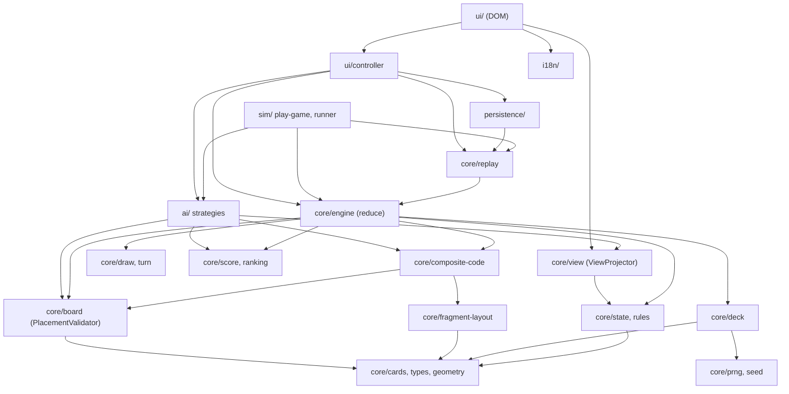
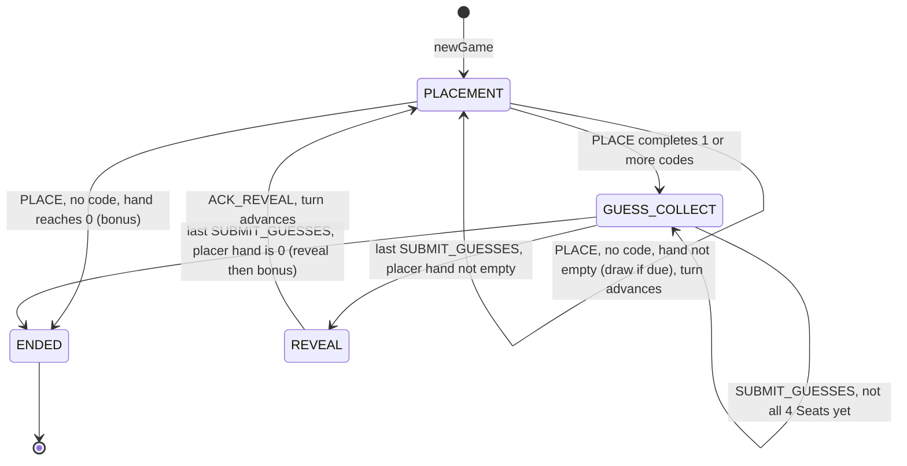
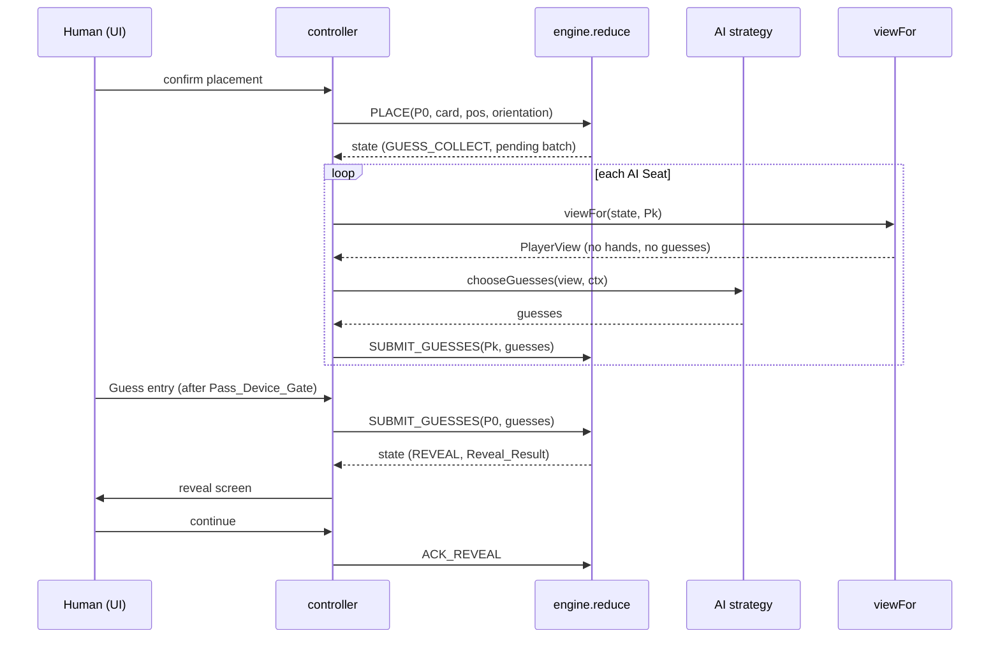

# Design Document

## Overview

This design implements `requirements.md` of this spec: the QRoker game engine and the browser Practice Mode as one playable, offline-capable web app. It builds on the approved rules in `.kiro/specs/qroker-game/` (referred to below as "qroker-game") and does not change them. Where this design deviates from the qroker-game design text (for example the `AIStrategy` signature), the deviation is listed in the section "Deviations from the qroker-game design" and in the inconsistency notes of `requirements.md`.

**Scope.** Engine modules (Deck, Board and PlacementValidator, FragmentLayout and CompositeCodeDetector, DrawManager and TurnManager, ScoreEngine, reducer, ViewProjector), three AI strategies, headless play harness, simulation interface, save/resume, localization, DOM-based UI, mobile layout, Service Worker and PWA basics. Out of scope: everything in `src/optical/**`, the frozen codebook, the Scoring Companion (qroker-game Requirement 9), and any camera or print validation.

**Technology stack.**
- Language: TypeScript, no UI framework.
- Rendering: DOM and CSS Grid (Decision D2).
- Build and dev server: Vite as an explicit devDependency (Decision D3).
- Tests: Vitest 5.1 and fast-check (already installed), `happy-dom` for UI tests (Decision D4).
- Storage: `localStorage` through an injected `KeyValueStore`.
- Offline: a hand-written Service Worker with a build-time precache list (Decision D9).
- Runtime: Node 24 for headless tests and scripts. Browsers: the build declares a target; cross-browser behavior is verified manually.

### Design Decisions (flagged for the user)

| ID | Decision | Rationale | Alternative | Flag |
|----|----------|-----------|-------------|------|
| D1 | Engine is a pure reducer `reduce(state, action) → Result` over a sealed `GameState`. Consumers read a `PlayerView` projection only. | Testable headless in Node. Makes illegal information access a type-level impossibility instead of a convention. | Class with mutable state and getters. | none |
| D2 | DOM and CSS Grid, not Canvas. | 64 cells and at most 52 cards. Buttons give focus, keyboard, accessible names and large touch targets for free. CSS handles responsive layout and text scaling. happy-dom has no Canvas, so DOM is testable headless. | Canvas for drawing; needs hand-built hit testing, accessibility tree and text rendering. | none |
| D3 | Vite as an explicit devDependency, no UI framework. | Provides dev server, ES module bundling and hashed assets with little configuration. Vite 8.3.8 is already present in `node_modules` as a transitive dependency of Vitest 5.1.0 (observed in this workspace), so adding it explicitly aligns versions. Task 16.1 must pin a version range that satisfies the Vitest peer range and verify it with `npm ls vite`. | tsc plus static files without a bundler (no dev server, no hashing). A UI framework (extra dependency, no need at this size). | **User decision** (OQ-7) |
| D4 | `happy-dom` as a devDependency for UI smoke tests, selected per test file by a `// @vitest-environment happy-dom` docblock. The global Vitest environment stays `node`. | Light, fast, no change to `vitest.config.ts`, and no effect on `src/optical` tests. | jsdom (heavier). Playwright (real browsers, large download, deferred). | **User decision** (OQ-11) |
| D5 | Saves store `(seed, config, action log)` and restore by replay. | Smaller than state, no hidden information duplicated as state, and replay is already required for determinism. | Serialize the full state. | none |
| D6 | Composite_Code visualization is a schematic of fragment corners and Inward_Corner. | `src/optical/fragments.ts` reads the codebook through `node:fs`, so the optical module is not browser-loadable. The optical module must not become a dependency. | Pixel rendering through the optical module after a browser-safe loader exists. | **User decision** (OQ-12) |
| D7 | Public structures identify codes by `Quad_Key` (top-left cell notation), never by the sorted card-id `groupId`. | A sorted card-id string reveals the Hidden_Sum (IC-4). | Use `groupId` publicly (leaks in `OWNER_ONLY`). | none |
| D8 | A second `tsconfig.game.json` adds the DOM library for `ui/` and `pwa/`. The root `tsconfig.json` excludes those two folders. | Keeps `src/optical` type checking unchanged and keeps DOM types out of `core/` and `ai/` at compile time. | Add `DOM` to the root `lib` (affects optical). | none |
| D9 | Hand-written `sw.js` plus `scripts/build-sw.ts` that injects the file list and a content hash after `vite build`. | No extra dependency, small, and fully testable. | Workbox or a Vite PWA plugin (dependency). | none |
| D10 | Identity_Visibility is an engine option, default `OWNER_ONLY`. | Makes the Guess a real inference (OQ-1) while keeping the approved text valid in `FACE_UP`. | One fixed mode. | **User decision** (OQ-1) |

---

## Architecture

### Folder Layout

```
src/game/
  core/            pure engine (no DOM, no node:, no Math.random/Date)
    types.ts  cards.ts  prng.ts  seed.ts  geometry.ts  fragment-layout.ts
    deck.ts  board.ts  composite-code.ts  draw.ts  turn.ts
    score.ts  ranking.ts  rules.ts  state.ts  engine.ts  view.ts  replay.ts
    schematic.ts   (rule-level code view model)
  ai/              strategies; reads PlayerView only
    strategy.ts  registry.ts  random.ts  heuristic.ts  unseen.ts  bayesian.ts  params.ts
  sim/             headless harness and simulation interface
    types.ts  play-game.ts  runner.ts
  persistence/     save envelope, migration, storage adapters
    save-format.ts  storage.ts
  i18n/            string tables and lookup
    index.ts  types.ts  strings/<area>.ts   (one file per UI area, each exports { en, ko })
  ui/              DOM layer (Vite root)
    index.html  main.ts  dom.ts  store.ts  controller.ts
    components/  screens/  overlays/  styles/  public/ (manifest, icons, sw.js)  testing/
  README.md
scripts/build-sw.ts   scripts/simulate.ts
docs/practice-mode.md  docs/responsive-checklist.md  docs/offline-checklist.md
```

### Module Dependency Diagram



Rules enforced by the boundary test (task 1.3):

| Folder | May import | Must not |
|--------|-----------|----------|
| `core/` | `core/` only | `node:*`, DOM globals, `src/optical`, `Math.random`, `Date`, `performance.now`, `crypto` |
| `ai/` | `core/types`, `core/cards`, `core/geometry`, `core/fragment-layout`, `core/board` (pure helpers), `core/score`, `core/prng`, `core/view` (types and `unseenCards`) | `core/state`, `core/engine`, `core/deck`, `core/replay`, `core/rules` internals; the `GameState` type; same bans as `core/` |
| `sim/` | `core/`, `ai/` | DOM, `src/optical` |
| `persistence/` | `core/replay`, `core/types` | DOM globals (storage is injected), `node:*`, `src/optical` |
| `ui/`, `i18n/` | `core/view`, `core/engine` through `controller`, `core/types`, `ai/registry`, `persistence/` | `src/optical`, any network API |
| test files | any, but only `core/fragment-layout.parity.test.ts` may import `src/optical` | |

### Game Phase State Machine

`INIT` of the qroker-game design is omitted because `newGame` returns an already dealt state (IC-10).



### Placement Sequence (with a Composite_Code)



---

## Components and Interfaces

### Core Types (`core/types.ts`)

```typescript
export type Suit = 'H' | 'D' | 'C' | 'S';
export type Rank = 'A' | '2' | '3' | '4' | '5' | '6' | '7' | '8' | '9' | '10' | 'J' | 'Q' | 'K';
export type CardId = `${Suit}-${Rank}`;       // 'H-7', 'S-10' (same text as optical card keys; no import)
export type Orientation = 0 | 180;
export type Corner = 'TL' | 'TR' | 'BL' | 'BR';
export type Slot = Corner;                    // position of a card inside a 2x2 group
export type PlayerId = 'P0' | 'P1' | 'P2' | 'P3';
export type Owner = PlayerId | 'NEUTRAL';
export type Difficulty = 'BEGINNER' | 'ADVANCED' | 'EXPERT';
export type QuadKey = string;                 // notation of the top-left cell, e.g. 'D4'

export interface GridPosition { readonly row: number; readonly col: number } // 0-based, row 0 = row "1" (top)

export type Result<T, E = EngineError> = { readonly ok: true; readonly value: T } | { readonly ok: false; readonly error: E };
export interface EngineError { readonly code: ErrorCode; readonly detail?: string }

export type ErrorCode =
  | 'INVALID_CARD_ID' | 'SEED_EMPTY' | 'INVALID_SCORE_CONFIG' | 'INVALID_CONFIG'
  | 'OUT_OF_BOUNDS' | 'OCCUPIED' | 'NOT_ADJACENT' | 'INVALID_ORIENTATION' | 'CARD_NOT_IN_HAND'
  | 'NOT_YOUR_TURN' | 'WRONG_PHASE' | 'GAME_ENDED'
  | 'GUESS_NOT_INTEGER' | 'GUESS_OUT_OF_RANGE' | 'DUPLICATE_SUBMISSION' | 'GUESS_KEYS_MISMATCH'
  | 'UNKNOWN_PLAYER' | 'REPLAY_REJECTED';

export interface ScoreConfig { readonly rewardByError: readonly number[]; readonly handEmptyBonus: number }
export interface NamedScoreConfig { readonly id: string; readonly provisional: boolean; readonly config: ScoreConfig }

export type IdentityVisibility = 'OWNER_ONLY' | 'FACE_UP';
export interface SeatConfig { readonly id: PlayerId; readonly kind: 'HUMAN' | 'AI'; readonly difficulty?: Difficulty; readonly name: string }
export interface GameConfig {
  readonly rulesVersion: number;                // RULES_VERSION
  readonly seats: readonly [SeatConfig, SeatConfig, SeatConfig, SeatConfig];
  readonly scoreConfig: NamedScoreConfig;
  readonly identityVisibility: IdentityVisibility;
}

export type Action =
  | { readonly type: 'PLACE'; readonly player: PlayerId; readonly card: CardId; readonly pos: GridPosition; readonly orientation: Orientation }
  | { readonly type: 'SUBMIT_GUESSES'; readonly player: PlayerId; readonly guesses: Readonly<Record<QuadKey, number>> }
  | { readonly type: 'ACK_REVEAL' };
```

Error handling convention: all engine functions that can fail return `Result`. Functions that cannot fail for valid types return plain values. No exception is thrown for a rejected Action.

### Cards, PRNG and Seed (`core/cards.ts`, `prng.ts`, `seed.ts`)

```typescript
export const SUITS: readonly Suit[];            // ['H','D','C','S']
export const RANKS: readonly Rank[];            // ['A','2',...,'10','J','Q','K']
export const ALL_CARDS: readonly CardId[];      // 52, canonical order: suit-major (H,D,C,S), rank A..K
export function parseCardId(s: string): Result<CardId>;       // INVALID_CARD_ID
export function suitOf(c: CardId): Suit;  export function rankOf(c: CardId): Rank;
export function cardValue(c: CardId): number;                 // A=1 .. K=13
export function hiddenSum(cards: readonly [CardId, CardId, CardId, CardId]): number; // 4..52
export function groupIdOf(cards: readonly CardId[]): string;  // sorted ids joined by '|' (sealed use only)

export function mulberry32(seed: number): () => number;        // own implementation; not imported from src/optical
export function mix32(a: number, b: number): number;           // deterministic seed derivation
export function shuffle<T>(items: readonly T[], rng: () => number): T[]; // Fisher-Yates, i = n-1 .. 1, j = floor(rng() * (i + 1))
export function parseSeed(text: string): Result<number>;       // decimal 0..4294967295 -> itself; other text -> FNV-1a 32 over UTF-16 code units; empty -> SEED_EMPTY
```

`mulberry32` is the same published algorithm as the one used in the optical prototype, re-implemented so that `core/` has no cross-module runtime dependency.

### Geometry (`core/geometry.ts`)

```typescript
export const BOARD_SIZE = 8;
export function toNotation(p: GridPosition): string;           // {row:3,col:3} -> 'D4'
export function fromNotation(s: string): Result<GridPosition>;
export function inBounds(p: GridPosition): boolean;
export function orthogonalNeighbors(p: GridPosition): GridPosition[];
export function candidateQuads(p: GridPosition): GridPosition[]; // top-left corners of the in-bounds 2x2 regions containing p (0..4, here 1..4)
export function quadCells(topLeft: GridPosition): [GridPosition, GridPosition, GridPosition, GridPosition]; // order TL, TR, BL, BR
export function quadKey(topLeft: GridPosition): QuadKey;       // toNotation(topLeft)
export function slotOf(topLeft: GridPosition, p: GridPosition): Slot;
```

### FragmentLayout (`core/fragment-layout.ts`)

```typescript
export const FRAGMENT_LAYOUT: Readonly<Record<Suit, Readonly<Record<Orientation, readonly Corner[]>>>> = {
  H: { 0: ['TL', 'BR'], 180: ['TL', 'BR'] },
  D: { 0: ['TR', 'BL'], 180: ['TR', 'BL'] },
  C: { 0: ['TR', 'BR'], 180: ['TL', 'BL'] },
  S: { 0: ['TL', 'BL'], 180: ['TR', 'BR'] },
};
export const INWARD_CORNER: Readonly<Record<Slot, Corner>> = { TL: 'BR', TR: 'BL', BL: 'TR', BR: 'TL' };
export function isValidMember(card: CardId, orientation: Orientation, slot: Slot): boolean;
// = FRAGMENT_LAYOUT[suitOf(card)][orientation].includes(INWARD_CORNER[slot])
export function validOrientations(card: CardId, slot: Slot): readonly Orientation[]; // used by AI and the schematic view
```

The table is the one in the qroker-game design (Core Types and "Per-slot participation conditions"). A test-only parity file compares it with the corner sets of `src/optical/fragments.ts` (`visibleCorners`) for all 52 cards and both orientations.

### Deck (`core/deck.ts`)

```typescript
export interface Deal {
  readonly neutral: readonly [CardId, CardId, CardId, CardId];     // D4, E4, D5, E5 in this order
  readonly hands: Readonly<Record<PlayerId, readonly CardId[]>>;   // 4 cards each, in deal order
  readonly deck: readonly CardId[];                                // 32 cards, top = last element
}
export function dealGame(seed: number): Deal;
// shuffled = shuffle(ALL_CARDS, mulberry32(seed)); neutral = shuffled[0..3];
// hand(Pk) = shuffled[4+4k .. 7+4k] for k = 0..3; deck = shuffled[20..51]
export function drawTop(deck: readonly CardId[]): { card: CardId | null; deck: readonly CardId[] }; // null when empty
```

### Board and PlacementValidator (`core/board.ts`)

```typescript
export interface PlacedCard { readonly card: CardId; readonly orientation: Orientation; readonly owner: Owner }
export type Board = readonly (PlacedCard | null)[];          // length 64, index = row * 8 + col
export function emptyBoard(): Board;
export function cellAt(b: Board, p: GridPosition): PlacedCard | null;
export function cardCount(b: Board): number;
export function validatePlacement(b: Board, pos: GridPosition, orientation: number): Result<true>;
// precedence: INVALID_ORIENTATION, OUT_OF_BOUNDS, OCCUPIED, NOT_ADJACENT
export function placeOnBoard(b: Board, pos: GridPosition, pc: PlacedCard): Result<Board>;
export function legalCells(b: Board): GridPosition[];        // row-major order; equals { p : validatePlacement(b,p,0).ok }
```

Why a legal cell always exists: every placement is adjacent to an existing card, so the occupied cells stay orthogonally connected from the 2×2 start. At most 52 of 64 cells are ever occupied, and a connected proper subset of a connected grid graph has an empty neighbor. Property 7 tests this.

### CompositeCodeDetector (`core/composite-code.ts`)

```typescript
export interface CompositeCodeResult {
  readonly quadKey: QuadKey;                 // public identifier
  readonly topLeft: GridPosition;
  readonly cards: readonly [CardId, CardId, CardId, CardId];        // order TL, TR, BL, BR
  readonly orientations: readonly [Orientation, Orientation, Orientation, Orientation];
  readonly hiddenSum: number;                // 4..52
  readonly groupId: string;                  // SEALED: never put in a PlayerView
}
export function detect(board: Board, placedAt: GridPosition, scoredGroups: ReadonlySet<string>): CompositeCodeResult[];
// 1. for each candidate quad containing placedAt: all 4 cells occupied?
// 2. all 4 members isValidMember(card, orientation, slot)?
// 3. groupId not in scoredGroups  -> eligible (qroker-game 4.4)
export function startingQuadIsExcluded(): true;  // documented: neutral quad is never passed to detect (OQ-3)
```

`detect` is called only for a just-placed cell, so a quad is "newly formed" by construction. The starting 2×2 is never examined because no placement forms it. The caller adds the groupIds of results to `scoredGroups` in the same reducer step. Returned results are ordered by `quadKey` for determinism.

### DrawManager and TurnManager (`core/draw.ts`, `core/turn.ts`)

```typescript
export function shouldDraw(player: PlayerId, firstPlacementDone: readonly PlayerId[], newCodes: number): boolean;
// false if player not in firstPlacementDone (first placement exempt, qroker-game 3.5),
// false if newCodes >= 1 (qroker-game 3.6), true otherwise
export function nextSeat(current: PlayerId): PlayerId;     // P0 -> P1 -> P2 -> P3 -> P0 (OQ-5)
```

If `shouldDraw` is true and the deck is empty, `drawTop` returns `card: null` and the reducer leaves the hand unchanged (qroker-game 3.8).

### ScoreEngine and Ranking (`core/score.ts`, `core/ranking.ts`)

```typescript
export const RULES_VERSION = 1;
export const DEV_PLACEHOLDER_SCORE_CONFIG: NamedScoreConfig = {
  id: 'DEV_PLACEHOLDER',
  provisional: true,
  config: {
    // DEVELOPMENT PLACEHOLDER. Not a balance decision. Chosen only so that scores are visible and
    // differ by accuracy during development. Final values are decided by simulation (open-decisions #7, milestone P3).
    rewardByError: [6, 4, 3, 2, 1],
    handEmptyBonus: 3,
  },
};
export function validateScoreConfig(c: ScoreConfig): Result<true>;      // INVALID_SCORE_CONFIG; rules in requirement 8.3
export function score(guess: number, hiddenSum: number, c: ScoreConfig): number;
export function validateGuess(g: unknown): Result<number>;              // GUESS_NOT_INTEGER, GUESS_OUT_OF_RANGE (4..52)

export interface RankEntry { readonly player: PlayerId; readonly score: number; readonly rank: number }
export function rankPlayers(scores: Readonly<Record<PlayerId, number>>): RankEntry[]; // competition ranking, order by rank then seat
```

The numbers in `DEV_PLACEHOLDER_SCORE_CONFIG` are illustrative and live in exactly one place. No other module may contain a score value (checked by a scan test in task 6.1). The UI displays a "provisional scoring" banner whenever `scoreConfig.provisional` is true.

### GameState and Rules (`core/state.ts`, `core/rules.ts`)

```typescript
export type GamePhase = 'PLACEMENT' | 'GUESS_COLLECT' | 'REVEAL' | 'ENDED';

export interface PendingBatch {
  readonly placer: PlayerId;
  readonly codes: readonly CompositeCodeResult[];
  readonly guesses: Readonly<Partial<Record<PlayerId, Readonly<Record<QuadKey, number>>>>>;   // SEALED
  readonly endsGame: boolean;                    // placer hand reached 0 with this placement
}

export interface RevealRecord {                  // public once created
  readonly batchIndex: number;
  readonly placer: PlayerId;
  readonly codes: readonly { quadKey: QuadKey; cards: readonly CardId[]; hiddenSum: number }[];
  readonly perPlayer: readonly { player: PlayerId; earned: number; cumulative: number }[];   // no guess values
}

export interface GameState {                     // SEALED: never leaves core/engine and ViewProjector
  readonly config: GameConfig;
  readonly seed: number;
  readonly phase: GamePhase;
  readonly board: Board;
  readonly deck: readonly CardId[];
  readonly hands: Readonly<Record<PlayerId, readonly CardId[]>>;
  readonly turn: PlayerId;
  readonly firstPlacementDone: readonly PlayerId[];
  readonly scoredGroups: readonly string[];      // sorted groupIds
  readonly revealedCards: readonly CardId[];     // cards of revealed codes (public)
  readonly pending: PendingBatch | null;
  readonly scores: Readonly<Record<PlayerId, number>>;
  readonly placements: number;                   // accepted PLACE count
  readonly history: readonly RevealRecord[];
  readonly lastReveal: RevealRecord | null;
  readonly bonusAwarded: PlayerId | null;
  readonly log: readonly Action[];               // accepted actions, in order
}

export interface NewGameOptions { readonly seed: number; readonly config: GameConfig }
export function newGame(o: NewGameOptions): Result<GameState>;   // validates config (INVALID_CONFIG, INVALID_SCORE_CONFIG)
export function defaultConfig(): GameConfig;                     // 1 human + 3 AI, DEV_PLACEHOLDER_SCORE_CONFIG, OWNER_ONLY
```

`newGame` places the 4 Neutral_Cards at orientation 0 with owner `NEUTRAL` (OQ-2), sets `turn = 'P0'`, `phase = 'PLACEMENT'`, all scores 0, `placements = 0`, and an empty `log`.

### Reducer (`core/engine.ts`)

```typescript
export function reduce(state: GameState, action: Action): Result<GameState>;
export function actingSeats(state: GameState): readonly PlayerId[];   // who may act now (turn seat; unsubmitted seats; none when ENDED)
```

Processing of `PLACE` (all steps on a copy; the input is never mutated; any failure returns before a new state exists):

1. `ENDED` → `GAME_ENDED`. Phase not `PLACEMENT` → `WRONG_PHASE`. `action.player !== turn` → `NOT_YOUR_TURN`. Unknown player → `UNKNOWN_PLAYER`.
2. `card ∈ hands[player]`, else `CARD_NOT_IN_HAND`.
3. `validatePlacement` (orientation, bounds, empty, adjacent).
4. Place; remove the card from the Hand; `placements += 1`.
5. `codes = detect(board, pos, scoredGroups)`; add each `groupId` to `scoredGroups`.
6. `draw = shouldDraw(player, firstPlacementDone, codes.length)`; add `player` to `firstPlacementDone`; if `draw`, `drawTop` and append to the Hand when a card exists.
7. If `codes.length ≥ 1`: `phase = GUESS_COLLECT`, `pending = { placer, codes, guesses: {}, endsGame: hand.length === 0 }`.
8. Else if the Hand is empty: add `handEmptyBonus` to the placer, set `bonusAwarded`, `phase = ENDED`.
9. Else `turn = nextSeat(turn)`.
10. Append the action to `log`.

Processing of `SUBMIT_GUESSES`: phase must be `GUESS_COLLECT`; every Guess is validated with `validateGuess`; keys must equal the batch Quad_Keys exactly (`GUESS_KEYS_MISMATCH`); a second submission by the same Seat → `DUPLICATE_SUBMISSION`. When all 4 Seats have submitted: compute earned score per Seat as the sum over codes of `score(guess, hiddenSum, config)`, add to `scores`, append a `RevealRecord` (no guesses) to `history` and `lastReveal`, add the cards of the codes to `revealedCards`, clear `pending`. If `endsGame`: add `handEmptyBonus` to the placer, set `bonusAwarded`, `phase = ENDED`; else `phase = REVEAL`.

Processing of `ACK_REVEAL`: phase must be `REVEAL`; set `phase = PLACEMENT`, `turn = nextSeat(placer)`.

Termination argument: every accepted `PLACE` adds one card to a Board that holds at most 52 cards, and 4 are Neutral, so at most 48 `PLACE` Actions exist. The game ends at the latest when all non-Neutral cards are placed, because the Seat that places the last card of its Hand reaches 0. A legal cell always exists (see Board). Guess collection and reveal terminate because exactly 4 submissions are required and `ACK_REVEAL` is a single step.

### ViewProjector and PlayerView (`core/view.ts`)

```typescript
export interface CellView { readonly owner: Owner; readonly orientation: Orientation; readonly card: CardId | null } // null = hidden from this viewer
export interface PublicRules { readonly rulesVersion: number; readonly seats: GameConfig['seats']; readonly scoreConfig: NamedScoreConfig; readonly identityVisibility: IdentityVisibility }

export interface PlayerView {
  readonly viewer: PlayerId;
  readonly rules: PublicRules;
  readonly phase: GamePhase;
  readonly turn: PlayerId;
  readonly board: readonly (CellView | null)[];                   // length 64
  readonly myHand: readonly CardId[];                             // canonical order
  readonly handCounts: Readonly<Record<PlayerId, number>>;
  readonly deckCount: number;
  readonly scores: Readonly<Record<PlayerId, number>>;
  readonly pendingQuadKeys: readonly QuadKey[];                   // codes awaiting Guesses (positions only)
  readonly guessSubmitted: Readonly<Record<PlayerId, boolean>>;
  readonly myGuesses: Readonly<Record<QuadKey, number>> | null;  // the viewer's own submission only
  readonly lastReveal: RevealRecord | null;
  readonly history: readonly RevealRecord[];
  readonly ranking: readonly RankEntry[] | null;                  // set when phase is ENDED
}
// NOT in PlayerView: seed, deck contents/order, other Hands, other Seats' guesses, hiddenSum of a pending code,
// groupId, scoredGroups, the log, and the identity of any card hidden from the viewer.

export function viewFor(state: GameState, viewer: PlayerId): PlayerView;
export function unseenCards(view: PlayerView): CardId[];          // ALL_CARDS minus myHand minus identities visible on the board
export function legalCellsFor(view: PlayerView): GridPosition[];  // pure helper over the view's board occupancy
```

Visibility rule for `CellView.card`:

| Cell | `OWNER_ONLY` | `FACE_UP` |
|------|--------------|-----------|
| Neutral_Card | visible to all | visible to all |
| Card placed by the viewer | visible | visible |
| Card of another Seat, code not yet revealed | `null` | visible |
| Card of a revealed code (in `revealedCards`) | visible to all | visible to all |

The seed is not in the view because a Seed determines the whole deal. The UI keeps the Seed in its own application model for display.

Residual-risk statement (also in docs): AI code receives a `decisionSeed` derived from the game seed through `mix32`. The AI modules cannot import the deal or shuffle functions (boundary test), so the types and imports do not give the AI a path to hidden data. This design does not claim cryptographic secrecy against code written to cheat.

### Replay (`core/replay.ts`)

```typescript
export function replay(seed: number, config: GameConfig, actions: readonly Action[]): Result<GameState, { code: 'REPLAY_REJECTED'; index: number; cause: EngineError }>;
export function stateEquals(a: GameState, b: GameState): boolean;   // deep structural equality for tests
```

### Schematic Code View model (`core/schematic.ts`)

```typescript
export interface SchematicSlot { readonly slot: Slot; readonly card: CardId; readonly orientation: Orientation;
  readonly fragmentCorners: readonly Corner[]; readonly inward: Corner; readonly valid: boolean }
export function schematicModel(cards: readonly [CardId, CardId, CardId, CardId], orientations: readonly [Orientation, Orientation, Orientation, Orientation]): readonly SchematicSlot[]; // order TL, TR, BL, BR
```

The view component draws each slot as a small square with dots at `fragmentCorners` and a ring at `inward`. It is available for revealed codes and, in `OWNER_ONLY` mode, for codes whose four cards are all visible to the viewer. It does not draw optical pixel patterns (D6).

### AI Strategies (`ai/`)

```typescript
export interface AiContext { readonly decisionSeed: number }   // = mix32(gameSeed, seatIndex * 100000 + actionIndex), supplied by the caller
export interface AIStrategy {
  readonly id: Difficulty;
  choosePlacement(view: PlayerView, ctx: AiContext): Extract<Action, { type: 'PLACE' }>;
  chooseGuesses(view: PlayerView, ctx: AiContext): Extract<Action, { type: 'SUBMIT_GUESSES' }>;
}
export function getStrategy(d: Difficulty): AIStrategy;                       // registry
export const DIFFICULTY_LABELS: Readonly<Record<Difficulty, { readonly en: string; readonly ko: string }>>;
// BEGINNER  "Beginner"  / "초급"     ADVANCED "Advanced" / "고급"     EXPERT "Expert" / "전문가"
```

Deviation from qroker-game design: `selectPlacement(view, deck)` and `submitGuess(view, hiddenSumRange)` are replaced by the two functions above. The deck argument is removed (IC-1). A single `chooseGuesses` call returns Guesses for all codes of the batch, as `SUBMIT_GUESSES` requires.

The three strategies. Each has a documented `WORK_BUDGET` constant (maximum candidates evaluated). Candidates are enumerated in a fixed order and truncated at the budget, so a decision is deterministic and bounded. Ties are broken by `mulberry32(decisionSeed)`.

| Tier | Placement | Guess | Status |
|------|-----------|-------|--------|
| `BEGINNER` (RandomStrategy) | Uniform choice among all legal (card, cell, orientation) triples. | Uniform integer in 4..52 per code. | P1 |
| `ADVANCED` (HeuristicStrategy) | Scores each candidate by the quads that contain the cell: a complete quad whose members are known valid scores `W_COMPLETE`; a complete quad with hidden members scores `W_COMPLETE` times the product of the probabilities that each hidden member is valid for its slot and orientation (fraction of unseen cards whose suit is valid, from `validOrientations`); quads with 2 or 3 filled cells and a valid placed card score `W_PARTIAL[k]`. Picks the maximum. | Sum of the known cards of the code plus, for each hidden card, the mean Card_Value of the unseen cards whose suit is valid for the slot and orientation, rounded and clamped to 4..52. | P1 |
| `EXPERT` (BayesianStrategy) | The `ADVANCED` evaluation with probabilities from the posterior, plus a penalty `W_GIVE` for placements that leave a 3-filled quad that the next Seats are likely to complete (tuning hooks in `params.ts`). | For each hidden card of the code, the candidates are the unseen cards whose suit is valid for the slot and orientation (the code is public, so validity is known). The posterior over the hidden sum is the distribution of sums over distinct assignments, enumerated exactly when the product of candidate counts is at most `MAX_ENUMERATION`, otherwise estimated from `POSTERIOR_SAMPLES` seeded samples. The Guess is the integer g in 4..52 that maximizes `Σ_s P(s)·score(g, s, scoreConfig)`; ties go to the g nearest the posterior mean, then the lower g. | P2 |

Stated approximation of `EXPERT`: the posterior treats the hidden cards of one code as drawn without replacement from the unseen pool and ignores other hidden Board cards outside the code. This is a modeling simplification and no accuracy claim is made. Under `FACE_UP` every card is known and all tiers compute the exact sum.

Placement-time budgets: with at most about 8 Hand cards, at most 56 legal cells and 2 orientations, a full enumeration is a few hundred candidates, and the budget constant is set above that. The measured decision time is recorded by a test and checked against 3000 ms (requirement 11.5); no speed claim is made in this document.

### Headless Driver and Simulation Interface (`sim/`)

```typescript
export interface PlayGameOptions {
  readonly seed: number;
  readonly config: GameConfig;
  readonly strategies: Readonly<Record<PlayerId, AIStrategy>>;   // every Seat, including HUMAN Seats in tests
  readonly checkInvariants?: boolean;                            // default true in tests
}
export interface PlayGameResult { readonly final: GameState; readonly log: readonly Action[] }
export function playGame(o: PlayGameOptions): PlayGameResult;    // throws only on an invariant violation or a rejected AI action (a bug)

// Interface only in P1; implemented in P3 (qroker-game design GameSimulator)
export interface SimulationConfig { seed: number; gameCount: number; scoreConfig: ScoreConfig; strategies: readonly Difficulty[] /* 4 Seats */; identityVisibility: IdentityVisibility }
export interface SimulationResult {
  winRates: Record<string, number>; avgGameLength: number; predictionScoreShare: number;
  handEmptyBonusImpact: number; scoreDistribution: number[];
}
export interface GameSimulator { run(c: SimulationConfig): SimulationResult; runBatch(cs: SimulationConfig[]): SimulationResult[] }
```

`playGame` asks the acting Seat's strategy for an Action using only `viewFor(state, seat)`. For `GUESS_COLLECT` it asks all Seats in seat order; because Guesses are independent of submission order (Property 15), the order is not significant.

### Persistence (`persistence/`)

```typescript
export interface KeyValueStore { getItem(k: string): string | null; setItem(k: string, v: string): void; removeItem(k: string): void }
export const SAVE_KEY = 'qroker.practice.save';
export const PREFS_KEY = 'qroker.practice.prefs';
export const SAVE_FORMAT = 'qroker-save';
export const SAVE_VERSION = 1;

export interface SaveEnvelope {
  readonly format: 'qroker-save'; readonly saveVersion: number; readonly rulesVersion: number;
  readonly savedAtIso: string;                    // supplied by the caller's clock; core/ never reads time
  readonly seed: number; readonly config: GameConfig; readonly actions: readonly Action[];
}
export type ParsedSave =
  | { kind: 'OK'; envelope: SaveEnvelope }
  | { kind: 'MIGRATED'; envelope: SaveEnvelope; fromVersion: number }
  | { kind: 'INCOMPATIBLE'; reason: 'SAVE_VERSION' | 'RULES_VERSION' }
  | { kind: 'CORRUPT' };
export function serializeSave(e: SaveEnvelope): string;
export function parseSave(text: string): ParsedSave;                  // never throws
export const MIGRATIONS: Readonly<Record<number, (old: unknown) => unknown>>;   // empty at version 1
export function loadGame(store: KeyValueStore): { kind: 'NONE' } | { kind: 'RESUMABLE'; state: GameState; envelope: SaveEnvelope } | { kind: 'DISCARDED'; reason: string };
export function saveGame(store: KeyValueStore, state: GameState, nowIso: string): { ok: boolean };
export function memoryStore(): KeyValueStore;                          // fallback and tests
export function browserStore(): KeyValueStore;                         // wraps window.localStorage, throws never (returns a memory store on failure)
```

Validation of parsed JSON uses hand-written type guards (no schema dependency). The envelope never contains the full state (D5). Prefs (`language`, last setup options) are stored as separate JSON under `PREFS_KEY`.

### Localization (`i18n/`)

```typescript
export type Lang = 'ko' | 'en';
export type StringTable = Readonly<Record<string, string>>;        // placeholders written as {name}
export function t(key: StringKey, params?: Readonly<Record<string, string | number>>): string; // current language
export function setLanguage(l: Lang): void;  export function getLanguage(): Lang;
export function detectLanguage(navigatorLanguage: string | undefined, stored: Lang | null): Lang;
export function errorMessageKey(code: ErrorCode): StringKey;       // 1:1 map from the closed ErrorCode set
```

Each `strings/<area>.ts` exports `{ en, ko }` for one UI area (`common`, `errors`, `setup`, `board`, `guess`, `reveal`, `end`, `help`, `pwa`). The Korean table type is `Record<keyof typeof en, string>`, so a missing Korean key is a compile error, and a test checks placeholder equality.

### Practice UI (`ui/`)

Application model (`store.ts`) and the controller (`controller.ts`):

```typescript
export interface AppModel {
  screen: 'SETUP' | 'GAME' | 'END';
  game: { seed: number; state: GameState } | null;      // sealed state stays inside the controller; screens receive views
  humanSeat: PlayerId | null;                           // seat currently shown (null while a gate is shown)
  gate: { forSeat: PlayerId; reason: 'GUESS' | 'TURN' } | null;
  placement: { card: CardId | null; orientation: Orientation; preview: GridPosition | null };
  guessDraft: Record<QuadKey, string>;
  overlay: 'NONE' | 'HELP' | 'ABANDON_CONFIRM';
  notices: Notice[];                                    // offline, update available, storage unavailable, save discarded
  prefs: { lang: Lang; setup: SetupOptions };
}
export interface AppDeps {
  root: HTMLElement; store: KeyValueStore; now: () => string; randomSeed: () => number;
  schedule: (fn: () => void, ms: number) => void;       // production: setTimeout; tests: immediate
  navigatorLanguage?: string; isOnline?: () => boolean;
}
export function mountApp(deps: AppDeps): { dispatch(e: UiEvent): void; destroy(): void };
```

Behavior:
- Rendering: a function `render(model, views)` rebuilds the changed screen region from plain data using a small `h(tag, props, children)` helper. Focus is restored by a `data-focus-key` after each render. With 64 cells this needs no virtual DOM.
- Controller: after every accepted Action it saves, then drains AI work: while the acting Seat is AI, it computes the Action from `viewFor` and applies it through `deps.schedule` with a presentation delay (`AI_DELAY_MS = 600`, at most 1000). Human Seats stop the loop.
- Placement flow: select a Hand card → highlight `legalCellsFor(view)` → choose orientation (0°/180°) → tap a legal cell to preview → confirm. A tap on an illegal cell shows the Error_Code message from `validatePlacement` and changes nothing.
- Gate flow (only when 2 or more human Seats): when the Seat to show changes from one human Seat to another, the DOM of the previous Seat's private area is removed, the gate is shown, and the next Seat's content is rendered only after "I am ready". AI Seats never need a gate because their information is never rendered.
- Guess flow: AI Seats submit immediately in the controller. Each human Seat in seat order sees (gate) → one numeric input per code, labelled with the code's Quad_Key and a Board highlight → submit. No Hidden_Sum is on screen. After the last submission the reveal screen shows `lastReveal`.
- Reveal screen: per code the 4 cards face up, the Hidden_Sum, and optionally the Schematic_Code_View; a table of earned and cumulative scores per Seat; a continue button that sends `ACK_REVEAL` (or moves to the final screen when `phase = ENDED`).
- End screen: ranking with shared ranks, final scores, all `history` records with Hidden_Sum details, buttons "rematch" (new seed), "replay same seed", "new setup".
- Banner: shown on every game screen while `rules.scoreConfig.provisional`.

Accessibility and styling:
- Board: `role="grid"` with `role="row"` and `role="gridcell"` wrappers, each cell a `<button>` with `aria-label` such as "D4, empty, legal placement" or "E5, card H-7, rotated 180 degrees, owner Player 1" (localized). Roving `tabindex` and arrow-key movement.
- Live region: `aria-live="polite"` for turn changes, errors and reveal summary.
- Tokens (`styles/tokens.css`): color custom properties with a contrast test; suits use glyph shapes as well as color; `@media (prefers-reduced-motion: reduce)` removes transitions.
- Layout: CSS Grid. `--cell: clamp(24px, calc((100vw - 16px) / 8), 64px)`. At 320 px width the cell is 38 px, above the 24 px minimum; other controls have `min-height: 44px; min-width: 44px`. Portrait stacks Board, Hand, scoreboard; landscape (`@media (orientation: landscape) and (min-width: 600px)`) places Board left and Hand and scoreboard right. A viewport meta tag is in `index.html`. Fonts use `rem`.

Build and run (decision D3):
- `vite.config.ts`: `root: 'src/game/ui'`, `base: './'`, `build.outDir: '../../../dist'`, `build.target: 'es2022'`, `publicDir: 'public'`.
- npm scripts: `dev` (`vite`), `build` (`tsc -p tsconfig.game.json --noEmit && vite build && tsx scripts/build-sw.ts`), `preview` (`vite preview`), `typecheck`, `typecheck:game`, `test:game`.
- `dist/` is added to `.gitignore`.

### PWA (`ui/public/`, `scripts/build-sw.ts`, `ui/pwa-register.ts`)

- `manifest.webmanifest`: `name`, `short_name`, `start_url: "./"`, `scope: "./"`, `display: "standalone"`, `theme_color`, `background_color`, `lang`, icons 192 and 512 (SVG source plus PNG, or SVG with `sizes: any`; the task decides after checking what the build tooling can emit without a new dependency).
- `sw.js` (source in `public/`, completed by `build-sw.ts`): constants `BUILD_ID` and `PRECACHE` are replaced after the build. `install`: open `qroker-practice-<BUILD_ID>` and `addAll(PRECACHE)`; no automatic `skipWaiting`. `message` event with `{ type: 'SKIP_WAITING' }` calls `skipWaiting()`. `activate`: delete all `qroker-practice-*` caches except the current one, then `clients.claim()`. `fetch`: for same-origin GET, cache first, then network; navigation requests fall back to the cached `index.html`.
- `pwa-register.ts` (production only): registers `./sw.js`; on `updatefound` and a waiting worker it adds the "update available, reload" notice; the button posts `SKIP_WAITING` and reloads on `controllerchange`. It listens to `online` and `offline` events and `navigator.onLine` for the offline notice. A registration failure is caught and ignored.
- Application code outside `sw.js` makes no `fetch` or XHR call (scan test).

---

## Data Models

### Action Log Example (JSON)

```json
{ "type": "PLACE", "player": "P0", "card": "H-7", "pos": { "row": 2, "col": 3 }, "orientation": 180 }
{ "type": "SUBMIT_GUESSES", "player": "P1", "guesses": { "D3": 31 } }
{ "type": "ACK_REVEAL" }
```

### Save Envelope Example (version 1)

```json
{
  "format": "qroker-save", "saveVersion": 1, "rulesVersion": 1,
  "savedAtIso": "2026-01-01T00:00:00.000Z",
  "seed": 123456789,
  "config": { "rulesVersion": 1, "identityVisibility": "OWNER_ONLY",
              "scoreConfig": { "id": "DEV_PLACEHOLDER", "provisional": true,
                               "config": { "rewardByError": [6, 4, 3, 2, 1], "handEmptyBonus": 3 } },
              "seats": [ { "id": "P0", "kind": "HUMAN", "name": "You" }, { "id": "P1", "kind": "AI", "difficulty": "BEGINNER", "name": "AI 1" } ] },
  "actions": [ { "type": "PLACE", "player": "P0", "card": "H-7", "pos": { "row": 2, "col": 3 }, "orientation": 0 } ]
}
```

(The `seats` array has 4 entries in a real save; the example is shortened.)

### Invariants

- `deck.length + cardCount(board) + Σ hands[p].length = 52` and all those cards are pairwise distinct.
- `cardCount(board) = placements + 4`.
- `scoredGroups` has no duplicates and `scoredGroups.length` equals the number of codes ever revealed or pending.
- `phase = GUESS_COLLECT ⇔ pending ≠ null`.
- `phase = ENDED ⇒ bonusAwarded ≠ null` and the Seat `bonusAwarded` has an empty Hand.

### Deviations from the qroker-game Design

| qroker-game design | This design | Reason |
|--------------------|-------------|--------|
| `CardId` as `{suit, rank}` | string `` `${Suit}-${Rank}` `` | IC-2, optical key compatibility |
| `AIStrategy.selectPlacement(view, deck)` | `choosePlacement(view, ctx)` | IC-1, information isolation |
| `PredictionBatch.groupIds` public | `Quad_Key` public, `groupId` sealed | IC-4 |
| `GamePhase` with `INIT` | no `INIT` | IC-10 |
| `GameStateManager` with a sealed store as mutable object | immutable `GameState` plus `viewFor` | D1 |
| `PublicGameState`/`PlayerView.publicState` | single flat `PlayerView` | simpler, no second structure to keep consistent |
| `winner?: string[]` | `ranking` with shared ranks | qroker-game Requirement 3.9 |

---

## Correctness Properties

*A property is a characteristic or behavior that should hold true across all valid executions of a system, essentially a formal statement about what the system should do. Properties serve as the bridge between human-readable specifications and machine-verifiable correctness guarantees.*

Testing by properties applies to the engine, the AI strategies, the persistence parser and the string tables, because these are pure functions with large input spaces. It does not apply to DOM rendering, layout, Service Worker behavior in a real browser, or the build; those use example tests, smoke tests and manual checks (see Testing Strategy). Properties 1 to 30 below come from the prework analysis after the reflection step; each property is implemented by exactly one `fast-check` test. A parenthetical "qroker-game" reference after a requirement list names the approved design property that the new property covers.

### Property 1: Card catalog and CardId round trip

*For any* string, `parseCardId` accepts the string if and only if it equals one of the 52 canonical CardIds, and otherwise returns `INVALID_CARD_ID`; *for any* of the 52 cards, formatting the parsed suit and rank reproduces the original CardId; the 52 CardIds are pairwise distinct.

**Validates: Requirements 1.2, 1.4, 1.5** (qroker-game Property 1 for the catalog part)

### Property 2: Card_Value and Hidden_Sum

*For any* card, `cardValue` is an integer in [1, 13] that matches the rank table; *for any* 4 distinct cards, `hiddenSum` is an integer in [4, 52] and is identical for every permutation of the 4 cards, and `groupIdOf` is identical for every permutation.

**Validates: Requirements 1.3, 5.3, 5.4** (qroker-game Properties 1 and 2)

### Property 3: Seed parsing

*For any* decimal integer in [0, 4294967295], `parseSeed` returns that integer; *for any* other non-empty text, `parseSeed` returns the same unsigned 32-bit integer on every call; *for any* empty or whitespace-only text, `parseSeed` returns `SEED_EMPTY`.

**Validates: Requirements 2.5**

### Property 4: Deterministic deal partition

*For any* Seed and valid configuration, `newGame` returns deeply equal states on two calls; the 4 Neutral_Cards are on D4, E4, D5 and E5; each of the 4 Hands has 4 cards; the deck has 32 cards; the 20 dealt cards (neutral plus Hands) are pairwise distinct; and neutral, Hands and deck together equal the 52-card catalog exactly.

**Validates: Requirements 2.2, 2.3, 2.4, 5.7** (qroker-game Property 7)

### Property 5: Board notation round trip

*For any* of the 64 cells, `fromNotation(toNotation(p))` equals `p`; *for any* string that is not a cell notation, `fromNotation` returns an error.

**Validates: Requirements 3.1**

### Property 6: Placement validation completeness and board immutability

*For any* Board produced by legal placements, any cell (including out-of-range coordinates) and any orientation value (including values other than 0 and 180), `validatePlacement` succeeds if and only if the orientation is 0 or 180, the cell is within bounds, the cell is empty, and the cell has an orthogonally adjacent occupied cell; on failure it returns the code by the precedence `INVALID_ORIENTATION`, `OUT_OF_BOUNDS`, `OCCUPIED`, `NOT_ADJACENT`; and the input Board is never modified.

**Validates: Requirements 3.2, 3.3, 3.6** (qroker-game Property 9)

### Property 7: Board card count increases by one

*For any* Board and any successful `placeOnBoard`, the card count after equals the count before plus 1; and *for any* reachable `GameState`, `cardCount(board)` equals `placements + 4`.

**Validates: Requirements 3.7** (qroker-game Property 8)

### Property 8: Legal cell enumeration

*For any* Board reachable by legal placements, `legalCells(board)` equals the set of cells for which `validatePlacement` succeeds with orientation 0, contains no duplicates, and is non-empty whenever `cardCount(board)` is less than 64.

**Validates: Requirements 3.8, 3.9**

### Property 9: Member validity equals fragment-corner membership

*For any* card, orientation in {0, 180} and slot, `isValidMember` is true if and only if the Inward_Corner of the slot is in `FRAGMENT_LAYOUT[suit][orientation]`; and *for any* H or D card and any slot, validity at orientation 0 equals validity at orientation 180.

**Validates: Requirements 4.1, 4.4, 4.5** (qroker-game Properties 12 and 16)

### Property 10: Detection structure

*For any* Board and any just-placed cell, `candidateQuads` has at most 4 elements and each contains the cell; every code returned by `detect` has 4 occupied cells, all 4 members valid, `hiddenSum` in [4, 52] and 4 pairwise distinct cards; every complete quad that contains the cell and has 4 valid members and an unrecorded `groupId` is returned (none is missed); and no returned code has a public identifier other than its `quadKey`.

**Validates: Requirements 5.1, 5.2, 5.3, 5.8** (qroker-game Property 3)

### Property 11: Detection idempotence

*For any* Board, placed cell and scored-groups record, calling `detect` a second time with the record extended by the groupIds of the first result returns no code, and calling `detect` twice with the same inputs returns equal results.

**Validates: Requirements 5.5, 5.6** (qroker-game Property 11)

### Property 12: Draw rule

*For any* reachable state and any accepted `PLACE`: if it is the Seat's first placement, the Hand size afterwards is the Hand size before minus 1; otherwise if the placement forms at least one new code, the Hand size afterwards is the size before minus 1; otherwise the Hand size afterwards equals the size before when the deck was non-empty (one card drawn from the top of the deck) and equals the size before minus 1 when the deck was empty; and the phase is `GUESS_COLLECT` if and only if at least one new code was formed.

**Validates: Requirements 6.3, 6.4, 6.5, 6.6, 7.9** (qroker-game Property 10)

### Property 13: Conservation invariants under random legal play

*For any* Seed and any sequence of legal Actions chosen by a random legal player, after every accepted Action the deck, Board and Hands together hold exactly the 52 catalog cards without duplicates, `cardCount(board) = placements + 4`, `scoredGroups` has no duplicates, and `phase = GUESS_COLLECT` if and only if `pending` is non-null.

**Validates: Requirements 6.7, 3.7**

### Property 14: Action authorization

*For any* reachable state and any Action that comes from the wrong Seat, arrives in the wrong phase, names a card not in the acting Seat's Hand, or arrives after the game ended, `reduce` returns an error with the corresponding code (`NOT_YOUR_TURN`, `WRONG_PHASE`, `CARD_NOT_IN_HAND`, `GAME_ENDED`) and the input state is deeply equal to its copy taken before the call.

**Validates: Requirements 3.4, 3.6, 6.2, 9.2**

### Property 15: Score function and configuration validation

*For any* valid ScoreConfig, Hidden_Sum and error e, `score(hiddenSum + e)` equals `score(hiddenSum − e)` when both Guesses are in range, the score does not increase as e increases, the score is 0 when e is at least the table length, and the score equals the table entry otherwise; *for any* candidate configuration, `validateScoreConfig` accepts it if and only if the table is non-empty, all values are finite and non-negative, the first value is positive, the table is non-increasing, and `handEmptyBonus` is finite and non-negative.

**Validates: Requirements 8.1, 8.2, 8.3** (qroker-game Property 4)

### Property 16: Guess validation

*For any* JavaScript value, `validateGuess` accepts the value if and only if it is an integer in [4, 52]; otherwise it returns `GUESS_NOT_INTEGER` for non-integers and `GUESS_OUT_OF_RANGE` for integers outside [4, 52].

**Validates: Requirements 7.2** (qroker-game Property 5)

### Property 17: Simultaneous reveal

*For any* Prediction_Batch and any submission order of the 4 Seats, the resulting state (scores, `lastReveal`, `history`) is identical; the `RevealRecord` contains for each code the Hidden_Sum, the 4 card identities and its Quad_Key; each Seat's `earned` equals the sum over codes of `score(guess, hiddenSum, config)` and nothing else (no completion bonus); and the record contains no Guess value.

**Validates: Requirements 7.6, 7.7, 8.6, 8.7** (qroker-game Property 6)

### Property 18: Submission protocol

*For any* Prediction_Batch, a second submission by the same Seat returns `DUPLICATE_SUBMISSION` and leaves the first submission unchanged, and a submission whose key set differs from the batch's Quad_Keys returns `GUESS_KEYS_MISMATCH`; in both cases the state is unchanged.

**Validates: Requirements 7.3, 7.4**

### Property 19: Hand-empty bonus and game end ordering

*For any* complete game reached by legal play, the phase is `ENDED`, `handEmptyBonus` has been added exactly once, to the Seat whose Hand is empty (`bonusAwarded`), after every Guess of the last batch has been scored; and every Seat's final Score equals the sum of its prediction scores plus the bonus when awarded.

**Validates: Requirements 8.8, 9.1, 9.3**

### Property 20: Ranking

*For any* score vector of 4 non-negative numbers, `rankPlayers` assigns equal ranks to equal scores, a lower rank number to a higher score, competition numbering (a Seat's rank equals 1 plus the number of Seats with a strictly higher score), and at least one Seat has rank 1.

**Validates: Requirements 9.4, 9.5** (qroker-game Property 19)

### Property 21: Termination and bounded length

*For any* Seed and any assignment of AI strategies to the 4 Seats, `playGame` ends in the phase `ENDED` after at most 48 accepted `PLACE` Actions, no Action is rejected, every invariant of Property 13 holds after every Action, and the number of `history` records equals the number of Prediction_Batches.

**Validates: Requirements 9.6, 9.7, 20.2**

### Property 22: No leakage of pending or hidden information in views

*For any* reachable state, any viewer, and any phase (including `GUESS_COLLECT` and `ENDED`), the JSON serialization of `viewFor(state, viewer)` contains no `groupId`, no Guess of another Seat, no Guess of any Seat after the game has ended, no Hand card of another Seat, no deck card, no `seed`, and, while a batch is pending, no Hidden_Sum of a pending code; and `CellView.card` is non-null only for the cells allowed by the visibility rule of the active Identity_Visibility.

**Validates: Requirements 5.8, 7.5, 7.8, 10.3, 10.4, 10.5** (qroker-game Property 18)

### Property 23: View non-interference

*For any* reachable state `s`, viewer `v` and state `s'` obtained from `s` by changing only information hidden from `v` (other Seats' Hand contents, deck order, other Seats' pending Guesses, and the identity of cards hidden from `v`, kept consistent with the 52-card catalog), `viewFor(s, v)` deeply equals `viewFor(s', v)`.

**Validates: Requirements 10.4, 10.5, 10.6**

### Property 24: AI action validity and determinism

*For any* reachable state in which an AI Seat must act, *for any* of the registered strategies and any `decisionSeed`, the returned Action is accepted by `reduce`, the number of evaluated candidates is at most the strategy's Work_Budget, and a second call with the same Player_View and `decisionSeed` returns a deeply equal Action; the returned Guesses are integers in [4, 52] with exactly the Quad_Keys of the batch.

**Validates: Requirements 11.2, 11.3, 11.4** (qroker-game Property 17)

### Property 25: AI non-interference

*For any* registered strategy, pair of reachable states `s` and `s'` that differ only in information hidden from the acting Seat (as in Property 23), and any `decisionSeed`, the strategy returns deeply equal Actions for `viewFor(s, seat)` and `viewFor(s', seat)`.

**Validates: Requirements 10.7, 11.3**

### Property 26: Replay determinism and purity

*For any* Seed, configuration and legal Action sequence, `replay(seed, config, actions)` returns a state deeply equal to the state obtained by applying the Actions one by one to `newGame`; the final `log` equals the Action sequence; `reduce` and `newGame` do not modify deep-frozen inputs; and an Action sequence with a rejected Action at index `i` makes `replay` return `REPLAY_REJECTED` with `index = i`.

**Validates: Requirements 12.1, 12.4, 12.5, 20.3**

### Property 27: Save round trip

*For any* reachable state, `parseSave(serializeSave(envelope))` returns `OK` with an envelope deeply equal to the original, and replaying the parsed envelope returns a state deeply equal to the original state.

**Validates: Requirements 18.7**

### Property 28: Save parser robustness

*For any* string, including random text, truncated valid saves, valid JSON of the wrong shape, and valid saves with altered version fields, `parseSave` returns without throwing and returns exactly one of `OK`, `MIGRATED`, `INCOMPATIBLE`, `CORRUPT`; *for any* `OK` result, replay does not throw.

**Validates: Requirements 18.5**

### Property 29: Localization completeness and language detection

*For any* string key defined in an area table, the key exists in both the Korean and English tables with the same set of placeholder names; every `ErrorCode` maps to a key that exists in both tables; and *for any* browser language string and stored value, `detectLanguage` returns the stored value when present, `ko` when the browser language starts with `ko`, and `en` otherwise.

**Validates: Requirements 16.2, 16.5, 12.7**

### Property 30: Schematic model consistency

*For any* 4 distinct cards and any 4 orientations, `schematicModel` returns 4 slots in the order TL, TR, BL, BR whose `valid` flag equals `isValidMember`, whose `fragmentCorners` equal the Fragment_Layout entry, and whose `inward` equals the Inward_Corner of the slot; and the group is a Composite_Code if and only if all 4 flags are true.

**Validates: Requirements 13.9, 4.4**

---

## Error Handling

### Engine Errors

All rejections are returned as `Result` values; no exception is used for a rejected Action. The Korean text of the first five rows is copied verbatim from the approved Error Handling table of the qroker-game design.

| Error_Code | Condition | State effect | Korean (UI) | English (UI) |
|------------|-----------|--------------|-------------|--------------|
| `OUT_OF_BOUNDS` | cell outside A1–H8 | unchanged | 유효하지 않은 위치 | Invalid position |
| `OCCUPIED` | cell already holds a card | unchanged | 이미 카드가 있는 위치 | Position already has a card |
| `NOT_ADJACENT` | no orthogonal neighbor card | unchanged | 기존 카드와 인접해야 합니다 | Must be adjacent to an existing card |
| `INVALID_ORIENTATION` | orientation not 0 or 180 | unchanged | 90°/270° 배치는 지원하지 않습니다 | 90°/270° placement is not supported |
| `CARD_NOT_IN_HAND` | card not in the acting Seat's Hand | unchanged | 손패에 없는 카드 | Card not in hand |
| `NOT_YOUR_TURN` | Seat is not the turn Seat | unchanged | 지금은 내 차례가 아닙니다 | It is not your turn |
| `WRONG_PHASE` | Action does not fit the phase | unchanged | 지금은 할 수 없는 동작입니다 | This action is not available now |
| `GAME_ENDED` | Action after `ENDED` | unchanged | 게임이 이미 끝났습니다 | The game has already ended |
| `GUESS_NOT_INTEGER` | Guess is not an integer | pending unchanged | 정수만 입력할 수 있습니다 | Enter a whole number |
| `GUESS_OUT_OF_RANGE` | Guess outside 4–52 | pending unchanged | 예측값은 4에서 52 사이여야 합니다 | The guess must be between 4 and 52 |
| `DUPLICATE_SUBMISSION` | second submission for the batch | first kept | 이미 제출했습니다 | Already submitted |
| `GUESS_KEYS_MISMATCH` | Guess keys differ from the batch | pending unchanged | 모든 조합에 예측값이 필요합니다 | A guess is required for every code |
| `INVALID_SCORE_CONFIG` | config rejected by `validateScoreConfig` | no game created | 점수 설정이 올바르지 않습니다 | The score configuration is invalid |
| `INVALID_CONFIG` | seats or options invalid | no game created | 게임 설정이 올바르지 않습니다 | The game configuration is invalid |
| `INVALID_CARD_ID` | unknown card string | parse fails | 알 수 없는 카드입니다 | Unknown card |
| `SEED_EMPTY` | empty seed text | setup stays open | 시드를 입력하세요 | Enter a seed |
| `UNKNOWN_PLAYER` | Seat id not in the game | unchanged | 알 수 없는 플레이어입니다 | Unknown player |
| `REPLAY_REJECTED` | replay hit a rejected Action | no state | 저장된 게임을 이어할 수 없습니다 | The saved game cannot be continued |

Precedence inside `PLACE`: phase and Seat checks, then card in Hand, then orientation, bounds, occupancy, adjacency.

The Korean strings for the last 12 rows are new texts proposed by this design; they are not from the approved documents and need a native-speaker review before release (task 15.2 records this).

### UI-Level Errors and Notices

| Situation | Handling |
|-----------|----------|
| Illegal cell tapped | Message for the Error_Code from `validatePlacement`, shown in the live region and next to the Board. No state change. |
| Invalid Guess text | Inline message for `GUESS_NOT_INTEGER` or `GUESS_OUT_OF_RANGE`; the submit button stays disabled until the value is valid. |
| Save incompatible or corrupt | Notice "saved game cannot be continued", the save is removed, the setup screen opens. |
| `localStorage` unavailable or full | Persistent notice "cannot save", the game continues from memory. |
| Service Worker unsupported or registration fails | Silent. The app works online without offline support. |
| Offline | Non-blocking notice "offline". |
| AI strategy throws (a bug) | The controller logs to the console, the game screen shows a generic error notice, and the game is kept at the last valid state so that the user can save or abandon. The headless E2E test fails on any such throw. |

### Deck Exhaustion

`drawTop` returns `card: null`; the reducer keeps the Hand unchanged (qroker-game Requirement 3.8). The game continues until some Seat's Hand reaches 0.

### Game State Recovery

Saves are replay logs (Requirement 18). A replay rejection or a version mismatch discards the save with a notice and never partially restores a game.

---

## Testing Strategy

### Dual Approach

- Property tests (`fast-check`) cover the 30 properties above. Each property is one test, runs at least 100 iterations (`fc.assert(..., { numRuns: 100 })` or more), and has the comment `// Feature: qroker-playable-game, Property N: <property text>`.
- Example and unit tests cover specific scenarios, rejection cases, tables, DOM behavior and documents.
- Library: `fast-check` (already a devDependency). No property-testing code is written from scratch.

### Generators (`src/game/core/testing/`, test support only: `card-generators.ts`, `board-generators.ts`, `state-generators.ts`, `perturb.ts`)

- `arbSeed`: `fc.integer({ min: 0, max: 0xffffffff })`.
- `arbCard`: `fc.constantFrom(...ALL_CARDS)`; `arbFourDistinctCards`: `fc.uniqueArray(arbCard, { minLength: 4, maxLength: 4 })`.
- `arbConfig`: valid configurations with random AI difficulties and both Identity_Visibility values.
- `arbReachableState`: derives a state by applying a generated number of steps of a random legal player (`randomLegalAction(state, rng)`) to `newGame`. This avoids hand-constructing states and keeps every generated state reachable.
- `arbBoard`: boards produced by repeated legal placements from the starting 2×2.
- `arbHiddenPerturbation(state, viewer)`: returns a state that agrees with `state` on everything visible to `viewer` and differs in other Hands, deck order, other Seats' pending Guesses and hidden identities (by permuting the unseen cards consistently across those zones).
- `arbScoreConfig`: valid non-increasing tables (length 1–60) and, separately, invalid variants.

### Example Tests

- Golden deal: seed `1` (and one more fixed seed) with the exact initial neutral cards, Hands and deck top, recorded when the implementation is first written.
- Fragment table: 4 suits × 2 orientations against the table in this design; Inward_Corner table; parity test with `src/optical/fragments.ts` (test-only).
- Detection fixtures: the valid and invalid examples of qroker-game Requirement 14.4 (♥ at TL valid, ♣ at TL valid, ♠ at BL at 0° invalid, ♦ at TL invalid).
- Reducer scenarios: a first placement that completes a code (no draw, guess phase), a non-first placement without a code (draw), a placement with two codes (one batch with two Quad_Keys), a placement that empties the Hand with a code (reveal then `ENDED` with bonus), deck exhaustion.
- Score fixtures: table boundaries e = length − 1, length, length + 1.
- AI: registry has 3 ids, each with Korean and English labels; Work_Budget constants exist; recorded decision times per tier (fail above 3000 ms).
- Boundary and scan tests (task 1.3): imports and banned globals, score-constant scan, network API scan.

### Integration and End-to-End Tests

- Headless E2E (task 13.2): `playGame` for a configurable range of Seeds (default 200) and several strategy mixes; asserts Properties 13, 21 and 26 on every game. The range is configurable so the CI run time can be tuned after measuring; this design makes no run-time claim.
- UI smoke tests (tasks 21.2, 21.3) in `happy-dom`: mount the app with a memory store and an immediate scheduler; play a complete game from the setup screen to the final ranking by dispatching DOM events; with 2 human Seats verify that the Pass_Device_Gate appears and that no private content is in the DOM while it is shown; switch language; trigger one placement error and one Guess error; reload (re-mount) mid-game and continue from the save; corrupt the save and verify the notice.
- Persistence tests use `memoryStore` and a throwing store.
- Service Worker logic tests run `sw.js` source in a stubbed scope (mock `caches`, `self`, `clients`) to check install, activate cleanup and the absence of automatic `skipWaiting`.

### Manual Verification (not automated, not claimed by this spec)

- Browser matrix: latest 2 versions of Chrome, Firefox and Safari, desktop and mobile where available.
- Responsive matrix: 320×568, 360×640, 390×844 portrait; 844×390 landscape; 1280×800 desktop.
- Offline check: load once online, switch the browser to offline, reload, play; then deploy a changed build and check the update notice.
- Results go to `docs/responsive-checklist.md` and `docs/offline-checklist.md` with the date and the browser versions tested. Playwright (real browser automation) is a deferred option (OQ-11).

### Commands

| Purpose | Command |
|---------|---------|
| Install | `npm install` |
| Development server | `npm run dev` |
| Production build | `npm run build` |
| Serve the build | `npm run preview` (or any static server on `dist/`) |
| All tests | `npm test` |
| Game tests only | `npm run test:game` |
| Type check (root and game) | `npm run typecheck` and `npm run typecheck:game` |
| Simulation (P3) | `npm run sim:game` |

### What Is Not Claimed

This design makes no claim about score balance, strategic soundness (qroker-game Requirement 11.1 and 11.2 are deferred to P3), AI strength ordering, performance, real-device layout, real-browser offline behavior or any optical or camera behavior. Each is either measured and recorded later or left to the manual checklists.
