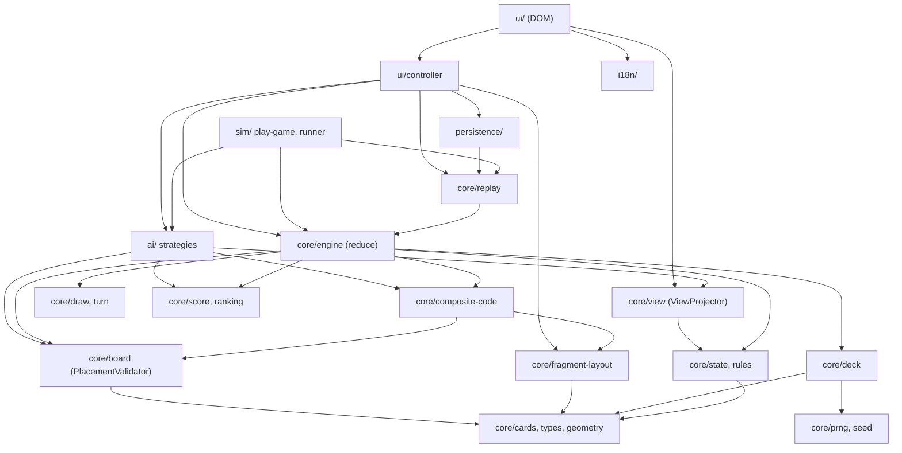
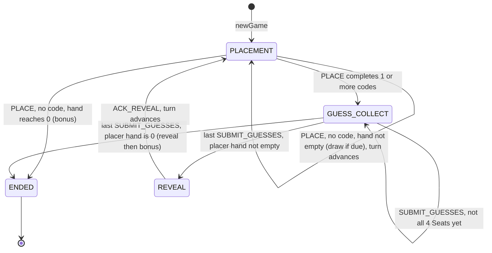
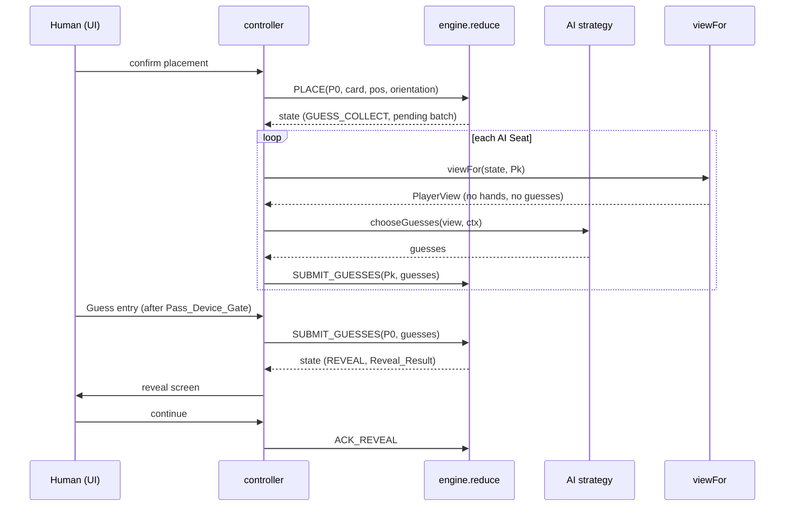
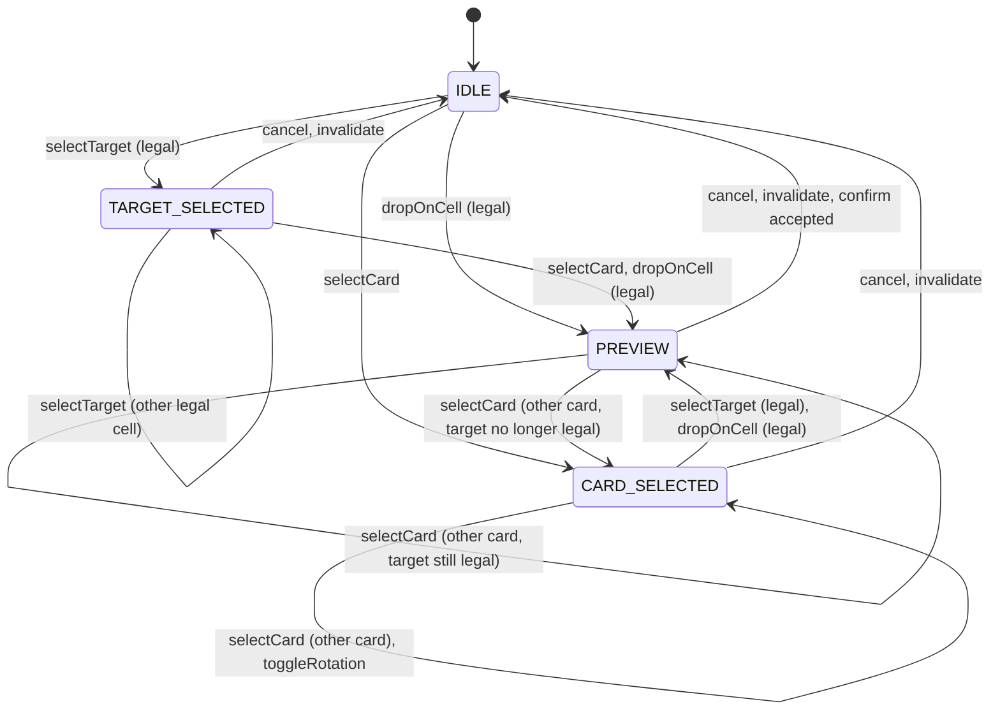

# Design Document

## Overview

This design implements `requirements.md` of this spec: the QRoker game engine and the browser Practice Mode as one playable, offline-capable web app. It builds on the approved rules in `.kiro/specs/qroker-game/` (referred to below as "qroker-game") and does not change them. Where this design deviates from the qroker-game design text (for example the `AIStrategy` signature), the deviation is listed in the section "Deviations from the qroker-game design" and in the inconsistency notes of `requirements.md`.

**Scope.** Engine modules (Deck, Board and PlacementValidator, FragmentLayout and CompositeCodeDetector, DrawManager and TurnManager, ScoreEngine, reducer, ViewProjector), three AI strategies, headless play harness, simulation interface, save/resume, localization, DOM-based UI, mobile layout, Service Worker and PWA basics. Out of scope: everything in `src/optical/**`, the frozen codebook, the Scoring Companion (qroker-game Requirement 9), and any camera or print validation.

**Technology stack.**
- Language: TypeScript, no UI framework.
- Rendering: DOM and CSS Grid (Decision D2).
- Build and dev server: Vite as an explicit devDependency (Decision D3).
- Tests: Vitest 5.1 and fast-check (already installed), `happy-dom` for UI tests (Decision D4).
- Storage: `localStorage` through an injected `KeyValueStore`.
- Offline: a hand-written Service Worker with a build-time precache list (Decision D9).
- Runtime: Node 24 for headless tests and scripts. Browsers: the build declares a target; cross-browser behavior is verified manually.

### Design Decisions (flagged for the user)

| ID | Decision | Rationale | Alternative | Flag |
|----|----------|-----------|-------------|------|
| D1 | Engine is a pure reducer `reduce(state, action) → Result` over a sealed `GameState`. Consumers read a `PlayerView` projection only. | Testable headless in Node. Makes illegal information access a type-level impossibility instead of a convention. | Class with mutable state and getters. | none |
| D2 | DOM and CSS Grid, not Canvas. | 64 cells and at most 52 cards. Buttons give focus, keyboard, accessible names and large touch targets for free. CSS handles responsive layout and text scaling. happy-dom has no Canvas, so DOM is testable headless. | Canvas for drawing; needs hand-built hit testing, accessibility tree and text rendering. | none |
| D3 | Vite as an explicit devDependency, no UI framework. | Provides dev server, ES module bundling and hashed assets with little configuration. Vite 8.3.8 is already present in `node_modules` as a transitive dependency of Vitest 5.1.0 (observed in this workspace), so adding it explicitly aligns versions. Task 16.1 must pin a version range that satisfies the Vitest peer range and verify it with `npm ls vite`. | tsc plus static files without a bundler (no dev server, no hashing). A UI framework (extra dependency, no need at this size). | **User decision** (OQ-7) |
| D4 | `happy-dom` as a devDependency for UI smoke tests, selected per test file by a `// @vitest-environment happy-dom` docblock. The global Vitest environment stays `node`. | Light, fast, no change to `vitest.config.ts`, and no effect on `src/optical` tests. | jsdom (heavier). Playwright (real browsers, large download, deferred). | **User decision** (OQ-11) |
| D5 | Saves store `(seed, config, action log)` and restore by replay. | Smaller than state, no hidden information duplicated as state, and replay is already required for determinism. | Serialize the full state. | none |
| D6 | Composite_Code visualization is a schematic of fragment corners and Inward_Corner. | `src/optical/fragments.ts` reads the codebook through `node:fs`, so the optical module is not browser-loadable. The optical module must not become a dependency. | Pixel rendering through the optical module after a browser-safe loader exists. | **User decision** (OQ-12) |
| D7 | Public structures identify codes by `Quad_Key` (top-left cell notation), never by the sorted card-id `groupId`. | A sorted card-id string reveals the Hidden_Sum (IC-4). | Use `groupId` publicly (leaks in `OWNER_ONLY`). | none |
| D8 | A second `tsconfig.game.json` adds the DOM library for `ui/` and `pwa/`. The root `tsconfig.json` excludes those two folders. | Keeps `src/optical` type checking unchanged and keeps DOM types out of `core/` and `ai/` at compile time. | Add `DOM` to the root `lib` (affects optical). | none |
| D9 | Hand-written `sw.js` plus `scripts/build-sw.ts` that injects the file list and a content hash after `vite build`. | No extra dependency, small, and fully testable. | Workbox or a Vite PWA plugin (dependency). | none |
| D10 | Identity_Visibility is an engine option, default `OWNER_ONLY`. | Makes the Guess a real inference (OQ-1) while keeping the approved text valid in `FACE_UP`. | One fixed mode. | **User decision** (OQ-1) |
| D11 | Human placement goes through one UI-only `PlacementDraft` that two input paths fill: drag and drop of an own-Hand card, and position first then card. Only the explicit confirm action dispatches `PLACE`. The human `Rotation_Control` is offered only when a 180° rotation changes the printed fragment corners (clubs and spades). | One draft, one validation and one confirmation keep the two paths equivalent and make "no state change before confirmation" a property of one module. Hearts and diamonds have the same corner set at 0° and 180° in `FRAGMENT_LAYOUT`, so a rotation control for them would change nothing. The engine, the `Orientation` type, the AI and replay logs are unchanged (IC-12). | Card-first selection with an orientation toggle on every card (the earlier wording of requirement 13.3 and 13.4). | **Owner-directed update** (IC-11); not claimed as approved earlier |
| D12 | Drag input uses Pointer Events in one small module (`ui/pointer-gesture.ts`), with the drop cell found by hit-testing the pointer coordinates. No drag-and-drop dependency. | One code path for mouse, touch and pen, and a pure gesture state machine that is testable without a browser. | The HTML Drag and Drop API or a drag-and-drop library. Revisit only if a real-device check shows that Pointer Events are insufficient; adding a dependency then needs a user decision. | **Owner-directed update** (IC-11) |

---

## Architecture

### Folder Layout

```
src/game/
  core/            pure engine (no DOM, no node:, no Math.random/Date)
    types.ts  cards.ts  prng.ts  seed.ts  geometry.ts  fragment-layout.ts
    deck.ts  board.ts  composite-code.ts  draw.ts  turn.ts
    score.ts  ranking.ts  rules.ts  state.ts  engine.ts  view.ts  replay.ts
    schematic.ts   (rule-level code view model)
  ai/              strategies; reads PlayerView only
    strategy.ts  registry.ts  random.ts  heuristic.ts  unseen.ts  bayesian.ts  params.ts
  sim/             headless harness and simulation interface
    types.ts  play-game.ts  runner.ts
  persistence/     save envelope, migration, storage adapters
    save-format.ts  storage.ts
  i18n/            string tables and lookup
    index.ts  types.ts  strings/<area>.ts   (one file per UI area, each exports { en, ko })
  ui/              DOM layer (Vite root)
    index.html  main.ts  dom.ts  store.ts  controller.ts  placement-draft.ts  pointer-gesture.ts
    components/  screens/  overlays/  styles/  public/ (manifest, icons, sw.js)  testing/
  README.md
scripts/build-sw.ts   scripts/simulate.ts
docs/practice-mode.md  docs/responsive-checklist.md  docs/offline-checklist.md
```

### Module Dependency Diagram



Rules enforced by the boundary test (task 1.3):

| Folder | May import | Must not |
|--------|-----------|----------|
| `core/` | `core/` only | `node:*`, DOM globals, `src/optical`, `Math.random`, `Date`, `performance.now`, `crypto` |
| `ai/` | `core/types`, `core/cards`, `core/geometry`, `core/fragment-layout`, `core/board` (pure helpers), `core/score`, `core/prng`, `core/view` (types and `unseenCards`) | `core/state`, `core/engine`, `core/deck`, `core/replay`, `core/rules` internals; the `GameState` type; same bans as `core/` |
| `sim/` | `core/`, `ai/` | DOM, `src/optical` |
| `persistence/` | `core/replay`, `core/types` | DOM globals (storage is injected), `node:*`, `src/optical` |
| `ui/` screen-class modules (every `ui/` file except `ui/controller.ts`, including `ui/placement-draft.ts` and `ui/pointer-gesture.ts`), `i18n/` | from `core/` only `core/view` and `core/types`; `i18n/`; `ui/` helpers | `core/engine`, `core/state`, `core/fragment-layout`, `ai/`, `src/optical`, any network API |
| `ui/controller.ts` (the trusted module that owns the sealed `GameState`) | `core/view`, `core/engine`, `core/types`, `ai/registry`, `persistence/` and the other modules already allowed by task 16.2, plus **`core/fragment-layout`** (added by the owner-directed placement update, IC-11, solely to compute the rotation capability of the viewer's own Hand cards; see "Rotation capability metadata") | `core/deck`, `core/rules`, `src/optical`, any network API; the controller never hands `GameState` or `FRAGMENT_LAYOUT` to a screen |
| test files | any, but only `core/fragment-layout.parity.test.ts` may import `src/optical` | |

### Game Phase State Machine

`INIT` of the qroker-game design is omitted because `newGame` returns an already dealt state (IC-10).



### Placement Sequence (with a Composite_Code)



---

## Components and Interfaces

### Core Types (`core/types.ts`)

```typescript
export type Suit = 'H' | 'D' | 'C' | 'S';
export type Rank = 'A' | '2' | '3' | '4' | '5' | '6' | '7' | '8' | '9' | '10' | 'J' | 'Q' | 'K';
export type CardId = `${Suit}-${Rank}`;       // 'H-7', 'S-10' (same text as optical card keys; no import)
export type Orientation = 0 | 180;
export type Corner = 'TL' | 'TR' | 'BL' | 'BR';
export type Slot = Corner;                    // position of a card inside a 2x2 group
export type PlayerId = 'P0' | 'P1' | 'P2' | 'P3';
export type Owner = PlayerId | 'NEUTRAL';
export type Difficulty = 'BEGINNER' | 'ADVANCED' | 'EXPERT';
export type QuadKey = string;                 // notation of the top-left cell, e.g. 'D4'

export interface GridPosition { readonly row: number; readonly col: number } // 0-based, row 0 = row "1" (top)

export type Result<T, E = EngineError> = { readonly ok: true; readonly value: T } | { readonly ok: false; readonly error: E };
export interface EngineError { readonly code: ErrorCode; readonly detail?: string }

export type ErrorCode =
  | 'INVALID_CARD_ID' | 'SEED_EMPTY' | 'INVALID_SCORE_CONFIG' | 'INVALID_CONFIG'
  | 'OUT_OF_BOUNDS' | 'OCCUPIED' | 'NOT_ADJACENT' | 'INVALID_ORIENTATION' | 'CARD_NOT_IN_HAND'
  | 'NOT_YOUR_TURN' | 'WRONG_PHASE' | 'GAME_ENDED'
  | 'GUESS_NOT_INTEGER' | 'GUESS_OUT_OF_RANGE' | 'DUPLICATE_SUBMISSION' | 'GUESS_KEYS_MISMATCH'
  | 'UNKNOWN_PLAYER' | 'REPLAY_REJECTED';

export interface ScoreConfig { readonly rewardByError: readonly number[]; readonly handEmptyBonus: number }
export interface NamedScoreConfig { readonly id: string; readonly provisional: boolean; readonly config: ScoreConfig }

export type IdentityVisibility = 'OWNER_ONLY' | 'FACE_UP';
export interface SeatConfig { readonly id: PlayerId; readonly kind: 'HUMAN' | 'AI'; readonly difficulty?: Difficulty; readonly name: string }
export interface GameConfig {
  readonly rulesVersion: number;                // RULES_VERSION
  readonly seats: readonly [SeatConfig, SeatConfig, SeatConfig, SeatConfig];
  readonly scoreConfig: NamedScoreConfig;
  readonly identityVisibility: IdentityVisibility;
}

export type Action =
  | { readonly type: 'PLACE'; readonly player: PlayerId; readonly card: CardId; readonly pos: GridPosition; readonly orientation: Orientation }
  | { readonly type: 'SUBMIT_GUESSES'; readonly player: PlayerId; readonly guesses: Readonly<Record<QuadKey, number>> }
  | { readonly type: 'ACK_REVEAL' };
```

Error handling convention: all engine functions that can fail return `Result`. Functions that cannot fail for valid types return plain values. No exception is thrown for a rejected Action.

### Cards, PRNG and Seed (`core/cards.ts`, `prng.ts`, `seed.ts`)

```typescript
export const SUITS: readonly Suit[];            // ['H','D','C','S']
export const RANKS: readonly Rank[];            // ['A','2',...,'10','J','Q','K']
export const ALL_CARDS: readonly CardId[];      // 52, canonical order: suit-major (H,D,C,S), rank A..K
export function parseCardId(s: string): Result<CardId>;       // INVALID_CARD_ID
export function suitOf(c: CardId): Suit;  export function rankOf(c: CardId): Rank;
export function cardValue(c: CardId): number;                 // A=1 .. K=13
export function hiddenSum(cards: readonly [CardId, CardId, CardId, CardId]): number; // 4..52
export function groupIdOf(cards: readonly CardId[]): string;  // sorted ids joined by '|' (sealed use only)

export function mulberry32(seed: number): () => number;        // own implementation; not imported from src/optical
export function mix32(a: number, b: number): number;           // deterministic seed derivation
export function shuffle<T>(items: readonly T[], rng: () => number): T[]; // Fisher-Yates, i = n-1 .. 1, j = floor(rng() * (i + 1))
export function parseSeed(text: string): Result<number>;       // decimal 0..4294967295 -> itself; other text -> FNV-1a 32 over UTF-16 code units; empty -> SEED_EMPTY
```

`mulberry32` is the same published algorithm as the one used in the optical prototype, re-implemented so that `core/` has no cross-module runtime dependency.

### Geometry (`core/geometry.ts`)

```typescript
export const BOARD_SIZE = 8;
export function toNotation(p: GridPosition): string;           // {row:3,col:3} -> 'D4'
export function fromNotation(s: string): Result<GridPosition>;
export function inBounds(p: GridPosition): boolean;
export function orthogonalNeighbors(p: GridPosition): GridPosition[];
export function candidateQuads(p: GridPosition): GridPosition[]; // top-left corners of the in-bounds 2x2 regions containing p (0..4, here 1..4)
export function quadCells(topLeft: GridPosition): [GridPosition, GridPosition, GridPosition, GridPosition]; // order TL, TR, BL, BR
export function quadKey(topLeft: GridPosition): QuadKey;       // toNotation(topLeft)
export function slotOf(topLeft: GridPosition, p: GridPosition): Slot;
```

### FragmentLayout (`core/fragment-layout.ts`)

```typescript
export const FRAGMENT_LAYOUT: Readonly<Record<Suit, Readonly<Record<Orientation, readonly Corner[]>>>> = {
  H: { 0: ['TL', 'BR'], 180: ['TL', 'BR'] },
  D: { 0: ['TR', 'BL'], 180: ['TR', 'BL'] },
  C: { 0: ['TR', 'BR'], 180: ['TL', 'BL'] },
  S: { 0: ['TL', 'BL'], 180: ['TR', 'BR'] },
};
export const INWARD_CORNER: Readonly<Record<Slot, Corner>> = { TL: 'BR', TR: 'BL', BL: 'TR', BR: 'TL' };
export function isValidMember(card: CardId, orientation: Orientation, slot: Slot): boolean;
// = FRAGMENT_LAYOUT[suitOf(card)][orientation].includes(INWARD_CORNER[slot])
export function validOrientations(card: CardId, slot: Slot): readonly Orientation[]; // used by AI and the schematic view
export function rotationChangesCorners(card: CardId): boolean;
// Additive export (owner-directed placement update, IC-11). True iff the corner SET of FRAGMENT_LAYOUT[suit][0]
// differs from the corner set of FRAGMENT_LAYOUT[suit][180] (order-insensitive): C and S true, H and D false.
// The table and every existing export stay unchanged. Consumed only by ui/controller.ts (see "Rotation capability metadata").
```

The table is the one in the qroker-game design (Core Types and "Per-slot participation conditions"). A test-only parity file compares it with the corner sets of `src/optical/fragments.ts` (`visibleCorners`) for all 52 cards and both orientations.

### Deck (`core/deck.ts`)

```typescript
export interface Deal {
  readonly neutral: readonly [CardId, CardId, CardId, CardId];     // D4, E4, D5, E5 in this order
  readonly hands: Readonly<Record<PlayerId, readonly CardId[]>>;   // 4 cards each, in deal order
  readonly deck: readonly CardId[];                                // 32 cards, top = last element
}
export function dealGame(seed: number): Deal;
// shuffled = shuffle(ALL_CARDS, mulberry32(seed)); neutral = shuffled[0..3];
// hand(Pk) = shuffled[4+4k .. 7+4k] for k = 0..3; deck = shuffled[20..51]
export function drawTop(deck: readonly CardId[]): { card: CardId | null; deck: readonly CardId[] }; // null when empty
```

### Board and PlacementValidator (`core/board.ts`)

```typescript
export interface PlacedCard { readonly card: CardId; readonly orientation: Orientation; readonly owner: Owner }
export type Board = readonly (PlacedCard | null)[];          // length 64, index = row * 8 + col
export function emptyBoard(): Board;
export function cellAt(b: Board, p: GridPosition): PlacedCard | null;
export function cardCount(b: Board): number;
export function validatePlacement(b: Board, pos: GridPosition, orientation: number): Result<true>;
// precedence: INVALID_ORIENTATION, OUT_OF_BOUNDS, OCCUPIED, NOT_ADJACENT
export function placeOnBoard(b: Board, pos: GridPosition, pc: PlacedCard): Result<Board>;
export function legalCells(b: Board): GridPosition[];        // row-major order; equals { p : validatePlacement(b,p,0).ok }
```

Why a legal cell always exists: every placement is adjacent to an existing card, so the occupied cells stay orthogonally connected from the 2×2 start. At most 52 of 64 cells are ever occupied, and a connected proper subset of a connected grid graph has an empty neighbor. Property 7 tests this.

### CompositeCodeDetector (`core/composite-code.ts`)

```typescript
export interface CompositeCodeResult {
  readonly quadKey: QuadKey;                 // public identifier
  readonly topLeft: GridPosition;
  readonly cards: readonly [CardId, CardId, CardId, CardId];        // order TL, TR, BL, BR
  readonly orientations: readonly [Orientation, Orientation, Orientation, Orientation];
  readonly hiddenSum: number;                // 4..52
  readonly groupId: string;                  // SEALED: never put in a PlayerView
}
export function detect(board: Board, placedAt: GridPosition, scoredGroups: ReadonlySet<string>): CompositeCodeResult[];
// 1. for each candidate quad containing placedAt: all 4 cells occupied?
// 2. all 4 members isValidMember(card, orientation, slot)?
// 3. groupId not in scoredGroups  -> eligible (qroker-game 4.4)
export function startingQuadIsExcluded(): true;  // documented: neutral quad is never passed to detect (OQ-3)
```

`detect` is called only for a just-placed cell, so a quad is "newly formed" by construction. The starting 2×2 is never examined because no placement forms it. The caller adds the groupIds of results to `scoredGroups` in the same reducer step. Returned results are ordered by `quadKey` for determinism.

### DrawManager and TurnManager (`core/draw.ts`, `core/turn.ts`)

```typescript
export function shouldDraw(player: PlayerId, firstPlacementDone: readonly PlayerId[], newCodes: number): boolean;
// false if player not in firstPlacementDone (first placement exempt, qroker-game 3.5),
// false if newCodes >= 1 (qroker-game 3.6), true otherwise
export function nextSeat(current: PlayerId): PlayerId;     // P0 -> P1 -> P2 -> P3 -> P0 (OQ-5)
```

If `shouldDraw` is true and the deck is empty, `drawTop` returns `card: null` and the reducer leaves the hand unchanged (qroker-game 3.8).

### ScoreEngine and Ranking (`core/score.ts`, `core/ranking.ts`)

```typescript
export const RULES_VERSION = 1;
export const DEV_PLACEHOLDER_SCORE_CONFIG: NamedScoreConfig = {
  id: 'DEV_PLACEHOLDER',
  provisional: true,
  config: {
    // DEVELOPMENT PLACEHOLDER. Not a balance decision. Chosen only so that scores are visible and
    // differ by accuracy during development. Final values are decided by simulation (open-decisions #7, milestone P3).
    rewardByError: [6, 4, 3, 2, 1],
    handEmptyBonus: 3,
  },
};
export function validateScoreConfig(c: ScoreConfig): Result<true>;      // INVALID_SCORE_CONFIG; rules in requirement 8.3
export function score(guess: number, hiddenSum: number, c: ScoreConfig): number;
export function validateGuess(g: unknown): Result<number>;              // GUESS_NOT_INTEGER, GUESS_OUT_OF_RANGE (4..52)

export interface RankEntry { readonly player: PlayerId; readonly score: number; readonly rank: number }
export function rankPlayers(scores: Readonly<Record<PlayerId, number>>): RankEntry[]; // competition ranking, order by rank then seat
```

The numbers in `DEV_PLACEHOLDER_SCORE_CONFIG` are illustrative and live in exactly one place. No other module may contain a score value (checked by a scan test in task 6.1). The UI displays a "provisional scoring" banner whenever `scoreConfig.provisional` is true.

### GameState and Rules (`core/state.ts`, `core/rules.ts`)

```typescript
export type GamePhase = 'PLACEMENT' | 'GUESS_COLLECT' | 'REVEAL' | 'ENDED';

export interface PendingBatch {
  readonly placer: PlayerId;
  readonly codes: readonly CompositeCodeResult[];
  readonly guesses: Readonly<Partial<Record<PlayerId, Readonly<Record<QuadKey, number>>>>>;   // SEALED
  readonly endsGame: boolean;                    // placer hand reached 0 with this placement
}

export interface RevealRecord {                  // public once created
  readonly batchIndex: number;
  readonly placer: PlayerId;
  readonly codes: readonly { quadKey: QuadKey; cards: readonly CardId[]; hiddenSum: number }[];
  readonly perPlayer: readonly { player: PlayerId; earned: number; cumulative: number }[];   // no guess values
}

export interface GameState {                     // SEALED: never leaves core/engine and ViewProjector
  readonly config: GameConfig;
  readonly seed: number;
  readonly phase: GamePhase;
  readonly board: Board;
  readonly deck: readonly CardId[];
  readonly hands: Readonly<Record<PlayerId, readonly CardId[]>>;
  readonly turn: PlayerId;
  readonly firstPlacementDone: readonly PlayerId[];
  readonly scoredGroups: readonly string[];      // sorted groupIds
  readonly revealedCards: readonly CardId[];     // cards of revealed codes (public)
  readonly pending: PendingBatch | null;
  readonly scores: Readonly<Record<PlayerId, number>>;
  readonly placements: number;                   // accepted PLACE count
  readonly history: readonly RevealRecord[];
  readonly lastReveal: RevealRecord | null;
  readonly bonusAwarded: PlayerId | null;
  readonly log: readonly Action[];               // accepted actions, in order
}

export interface NewGameOptions { readonly seed: number; readonly config: GameConfig }
export function newGame(o: NewGameOptions): Result<GameState>;   // validates config (INVALID_CONFIG, INVALID_SCORE_CONFIG)
export function defaultConfig(): GameConfig;                     // 1 human + 3 AI, DEV_PLACEHOLDER_SCORE_CONFIG, OWNER_ONLY
```

`newGame` places the 4 Neutral_Cards at orientation 0 with owner `NEUTRAL` (OQ-2), sets `turn = 'P0'`, `phase = 'PLACEMENT'`, all scores 0, `placements = 0`, and an empty `log`.

### Reducer (`core/engine.ts`)

```typescript
export function reduce(state: GameState, action: Action): Result<GameState>;
export function actingSeats(state: GameState): readonly PlayerId[];   // who may act now (turn seat; unsubmitted seats; none when ENDED)
```

Processing of `PLACE` (all steps on a copy; the input is never mutated; any failure returns before a new state exists):

1. `ENDED` → `GAME_ENDED`. Phase not `PLACEMENT` → `WRONG_PHASE`. `action.player !== turn` → `NOT_YOUR_TURN`. Unknown player → `UNKNOWN_PLAYER`.
2. `card ∈ hands[player]`, else `CARD_NOT_IN_HAND`.
3. `validatePlacement` (orientation, bounds, empty, adjacent).
4. Place; remove the card from the Hand; `placements += 1`.
5. `codes = detect(board, pos, scoredGroups)`; add each `groupId` to `scoredGroups`.
6. `draw = shouldDraw(player, firstPlacementDone, codes.length)`; add `player` to `firstPlacementDone`; if `draw`, `drawTop` and append to the Hand when a card exists.
7. If `codes.length ≥ 1`: `phase = GUESS_COLLECT`, `pending = { placer, codes, guesses: {}, endsGame: hand.length === 0 }`.
8. Else if the Hand is empty: add `handEmptyBonus` to the placer, set `bonusAwarded`, `phase = ENDED`.
9. Else `turn = nextSeat(turn)`.
10. Append the action to `log`.

Processing of `SUBMIT_GUESSES`: phase must be `GUESS_COLLECT`; every Guess is validated with `validateGuess`; keys must equal the batch Quad_Keys exactly (`GUESS_KEYS_MISMATCH`); a second submission by the same Seat → `DUPLICATE_SUBMISSION`. When all 4 Seats have submitted: compute earned score per Seat as the sum over codes of `score(guess, hiddenSum, config)`, add to `scores`, append a `RevealRecord` (no guesses) to `history` and `lastReveal`, add the cards of the codes to `revealedCards`, clear `pending`. If `endsGame`: add `handEmptyBonus` to the placer, set `bonusAwarded`, `phase = ENDED`; else `phase = REVEAL`.

Processing of `ACK_REVEAL`: phase must be `REVEAL`; set `phase = PLACEMENT`, `turn = nextSeat(placer)`.

Termination argument: every accepted `PLACE` adds one card to a Board that holds at most 52 cards, and 4 are Neutral, so at most 48 `PLACE` Actions exist. The game ends at the latest when all non-Neutral cards are placed, because the Seat that places the last card of its Hand reaches 0. A legal cell always exists (see Board). Guess collection and reveal terminate because exactly 4 submissions are required and `ACK_REVEAL` is a single step.

### ViewProjector and PlayerView (`core/view.ts`)

```typescript
export interface CellView { readonly owner: Owner; readonly orientation: Orientation; readonly card: CardId | null } // null = hidden from this viewer
export interface PublicRules { readonly rulesVersion: number; readonly seats: GameConfig['seats']; readonly scoreConfig: NamedScoreConfig; readonly identityVisibility: IdentityVisibility }

export interface PlayerView {
  readonly viewer: PlayerId;
  readonly rules: PublicRules;
  readonly phase: GamePhase;
  readonly turn: PlayerId;
  readonly board: readonly (CellView | null)[];                   // length 64
  readonly myHand: readonly CardId[];                             // canonical order
  readonly handCounts: Readonly<Record<PlayerId, number>>;
  readonly deckCount: number;
  readonly scores: Readonly<Record<PlayerId, number>>;
  readonly pendingQuadKeys: readonly QuadKey[];                   // codes awaiting Guesses (positions only)
  readonly guessSubmitted: Readonly<Record<PlayerId, boolean>>;
  readonly myGuesses: Readonly<Record<QuadKey, number>> | null;  // the viewer's own submission only
  readonly lastReveal: RevealRecord | null;
  readonly history: readonly RevealRecord[];
  readonly ranking: readonly RankEntry[] | null;                  // set when phase is ENDED
}
// NOT in PlayerView: seed, deck contents/order, other Hands, other Seats' guesses, hiddenSum of a pending code,
// groupId, scoredGroups, the log, and the identity of any card hidden from the viewer.

export function viewFor(state: GameState, viewer: PlayerId): PlayerView;
export function unseenCards(view: PlayerView): CardId[];          // ALL_CARDS minus myHand minus identities visible on the board
export function legalCellsFor(view: PlayerView): GridPosition[];  // pure helper over the view's board occupancy
```

Visibility rule for `CellView.card`:

| Cell | `OWNER_ONLY` | `FACE_UP` |
|------|--------------|-----------|
| Neutral_Card | visible to all | visible to all |
| Card placed by the viewer | visible | visible |
| Card of another Seat, code not yet revealed | `null` | visible |
| Card of a revealed code (in `revealedCards`) | visible to all | visible to all |

The seed is not in the view because a Seed determines the whole deal. The UI keeps the Seed in its own application model for display.

Residual-risk statement (also in docs): AI code receives a `decisionSeed` derived from the game seed through `mix32`. The AI modules cannot import the deal or shuffle functions (boundary test), so the types and imports do not give the AI a path to hidden data. This design does not claim cryptographic secrecy against code written to cheat.

### Replay (`core/replay.ts`)

```typescript
export function replay(seed: number, config: GameConfig, actions: readonly Action[]): Result<GameState, { code: 'REPLAY_REJECTED'; index: number; cause: EngineError }>;
export function stateEquals(a: GameState, b: GameState): boolean;   // deep structural equality for tests
```

### Schematic Code View model (`core/schematic.ts`)

```typescript
export interface SchematicSlot { readonly slot: Slot; readonly card: CardId; readonly orientation: Orientation;
  readonly fragmentCorners: readonly Corner[]; readonly inward: Corner; readonly valid: boolean }
export function schematicModel(cards: readonly [CardId, CardId, CardId, CardId], orientations: readonly [Orientation, Orientation, Orientation, Orientation]): readonly SchematicSlot[]; // order TL, TR, BL, BR
```

The view component draws each slot as a small square with dots at `fragmentCorners` and a ring at `inward`. It is available for revealed codes and, in `OWNER_ONLY` mode, for codes whose four cards are all visible to the viewer. It does not draw optical pixel patterns (D6).

### AI Strategies (`ai/`)

```typescript
export interface AiContext { readonly decisionSeed: number }   // = mix32(gameSeed, seatIndex * 100000 + actionIndex), supplied by the caller
export interface AIStrategy {
  readonly id: Difficulty;
  choosePlacement(view: PlayerView, ctx: AiContext): Extract<Action, { type: 'PLACE' }>;
  chooseGuesses(view: PlayerView, ctx: AiContext): Extract<Action, { type: 'SUBMIT_GUESSES' }>;
}
export function getStrategy(d: Difficulty): AIStrategy;                       // registry
export const DIFFICULTY_LABELS: Readonly<Record<Difficulty, { readonly en: string; readonly ko: string }>>;
// BEGINNER  "Beginner"  / "초급"     ADVANCED "Advanced" / "고급"     EXPERT "Expert" / "전문가"
```

Deviation from qroker-game design: `selectPlacement(view, deck)` and `submitGuess(view, hiddenSumRange)` are replaced by the two functions above. The deck argument is removed (IC-1). A single `chooseGuesses` call returns Guesses for all codes of the batch, as `SUBMIT_GUESSES` requires.

The three strategies. Each has a documented `WORK_BUDGET` constant (maximum candidates evaluated). Candidates are enumerated in a fixed order and truncated at the budget, so a decision is deterministic and bounded. Ties are broken by `mulberry32(decisionSeed)`.

| Tier | Placement | Guess | Status |
|------|-----------|-------|--------|
| `BEGINNER` (RandomStrategy) | Uniform choice among all legal (card, cell, orientation) triples. | Uniform integer in 4..52 per code. | P1 |
| `ADVANCED` (HeuristicStrategy) | Scores each candidate by the quads that contain the cell: a complete quad whose members are known valid scores `W_COMPLETE`; a complete quad with hidden members scores `W_COMPLETE` times the product of the probabilities that each hidden member is valid for its slot and orientation (fraction of unseen cards whose suit is valid, from `validOrientations`); quads with 2 or 3 filled cells and a valid placed card score `W_PARTIAL[k]`. Picks the maximum. | Sum of the known cards of the code plus, for each hidden card, the mean Card_Value of the unseen cards whose suit is valid for the slot and orientation, rounded and clamped to 4..52. | P1 |
| `EXPERT` (BayesianStrategy) | The `ADVANCED` evaluation with probabilities from the posterior, plus a penalty `W_GIVE` for placements that leave a 3-filled quad that the next Seats are likely to complete (tuning hooks in `params.ts`). | For each hidden card of the code, the candidates are the unseen cards whose suit is valid for the slot and orientation (the code is public, so validity is known). The posterior over the hidden sum is the distribution of sums over distinct assignments, enumerated exactly when the product of candidate counts is at most `MAX_ENUMERATION`, otherwise estimated from `POSTERIOR_SAMPLES` seeded samples. The Guess is the integer g in 4..52 that maximizes `Σ_s P(s)·score(g, s, scoreConfig)`; ties go to the g nearest the posterior mean, then the lower g. | P2 |

Stated approximation of `EXPERT`: the posterior treats the hidden cards of one code as drawn without replacement from the unseen pool and ignores other hidden Board cards outside the code. This is a modeling simplification and no accuracy claim is made. Under `FACE_UP` every card is known and all tiers compute the exact sum.

Placement-time budgets: with at most about 8 Hand cards, at most 56 legal cells and 2 orientations, a full enumeration is a few hundred candidates, and the budget constant is set above that. The measured decision time is recorded by a test and checked against 3000 ms (requirement 11.5); no speed claim is made in this document.

### Headless Driver and Simulation Interface (`sim/`)

```typescript
export interface PlayGameOptions {
  readonly seed: number;
  readonly config: GameConfig;
  readonly strategies: Readonly<Record<PlayerId, AIStrategy>>;   // every Seat, including HUMAN Seats in tests
  readonly checkInvariants?: boolean;                            // default true in tests
}
export interface PlayGameResult { readonly final: GameState; readonly log: readonly Action[] }
export function playGame(o: PlayGameOptions): PlayGameResult;    // throws only on an invariant violation or a rejected AI action (a bug)

// Interface only in P1; implemented in P3 (qroker-game design GameSimulator)
export interface SimulationConfig { seed: number; gameCount: number; scoreConfig: ScoreConfig; strategies: readonly Difficulty[] /* 4 Seats */; identityVisibility: IdentityVisibility }
export interface SimulationResult {
  winRates: Record<string, number>; avgGameLength: number; predictionScoreShare: number;
  handEmptyBonusImpact: number; scoreDistribution: number[];
}
export interface GameSimulator { run(c: SimulationConfig): SimulationResult; runBatch(cs: SimulationConfig[]): SimulationResult[] }
```

`playGame` asks the acting Seat's strategy for an Action using only `viewFor(state, seat)`. For `GUESS_COLLECT` it asks all Seats in seat order; because Guesses are independent of submission order (Property 15), the order is not significant.

### Persistence (`persistence/`)

```typescript
export interface KeyValueStore { getItem(k: string): string | null; setItem(k: string, v: string): void; removeItem(k: string): void }
export const SAVE_KEY = 'qroker.practice.save';
export const PREFS_KEY = 'qroker.practice.prefs';
export const SAVE_FORMAT = 'qroker-save';
export const SAVE_VERSION = 1;

export interface SaveEnvelope {
  readonly format: 'qroker-save'; readonly saveVersion: number; readonly rulesVersion: number;
  readonly savedAtIso: string;                    // supplied by the caller's clock; core/ never reads time
  readonly seed: number; readonly config: GameConfig; readonly actions: readonly Action[];
}
export type ParsedSave =
  | { kind: 'OK'; envelope: SaveEnvelope }
  | { kind: 'MIGRATED'; envelope: SaveEnvelope; fromVersion: number }
  | { kind: 'INCOMPATIBLE'; reason: 'SAVE_VERSION' | 'RULES_VERSION' }
  | { kind: 'CORRUPT' };
export function serializeSave(e: SaveEnvelope): string;
export function parseSave(text: string): ParsedSave;                  // never throws
export const MIGRATIONS: Readonly<Record<number, (old: unknown) => unknown>>;   // empty at version 1
export function loadGame(store: KeyValueStore): { kind: 'NONE' } | { kind: 'RESUMABLE'; state: GameState; envelope: SaveEnvelope } | { kind: 'DISCARDED'; reason: string };
export function saveGame(store: KeyValueStore, state: GameState, nowIso: string): { ok: boolean };
export function memoryStore(): KeyValueStore;                          // fallback and tests
export function browserStore(): KeyValueStore;                         // wraps window.localStorage, throws never (returns a memory store on failure)
```

Validation of parsed JSON uses hand-written type guards (no schema dependency). The envelope never contains the full state (D5). Prefs (`language`, last setup options) are stored as separate JSON under `PREFS_KEY`. How the UI uses this module (save points, resume, notices, prefs) is fixed in "Task 20.4 persistence integration contracts".

### Localization (`i18n/`)

```typescript
export type Lang = 'ko' | 'en';
export type StringTable = Readonly<Record<string, string>>;        // placeholders written as {name}
export function t(key: StringKey, params?: Readonly<Record<string, string | number>>): string; // current language
export function setLanguage(l: Lang): void;  export function getLanguage(): Lang;
export function detectLanguage(navigatorLanguage: string | undefined, stored: Lang | null): Lang;
export function errorMessageKey(code: ErrorCode): StringKey;       // 1:1 map from the closed ErrorCode set
```

Each `strings/<area>.ts` exports `{ en, ko }` for one UI area (`common`, `errors`, `setup`, `board`, `guess`, `reveal`, `end`, `help`, `pwa`). The Korean table type is `Record<keyof typeof en, string>`, so a missing Korean key is a compile error, and a test checks placeholder equality.

### Practice UI (`ui/`)

Application model (`store.ts`) and the controller (`controller.ts`):

```typescript
export interface AppModel {
  screen: 'SETUP' | 'GAME' | 'END';
  game: { seed: number; state: GameState } | null;      // sealed state stays inside the controller; screens receive views
  humanSeat: PlayerId | null;                           // seat currently shown (null while a gate is shown)
  gate: { forSeat: PlayerId; reason: 'GUESS' | 'TURN' } | null;
  draft: PlacementDraft;                                // see "Placement interaction"; supersedes the earlier `placement` record and the `UiSelection` of task 16.2
  guessDraft: Record<QuadKey, string>;
  overlay: 'NONE' | 'HELP' | 'ABANDON_CONFIRM';
  notices: Notice[];                                    // offline, update available, storage unavailable, save discarded
  prefs: { lang: Lang; setup: SetupOptions };
}
export interface AppDeps {
  root: HTMLElement; store: KeyValueStore; now: () => string; randomSeed: () => number;
  schedule: (fn: () => void, ms: number) => void;       // production: setTimeout; tests: immediate
  navigatorLanguage?: string; isOnline?: () => boolean;
}
export function mountApp(deps: AppDeps): { dispatch(e: UiEvent): void; destroy(): void };
```

Behavior:
- Rendering: a function `render(model, views)` rebuilds the changed screen region from plain data using a small `h(tag, props, children)` helper. Focus is restored by a `data-focus-key` after each render. With 64 cells this needs no virtual DOM.
- Controller: after every accepted Action it saves, then drains AI work: while the acting Seat is AI, it computes the Action from `viewFor` and applies it through `deps.schedule` with a presentation delay (`AI_DELAY_MS = 600`, at most 1000). Human Seats stop the loop.
- Placement flow (owner-directed update, IC-11; supersedes the earlier card-first flow with an orientation toggle for every card): two input paths fill one `PlacementDraft`. Path A, drag and drop: drag an own-Hand card onto a legal cell. Path B, position first: select a legal empty cell, keep it selected, then select a Hand card (card-first selection stays allowed, not required). Both paths show the preview, the `Rotation_Control` only for clubs and spades, "Confirm placement" ("배치 확정") and "Cancel" ("취소"), and only the confirm action sends `PLACE`. Legality comes from `legalCellsFor(view)`; the message for an illegal cell comes from the engine through `controller.explainTarget` (see "Placement interaction"). Nothing in the draft changes the `GameState`.
- Gate flow (only when 2 or more human Seats): when the Seat to show changes from one human Seat to another, the DOM of the previous Seat's private area is removed, the gate is shown, and the next Seat's content is rendered only after "I am ready". AI Seats never need a gate because their information is never rendered. Gate sequencing model and scope: see "Task 18 interaction contracts". Seat-to-show, the controller-owned gate and the composition host: see "Task 19.4 composition contracts".
- Guess flow: AI Seats submit immediately in the controller. Each human Seat in seat order sees (gate) → one numeric input per code, labelled with the code's Quad_Key and a Board highlight → submit. No Hidden_Sum is on screen. After the last submission the reveal screen shows `lastReveal`. Input parsing, stale-form and privacy rules: see "Task 18 interaction contracts".
- Reveal screen: per code the 4 cards face up, the Hidden_Sum, and optionally the Schematic_Code_View; a table of earned and cumulative scores per Seat; a continue button that sends `ACK_REVEAL` (or moves to the final screen when `phase = ENDED`). View model, scoreboard and the PLACE boundary of `handlers.dispatch`: see "Task 18 interaction contracts".
- End screen: ranking with shared ranks, final scores, all `history` records with Hidden_Sum details, buttons "rematch" (new seed), "replay same seed", "new setup".
- Banner: shown on every game screen while `rules.scoreConfig.provisional` (model flag in "Task 18 interaction contracts").

Accessibility and styling:
- Board: `role="grid"` with `role="row"` and `role="gridcell"` wrappers, each cell a `<button>` with `aria-label` such as "D4, empty, legal placement" or "E5, card H-7, rotated 180 degrees, owner Player 1" (localized). Roving `tabindex` and arrow-key movement. The label adds the state "selected target" for the draft target, and carries no identity that is hidden from the viewer. Cell attributes and the board DOM contract for drag and drop are in "Placement interaction".
- Live region: `aria-live="polite"` for turn changes, errors and reveal summary.
- Tokens (`styles/tokens.css`): color custom properties with a contrast test; suits use glyph shapes as well as color; `@media (prefers-reduced-motion: reduce)` removes transitions.
- Layout: CSS Grid. `--cell: clamp(24px, calc((100vw - 16px) / 8), 64px)`. At 320 px width the cell is 38 px, above the 24 px minimum; other controls have `min-height: 44px; min-width: 44px`. Portrait stacks Board, Hand, scoreboard; landscape (`@media (orientation: landscape) and (min-width: 600px)`) places Board left and Hand and scoreboard right. A viewport meta tag is in `index.html`. Fonts use `rem`.
- Touching cells: the Board grid has `gap: 0`, cells and card footprints fill their grid cell with no margin, and borders, focus rings and selection indicators are drawn inside the cell box (`box-sizing: border-box`, `outline-offset` negative, or `box-shadow: inset`), so that they never change `--cell`. Adjacent card footprints touch (requirement 13.13 item d).
- Touch handling: `touch-action: none` is set only on the draggable Hand card class (`.hand-card--draggable`), never on `html`, `body`, the Board or any container, so page scrolling and pinch zoom stay available (requirements 13.15 item e and 17.7).

Build and run (decision D3):
- `vite.config.ts`: `root: 'src/game/ui'`, `base: './'`, `build.outDir: '../../../dist'`, `build.target: 'es2022'`, `publicDir: 'public'`.
- npm scripts: `dev` (`vite`), `build` (`tsc -p tsconfig.game.json --noEmit && vite build && tsx scripts/build-sw.ts`), `preview` (`vite preview`), `typecheck`, `typecheck:game`, `test:game`.
- `dist/` is added to `.gitignore`.

### Placement interaction (`ui/placement-draft.ts`, `ui/pointer-gesture.ts`, controller additions)

Owner-directed update (IC-11, requirement 13 Criteria 3, 4 and 10 to 16, requirement 17 Criterion 7; decisions D11 and D12). It supersedes the earlier card-first flow and the orientation toggle for every card. It does not change the engine, `Orientation`, the optical rules, the AI actions, stored games or replay logs (IC-12), and it leaves OQ-1, OQ-3, the score policy and the reveal policy unchanged and unresolved.

#### Placement_Draft model and state machine (`ui/placement-draft.ts`)

The module is pure TypeScript. It imports only `core/types` and `core/view` (screen-class module, see the dependency table) and has no DOM access.

```typescript
export interface PlacementDraft {
  readonly target: GridPosition | null;   // a cell that was legal when it was chosen
  readonly card: CardId | null;           // always a card of the viewer's own Hand (myHand)
  readonly orientation: Orientation;      // 0 | 180; 180 only for a card with rotationChangesCorners
}
export const EMPTY_DRAFT: PlacementDraft;                            // { target: null, card: null, orientation: 0 }
export type DraftState = 'IDLE' | 'TARGET_SELECTED' | 'CARD_SELECTED' | 'PREVIEW';
export function draftState(d: PlacementDraft): DraftState;          // derived: no card and no target -> IDLE; target only -> TARGET_SELECTED; card only -> CARD_SELECTED; both -> PREVIEW

export type DraftEvent =
  | { readonly type: 'selectTarget'; readonly cell: GridPosition }                 // click or Enter on a Board cell
  | { readonly type: 'selectCard'; readonly card: CardId }                         // click or Enter on a Hand card
  | { readonly type: 'dragStart'; readonly card: CardId }                          // gesture began; the draft does not change
  | { readonly type: 'dropOnCell'; readonly cell: GridPosition; readonly card: CardId }
  | { readonly type: 'dropOutside' }                                               // released outside the Board or on no cell
  | { readonly type: 'dragCancel' }                                                // pointercancel, lost capture, Escape during a gesture
  | { readonly type: 'toggleRotation' }
  | { readonly type: 'cancel' }                                                    // "Cancel" control or Escape without a gesture
  | { readonly type: 'invalidate'; readonly reason: 'VIEWER' | 'PHASE' | 'TURN' | 'GAME' | 'HAND' | 'RESTART' | 'ABANDON' | 'DISPOSE' };

export type RotationInfoMap = Readonly<Partial<Record<CardId, { readonly rotationChangesCorners: boolean }>>>;   // keys: the viewer's own Hand CardIds only
export interface DraftContext {
  readonly legal: ReadonlySet<string>;      // 'row,col' keys of legalCellsFor(view), recomputed from the latest view for every event
  readonly hand: readonly CardId[];         // view.myHand
  readonly rotation: RotationInfoMap;
}
export type DraftNotice = 'TARGET_NOT_LEGAL' | 'CARD_NOT_IN_HAND';
export interface DraftResult { readonly draft: PlacementDraft; readonly notice: DraftNotice | null }
export function reduceDraft(d: PlacementDraft, e: DraftEvent, ctx: DraftContext): DraftResult;
```

`confirm` is not a reducer event, because it must produce an Action. The controller method `confirmPlacement` (below) validates the draft with `validateDraft` and dispatches; the accepted Action then resets the draft through `invalidate`.



Reducer rules. Every rule returns a new draft or the same object when nothing changes, and never mutates its input.

| Event | Rule |
|-------|------|
| `selectCard(c)` | `c` not in `ctx.hand`: unchanged, notice `CARD_NOT_IN_HAND`. `c` equals `d.card`: unchanged. Otherwise `card = c`, `orientation = 0` (a new card always resets the rotation), `target` kept if `ctx.legal` still contains it and cleared otherwise. |
| `selectTarget(cell)` | Not in `ctx.legal`: unchanged, notice `TARGET_NOT_LEGAL`. Otherwise `target = cell`; `card` and `orientation` are kept. |
| `dragStart(c)` | Draft unchanged. The gesture itself lives in `pointer-gesture.ts`; this event exists so that tests can assert that a gesture alone creates no draft and no Action. |
| `dropOnCell(cell, c)` | `c` not in `ctx.hand`: unchanged, notice `CARD_NOT_IN_HAND`. `cell` not in `ctx.legal`: unchanged (the earlier draft stays), notice `TARGET_NOT_LEGAL`; the drop is never moved to a nearby legal cell. Otherwise `target = cell` exactly, `card = c`, `orientation` kept when `c` equals `d.card` and `0` otherwise. |
| `dropOutside`, `dragCancel` | Unchanged, no notice. |
| `toggleRotation` | No card, or `ctx.rotation[card]` missing or `rotationChangesCorners` false: unchanged. Otherwise `orientation` switches between 0 and 180; `target` and `card` are kept. Never 90 or 270, never automatic. |
| `cancel`, `invalidate` | `EMPTY_DRAFT`. |

Invariants that hold after every event for a context built from one `PlayerView`: `card` is null or in `ctx.hand`; `target` is null or in `ctx.legal`; `orientation = 180` implies a non-null `card` with `rotationChangesCorners`. Path equivalence: for a card `c` and a legal cell `x` from `EMPTY_DRAFT`, `dropOnCell(x, c)`, `selectTarget(x)` then `selectCard(c)`, and `selectCard(c)` then `selectTarget(x)` all produce the same draft `{ target: x, card: c, orientation: 0 }`.

Draft validation against the latest `PlayerView`:

```typescript
export type DraftIssue = 'NO_CARD' | 'NO_TARGET' | 'WRONG_PHASE' | 'NOT_VIEWER_TURN' | 'CARD_NOT_IN_HAND' | 'TARGET_NOT_LEGAL' | 'ROTATION_NOT_MEANINGFUL';
export type DraftCheck =
  | { readonly ok: true; readonly place: { readonly card: CardId; readonly pos: GridPosition; readonly orientation: Orientation } }
  | { readonly ok: false; readonly issue: DraftIssue };
export function validateDraft(d: PlacementDraft, view: PlayerView, rotation: RotationInfoMap): DraftCheck;
// checks in this order: card and target present; view.phase === 'PLACEMENT'; view.turn === view.viewer;
// d.card in view.myHand; d.target in legalCellsFor(view); orientation 180 only with rotationChangesCorners.
```

`validateDraft` is a fast guard that gives early, localized feedback. The engine `reduce` remains the final authority: an Action that passes the guard but is rejected by the engine returns its `ErrorCode` and leaves the state unchanged.

#### Controller additions (`ui/controller.ts`)

The controller keeps the draft in `AppModel.draft` and exposes these functions to screens through `RenderHandlers` (they replace the `select(patch)` function and the `UiSelection` model of task 16.2). Screens still receive no `GameState`.

```typescript
interface RenderHandlers {
  readonly draftEvent: (e: DraftEvent) => DraftResult;     // reduceDraft against the latest view; stores model.draft; may return a notice
  readonly confirmPlacement: () => OpResult;               // the ONLY function that dispatches PLACE for a human Seat
  readonly explainTarget: (cell: GridPosition) => ErrorCode | null;   // message code for a cell that is not legal; never decides legality
  // existing: dispatch, startGame, restart, abandon, setLanguage
}
interface RenderInput { /* existing fields */ readonly rotationInfo: RotationInfoMap }   // for model.viewer only
export type OpResult = /* existing */ | { readonly ok: false; readonly reason: 'DRAFT_INVALID'; readonly issue: DraftIssue };
```

- `confirmPlacement()` takes no argument, so a stale screen closure cannot carry an old draft. It runs in the controller's existing re-entrancy and epoch protection: it returns `DISPOSED` or `BUSY` as `dispatchHuman` does; it reads `model.draft` and `viewFor(state, viewer)`; it calls `validateDraft`; on failure it sends nothing, resets the draft, and stores the localized message (`CARD_NOT_IN_HAND`, `NOT_YOUR_TURN`, `WRONG_PHASE`, or the code from `explainTarget` for `TARGET_NOT_LEGAL`); on success it dispatches exactly one `PLACE` Action through the same path as `dispatchHuman` (save, AI drain, epoch check). A second activation finds `EMPTY_DRAFT` (`NO_CARD`) and sends nothing.
- `explainTarget(cell)` returns the `ErrorCode` that the engine gives for a `PLACE` at `cell` by calling `reduce` on the current state with a probe Action (the viewer's first Hand card, orientation 0) and discarding the result. `reduce` does not mutate its input (requirement 12.1), so the probe has no effect. The code is geometry only (`OUT_OF_BOUNDS`, `OCCUPIED`, `NOT_ADJACENT`) and reveals nothing hidden. It supplies the message text of requirement 13.5. Legality in the UI is always decided by `legalCellsFor(view)`; the controller adds no import of `core/board` for this purpose.
- Invalidation: the controller sets `draft = EMPTY_DRAFT` when `viewer`, `screen`, the game epoch, `actionCount` or the phase changes, when `view.turn` is no longer the viewer, when the drafted card is no longer in `view.myHand`, and on `startGame`, `restart`, `abandon` and `dispose`. The render host cancels an active gesture at the same moments (`gesture.cancel('INVALIDATED')`).

#### Rotation capability metadata

```typescript
// ui/controller.ts, the only ui/ module that imports core/fragment-layout
function rotationInfoFor(view: PlayerView): RotationInfoMap;
// for each card of view.myHand only: { rotationChangesCorners: rotationChangesCorners(card) }
// exposed as RenderInput.rotationInfo (and Controller.rotationInfo()); the record has no key for any other card
```

`rotationChangesCorners(card)` is the canonical helper of `core/fragment-layout.ts`: true for clubs and spades, false for hearts and diamonds, because only `C` and `S` have different corner sets at 0° and 180° in `FRAGMENT_LAYOUT`. It is computed only from the identity of the viewer's own Hand cards, which the viewer already sees. Screens receive booleans, never `FRAGMENT_LAYOUT`, never a corner set and never a suit. Rationale for the additive export in `core/` rather than a controller-local copy: one definition next to the table, covered by the existing parity test of the table. The only change to the boundary rules is that `ui/controller.ts` may import `core/fragment-layout`; screen-class modules stay limited to `core/view` and `core/types`.

#### Pointer gesture module (`ui/pointer-gesture.ts`)

Two layers: a pure state machine that unit tests drive without a DOM, and a thin DOM adapter. Imports: `core/types` only.

```typescript
export const DRAG_THRESHOLD_PX = 8;                       // named, provisional; confirmed or changed by real-device checks
export type GestureState = { kind: 'IDLE' } | { kind: 'PRESSED'; pointerId: number; x0: number; y0: number }
                         | { kind: 'DRAGGING'; pointerId: number };
export type GestureInput =
  | { type: 'down'; pointerId: number; isPrimary: boolean; button: number; x: number; y: number }
  | { type: 'move' | 'up'; pointerId: number; x: number; y: number }
  | { type: 'cancel' | 'lostcapture'; pointerId: number }
  | { type: 'escape' } | { type: 'invalidate' };
export type GestureOutput =
  | { type: 'dragStart' } | { type: 'dragMove'; x: number; y: number } | { type: 'drop'; x: number; y: number }   // drop: x, y of the pointer at release
  | { type: 'cancelled'; reason: 'POINTERCANCEL' | 'LOST_CAPTURE' | 'ESCAPE' | 'INVALIDATED' }
  | { type: 'suppressNextClick' };
export function stepGesture(s: GestureState, i: GestureInput, threshold?: number): { state: GestureState; out: readonly GestureOutput[] };

export interface HitTestHost { elementFromPoint(x: number, y: number): Element | null }   // production: document; tests: a stub
export function cellFromPoint(host: HitTestHost, x: number, y: number): GridPosition | null;
export function attachHandGestures(container: HTMLElement, opts: {
  host: HitTestHost; enabled: () => boolean; cardAt: (el: Element) => CardId | null;
  onDragStart(card: CardId, x: number, y: number): void; onDragMove(x: number, y: number, over: GridPosition | null): void;
  onDrop(card: CardId, over: GridPosition | null): void; onCancel(reason: string): void;
}): { cancel(reason: 'INVALIDATED'): void; detach(): void };
```

Rules:
- Only a primary pointer starts a gesture (mouse button 0, any primary touch or pen contact); a second pointer is ignored. `enabled()` is false during an AI turn, behind a gate, and when the pressed card is not in the viewer's own Hand, and then `down` is ignored.
- `down` moves to `PRESSED` and captures the pointer. A `move` that goes farther than `DRAG_THRESHOLD_PX` from the press point (Euclidean distance) moves to `DRAGGING` and emits `dragStart`; smaller movement stays `PRESSED`. `up` in `PRESSED` emits nothing: the browser `click` then handles the tap (`selectCard`), which also covers keyboard activation.
- `up` in `DRAGGING` emits `drop` with the pointer coordinates of that `up` event and `suppressNextClick`. The adapter then calls `cellFromPoint(host, x, y)`: `host.elementFromPoint(x, y)`, then `closest('[data-row][data-col]')`, with both integers parsed and checked to be in 0 to 7. An element inside `[data-drag-overlay]` is treated as no cell. The adapter never reads `event.target` or `event.currentTarget` to find the cell, so neither a captured target nor the drag overlay can decide the drop. `null` becomes `dropOutside`; a cell becomes `dropOnCell`.
- `cancel` (pointercancel) and `lostcapture` before `up`, `escape` and `invalidate` while `PRESSED` or `DRAGGING` emit `cancelled`, return to `IDLE`, and produce no `drop`. A re-render that removes the pressed element ends the gesture through `lostcapture`, so nothing is placed. `lostpointercapture` after a normal `up` is ignored.
- Click suppression: after `suppressNextClick` the adapter registers one capture-phase `click` listener on `document` that calls `preventDefault` and `stopPropagation` once and removes itself. A fallback removal runs on the next scheduled task, so a missed click cannot swallow a later real click.
- The Escape key listener is on `document`, active only while a gesture is active; Escape with no gesture clears the draft through `draftEvent({ type: 'cancel' })` in the game screen.
- No `preventDefault` on `pointerdown`, `pointermove` or `wheel` for the page. `touch-action: none` and `user-select: none` apply to `.hand-card--draggable` only. The drag overlay follows the pointer with `position: fixed`, `pointer-events: none`, `aria-hidden="true"`, and is added only during a gesture.
- No drag-and-drop library and no HTML Drag and Drop API (D12).

#### Board and Hand DOM contract

| Element | Required | Forbidden |
|---------|----------|-----------|
| Cell (`<button>` in `role="gridcell"`) | `data-row` and `data-col` as integers 0 to 7; localized `aria-label` with notation and state, including "selected target"; state classes `board-cell--legal`, `board-cell--target`, `board-cell--drop-ok`, `board-cell--occupied` | CardId, suit, rank, fragment corners or layout in any attribute, class or `title`; a hidden card's identity anywhere |
| Preview ghost | A child of the target cell element (so the preview snaps to the exact cell by construction, not by pixel position); `aria-hidden="true"`; renders the face of the viewer's own drafted card | Any pixel-based `top` or `left` positioning |
| Hand card (`<button>`) | Class `hand-card hand-card--draggable` while draggable; `data-hand-index`; accessible name with rank and suit of the viewer's own card | `data-card` or a CardId in an attribute (defense in depth; the adapter maps the index to the card through the view); the Hand of any other Seat |
| Drag overlay | `data-drag-overlay`, `pointer-events: none`, `aria-hidden="true"`, removed when the gesture ends | A drag payload that carries an identity (no `DataTransfer` is used) |
| Placement controls | "Confirm placement" ("배치 확정"), "Cancel" ("취소"), and "180° rotation" ("180° 회전", a button with `aria-pressed` for the rotated state) only while the drafted card has `rotationChangesCorners`; each at least 44×44 CSS pixels | A rotation control on a committed Board card or on another Seat's card |

Strings (English / Korean) live in `i18n/strings/hand.ts` and `i18n/strings/board.ts`: confirm "Confirm placement" / "배치 확정", cancel "Cancel" / "취소", rotation "180° rotation" / "180° 회전", plus localized live-region messages for preview created, rotation changed, draft cancelled and drop rejected. None of them names a hidden card.

Keyboard path (no drag needed): Tab to a Hand card and press Enter or Space (`selectCard`); arrow keys move the Board focus and Enter or Space on a legal cell sets the target (`selectTarget`); in either order the preview appears when both are set; Tab to the rotation control when offered, then to "Confirm placement" or "Cancel"; Escape clears the draft.

Residual risk: the pure layers (`reduceDraft`, `validateDraft`, `stepGesture`, `rotationInfoFor`) are verifiable in Node. Pointer capture, `elementFromPoint` against a real layout, click suppression order and browser touch behavior are verified only by the manual real-device checks (Testing Strategy, evidence classes). This design makes no claim about them before those checks are recorded.

### Task 18 interaction contracts (placement boundary, gate, Guess entry, reveal, scoreboard)

Contracts for requirements 13.14 and 14.1 to 14.8 (tasks 18.1 to 18.3). They change no engine semantics, score value, reveal policy, visibility mode, OQ decision or optical code. The Guess values of other Seats are never displayed anywhere in task 18, so OQ-14 (post-game disclosure of Guesses) does not apply.

#### Placement confirmation boundary (task 18.3)

```typescript
interface RenderHandlers {
  readonly dispatch: (action: Exclude<Action, { type: 'PLACE' }>) => OpResult;   // narrowed at type level
  // draftEvent, confirmPlacement, explainTarget, startGame, restart, abandon, setLanguage: unchanged
}
export type OpResult = /* existing */ | { readonly ok: false; readonly reason: 'PLACE_NOT_ALLOWED' };
```

- At runtime `handlers.dispatch` rejects an Action whose `type` is `'PLACE'` (a caller that bypasses TypeScript) with `PLACE_NOT_ALLOWED`. The check runs before the engine: `reduce` is not called, and `log`, state, `draft`, `actionCount`, `lastAccepted` and AI scheduling do not change.
- `confirmPlacement()` is the only human UI path to a `PLACE`. `Controller.dispatchHuman` keeps its full `Action` type as the trusted API for the composition root, tests and `confirmPlacement` itself. AI Actions keep using the controller's internal reducer path. There is one placement engine (`reduce`) and no second one.

#### Gate sequencing model (`ui/screens/privacy-gate.ts`, pure part `nextGate`)

```typescript
export type GatePurpose = 'HAND' | 'GUESS';                       // 'HAND' replaces the sketch's reason 'TURN' in AppModel.gate
export interface GateInput {
  readonly seats: PublicRules['seats'];                           // view.rules.seats: real kinds and names
  readonly phase: GamePhase; readonly turn: PlayerId;
  readonly guessSubmitted: Readonly<Record<PlayerId, boolean>>;
  readonly lastPrivateSeat: PlayerId | null;                      // seat whose private view was last rendered
  readonly acknowledgedSeat: PlayerId | null;                     // seat whose gate was already acknowledged
}
export interface GateModel { readonly forSeat: PlayerId; readonly name: string; readonly purpose: GatePurpose }
export function nextGate(i: GateInput): GateModel | null;
```

| Condition | Result |
|-----------|--------|
| Exactly one human Seat | `null` always: that Seat sees its own eligible view and waits for its own private Guess |
| 2 to 4 human Seats, `PLACEMENT`, turn Seat is human | candidate = turn Seat, purpose `HAND` |
| 2 to 4 human Seats, `GUESS_COLLECT` | candidate = first human Seat in seat order with `guessSubmitted` false, purpose `GUESS` |
| `REVEAL`, `ENDED`, or the turn Seat is an AI | `null` (public screens and AI Seats need no gate) |
| candidate equals `lastPrivateSeat` or `acknowledgedSeat` | `null` (no hand-over happens) |
| otherwise | the gate for the candidate |

- Order in the render host: (1) remove the previous Seat's private DOM synchronously, (2) create the gate DOM, (3) after acknowledgement set `acknowledgedSeat` and render the next Seat's private view and set `lastPrivateSeat`. `acknowledgedSeat` is cleared when another Seat's private view is rendered.
- Acknowledgement is single use. The callback is bound to `(forSeat, purpose, actionCount)` and does nothing unless `nextGate` still returns that gate, so a double click or a stale callback is a no-op. A language change or a re-render while the gate is open renders the same gate again, never the private view.
- The gate model and the gate DOM contain only the next Seat's id, public name and the phase kind (placement or Guess). No CardId, Guess, owner-only identity or Hidden_Sum appears in text, attributes, `aria-label`, hidden nodes or serialized models.
- Scope: switching `AppModel.viewer` (today the first human Seat) and activating the gate in the composed page belong to task 19.4. Task 18.1 delivers and tests the isolated gate contract. No claim of full browser privacy is made before tasks 19.4 and 21.

#### Guess entry (`ui/screens/guess-entry.ts`, `ui/guess-model.ts`, `i18n/strings/guess.ts`)

```typescript
// ui/guess-model.ts: pure; the only ui/ file besides controller.ts with a special core import (core/score)
export function parseGuessText(text: string): Result<number>;      // trim; /^-?[0-9]+$/ else GUESS_NOT_INTEGER; then validateGuess(Number(text))
export function buildGuesses(keys: readonly QuadKey[], texts: Readonly<Record<QuadKey, string>>):
  | { readonly ok: true; readonly guesses: Readonly<Record<QuadKey, number>> }
  | { readonly ok: false; readonly errors: Readonly<Record<QuadKey, ErrorCode>> };   // one entry per invalid or blank key
export interface GuessFormToken { readonly viewer: PlayerId; readonly actionCount: number; readonly phase: GamePhase; readonly keys: readonly QuadKey[] }
```

- Inputs: one numeric text input per key of `view.pendingQuadKeys` and no others, labelled by the public Quad_Key plus localized instructions, and associated with the public 2×2 board region of that code. No Hidden_Sum is shown.
- Accepted text: a finite integer from `GUESS_MIN` (4) to `GUESS_MAX` (52). Blank, fractional, out-of-range, non-numeric and malformed text (`1e1`, `0x10`, `+`, `--3`, `4.0`, spaces only, a digit string that overflows to `Infinity`) is rejected with the engine's localized `GUESS_NOT_INTEGER` or `GUESS_OUT_OF_RANGE` message shown inline for that key. A blank or missing key is reported and nothing is sent.
- Boundary: `ui/guess-model.ts` imports `validateGuess`, `GUESS_MIN` and `GUESS_MAX` from `core/score` through one additive allow-list entry in `boundaries.test.ts` for that file only (same pattern as `controller.ts` importing `core/fragment-layout`). No screen imports `core/state` or `core/engine`.
- Submission: `handlers.dispatch({ type: 'SUBMIT_GUESSES', player: viewer, guesses })` with exactly the current key set. The form captures a `GuessFormToken`. A submit does nothing when the current view's viewer, `actionCount`, phase or key set differs from the token, or when `view.guessSubmitted[viewer]` is already true (stale form). A duplicate submission that reaches the engine is refused by `DUPLICATE_SUBMISSION`, which stays the authority. A failed validation sends nothing and leaves the engine state unchanged.
- Privacy: after success the input values are cleared and only a submitted or waiting status is shown. No console, storage, data attribute or global holds a Guess. AI Guesses and other humans' Guesses are never displayed.

#### Reveal screen and scoreboard (`ui/screens/reveal.ts`, `ui/components/scoreboard.ts`, `i18n/strings/reveal.ts`)

```typescript
export interface RevealViewModel {                                 // built from view.lastReveal and view.rules only; no guess field
  readonly batchIndex: number; readonly placer: { readonly id: PlayerId; readonly name: string };
  readonly codes: readonly { readonly quadKey: QuadKey; readonly cards: readonly CardId[]; readonly hiddenSum: number }[];
  readonly seats: readonly { readonly id: PlayerId; readonly name: string; readonly earned: number; readonly cumulative: number }[];
  readonly canContinue: boolean;                                   // view.phase === 'REVEAL'
}
export function buildRevealModel(view: PlayerView): RevealViewModel | null;   // null without lastReveal
export interface ScoreboardModel {
  readonly rows: readonly { readonly id: PlayerId; readonly name: string; readonly score: number; readonly handCount: number; readonly active: boolean }[];
  readonly deckCount: number; readonly provisional: boolean;       // rules.scoreConfig.provisional
}
export function buildScoreboardModel(view: PlayerView): ScoreboardModel;
```

- Reveal: per code it shows the Quad_Key, the card identities the record currently supplies (the existing four-card contract is rendered as is; the one-card versus four-card product policy stays open and is not decided here), the Hidden_Sum, and the earned and cumulative points per Seat. The model has no Guess field in its type (type-level test on `keyof`) and no Guess in its value (a scan of the serialized model against the Guesses submitted in the test game).
- Continue control: sends `ACK_REVEAL` through `handlers.dispatch` once. It captures `actionCount` and does nothing when it changed or after the first activation (double acknowledgement prevented). It is the public continuation. When `phase` is `ENDED` the screen offers no ACK; the final screen is task 19.2.
- Scoreboard: an accessible table with a caption, column headers and row headers (`scope`), built from `PlayerView` only. Columns: Seat name, cumulative score, current Hand count, and the active Seat marked by a visually distinct, non-color-only marker (a text or glyph plus a class). The remaining deck count and the provisional-scoring banner (driven by `rules.scoreConfig.provisional`, with no point value in its text) are shown with it. Labels exist in Korean and English.

#### Evidence classes for task 18

Pure model tests (`nextGate`, `parseGuessText`, `buildGuesses`, `buildRevealModel`, `buildScoreboardModel`), DOM-free controller tests (`PLACE_NOT_ALLOWED`, unchanged state), and component-level tests with the existing `ui/testing/fake-dom.ts` harness (evidence class 2 of the Testing Strategy). Assembled-page browser privacy tests stay in tasks 19.4 and 21.

### Task 19.4 composition contracts (seat-to-show, gate, Seed, host, layout, browser verification)

Contracts for task 19.4, which composes the screens of tasks 17 to 19.3 into the production page. They change no engine semantics, score value, reveal policy, Identity_Visibility mode, OQ decision or optical code, and they add no requirement. Names follow the code: `AppModel.viewer` is the `humanSeat` of the earlier `AppModel` sketch.

#### Controller: seat-to-show and gate (`ui/controller.ts`, `ui/store.ts`)

| Game | Phase and condition | Seat to show (`model.viewer`) |
|------|---------------------|-------------------------------|
| Exactly one human Seat | any | that Seat, always; no gate (unchanged behaviour) |
| 2 to 4 human Seats | `PLACEMENT`, a human is on turn | the turn Seat |
| 2 to 4 human Seats | `GUESS_COLLECT` | the first human Seat in seat order that has not submitted (AI Seats still submit in their one scheduled step) |
| 2 to 4 human Seats | `PLACEMENT` with an AI Seat on turn, `REVEAL`, `ENDED` | none (no private view; REVEAL and ENDED are public screens) |

- The controller computes the gate with the existing pure `nextGate` (policy unchanged, in particular no gate when the next private Seat equals the last private Seat). `lastPrivateSeat` and `acknowledgedSeat` live in the controller closure; no second state system. A new additive allow-list entry in `boundaries.test.ts` lets `ui/controller.ts` (that file only) import `nextGate` and the `GateModel` type from `ui/screens/privacy-gate.ts`, the same pattern as the `core/fragment-layout` entry of task 17.4.
- `AppModel` gets `gate: { forSeat: PlayerId; name: string; purpose: GatePurpose } | null`: public data only (the same fields as `GateModel`). It replaces the `gate: { forSeat; reason: 'GUESS' | 'TURN' }` of the earlier sketch. While `gate` is not null, `viewer` is null. The controller invalidates the draft and the Guess form under the existing invalidation rules whenever `viewer` changes.
- `RenderInput.view` stays `viewFor(state, model.viewer)` and is null whenever `model.viewer` is null, so in a multi-human game a screen cannot render a private view during a gate or an AI turn by construction. Gap found while writing this section: the reveal, end and scoreboard components take a `PlayerView`, so they need one when `viewer` is null. `RenderInput.publicView: PlayerView | null` is non-null only in a multi-human game while a game runs and `viewer` is null. The controller builds it from the view of the first human Seat with `myHand` empty, `myGuesses` null, and every board cell identity cleared unless that identity is visible in the views of all four Seats (Neutral and revealed cards, or every card in `FACE_UP`). It contains no private data by construction; a test serializes it and searches for the Hands, Guesses and owner-only identities of the test game. The host passes it only to the scoreboard, banner, Seed line, status line, reveal and end components, and to a read-only Board (no draft, no legal-cell marks) while an AI Seat acts. It never passes it to the Hand or the Guess form.
- New handler `acknowledgeGate(ack: { forSeat: PlayerId; purpose: GatePurpose; actionCount: number }): OpResult`, with the new reason `'STALE_GATE'`. It is single use and guarded: it does nothing and returns `STALE_GATE` unless `model.gate` still equals `(forSeat, purpose)` and `model.actionCount` equals `ack.actionCount`; it returns `DISPOSED` or `BUSY` as the other handlers do and does nothing for a wrong Seat or an older game epoch. On success it sets `viewer` to the gate's Seat, sets `lastPrivateSeat`, `acknowledgedSeat` and `gate = null`, and clears the draft and the forms through the invalidation rules. `acknowledgedSeat` is cleared when another Seat's private view is rendered. The `PrivacyGate` component passes the same binding it already uses.
- Guess forms and AI submissions: the existing `GuessFormToken` rule is kept (a changed `actionCount` makes a form stale). The host therefore mounts a Guess form only when every AI Seat of the batch already has `guessSubmitted` true (public flags), and shows the AI status text until then. No AI submission can then be accepted while a form is open, so AI submissions never invalidate an active human Guess form. This also applies with one human Seat, where the controller itself is unchanged.

#### Seed display (requirement 15.2) and integration conflict IC-13

`RenderInput.seed: number | null` carries the Seed of the running game (null when no game runs); the host shows it on the game screens.

- **IC-13** (integration conflict, recorded here because `requirements.md` is not edited): Requirement 15 Criterion 2 requires the Seed on the game screen, and the Seed determines the whole deal. A determined player can therefore compute the hidden Hands and the deck from the displayed Seed. The Pass_Device_Gate only prevents casual viewing; it is not a defence against this. The requirement is not changed. Open question for the owner, with the current provisional default "display the Seed during play": whether to hide it while a game is in progress.

#### Composition host (`ui/screens/game.ts`, `ui/main.ts`)

`ui/screens/game.ts` exports one host (`createGameScreen`, or an equivalent factory) that `ui/main.ts` passes to `mountApp(...)` as the existing `renderer` hook.

- Persistent handles: the host keeps one handle per component (setup, scoreboard, banner, Seed line, board, hand, placement panel, Guess form, gate, reveal, end, help and abandon overlays) and reconciles them from each `RenderInput` by `update(input)` instead of recreating them, so typed text, focus and active gestures survive re-renders. A handle is created when its component becomes visible and disposed when it stops being visible. The host cancels the gesture when `model.gestureEpoch` changes (existing rule).
- Gate order: when `model.gate` becomes non-null, the host first removes the Hand, Board, Guess form and every other private DOM synchronously (`clearPrivate`), then creates the gate DOM. It draws nothing else while the gate is shown (an open overlay is closed first, and no overlay opens over a gate). The gate component's `onAcknowledge` calls `handlers.acknowledgeGate`.
- Banner: one provisional banner from `components/banner.ts` is mounted once; the child screens are created with `{ banner: false }`. The static banner paragraph and the "not connected yet" notice of `mountShell` are removed from the production page, so exactly one banner exists on every screen. The shell keeps the title and the language selector.
- Overlays: the `OverlayState` is owned by this host only and changes only through `reduceOverlay`, with `CONTEXT` events when the screen or phase changes. While an overlay is open the underlying game controls are inert (the existing modal focus trap plus `inert` or `aria-hidden` on the game region). Help opens from every screen except over a gate; the abandon confirmation opens only for an active game.
- Boundaries: there is no second game-state system, and screens still receive no `GameState` and no controller. `main.ts` stays the only place with `setTimeout`, `navigator` and `crypto`.

#### Layout (`ui/styles/layout.css`)

- Mobile first. Portrait stacks the Board, the Hand and controls, the scoreboard. Landscape (`@media (orientation: landscape) and (min-width: 600px)`) puts the Board on the left and a side panel (Hand, placement controls, status, scoreboard) on the right.
- `--cell` keeps the clamp of "Practice UI" (cell 38 px at 320 px width) and, in landscape, is also bounded by the viewport height with the 24 px minimum. Interactive controls other than Board cells are at least 44×44 px.
- No document-level horizontal overflow at 320 px and 390 px width. No rule depends on hover. `@media (prefers-reduced-motion: reduce)` removes transitions and animations. `touch-action` stays limited to `.hand-card--draggable` (requirement 17.7).
- The placement "Confirm placement" and "Cancel" controls are reachable without scrolling at 1280×800. At 390×844 they are reachable by scrolling or by a sticky placement bar; the chosen option is documented in `docs/game/ui-progress.md`.
- CSS linking: the production page links `tokens`, `card`, `board`, `hand`, `placement`, `setup`, `reveal`, `end`, `overlay` and `layout` (in this order: `tokens` first, `layout` last) in addition to `shell.css`.

#### Real-browser verification (Playwright, Chromium, `e2e/game.spec.ts`)

The tests run against the production page `/` (`ui/index.html` through `main.ts`), not the playground. `playwright.config.ts` keeps its `baseURL` and `command` and changes only the `webServer.url` to the page `/`. `@playwright/test` is already a devDependency and `e2e/placement-playground.spec.ts` already uses it; no dependency is added. The OQ-11 text in `tasks.md` is not edited here; the owner decides whether to update it. No test hook exists in production code: the Seed is controlled by a `page.addInitScript` stub of `crypto.getRandomValues` (a queue of Uint32 values for `Uint32Array(1)` calls, delegating to the original otherwise). AI pacing (`AI_DELAY_MS = 600`) is not changed; the full-game scenario uses a longer test timeout or `page.clock`.

| # | Scenario | What it checks |
|---|----------|----------------|
| 1 | Full game, one human and three BEGINNER AI Seats | Play from setup to the final ranking with four players; the banner and the Seed are shown at every step |
| 2 | Placement: drag, and position first | Exactly one accepted placement per confirm; no change of the public state (Hand count, scoreboard, Board occupancy) before "Confirm placement" |
| 3 | Two human Seats | The gate appears before each Hand and Guess entry; while it is shown the DOM holds no Hand card name, no Guess input and no value of the previous Seat; the next Seat gets its own view |
| 4 | Reveal and scoring | No Hidden_Sum in the DOM before the reveal; per-Seat earned and cumulative points are consistent (previous cumulative plus earned equals new cumulative); no Guess value or element that names a Guess |
| 5 | Replay and rematch | "Replay same seed" gives the identical initial deal (own Hand); "rematch" with an injected different Seed gives a different Seed display |
| 6 | Overlays | Help opens, closes by button and Escape, focus returns to the opener; abandon cancel keeps the game; abandon confirm abandons once |
| 7 | Mobile | At 390×844 and at 320 px width: no horizontal overflow, Board and Hand visible, placement controls reachable |

Evidence classes (the four classes of the Testing Strategy): Playwright with desktop Chromium is reported as class 2/3: a real browser engine with real layout, an emulated viewport and emulated touch. It is never class 4 and supports no statement about physical touch, other browsers or real devices. The run records the browser name and version (`browser.browserType().name()` and `browser.version()`, attached to the test report and copied into `docs/game/ui-progress.md`). The e2e run does not cover `vite preview` of `dist/`, Firefox, Safari or the offline behaviour.

### Task 20.4 persistence integration contracts (save points, resume, notices, prefs, browser verification)

Contracts for task 20.4, which connects the finished `persistence/` module (tasks 20.1 to 20.3: `saveGame`, `loadGame`, `clearSave`, `readPrefs`, `writePrefs`, `browserStore`, `memoryStore`, the optional `durable` member of `KeyValueStore`) to the controller and the host. They change no engine semantics, score value, reveal policy, Identity_Visibility mode, OQ decision or optical code, and add no requirement. They refine the two rows "Save incompatible or corrupt" and "`localStorage` unavailable or full" of "UI-Level Errors and Notices". Names follow the code (`AppDeps`/`MountDeps` of `ui/controller.ts`, `AppModel` of `ui/store.ts`), not the earlier sketch in "Practice UI".

#### a. Dependencies

- `AppDeps` gets optional `store?: KeyValueStore` and `nowIso?: () => string`; `MountDeps` gets the same two and passes them on. Persistence is active only when both are given. Without them the controller behaves exactly as today (no read, no write, no notice, no resume offer).
- The controller imports only `persistence/` (already allowed by the dependency table) and the pure helpers of `ui/setup-model`. It never touches `localStorage`, `Date` or `window`. `ui/main.ts` builds `browserStore()` and `() => new Date().toISOString()`. Screen-class modules do not import `persistence/`: `ui/store.ts` declares its own closed `NoticeReason` union, equal to `DiscardReason` (a compile-time equality check in the controller).
- `AppModel` gets four fields with fixed defaults when persistence is inactive: `storage: 'DURABLE' | 'MEMORY_ONLY' | 'FAILED' | 'UNKNOWN'` (default `'UNKNOWN'`), `resume: { savedAtIso: string; humanSeats: number } | null` (default `null`), `notices: readonly Notice[]` (default `[]`) and `setupPrefs: SetupPrefs` (default `DEFAULT_SETUP_PREFS`). `Notice` is `{ kind: 'SAVE_DISCARDED'; reason: NoticeReason } | { kind: 'STORAGE_READ_FAILED' } | { kind: 'STORAGE_NOT_DURABLE' } | { kind: 'STORAGE_WRITE_FAILED' }`, public data only, at most one per kind. Existing tests assert fields individually and stay unchanged; the one whole-model literal (`initialModel` in `ui/store.test.ts`) gets the four defaults added.

#### b. Save points

- The controller calls `saveGame(store, state, nowIso())` synchronously right after each ACCEPTED engine transition: a human `PLACE` (through `confirmPlacement`), `SUBMIT_GUESSES` and `ACK_REVEAL` (all through `dispatchHuman`), every AI Action (each accepted Action of an AI batch, so an AI Guess batch saves once per Seat), and a new game created by `begin` (it overwrites any earlier save, so a new game never resumes an unrelated old one). The save happens BEFORE the render and BEFORE the next AI step is scheduled (requirement 18.1).
- A rejected Action saves nothing. A failed save never rolls back the accepted Action. `saveGame` removes the save itself for an `ENDED` state (requirement 18.8). `abandon` calls `clearSave`. `restart` and `replaySameSeed` go through `begin` and overwrite.
- Result mapping to `model.storage`: `ok` and `durable` gives `'DURABLE'`; `ok` and not durable gives `'MEMORY_ONLY'` (not a recovery guarantee); not `ok` gives `'FAILED'`; no store, or nothing saved yet, gives `'UNKNOWN'`. A failed `clearSave` (`abandon`, `discardSaved`) also maps to `'FAILED'`, because a stale save could resume an abandoned game.
- The controller never logs and never puts saved text or errors into the model. `lastAccepted` and the double-click guard are unchanged.

#### c. Startup, resume and discard

- Before the first render the controller reads the save ONCE with `loadGame(store)`. `NONE` opens the normal setup (with `readFailed`, plus notice `STORAGE_READ_FAILED`). `DISCARDED` adds notice `SAVE_DISCARDED` with the closed reason code only (never replay details) and opens the normal setup. `RESUMABLE` keeps the sealed `{ state, envelope }` in the controller closure (NOT in the model, never given to a screen) and sets `AppModel.resume` (saved time and the number of human Seats; no hand, Guess, card or sum), so the host shows a Continue/Discard prompt INSTEAD of the setup screen. Nothing starts automatically.
- When the store is not durable (`store.durable !== true`) the persistent notice `STORAGE_NOT_DURABLE` is shown from startup. After a failed write `STORAGE_WRITE_FAILED` is shown. Both clear when a later save is `'DURABLE'`.
- New handlers `continueSaved()` and `discardSaved()` (on `Controller` and `RenderHandlers`), both single use. The offer is bound to the epoch in which it was created; every `begin`, `abandon` and `dispose` drops it. Guards: `DISPOSED`, `BUSY`, the new `OpResult` reason `NO_RESUME` (no offer, already used, or the epoch changed). Nothing else changes on a refused call.
- `discardSaved` calls `clearSave`, drops the offer and shows the setup screen with the preferences preserved.
- `continueSaved` installs the replayed state as the running game with the saved configuration: new epoch (pending AI step cancelled), draft, `gestureEpoch`, `lastAccepted`, gate markers and `lastError` reset, `aiStalled` false, then `scheduleNext` so AI steps resume if an AI must act. No game is created, `newGame` and `deps.randomSeed` are not called, and no write happens until the next accepted Action. The seat-to-show rules of "Task 19.4 composition contracts" apply unchanged.
- Any other call that starts a game (`startFromSetup`, `startGame`, `startPracticeGame`, `restart`) drops a pending offer when the new game is created (the offer is never kept for a different game) and overwrites the save through `begin`. A start that the engine rejects leaves the offer and the save untouched.

#### d. Resume privacy with several human Seats

- After `continueSaved` in a game with 2 to 4 human Seats, `lastPrivateSeat` and `acknowledgedSeat` stay `null` (a freshly started game pre-sets `lastPrivateSeat`). `nextGate` therefore returns the gate for the first private Seat before any private view: `model.viewer` is `null`, `RenderInput.view` is `null` and `publicView` is used until `acknowledgeGate` succeeds. With one human Seat there is no gate (unchanged).
- No typed Guess, draft or gate acknowledgement survives a resume: they are UI-local and the new epoch resets them. An acknowledgement made for an earlier render or game fails with `STALE_GATE`.
- The prompt renders no card, Guess, sum or board of the saved game: only the saved time and the number of human Seats.

#### e. Preferences (separate key)

- At startup the controller reads `readPrefs(store)` once. `language` is valid when `isLang` accepts it; otherwise the language stays the one detected from the browser languages (`detectLanguage(languages, null)` in `mountApp`, which equals `detectLanguage(languages, stored)` for a stored valid value). The first render applies `model.language` through the existing `shell.applyLanguage`, so `mountShell` is unchanged. `setup` goes through `sanitizeSetupPrefs` into `model.setupPrefs` (no second validator in `persistence/`). The Seed is not part of the prefs.
- `writePrefs(store, { language, setup })` runs when the language changes, when the setup prefs change (new handler `setSetupPrefs(prefs)`, passed by the host as the setup screen's `onPrefsChange`, which sanitizes again), and when a game starts from setup (the `SetupPrefs` part of the options; `seedText` is dropped). A failed prefs write is silent. Prefs survive `clearSave`, a discard, a corrupted save and a finished game. The host passes `model.setupPrefs` as the setup screen's `initialPrefs`.

#### f. Notices

- The host renders `model.notices` in one `aria-live="polite"` region (`ui/components/notices.ts`) with localized text from a new i18n area `persistence` (`i18n/strings/persistence.ts`, ko and en, REVIEW marks on the Korean text like the other new areas; also the prompt strings). Only `SAVE_DISCARDED` and `STORAGE_READ_FAILED` are dismissible, through the new handler `dismissNotice(kind)`, which ignores the other kinds.
- The `STORAGE_NOT_DURABLE` and `STORAGE_WRITE_FAILED` texts state plainly that the game continues but will not survive a reload. No string says "saved" unless `model.storage === 'DURABLE'`.
- No notice contains saved text, a card, a Guess, the Seed or an engine detail; the model and the DOM carry only the closed kinds and reason codes.

#### g. Privacy limits (documented, not mitigated)

The save holds the Seed and every accepted Action, including unrevealed Guesses. `localStorage` is readable by same-origin scripts and by anyone with DevTools. No encryption is claimed or added. The owner decision about storing during a pending Guess batch and IC-13 stay open; the provisional behaviour saves after every accepted Action including during `GUESS_COLLECT`, as requirement 18.1 states. `docs/game/save-format.md` and `docs/game/ui-progress.md` record this.

#### h. Real-browser verification (Playwright, Chromium, `e2e/persistence.spec.ts`)

Same setup as `e2e/game.spec.ts`: production page `/`, Seed controlled through the `page.addInitScript` stub of `crypto.getRandomValues`, no test hook in production code, no new dependency, no change to `playwright.config.ts`.

| # | Scenario | What it checks |
|---|----------|----------------|
| A | Reload during placement (one human) | After Continue, the Board occupancy, Hand and turn equal those before the reload; no new game started (same Seed text) |
| B | Reload during Guess collection, two humans, partial submission | The submitted status is correct after the reload; the earlier Seat's typed value is not in the DOM; the remaining Seats submit; the reveal is correct |
| C | Two-human resume | The gate comes first; the DOM holds no Hand card, Guess input, sum or Board before acknowledgement; the prompt shows no card or Board |
| D | Corrupted stored JSON (set with `page.evaluate` on `localStorage`, then reload) | A localized notice and the setup screen; no crash; no Continue; the stored save is removed |
| E | Storage unavailable or write failing (init script that overrides `Storage.prototype.setItem`, and a second variant with a throwing `localStorage` getter) | The game stays playable; the not-durable or write-failed notice shows; no text claims "saved" |
| F | Finished game | After the end, a reload offers no Continue; the stored language and setup prefs remain |
| G | Existing flows | `e2e/game.spec.ts` and the playground spec still pass |

Evidence class: real Chromium with an emulated viewport (class 2/3), recorded with browser name and version; not a real device, not another browser, not `vite preview`.

### PWA (`ui/public/`, `scripts/build-sw.ts`, `ui/pwa-register.ts`)

- `manifest.webmanifest`: `name`, `short_name`, `start_url: "./"`, `scope: "./"`, `display: "standalone"`, `theme_color`, `background_color`, `lang`, icons 192 and 512 (SVG source plus PNG, or SVG with `sizes: any`; the task decides after checking what the build tooling can emit without a new dependency).
- `sw.js` (source in `public/`, completed by `build-sw.ts`): constants `BUILD_ID` and `PRECACHE` are replaced after the build. `install`: open `qroker-practice-<BUILD_ID>` and `addAll(PRECACHE)`; no automatic `skipWaiting`. `message` event with `{ type: 'SKIP_WAITING' }` calls `skipWaiting()`. `activate`: delete all `qroker-practice-*` caches except the current one, then `clients.claim()`. `fetch`: for same-origin GET, cache first, then network; navigation requests fall back to the cached `index.html`.
- `pwa-register.ts` (production only): registers `./sw.js`; on `updatefound` and a waiting worker it adds the "update available, reload" notice; the button posts `SKIP_WAITING` and reloads on `controllerchange`. It listens to `online` and `offline` events and `navigator.onLine` for the offline notice. A registration failure is caught and ignored.
- Application code outside `sw.js` makes no `fetch` or XHR call (scan test).

---

## Data Models

### Action Log Example (JSON)

```json
{ "type": "PLACE", "player": "P0", "card": "H-7", "pos": { "row": 2, "col": 3 }, "orientation": 180 }
{ "type": "SUBMIT_GUESSES", "player": "P1", "guesses": { "D3": 31 } }
{ "type": "ACK_REVEAL" }
```

### Save Envelope Example (version 1)

```json
{
  "format": "qroker-save", "saveVersion": 1, "rulesVersion": 1,
  "savedAtIso": "2026-01-01T00:00:00.000Z",
  "seed": 123456789,
  "config": { "rulesVersion": 1, "identityVisibility": "OWNER_ONLY",
              "scoreConfig": { "id": "DEV_PLACEHOLDER", "provisional": true,
                               "config": { "rewardByError": [6, 4, 3, 2, 1], "handEmptyBonus": 3 } },
              "seats": [ { "id": "P0", "kind": "HUMAN", "name": "You" }, { "id": "P1", "kind": "AI", "difficulty": "BEGINNER", "name": "AI 1" } ] },
  "actions": [ { "type": "PLACE", "player": "P0", "card": "H-7", "pos": { "row": 2, "col": 3 }, "orientation": 0 } ]
}
```

(The `seats` array has 4 entries in a real save; the example is shortened.)

### Invariants

- `deck.length + cardCount(board) + Σ hands[p].length = 52` and all those cards are pairwise distinct.
- `cardCount(board) = placements + 4`.
- `scoredGroups` has no duplicates and `scoredGroups.length` equals the number of codes ever revealed or pending.
- `phase = GUESS_COLLECT ⇔ pending ≠ null`.
- `phase = ENDED ⇒ bonusAwarded ≠ null` and the Seat `bonusAwarded` has an empty Hand.

### Deviations from the qroker-game Design

| qroker-game design | This design | Reason |
|--------------------|-------------|--------|
| `CardId` as `{suit, rank}` | string `` `${Suit}-${Rank}` `` | IC-2, optical key compatibility |
| `AIStrategy.selectPlacement(view, deck)` | `choosePlacement(view, ctx)` | IC-1, information isolation |
| `PredictionBatch.groupIds` public | `Quad_Key` public, `groupId` sealed | IC-4 |
| `GamePhase` with `INIT` | no `INIT` | IC-10 |
| `GameStateManager` with a sealed store as mutable object | immutable `GameState` plus `viewFor` | D1 |
| `PublicGameState`/`PlayerView.publicState` | single flat `PlayerView` | simpler, no second structure to keep consistent |
| `winner?: string[]` | `ranking` with shared ranks | qroker-game Requirement 3.9 |

---

## Correctness Properties

*A property is a characteristic or behavior that should hold true across all valid executions of a system, essentially a formal statement about what the system should do. Properties serve as the bridge between human-readable specifications and machine-verifiable correctness guarantees.*

Testing by properties applies to the engine, the AI strategies, the persistence parser and the string tables, because these are pure functions with large input spaces. It does not apply to DOM rendering, layout, Service Worker behavior in a real browser, or the build; those use example tests, smoke tests and manual checks (see Testing Strategy). Properties 1 to 30 below come from the prework analysis after the reflection step; each property is implemented by exactly one `fast-check` test. A parenthetical "qroker-game" reference after a requirement list names the approved design property that the new property covers.

### Property 1: Card catalog and CardId round trip

*For any* string, `parseCardId` accepts the string if and only if it equals one of the 52 canonical CardIds, and otherwise returns `INVALID_CARD_ID`; *for any* of the 52 cards, formatting the parsed suit and rank reproduces the original CardId; the 52 CardIds are pairwise distinct.

**Validates: Requirements 1.2, 1.4, 1.5** (qroker-game Property 1 for the catalog part)

### Property 2: Card_Value and Hidden_Sum

*For any* card, `cardValue` is an integer in [1, 13] that matches the rank table; *for any* 4 distinct cards, `hiddenSum` is an integer in [4, 52] and is identical for every permutation of the 4 cards, and `groupIdOf` is identical for every permutation.

**Validates: Requirements 1.3, 5.3, 5.4** (qroker-game Properties 1 and 2)

### Property 3: Seed parsing

*For any* decimal integer in [0, 4294967295], `parseSeed` returns that integer; *for any* other non-empty text, `parseSeed` returns the same unsigned 32-bit integer on every call; *for any* empty or whitespace-only text, `parseSeed` returns `SEED_EMPTY`.

**Validates: Requirements 2.5**

### Property 4: Deterministic deal partition

*For any* Seed and valid configuration, `newGame` returns deeply equal states on two calls; the 4 Neutral_Cards are on D4, E4, D5 and E5; each of the 4 Hands has 4 cards; the deck has 32 cards; the 20 dealt cards (neutral plus Hands) are pairwise distinct; and neutral, Hands and deck together equal the 52-card catalog exactly.

**Validates: Requirements 2.2, 2.3, 2.4, 5.7** (qroker-game Property 7)

### Property 5: Board notation round trip

*For any* of the 64 cells, `fromNotation(toNotation(p))` equals `p`; *for any* string that is not a cell notation, `fromNotation` returns an error.

**Validates: Requirements 3.1**

### Property 6: Placement validation completeness and board immutability

*For any* Board produced by legal placements, any cell (including out-of-range coordinates) and any orientation value (including values other than 0 and 180), `validatePlacement` succeeds if and only if the orientation is 0 or 180, the cell is within bounds, the cell is empty, and the cell has an orthogonally adjacent occupied cell; on failure it returns the code by the precedence `INVALID_ORIENTATION`, `OUT_OF_BOUNDS`, `OCCUPIED`, `NOT_ADJACENT`; and the input Board is never modified.

**Validates: Requirements 3.2, 3.3, 3.6** (qroker-game Property 9)

### Property 7: Board card count increases by one

*For any* Board and any successful `placeOnBoard`, the card count after equals the count before plus 1; and *for any* reachable `GameState`, `cardCount(board)` equals `placements + 4`.

**Validates: Requirements 3.7** (qroker-game Property 8)

### Property 8: Legal cell enumeration

*For any* Board reachable by legal placements, `legalCells(board)` equals the set of cells for which `validatePlacement` succeeds with orientation 0, contains no duplicates, and is non-empty whenever `cardCount(board)` is less than 64.

**Validates: Requirements 3.8, 3.9**

### Property 9: Member validity equals fragment-corner membership

*For any* card, orientation in {0, 180} and slot, `isValidMember` is true if and only if the Inward_Corner of the slot is in `FRAGMENT_LAYOUT[suit][orientation]`; and *for any* H or D card and any slot, validity at orientation 0 equals validity at orientation 180.

**Validates: Requirements 4.1, 4.4, 4.5** (qroker-game Properties 12 and 16)

### Property 10: Detection structure

*For any* Board and any just-placed cell, `candidateQuads` has at most 4 elements and each contains the cell; every code returned by `detect` has 4 occupied cells, all 4 members valid, `hiddenSum` in [4, 52] and 4 pairwise distinct cards; every complete quad that contains the cell and has 4 valid members and an unrecorded `groupId` is returned (none is missed); and no returned code has a public identifier other than its `quadKey`.

**Validates: Requirements 5.1, 5.2, 5.3, 5.8** (qroker-game Property 3)

### Property 11: Detection idempotence

*For any* Board, placed cell and scored-groups record, calling `detect` a second time with the record extended by the groupIds of the first result returns no code, and calling `detect` twice with the same inputs returns equal results.

**Validates: Requirements 5.5, 5.6** (qroker-game Property 11)

### Property 12: Draw rule

*For any* reachable state and any accepted `PLACE`: if it is the Seat's first placement, the Hand size afterwards is the Hand size before minus 1; otherwise if the placement forms at least one new code, the Hand size afterwards is the size before minus 1; otherwise the Hand size afterwards equals the size before when the deck was non-empty (one card drawn from the top of the deck) and equals the size before minus 1 when the deck was empty; and the phase is `GUESS_COLLECT` if and only if at least one new code was formed.

**Validates: Requirements 6.3, 6.4, 6.5, 6.6, 7.9** (qroker-game Property 10)

### Property 13: Conservation invariants under random legal play

*For any* Seed and any sequence of legal Actions chosen by a random legal player, after every accepted Action the deck, Board and Hands together hold exactly the 52 catalog cards without duplicates, `cardCount(board) = placements + 4`, `scoredGroups` has no duplicates, and `phase = GUESS_COLLECT` if and only if `pending` is non-null.

**Validates: Requirements 6.7, 3.7**

### Property 14: Action authorization

*For any* reachable state and any Action that comes from the wrong Seat, arrives in the wrong phase, names a card not in the acting Seat's Hand, or arrives after the game ended, `reduce` returns an error with the corresponding code (`NOT_YOUR_TURN`, `WRONG_PHASE`, `CARD_NOT_IN_HAND`, `GAME_ENDED`) and the input state is deeply equal to its copy taken before the call.

**Validates: Requirements 3.4, 3.6, 6.2, 9.2**

### Property 15: Score function and configuration validation

*For any* valid ScoreConfig, Hidden_Sum and error e, `score(hiddenSum + e)` equals `score(hiddenSum − e)` when both Guesses are in range, the score does not increase as e increases, the score is 0 when e is at least the table length, and the score equals the table entry otherwise; *for any* candidate configuration, `validateScoreConfig` accepts it if and only if the table is non-empty, all values are finite and non-negative, the first value is positive, the table is non-increasing, and `handEmptyBonus` is finite and non-negative.

**Validates: Requirements 8.1, 8.2, 8.3** (qroker-game Property 4)

### Property 16: Guess validation

*For any* JavaScript value, `validateGuess` accepts the value if and only if it is an integer in [4, 52]; otherwise it returns `GUESS_NOT_INTEGER` for non-integers and `GUESS_OUT_OF_RANGE` for integers outside [4, 52].

**Validates: Requirements 7.2** (qroker-game Property 5)

### Property 17: Simultaneous reveal

*For any* Prediction_Batch and any submission order of the 4 Seats, the resulting state (scores, `lastReveal`, `history`) is identical; the `RevealRecord` contains for each code the Hidden_Sum, the 4 card identities and its Quad_Key; each Seat's `earned` equals the sum over codes of `score(guess, hiddenSum, config)` and nothing else (no completion bonus); and the record contains no Guess value.

**Validates: Requirements 7.6, 7.7, 8.6, 8.7** (qroker-game Property 6)

### Property 18: Submission protocol

*For any* Prediction_Batch, a second submission by the same Seat returns `DUPLICATE_SUBMISSION` and leaves the first submission unchanged, and a submission whose key set differs from the batch's Quad_Keys returns `GUESS_KEYS_MISMATCH`; in both cases the state is unchanged.

**Validates: Requirements 7.3, 7.4**

### Property 19: Hand-empty bonus and game end ordering

*For any* complete game reached by legal play, the phase is `ENDED`, `handEmptyBonus` has been added exactly once, to the Seat whose Hand is empty (`bonusAwarded`), after every Guess of the last batch has been scored; and every Seat's final Score equals the sum of its prediction scores plus the bonus when awarded.

**Validates: Requirements 8.8, 9.1, 9.3**

### Property 20: Ranking

*For any* score vector of 4 non-negative numbers, `rankPlayers` assigns equal ranks to equal scores, a lower rank number to a higher score, competition numbering (a Seat's rank equals 1 plus the number of Seats with a strictly higher score), and at least one Seat has rank 1.

**Validates: Requirements 9.4, 9.5** (qroker-game Property 19)

### Property 21: Termination and bounded length

*For any* Seed and any assignment of AI strategies to the 4 Seats, `playGame` ends in the phase `ENDED` after at most 48 accepted `PLACE` Actions, no Action is rejected, every invariant of Property 13 holds after every Action, and the number of `history` records equals the number of Prediction_Batches.

**Validates: Requirements 9.6, 9.7, 20.2**

### Property 22: No leakage of pending or hidden information in views

*For any* reachable state, any viewer, and any phase (including `GUESS_COLLECT` and `ENDED`), the JSON serialization of `viewFor(state, viewer)` contains no `groupId`, no Guess of another Seat, no Guess of any Seat after the game has ended, no Hand card of another Seat, no deck card, no `seed`, and, while a batch is pending, no Hidden_Sum of a pending code; and `CellView.card` is non-null only for the cells allowed by the visibility rule of the active Identity_Visibility.

**Validates: Requirements 5.8, 7.5, 7.8, 10.3, 10.4, 10.5** (qroker-game Property 18)

### Property 23: View non-interference

*For any* reachable state `s`, viewer `v` and state `s'` obtained from `s` by changing only information hidden from `v` (other Seats' Hand contents, deck order, other Seats' pending Guesses, and the identity of cards hidden from `v`, kept consistent with the 52-card catalog), `viewFor(s, v)` deeply equals `viewFor(s', v)`.

**Validates: Requirements 10.4, 10.5, 10.6**

### Property 24: AI action validity and determinism

*For any* reachable state in which an AI Seat must act, *for any* of the registered strategies and any `decisionSeed`, the returned Action is accepted by `reduce`, the number of evaluated candidates is at most the strategy's Work_Budget, and a second call with the same Player_View and `decisionSeed` returns a deeply equal Action; the returned Guesses are integers in [4, 52] with exactly the Quad_Keys of the batch.

**Validates: Requirements 11.2, 11.3, 11.4** (qroker-game Property 17)

### Property 25: AI non-interference

*For any* registered strategy, pair of reachable states `s` and `s'` that differ only in information hidden from the acting Seat (as in Property 23), and any `decisionSeed`, the strategy returns deeply equal Actions for `viewFor(s, seat)` and `viewFor(s', seat)`.

**Validates: Requirements 10.7, 11.3**

### Property 26: Replay determinism and purity

*For any* Seed, configuration and legal Action sequence, `replay(seed, config, actions)` returns a state deeply equal to the state obtained by applying the Actions one by one to `newGame`; the final `log` equals the Action sequence; `reduce` and `newGame` do not modify deep-frozen inputs; and an Action sequence with a rejected Action at index `i` makes `replay` return `REPLAY_REJECTED` with `index = i`.

**Validates: Requirements 12.1, 12.4, 12.5, 20.3**

### Property 27: Save round trip

*For any* reachable state, `parseSave(serializeSave(envelope))` returns `OK` with an envelope deeply equal to the original, and replaying the parsed envelope returns a state deeply equal to the original state.

**Validates: Requirements 18.7**

### Property 28: Save parser robustness

*For any* string, including random text, truncated valid saves, valid JSON of the wrong shape, and valid saves with altered version fields, `parseSave` returns without throwing and returns exactly one of `OK`, `MIGRATED`, `INCOMPATIBLE`, `CORRUPT`; *for any* `OK` result, replay does not throw.

**Validates: Requirements 18.5**

### Property 29: Localization completeness and language detection

*For any* string key defined in an area table, the key exists in both the Korean and English tables with the same set of placeholder names; every `ErrorCode` maps to a key that exists in both tables; and *for any* browser language string and stored value, `detectLanguage` returns the stored value when present, `ko` when the browser language starts with `ko`, and `en` otherwise.

**Validates: Requirements 16.2, 16.5, 12.7**

### Property 30: Schematic model consistency

*For any* 4 distinct cards and any 4 orientations, `schematicModel` returns 4 slots in the order TL, TR, BL, BR whose `valid` flag equals `isValidMember`, whose `fragmentCorners` equal the Fragment_Layout entry, and whose `inward` equals the Inward_Corner of the slot; and the group is a Composite_Code if and only if all 4 flags are true.

**Validates: Requirements 13.9, 4.4**

---

## Error Handling

### Engine Errors

All rejections are returned as `Result` values; no exception is used for a rejected Action. The Korean text of the first five rows is copied verbatim from the approved Error Handling table of the qroker-game design.

| Error_Code | Condition | State effect | Korean (UI) | English (UI) |
|------------|-----------|--------------|-------------|--------------|
| `OUT_OF_BOUNDS` | cell outside A1–H8 | unchanged | 유효하지 않은 위치 | Invalid position |
| `OCCUPIED` | cell already holds a card | unchanged | 이미 카드가 있는 위치 | Position already has a card |
| `NOT_ADJACENT` | no orthogonal neighbor card | unchanged | 기존 카드와 인접해야 합니다 | Must be adjacent to an existing card |
| `INVALID_ORIENTATION` | orientation not 0 or 180 | unchanged | 90°/270° 배치는 지원하지 않습니다 | 90°/270° placement is not supported |
| `CARD_NOT_IN_HAND` | card not in the acting Seat's Hand | unchanged | 손패에 없는 카드 | Card not in hand |
| `NOT_YOUR_TURN` | Seat is not the turn Seat | unchanged | 지금은 내 차례가 아닙니다 | It is not your turn |
| `WRONG_PHASE` | Action does not fit the phase | unchanged | 지금은 할 수 없는 동작입니다 | This action is not available now |
| `GAME_ENDED` | Action after `ENDED` | unchanged | 게임이 이미 끝났습니다 | The game has already ended |
| `GUESS_NOT_INTEGER` | Guess is not an integer | pending unchanged | 정수만 입력할 수 있습니다 | Enter a whole number |
| `GUESS_OUT_OF_RANGE` | Guess outside 4–52 | pending unchanged | 예측값은 4에서 52 사이여야 합니다 | The guess must be between 4 and 52 |
| `DUPLICATE_SUBMISSION` | second submission for the batch | first kept | 이미 제출했습니다 | Already submitted |
| `GUESS_KEYS_MISMATCH` | Guess keys differ from the batch | pending unchanged | 모든 조합에 예측값이 필요합니다 | A guess is required for every code |
| `INVALID_SCORE_CONFIG` | config rejected by `validateScoreConfig` | no game created | 점수 설정이 올바르지 않습니다 | The score configuration is invalid |
| `INVALID_CONFIG` | seats or options invalid | no game created | 게임 설정이 올바르지 않습니다 | The game configuration is invalid |
| `INVALID_CARD_ID` | unknown card string | parse fails | 알 수 없는 카드입니다 | Unknown card |
| `SEED_EMPTY` | empty seed text | setup stays open | 시드를 입력하세요 | Enter a seed |
| `UNKNOWN_PLAYER` | Seat id not in the game | unchanged | 알 수 없는 플레이어입니다 | Unknown player |
| `REPLAY_REJECTED` | replay hit a rejected Action | no state | 저장된 게임을 이어할 수 없습니다 | The saved game cannot be continued |

Precedence inside `PLACE`: phase and Seat checks, then card in Hand, then orientation, bounds, occupancy, adjacency.

The Korean strings for the last 12 rows are new texts proposed by this design; they are not from the approved documents and need a native-speaker review before release (task 15.2 records this).

### UI-Level Errors and Notices

| Situation | Handling |
|-----------|----------|
| Illegal cell tapped, selected by keyboard, or used as a drop target | Message for the Error_Code from `controller.explainTarget` (the engine's `OUT_OF_BOUNDS`, `OCCUPIED` or `NOT_ADJACENT`), shown in the live region and next to the Board. The draft is unchanged and no state changes. A drop outside the Board shows no message and changes nothing. |
| Confirm with a stale or incomplete draft | `validateDraft` fails (card left the Hand, turn or phase changed, target no longer legal, no card or no target): no Action is sent, the draft is reset, and a localized message is shown. |
| Invalid Guess text | Inline message for `GUESS_NOT_INTEGER` or `GUESS_OUT_OF_RANGE`; the submit button stays disabled until the value is valid. |
| Save incompatible or corrupt | Notice "saved game cannot be continued", the save is removed, the setup screen opens. |
| `localStorage` unavailable or full | Persistent notice "cannot save", the game continues from memory. |
| Service Worker unsupported or registration fails | Silent. The app works online without offline support. |
| Offline | Non-blocking notice "offline". |
| AI strategy throws (a bug) | The controller logs to the console, the game screen shows a generic error notice, and the game is kept at the last valid state so that the user can save or abandon. The headless E2E test fails on any such throw. |

### Deck Exhaustion

`drawTop` returns `card: null`; the reducer keeps the Hand unchanged (qroker-game Requirement 3.8). The game continues until some Seat's Hand reaches 0.

### Game State Recovery

Saves are replay logs (Requirement 18). A replay rejection or a version mismatch discards the save with a notice and never partially restores a game.

---

## Testing Strategy

### Dual Approach

- Property tests (`fast-check`) cover the 30 properties above. Each property is one test, runs at least 100 iterations (`fc.assert(..., { numRuns: 100 })` or more), and has the comment `// Feature: qroker-playable-game, Property N: <property text>`.
- Example and unit tests cover specific scenarios, rejection cases, tables, DOM behavior and documents.
- Library: `fast-check` (already a devDependency). No property-testing code is written from scratch.
- Placement interaction (IC-11): no new numbered Property is added; the 30 properties above are unchanged. The draft reducer, `validateDraft`, `stepGesture` and `rotationInfoFor` are pure and covered by example-based tests (below). Adjacency legality is already covered by Properties 6 and 8, because `legalCellsFor(view)` lists the cells that `validatePlacement` accepts.

### Generators (`src/game/core/testing/`, test support only: `card-generators.ts`, `board-generators.ts`, `state-generators.ts`, `perturb.ts`)

- `arbSeed`: `fc.integer({ min: 0, max: 0xffffffff })`.
- `arbCard`: `fc.constantFrom(...ALL_CARDS)`; `arbFourDistinctCards`: `fc.uniqueArray(arbCard, { minLength: 4, maxLength: 4 })`.
- `arbConfig`: valid configurations with random AI difficulties and both Identity_Visibility values.
- `arbReachableState`: derives a state by applying a generated number of steps of a random legal player (`randomLegalAction(state, rng)`) to `newGame`. This avoids hand-constructing states and keeps every generated state reachable.
- `arbBoard`: boards produced by repeated legal placements from the starting 2×2.
- `arbHiddenPerturbation(state, viewer)`: returns a state that agrees with `state` on everything visible to `viewer` and differs in other Hands, deck order, other Seats' pending Guesses and hidden identities (by permuting the unseen cards consistently across those zones).
- `arbScoreConfig`: valid non-increasing tables (length 1–60) and, separately, invalid variants.

### Example Tests

- Golden deal: seed `1` (and one more fixed seed) with the exact initial neutral cards, Hands and deck top, recorded when the implementation is first written.
- Fragment table: 4 suits × 2 orientations against the table in this design; Inward_Corner table; parity test with `src/optical/fragments.ts` (test-only).
- Detection fixtures: the valid and invalid examples of qroker-game Requirement 14.4 (♥ at TL valid, ♣ at TL valid, ♠ at BL at 0° invalid, ♦ at TL invalid).
- Reducer scenarios: a first placement that completes a code (no draw, guess phase), a non-first placement without a code (draw), a placement with two codes (one batch with two Quad_Keys), a placement that empties the Hand with a code (reveal then `ENDED` with bonus), deck exhaustion.
- Score fixtures: table boundaries e = length − 1, length, length + 1.
- AI: registry has 3 ids, each with Korean and English labels; Work_Budget constants exist; recorded decision times per tier (fail above 3000 ms).
- Boundary and scan tests (task 1.3): imports and banned globals, score-constant scan, network API scan. Extended by task 17.4: `ui/controller.ts` may import `core/fragment-layout`, every other `ui/` file may not; a fixture shows that a screen-class file importing `core/fragment-layout` fails.
- Placement draft (model tests, node environment, task 17.4): path equivalence (`dropOnCell`, position-first and card-first give the same draft from `EMPTY_DRAFT`); an event sequence of `dragStart`, `dragCancel`, `dropOutside` and an illegal `dropOnCell` leaves the draft unchanged and never creates a draft target; `selectCard` of a different card keeps a still-legal target and resets the orientation to 0; a new target keeps the card; `cancel` and every `invalidate` reason give `EMPTY_DRAFT`; the invariants (card in Hand, target legal, 180 only with `rotationChangesCorners`) hold after each event of a scripted sequence.
- Rotation capability (model tests): `rotationChangesCorners` is true for every club and spade and false for every heart and diamond (52 cards, derived from `FRAGMENT_LAYOUT`, and equal to the corner-set comparison of the parity test data); `rotationInfoFor` returns exactly the keys of `myHand`, never a key for another Seat's or a Board card; switching the draft from a rotated club or spade to a heart or diamond gives orientation 0 and no rotation control.
- Edge adjacency (model tests): with `legalCellsFor(view)` on fixed boards, an orthogonally adjacent empty cell is legal, a diagonal-only cell and an isolated cell are not, a cell that shares two or more edges is legal, an occupied cell and a cell outside the grid are not.
- `validateDraft` (model tests): one case per `DraftIssue`; a draft whose card left the Hand, whose turn passed, whose phase changed or whose target became occupied is rejected without an Action.
- Pointer gestures (model tests on `stepGesture`): movement at or below the threshold stays a tap (no `dragStart`, no click suppression); movement above it starts a drag; `up` after a drag emits `drop` and `suppressNextClick`; `cancel`, `lostcapture`, `escape` and `invalidate` emit `cancelled` and never `drop`; a second pointer is ignored.

### Integration and End-to-End Tests

- Headless E2E (task 13.2): `playGame` for a configurable range of Seeds (default 200) and several strategy mixes; asserts Properties 13, 21 and 26 on every game. The range is configurable so the CI run time can be tuned after measuring; this design makes no run-time claim.
- UI smoke tests (tasks 21.2, 21.3) in `happy-dom`: mount the app with a memory store and an immediate scheduler; play a complete game from the setup screen to the final ranking by dispatching DOM events; with 2 human Seats verify that the Pass_Device_Gate appears and that no private content is in the DOM while it is shown; switch language; trigger one placement error and one Guess error; reload (re-mount) mid-game and continue from the save; corrupt the save and verify the notice.
- Placement interaction in `happy-dom` (fake-DOM tests, written in task 21.3 because `happy-dom` arrives with task 21.1; tasks 17.3 and 17.4 provide the DOM-free model and controller tests): synthetic pointer events with a stubbed `elementFromPoint` check that the drop cell comes from the pointer coordinates and not from the event target (a `pointerup` whose target is the pressed card but whose coordinates fall on a cell), that the drag overlay is never the drop cell, that the click after a drag is suppressed and a later genuine click is not, that only own-Hand cards start a gesture, that no `PLACE` is dispatched by a drop, a cancelled pointer, Escape or an invalid drop, that exactly one `PLACE` is dispatched by "Confirm placement" (also on a double activation), that a stale draft (card gone, turn passed, viewer changed, restart, dispose) cannot place, and that no CardId, suit, rank or fragment layout of a hidden card appears in any attribute, class, `aria-label`, `title` or drag-overlay text of the rendered DOM. Keyboard-only play uses the position-first path and covers the rotation control, "Confirm placement" and Escape.
- Evidence classes. Each result is reported under exactly one class and never as a stronger class: (1) model tests, pure functions in Node; (2) fake-DOM tests, `happy-dom` with synthetic events and a stubbed hit test, which do not model real layout, touch or capture behavior; (3) emulated touch, browser DevTools or Playwright touch emulation, optional and deferred (OQ-11); (4) real-device checks, recorded manually. Only class 4 may support a statement about physical touch behavior.
- Persistence tests use `memoryStore` and a throwing store.
- Service Worker logic tests run `sw.js` source in a stubbed scope (mock `caches`, `self`, `clients`) to check install, activate cleanup and the absence of automatic `skipWaiting`.

### Manual Verification (not automated, not claimed by this spec)

- Browser matrix: latest 2 versions of Chrome, Firefox and Safari, desktop and mobile where available.
- Responsive matrix: 320×568, 360×640, 390×844 portrait; 844×390 landscape; 1280×800 desktop.
- Offline check: load once online, switch the browser to offline, reload, play; then deploy a changed build and check the update notice.
- Touch drag check (class 4 evidence, where a physical touch device is available): drag an own-Hand card onto a legal cell and onto an illegal cell, release outside the Board, start a drag and let the system cancel it (for example by a scroll or an incoming system gesture), tap a Hand card without dragging, scroll and pinch-zoom the page outside the Hand cards, and confirm that no `PLACE` is sent before "Confirm placement". Record device, browser and version, date, and the result of each step in `docs/responsive-checklist.md`. Emulated results are labelled as such and are not real-device results.
- Results go to `docs/responsive-checklist.md` and `docs/offline-checklist.md` with the date and the browser versions tested. Playwright (real browser automation) is a deferred option (OQ-11).

### Commands

| Purpose | Command |
|---------|---------|
| Install | `npm install` |
| Development server | `npm run dev` |
| Production build | `npm run build` |
| Serve the build | `npm run preview` (or any static server on `dist/`) |
| All tests | `npm test` |
| Game tests only | `npm run test:game` |
| Type check (root and game) | `npm run typecheck` and `npm run typecheck:game` |
| Simulation (P3) | `npm run sim:game` |

### What Is Not Claimed

This design makes no claim about score balance, strategic soundness (qroker-game Requirement 11.1 and 11.2 are deferred to P3), AI strength ordering, performance, real-device layout, real-browser offline behavior, real-device touch and drag behavior (the value of `DRAG_THRESHOLD_PX` is a provisional constant until the touch drag check is recorded) or any optical or camera behavior. Each is either measured and recorded later or left to the manual checklists.
