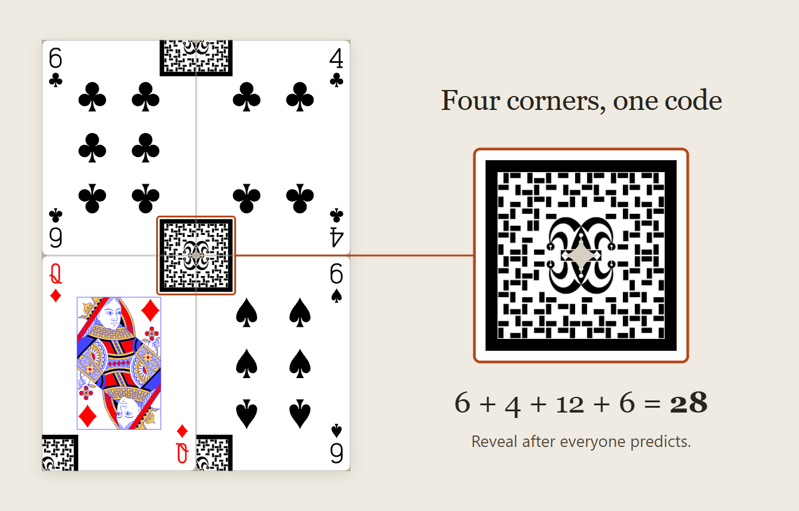

# QRoker 큐로커

> **Kiro**를 사용해 전체 설계([스펙](.kiro/specs), [스티어링](.kiro/steering))와 반복 검증([훅](.kiro/hooks), 비공개 예측·동시 공개 테스트)을 중심으로 구축한 프로젝트입니다.

큐로커 카드에는 모서리 두 곳에 무늬가 있습니다. 2×2로 놓인 네 장의 무늬가 중앙에서 만나면 코드가 완성됩니다. 각자 네 숫자의 합을 예측하고, 자기 예측이 정답에 얼마나 가까운지에 따라 점수를 받습니다. 두 사람이 정확히 맞히면 두 사람 모두 10점입니다.

**[브라우저에서 바로 플레이](https://goalan70-eng.github.io/qroker-kiroween/)** · [English](README.md) · [심사판 소스](https://github.com/goalan70-eng/qroker-kiroween/tree/kiroween-2026-final)

| 하고 싶은 일 | 방법 |
| --- | --- |
| 혼자 또는 함께 플레이 | 브라우저에서 **Start game**을 누르면 AI 세 명과 시작합니다. 최대 네 사람이 한 기기를 돌려가며 할 수 있습니다. 기본 언어는 영어이며 언어 메뉴에서 한국어를 선택할 수 있습니다. |
| 인터넷 없이 플레이 | [QRoker.html](https://github.com/goalan70-eng/qroker-kiroween/releases/download/kiroween-2026-final/QRoker.html)을 내려받아 Chrome이나 Edge에서 엽니다. 효과음과 카드 도안도 들어 있습니다. |
| 실물 카드로 내 점수 기록 | Android 8 이상에 [기본 APK](https://github.com/goalan70-eng/qroker-kiroween/releases/download/kiroween-2026-final/QRoker-Offline.apk)를 설치합니다. 예전 보관본에서 설치했다면 [보관본용 업데이트](https://github.com/goalan70-eng/qroker-kiroween/releases/download/kiroween-2026-final/QRoker-Offline-ArchiveUpdate.apk)를 사용해야 기존 점수를 유지할 수 있습니다. |

## 첫 턴부터 채점까지

1. 손패 세 장 중 하나와 기존 카드의 상하좌우에 표시된 칸을 고릅니다. 클럽과 스페이드는 180° 돌릴 수 있습니다. 체크 표시를 누르면 배치가 확정됩니다.
2. 새 코드가 없으면 첫 턴부터 한 장을 뽑습니다. 네 카드의 모서리가 코드를 완성하면 각자 합을 예측합니다. A는 1, J는 11, Q는 12, K는 13입니다. 정확히 맞히면 10점입니다.
3. **일반 모드**에서는 중앙 네 장을 펴고 시작합니다. 모두가 예측하면 완성된 네 장과 정답 합을 공개합니다. **블라인드 모드**에서는 내 손패를 볼 수 있고 보드는 끝까지 뒷면입니다. 예측 후에는 ‘정답 합과 점수’ 또는 ‘점수만’ 중에서 선택한 정보를 보여줍니다.

**두 턴 만에 코드를 만들어 보려면** 새 게임에서 일반 모드, 사람 4명, 시드 `1`을 선택하세요. 첫 사람은 D3에 ♣6을 그대로 놓고, 두 번째 사람은 E3에 ♣4를 놓으면서 180° 돌린 뒤 확정합니다. 혼자서도 화면의 차례 넘기기를 확인하며 네 자리의 예측을 모두 입력할 수 있습니다.

실물 카드에서는 앱의 **코드 인식 → 이 코드 고정**을 차례로 누르세요. 고정되면 휴대전화를 내려놓고 4~52의 예측값을 입력해 채점합니다. 내 예측과 획득 점수를 확인할 수 있습니다. 같은 네 장을 다시 비추면 중복으로 처리합니다. 네 장 중 한 장이라도 다른 카드로 바뀌어 새 코드가 완성되면 합이 같아도 따로 채점합니다. [Android 설치·사용 안내](prototypes/android-offline-companion/README.ko.md) · [실물 카드 시험표](docs/validation/offline-reader-real-device-ko.md)

## Kiro 기반 개발과 출처

큐로커의 핵심 설계와 기반 구현은 Kiro의 스펙([`.kiro/specs/`](.kiro/specs)), 스티어링 규칙([`.kiro/steering/`](.kiro/steering)), 6개의 커맨드 훅([`.kiro/hooks/`](.kiro/hooks))을 중심으로 진행되었습니다.

- **핵심 스펙과 구현 (`tasks.meta.json` 실행 기록 보존)**: Kiro의 `qroker-game` 스펙(`kiroween-2026-final` 기준 실행 이력이 있는 작업 37개, 완료 표시 36개)으로 52장 Optical V1 코드북, 마커 검출·복호화 파이프라인, 대규모 합성 광학 검증(168,000회 기하 스윕 오탐 0건·63,024회 비트플립 검증, 한계는 [`OPTICAL-STATUS.md`](docs/optical/OPTICAL-STATUS.md)에 명시)을 구축했습니다. `qroker-playable-game` 스펙(같은 태그 기준 실행 이력이 있는 작업 58개, 완료 표시 76개)으로 순수 TypeScript 게임 엔진, AI 전략, 헤드리스 시뮬레이션 하네스, 버전 관리 오프라인 저장/복원, 다국어화, UI 셸, 배치 인터랙션, Playwright E2E 기반 및 CI 워크플로를 구축했습니다. 세 번째 스펙(`qroker-optical-v2`)은 Optical V2 설계 제안을 담고 있습니다.
- **후속 설계·규칙 확정·밸런스 실험·프라이버시 검증**: 후반부에도 Kiro가 [Android 컴패니언 프로토타입 인수인계 설계서(0~10절)](docs/optical-v2/android-prototype-handoff.md) 작성, Rules v4(3장 손패·[덱 소진 종료 규칙](docs/validation/deck-exhaustion-rule-verification-ko.md)) 명세 확정, [블라인드·AI 조합 완성 기회 및 선공 밸런스 실험](docs/validation/kiro-ai-completion-opportunities-results-ko.md), 실기기 ScreenCheck 체크리스트 작성을 맡았습니다. 프로젝트 스티어링은 좌석별 뷰 분리(`boundaries.test.ts`로 강제), 비공개 예측 보호, 동결된 V1 코드북 보존을 규정하며, Kiro는 차례 넘기기·공개 타이밍·엔진 수준 24가지 제출 순서 불변성·브라우저 동시 다중 코드 채점도 검증했습니다(엔진과 브라우저 증거를 분리 기록).
- **Codex 후속 작업 구분**: 후반의 수용 테스트 보강, 승인된 규칙 v4·블라인드 모드 등 UI/규칙 확장, Android 오프라인 점수 기록 앱, 릴리스 패키징은 Codex로 진행했으며 Kiro와 Codex의 기여 기록은 분리해 유지합니다.

[전체 규칙과 점수표](PROJECT_BRIEF.md) · [빌드와 테스트](docs/practice-mode.md) · [Kiro 검증 기록](docs/validation/kiro-private-guess-reveal.md) · [개발 이력](docs/kiroween-development-log.md) · [배포 파일 전체](https://github.com/goalan70-eng/qroker-kiroween/releases/tag/kiroween-2026-final) · [도안·효과음 출처](docs/submission/credits.md)
