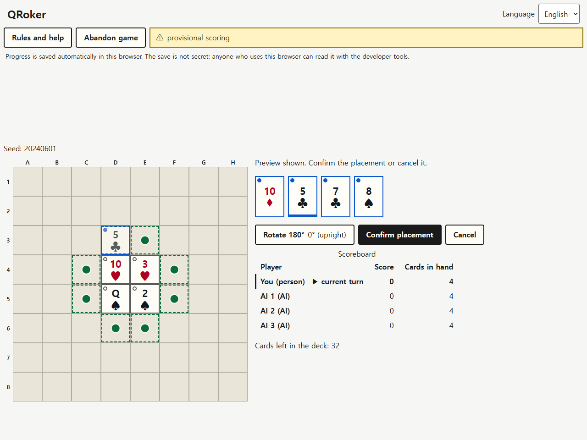

# QRoker

QRoker is a card-placement and deduction game. Players build 2×2 groups,
privately predict their card-value sums, and compete on points. The current
deliverable is a browser Practice Mode with Korean and English interfaces,
local AI opponents and shared-device human play.



[Submission materials](docs/submission/README.md) ·
[Run and play guide](docs/practice-mode.md) ·
[Current project brief](PROJECT_BRIEF.md) ·
[Development provenance](docs/kiroween-development-log.md)

## Release candidate status

This documentation describes the `codex/issue-5-submission-materials` release
candidate as of 2026-11-16, proposed in
[draft PR #15](https://github.com/goalan70-eng/qroker-kiroween/pull/15).
It includes the work proposed in draft PRs
[#12](https://github.com/goalan70-eng/qroker-kiroween/pull/12),
[#13](https://github.com/goalan70-eng/qroker-kiroween/pull/13) and
[#14](https://github.com/goalan70-eng/qroker-kiroween/pull/14).
Those PRs remain unmerged; `main` was at `3ca08b9` when this candidate was
assembled. Select the candidate branch to reproduce this version.
No public application URL or published YouTube demo is available yet.
A local English-captioned demonstration has been recorded; its
[evidence and limits](docs/submission/recording-evidence.md) are available for review.

## Play locally

Install Node.js 24 and npm, then run these commands from this checkout:

```sh
npm ci
npm run dev -- --host 127.0.0.1
```

Open the URL printed by Vite, normally `http://127.0.0.1:5173/`. Choose the
language, 1–4 human players, AI levels and board visibility, then start.
Unfilled seats use local `BEGINNER` or `ADVANCED` algorithms. No account,
credentials, paid AI service or external model call is needed for gameplay.
These tier names do not establish a measured strength ordering.

Select a legal empty board cell and a card from your hand, in either order,
or drag a hand card onto the board. Confirm the preview to place the card.
Clubs and spades can rotate 180°. When a valid group forms, enter an integer
Guess from 4 to 52 for each pending group. All four seats submit before the
sum and earned points are revealed. Continue until a player empties their
hand and the final ranking appears.

## Current rules

- Use 52 distinct cards, without Jokers: A=1, 2–10 at face value, J=11,
  Q=12 and K=13. Start with four neutral cards at D4, E4, D5 and E5,
  four cards per player's hand and 32 cards in the draw pile.
- Place a hand card into an orthogonally adjacent empty cell. Placed cards
  cannot be swapped, moved or removed. A 2×2 group counts only when each
  card's inward corner carries a fragment; each four-card set scores once.
- Draw one card when no new valid group forms, except on each seat's first
  placement. Creating a valid group avoids the draw. An empty draw pile
  does not end the game.
- New games use provisional points: exact=10; absolute errors 1–5 earn
  5,4,3,2,1; larger errors earn 0; emptying a hand earns +5. There is no
  group-completion bonus. Older saves retain their stored score table.
- The starting group is never scored. Finish the final placement's Guess
  collection and scoring before ending the game. Rank by total points,
  with shared competition ranks for ties (e.g. 1,1,3,4).

## Privacy and saving

`OWNER_ONLY` hides other players' unrevealed board identities by default;
`FACE_UP` exposes board identities. Players see only their own hands and
own pending Guess entries. Other players' Guess values remain undisclosed,
including after the game ends. Hot-seat privacy relies on honest device
hand-over. Replay saves contain private information accessible through
browser storage; see the [privacy and saving guide](docs/practice-mode.md#privacy-and-saving).

## Build and verify

```sh
npm run build
npm run preview -- --host 127.0.0.1
```

Open the printed preview URL, normally `http://127.0.0.1:4173/`. The build
produces `dist/`, which can be served by a static HTTP server. Opening
`index.html` directly with a `file:` URL is unsupported. Preview verifies a
local build; it does not publish the application.

Run the checks from the repository root:

```sh
npm run typecheck
npm run typecheck:game
npm run check:codebook
npm run test:ci
npm run build
npx playwright install chromium
npm run test:e2e
```

`npm test` is the uncapped Vitest alternative; `test:ci` limits workers to
four. Vitest includes headless games, property tests, fake-DOM tests and
synthetic optics. Playwright runs real headless Chromium regressions.
See the [P1 evidence report](docs/practice-mode-p1-report.md) for executed
results and limits, and the [full guide](docs/practice-mode.md) for fresh
production-preview tests. These local commands require no credentials,
paid model calls or Kiro credits.

## Scope and unfinished work

The Practice Mode operates locally after its assets load. Installable PWA
support, Service Worker caching and verified offline relaunch remain
unfinished. `EXPERT` AI and the full simulation-based balance study are
also deferred. The current score table remains provisional.

The separate optical prototype uses a **custom optical marker, not a
standard QR code**. It is not integrated into the browser game's runtime.
All current optical results are synthetic. Printed cards, phone-camera
performance, physical privacy controls, full tabletop play and the Physical
Scoring Companion remain unverified or incomplete. See the
[optical status](docs/optical/OPTICAL-STATUS.md) and
[physical-test protocol](docs/optical/physical-test-protocol.md).

## Specifications and attribution

[Approved game requirements](.kiro/specs/qroker-game/requirements.md) and the
[playable-game specification](.kiro/specs/qroker-playable-game/requirements.md)
describe the game. Historical task checkboxes are preserved and may lag
the evidence reports. The [initial concept brief](docs/history/PROJECT_BRIEF.initial.md)
is superseded and retained as history.

The repository retains genuine Kiro specifications, hooks and task history.
The owner reports Kiro as the primary historical development tool; Codex
performed the later audits, score revision, optical repair and submission
preparation recorded in the [provenance log](docs/kiroween-development-log.md).
The log distinguishes inspected artifacts, owner-reported history and
actual Codex work; it does not relabel Codex contributions as Kiro work.

License selection is pending owner confirmation; review the
[complete proposal](docs/submission/license-choice.md). The finalized terms
belong in root `LICENSE`; this candidate does not yet claim an open-source license.
