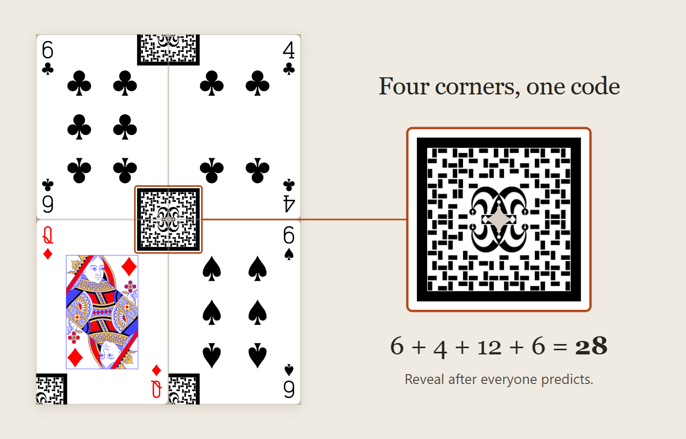

# QRoker

> Designed and iteratively verified with **Kiro** ([specs](https://github.com/goalan70-eng/qroker-kiroween/tree/kiroween-2026-final/.kiro/specs), [steering](https://github.com/goalan70-eng/qroker-kiroween/tree/kiroween-2026-final/.kiro/steering), [hooks](https://github.com/goalan70-eng/qroker-kiroween/tree/kiroween-2026-final/.kiro/hooks)) across the Optical V1 architecture, browser game foundation, and privacy/reveal checks.

Each QRoker card has two marked corners. Place a card so that four marked corners meet in the middle of a 2×2 square. Everyone privately predicts the sum of the four ranks. Each prediction earns points independently, so two exact guesses earn 10 points each.

**[Play QRoker in your browser](https://goalan70-eng.github.io/qroker-kiroween/)** · [한국어 안내](README.ko.md) · [Rules and scoring](https://github.com/goalan70-eng/qroker-kiroween/blob/kiroween-2026-final/PROJECT_BRIEF.md) · [Try a code in two moves](https://github.com/goalan70-eng/qroker-kiroween/blob/kiroween-2026-final/docs/practice-mode.md#make-your-first-code-in-two-moves)



| Choose how to play | What you need |
| --- | --- |
| [Play online](https://goalan70-eng.github.io/qroker-kiroween/) | A browser. Play solo against three local AI opponents, or up to four people can share one device. |
| [Download the offline web game](https://github.com/goalan70-eng/qroker-kiroween/releases/download/kiroween-2026-final/QRoker.html) | Open `QRoker.html` in Chrome or Edge. The game, artwork and sound are in the file. |
| [Install the Android scorekeeper](https://github.com/goalan70-eng/qroker-kiroween/releases/download/kiroween-2026-final/QRoker-Offline.apk) | Android 8 or later and a four-card QRoker marker. If updating an archive-signed installation, use the [archive update APK](https://github.com/goalan70-eng/qroker-kiroween/releases/download/kiroween-2026-final/QRoker-Offline-ArchiveUpdate.apk) to keep your scores. |

## Your first turn

1. Select **Start game** for the default table with three AI opponents. Look at your three cards and the four face-up cards in the center.
2. Select a card and a marked square next to an existing card. Clubs and spades can turn 180°. Press the check mark to place it. If it makes no new code, you draw a card.
3. When four corners complete a code, each player predicts a sum from **4 to 52**. In **Normal**, the four cards and their sum appear after the last prediction. In **Blind**, the board stays face down. Choose whether to show the correct sum with the points or just the points.

The web game opens in English on first use and runs without an account or a phone. At a physical table, the Android app keeps one player's scores. Tap **Scan code**, center the four-card marker, then tap **Lock code**. You can lower the phone before entering your guess. [Android installation and first scan](https://github.com/goalan70-eng/qroker-kiroween/blob/kiroween-2026-final/prototypes/android-offline-companion/README.md)

## Build the version judges play

To reproduce the judging build, check out the [kiroween-2026-final tag](https://github.com/goalan70-eng/qroker-kiroween/tree/kiroween-2026-final). The [release downloads](https://github.com/goalan70-eng/qroker-kiroween/releases/tag/kiroween-2026-final) include the standalone web game and Android scorekeeper.

```sh
git clone --branch kiroween-2026-final https://github.com/goalan70-eng/qroker-kiroween.git
cd qroker-kiroween
npm ci
npm run build:standalone
```

Use Node.js 24 and npm. Open `dist/QRoker.html`, or run `npm run build` to generate the static site in `dist/web/`. The public source includes the game's 52 marked card faces. [Running and testing the game](https://github.com/goalan70-eng/qroker-kiroween/blob/kiroween-2026-final/docs/practice-mode.md)

## Built with Kiro and credits

Kiro drove QRoker's spec-first design and core foundation across three specifications ([`.kiro/specs/`](https://github.com/goalan70-eng/qroker-kiroween/tree/kiroween-2026-final/.kiro/specs)), workspace steering rules ([`.kiro/steering/`](https://github.com/goalan70-eng/qroker-kiroween/tree/kiroween-2026-final/.kiro/steering)), and six command-only hooks ([`.kiro/hooks/`](https://github.com/goalan70-eng/qroker-kiroween/tree/kiroween-2026-final/.kiro/hooks)):

- **Core specs and implementation (`tasks.meta.json`)**: Kiro's `qroker-game` spec (37 tasks with execution history, 36 marked complete at `kiroween-2026-final`) built the frozen 52-card Optical V1 codebook, marker detection/decoding pipeline, and synthetic optical validation (including a 168,000-trial geometry sweep with zero false accepts and 63,024 bit-flip checks, documented with limits in [`OPTICAL-STATUS.md`](https://github.com/goalan70-eng/qroker-kiroween/blob/kiroween-2026-final/docs/optical/OPTICAL-STATUS.md)). Its `qroker-playable-game` spec (58 tasks with execution history, 76 marked complete at the same tag) built the pure TypeScript game engine, AI opponents, headless simulation harness, versioned offline save/resume persistence, localization, UI shell, placement interaction, Playwright E2E baseline, and CI workflow. A third spec (`qroker-optical-v2`) documents the Optical V2 proposal.
- **Ongoing Kiro specs, handoff, balance experiments, and verification**: Even during later iterations, Kiro authored the [Android companion handoff specification (sections 0–10)](https://github.com/goalan70-eng/qroker-kiroween/blob/kiroween-2026-final/docs/optical-v2/android-prototype-handoff.en.md), finalized the Rules v4 three-card and [deck-exhaustion specifications](https://github.com/goalan70-eng/qroker-kiroween/blob/kiroween-2026-final/docs/validation/deck-exhaustion-rule-verification.md), ran [Blind-mode and AI balance experiments](https://github.com/goalan70-eng/qroker-kiroween/blob/kiroween-2026-final/docs/validation/kiro-ai-completion-opportunities-results.md), and drafted the ScreenCheck playtest checklist. Project steering enforces seat-specific views (`boundaries.test.ts`), keeps private predictions out of shared views, and protects the frozen V1 codebook. Kiro also verified player handoffs, reveal timing, all 24 prediction submission orders at the engine level, and simultaneous multi-code scoring in Chromium, keeping engine and browser evidence separate.
- **Follow-up work with Codex**: Codex contributed follow-up acceptance tests, owner-approved rule and UI updates (including rules v4 and Blind mode), the offline Android scorekeeper, and release packaging. Kiro and Codex records are kept distinct.

[Kiro specs](https://github.com/goalan70-eng/qroker-kiroween/tree/kiroween-2026-final/.kiro/specs) · [Steering](https://github.com/goalan70-eng/qroker-kiroween/tree/kiroween-2026-final/.kiro/steering) · [Hooks](https://github.com/goalan70-eng/qroker-kiroween/tree/kiroween-2026-final/.kiro/hooks) · [Detailed Kiro test record (English)](https://github.com/goalan70-eng/qroker-kiroween/blob/kiroween-2026-final/docs/validation/kiro-private-guess-reveal-en.md) · [Development log](https://github.com/goalan70-eng/qroker-kiroween/blob/kiroween-2026-final/docs/kiroween-development-log.md)

The software is licensed under the GNU AGPL-3.0-only. Card illustrations, help artwork and sounds have their own credits. [Software license](https://github.com/goalan70-eng/qroker-kiroween/blob/kiroween-2026-final/LICENSE) · [Artwork and sound credits](https://github.com/goalan70-eng/qroker-kiroween/blob/kiroween-2026-final/docs/submission/credits.md)
