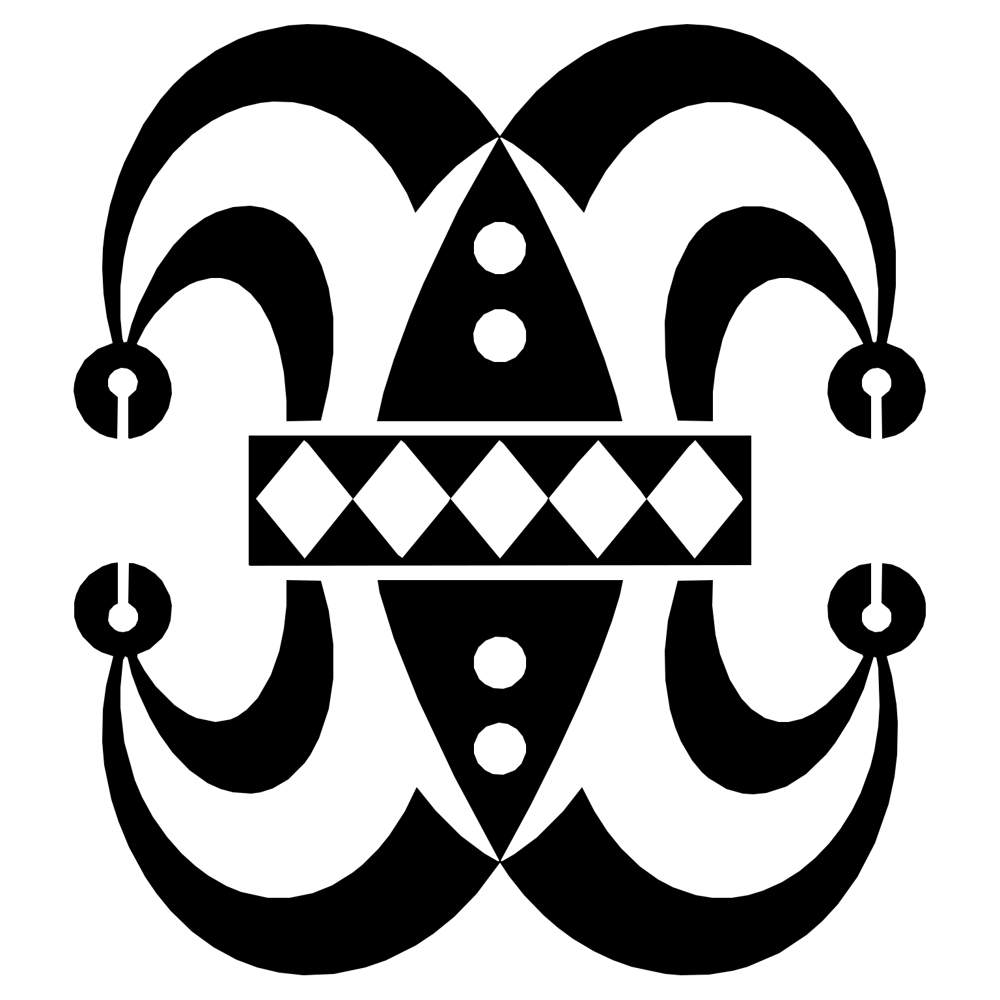

# QRoker Composite Code V2 — 구현·검증 계획안

> **상태:** DRAFT / 계획 문서만 작성. 구현·승인·실물 검증 완료를 뜻하지 않음.  
> **작성일:** 2026-11-16 (KST)  
> **근거:** 프로젝트 사용자가 대화에서 명시한 V2 요구사항 및 공개 GitHub `main` 설계.  
> **기여 구분:** 이 문서는 ChatGPT가 정리한 신규 계획안임. 기존 Kiro의 설계·구현 기여, Codex의 수정·테스트 기여와 혼동하지 않음.

## 사용자 제공 조커 도안 — 시각 참조 (V2 구현 아님)

- **자산:** [joker-four-piece-reference.svg](./assets/joker-four-piece-reference.svg). 사용자가 제공한 흑백 이미지를 기하학적으로 벡터화한 참조 도안이며, 원본 픽셀 파일과 바이트 단위로 동일하지 않음. 실제 광학 데이터, 코드북, 판독기, 인쇄용 확정 도안은 아님.
- **의도한 외형:** 4개 카드 모서리가 만나 하나의 조커 장식을 이루고, 광학 마커는 완전하고 유효한 네 조각에서만 판독 성공. 카드 모서리의 둥근 절단 형상으로 인한 **Central_Void**는 최종 렌더러에서 별도 마스크로 구현·검증할 것(현재 참조 이미지에 실제 구멍은 적용되지 않음).
- **선행 검증:** 52장 고정 인쇄, 수트별 인쇄 위치, 의미 있는 180° 회전, 여러 2×2 배치의 형상 일관성(M1)을 확인하고 장식 없는 기준선과 판독 성능을 A/B 비교(M4). 그림 때문에 잘못된 수락이 늘어나면 단순화하거나 제거.
- **변경 출처:** 사용자가 제공한 이미지에 기반하여 ChatGPT가 GitHub PR #18의 문서용 참조 자산을 추가. Kiro 명세/코드 변경이나 완료 주장 없음.

## 0. 목적과 범위

52장(조커 카드 없음)의 QRoker 물리 카드에 인쇄한 **고정된 광학 조각 네 개**가 유효한 2×2 배열을 만들면, **시각적으로 하나의 큰 정사각형 Composite Code**가 나타나도록 설계한다. 중앙에는 카드 네 장의 둥근 꼭짓점으로 생긴 작은 **Central_Void**만 허용한다. 공식 스캐너는 **검증된 네 조각이 모두 있을 때만** 유효한 카드 4장과 `Hidden_Sum`을 반환한다.

각 카드의 광학 데이터는 서로 구별 가능해야 하나, 일반 사용자가 **마커 모양만 육안으로 비교했을 때** 서로 쉽게 구별하지 못하도록 한다. 이 목표는 암호학적 비밀성이나 카드 신원 유출 방지를 의미하지 않는다.

사용자가 제공한 **흑백 조커 일러스트**는 **인식 마크 내부**에서 네 조각을 합쳤을 때 완성되는 **선택적 장식**으로 사용한다. 기준선보다 판독 정확도·오인식·거부율·인쇄 내성이 악화되면 단순화하거나 **완전히 제거한다**. 조커는 게임의 53번째 카드가 아니다.

장기 제품 흐름: **포장지의 표준 QR코드 → QRoker 공식 웹사이트(HTTPS) → 브라우저 카메라 권한 → 완성된 카드 Composite Code 촬영 → Guess 수집 이후 Hidden_Sum·점수 처리**. 별도 네이티브 앱은 필수가 아니다. 기존 오프라인 우선 원칙에 따라 가능하면 카메라 이미지·판독을 기기 내에서 처리한다.

### 제외 사항
- 표준 ISO QR코드 네 조각이 재조합되어 일반 QR 스캐너로 읽히도록 만드는 작업은 목표가 아니다.
- 카드 1~3장으로부터 **누구도 카드 신원을 역분석할 수 없다**는 보안 보장은 목표가 아니다. 공식 스캐너에서 **부분 결과를 반환하지 않는 것**이 요구사항이다.
- 현 단계에서 상용 인쇄·휴대폰 인식 성공률을 보장하지 않는다.
- V1 코드북/광학 구현을 삭제하거나 현재 게임 규칙·점수·AI를 변경하지 않는다.

## 1. 기존 GitHub의 검증된 출발점

- `.kiro/specs/qroker-game/requirements.md`: 52장, 카드별 두 광학 모서리, ♥ TL/BR·♦ TR/BL·♣ TR/BR·♠ TL/BL, 카드 배치 0° 또는 의미 있는 경우 180°, 2×2 유효 조합, `Hidden_Sum`.
- `src/optical/codebook.v1.json`: 52개의 동결된 5×5 데이터 패턴. **변경 금지**. V2가 별도 포맷을 요구하면 새로운 버전으로 생성하고 명시적 호환성 정책을 둔다.
- `src/optical/fragments.ts`, `render.ts`, `detect.ts`, `decode-fragment.ts`, `decode-group.ts`: V1의 네 개 **독립 마커** 검출·해독·그룹화. V2의 요구사항과 동등하지 않음.
- `src/optical/testing/physical-card.ts`: 기본 카드 63.5 × 88.9 mm, 반경 3.175 mm, 모듈 1.5875 mm, 중앙 공백 및 절단 경계 합성.
- `docs/optical/OPTICAL-STATUS.md`: V1의 성공률은 합성 이미지 결과이며 실물 카드·휴대폰 검증은 아직 없음.
- PR #14는 약 45° 검출 문제를 개선하고 인쇄/촬영 평가 준비를 했으나 **초안 PR**이며 `main`에 병합되지 않음. PR #12–#15는 별도 변경 스택. 본 계획은 이들을 자동으로 완료/병합한 것으로 간주하지 않는다.

## 2. 확정 요구사항 (R)

| ID | 요구사항 | 검증 기준 |
| --- | --- | --- |
| R01 | 완성된 2×2 네 조각은 **하나의 정사각형으로 보일 것** | 외곽 비율/정렬과 연결된 패턴을 출력 이미지 및 실물로 검사 |
| R02 | 설계상 중앙의 빈 공간은 둥근 꼭짓점의 `Central_Void`에 한정 | 모서리 곡선·절단선 내 데이터·여백 포함 여부의 기하 검증; 생산상 미세 이음선은 별도 허용오차로 관리 |
| R03 | 카메라에서 1·2·3조각으로는 성공 결과를 반환하지 않을 것 | 4개 조각 각각의 모든 누락 부분집합 및 배경/교란/회전 시험에서 `IDENTIFIED` 0건 |
| R04 | 네 조각이 있어도 문양별 위치, 0°/180° 회전, 중복 카드 등 불법 조합은 거부 | 전체 유효성 판정·음성 테스트; 기존 게임 엔진의 규칙을 기준으로 비교 |
| R05 | 유효한 완성 코드에서는 카드 네 장의 **정확한 신원과 합계**를 반환 | 정답은 판독기로 전달하지 않고 사후 독립 비교 |
| R06 | 광학 조각만의 육안 구별을 어렵게 할 것 | 일반 사용 거리·조명에서 라벨/숫자 가린 A/B 시각 구별 시험; 목표·측정값 공개, 보안으로 홍보 금지 |
| R07 | 사용자 제공 조커 그림을 **마커 내부의 선택적 장식**으로 사용 | 장식 없음(Baseline) vs 장식 있음(A/B)으로 같은 입력 분포에서 측정; 악화 시 제거 |
| R08 | 기존 카드 52장·수트별 인쇄 모서리·회전·양면 동작과 일치할 것 | 모든 허용 위치/회전 변환에서 같은 조커 외형·정확한 신원·합계가 나오는지 검증 |
| R09 | 스캔 대상 **중앙 네 카드**만 판독할 것 | 주변 다른 완성 코드가 있어도 `targetRegion` 밖 결과를 자동 적용하지 않음 |
| R10 | 웹에서 카메라로 판독하고 수동 입력으로 대체할 수 있을 것 | HTTPS·권한 거절·브라우저 호환성·오프라인 재방문·오류복구 확인 |
| R11 | Guess를 모두 확정하기 전에는 신원·합계를 공개하지 않을 것 | UI/저장·로그/상태 흐름의 정보 공개 순서를 게임 규칙과 대조 |

**모호성 해소:** R03은 **공식 스캐너/API의 원자적 최종 출력 정책**이다. 내부 이미지 처리에서 부분 특징을 계산할 수는 있지만, 1~3조각으로는 성공·카드 ID·합계 결과를 공개하지 않는다. 이미 공개된 정적 코드 패턴의 역공학을 차단한다고 주장하지 않는다. 물리 카드의 숫자/문양이 직접 보이는 문제도 별개다.

## 3. 설계 원칙과 타당성 검증

1. **고정 인쇄:** 각 카드는 게임 중 변화하지 않는 고유 조각을 가진다. 임의의 네 카드마다 새로운 QR코드를 생성한다는 전제를 사용하지 않는다. 같은 카드 조각이 서로 다른 유효 그룹 위치에 놓여도 규칙상 정상 판독되어야 한다.
2. **기하 구조:** 전체 정사각형의 중심을 네 카드가 만나는 정점으로 둔다. 네 카드가 인쇄할 사분면 데이터·기준 프레임은 카드 모서리, 절단선, `Central_Void`, 인쇄 오차 및 이음선과 충돌하지 않도록 한다. **데이터를 절단선/중앙 빈 공간에 넣지 않는다.**
3. **시각적 일체감:** 네 사분면 사이에 의도적인 넓은 흰 띠가 생기지 않도록 설계한다. 다만 카드의 실제 이음선, 인쇄 여유, 외곽의 인식용 quiet-zone 요구는 물리적으로 무시할 수 없으므로, '중앙만 공백'은 **목표 외형**이며 실물 가공 허용오차는 실험으로 확정한다.
4. **불변 변환:** ♠/♣의 의미 있는 180° 회전 및 ♥/♦의 점대칭이 조커 장식·기계 판독과 충돌할 수 있다. 그림은 정확한 변환 대칭성을 갖도록 보정하며 **모든 수트/위치/회전의 유효 조합**을 검사한다. 일반 그림을 단순 4등분했을 때 이 조건이 자동 충족된다고 가정하지 않는다.
5. **판독 우선:** 장식 영역은 인식에 필수적인 데이터·위치 기준·오류 정정·quiet-zone을 침범하지 않는다. 완성된 조커 그림의 크기/디테일보다 정답률·오인식 방지가 중요하다.
6. **V1 격리:** `src/optical/**` V1과 그 고정 코드북의 테스트를 보존한다. V2는 별도 모듈·새 파일·명시적인 버전으로 개발하고 합병 전 비교한다.

### 후보 아키텍처 비교 (결정 전 실험)

| 후보 | 개념 | 잠재적 장점 | 검증해야 할 리스크 |
| --- | --- | --- | --- |
| A. 전체 정사각형 프레임 우선 검출 | 외곽/방향 기준을 검출해 4사분면으로 정규화하고 조각 데이터 판독 | V2 외형과 가장 직접적 합치 | 카드 이음선·둥근 공백·원근·장식에 따른 프레임 손상, 기존 V1 판독기 재사용 제한 |
| B. 4개 데이터 영역을 내부적으로 판독한 뒤 **원자적 4개 검증** | V1의 코드북·해독 개념을 재사용하되 시각적으로 하나의 정사각형을 구현 | 기존 테스트 자산·오류 정정 일부 재사용 가능 | 분리된 quiet margin/검출기 구조가 '중앙만 공백' 외형과 충돌 가능. 새 인식 검증 필요 |

A/B를 모두 최소 프로토타입으로 평가하고, **외형·인식률·오인식·구현 비용의 실측 비교**로 방향을 결정한다. 후보 B도 공식 UI에 개별 마커 판독 결과를 노출해서는 안 된다.

## 4. 단계별 실행 계획과 중단 조건

### M0 — 기존 기준선 고정 (작업 전)
- [ ] `main` 및 열린 PR #12–#15의 상태, 테스트·증거·실험 환경 기록
- [ ] V1 코드북 SHA256·게임 규칙·기존 합성 성능을 기준선으로 고정
- [ ] 사용자 제공 조커 원본의 사용 권리·원본 파일 관리; 원본 이미지를 승인 없이 공개 저장소에 업로드하지 않음
- **완료 조건:** 버전·기준 테스트·출처가 문서화됨. 실제 새 구현은 없음.

### M1 — 기하학과 공통 그림의 실현 가능성
- [ ] 카드 모서리 반경 3.175mm 기준, 3.0–3.6mm 등 후보를 파라미터화
- [ ] 코드 전체 크기, 내부 데이터 셀, 기준 프레임, 중심 공백, 절단/인쇄 안전거리 모델링
- [ ] 52장/수트별 인쇄 위치 및 0°/180° 변환에서 **조커 형상이 한 가지로 일관되는지** 수학·렌더링으로 검증
- [ ] 중앙 외 필수 데이터가 잘리지 않고 유효 사분면이 충돌하지 않는지 검사
- **중단 조건:** 모든 유효 배치의 일관된 정사각형 그림이 고정 인쇄와 양립하지 않음. 그림 단순화/장식 제거 또는 구조 재설계부터 수행.

### M2 — V2 조각 생성기·렌더러 (광학 장식 OFF)
- [ ] `src/optical-v2/` 등 별도 경로에 실험용 코드·스키마 구축
- [ ] 52장의 고정 조각(수트·회전·거울 변환 포함)과 전체 정사각형 생성
- [ ] 후보 A/B의 작은 종합 이미지를 동일 조건으로 생성하고 코드 신원·합계 비교
- [ ] V1의 동결된 파일은 편집하지 않고, V2 포맷이 필요하면 `codebook.v2.*`를 별도로 생성
- **완료 조건:** 알려진 유효 샘플의 코드 인식이 가능하고 1~3조각은 공식 결과가 없음.

### M3 — V2 판독기와 안전한 결과 정책
- [ ] 카메라 방향·원근/좌우 반사·마커 정렬·타깃 정점 검출
- [ ] 완전한 4사분면 집합 여부를 **최종 결과 생성 전에** 검사
- [ ] 중복/불법 수트·회전/손상·모호함/대상 외 다른 그룹은 반환 금지 또는 명시적 오류
- [ ] 불완전 인식, 실제로 읽지 않은 ID 추정·대체, 단일 프레임 오인식에 의한 자동 채점 금지
- [ ] 승인된 4조각일 때만 `IDENTIFIED`·네 카드·`Hidden_Sum` 출력
- **완료 조건:** 정상 샘플 정확, 무효 샘플 거부. 거부를 성공률에 섞지 않음.

### M4 — 조커 장식 A/B 검증
- [ ] 사용자 제공 흑백 조커를 **인식 마크 내부에만** 배치하고 4사분면으로 나눔
- [ ] 중요 데이터/검출 기준/quiet-zone을 가리지 않도록 마스크 설계
- [ ] 장식 없음 vs 단순화 그림 vs 원본 기반 그림의 **동일한 시드·노이즈·기하 조건** 비교
- [ ] 정답률, 오인식, 불완전 거부, 촬영 민감도를 별도로 기록
- [ ] 회전·문양별 위치에 따른 조커 일체감 자동 평가
- **제거 기준:** 인식 기준선 대비 유의미한 성능 악화, 새로운 잘못된 수락, 기하 충돌이 발생하고 수정으로 해결되지 않으면 조커를 제거. 장식 제거 시에도 코드가 완성돼야 함.

### M5 — 합성 이미지 시험과 자동화
- [ ] 전체 유효 배치의 **정적 유효성** 전수 검사(가능한 조합 수 산정 후 중복 제거)
- [ ] 실제 이미지를 대상으로는 대표·층화된 세트로 회전 0/45/90/180/270°, 44.9/45.1°, 0/180° 카드 배치, 반사, 원근·가림, 밝기/노이즈/블러, 카드 간 틈·인쇄/재단 위치 오차 테스트
- [ ] 1/2/3조각 누락, 다른 코드의 교란, 중복 카드, 잘못된 방향, 유효한 다른 그룹이 화면에 존재하는 경우를 별도 음성 시험
- [ ] 시각 구별 시험(카드 표면의 원래 숫자·문양은 가리고 **마커만 평가**)
- [ ] baseline과 V2를 같은 조건에서 비교. 실패한 시드·입력 이미지·판독 결과 모두 기록
- **합성 시험 제안 게이트:** CLEAN 유효 정적 조합에서 사양 위반 0건; 누락/불법 그룹의 잘못된 `IDENTIFIED` 0건; 장식 ON이 OFF보다 신규 오수락을 만들지 않을 것. 임의 손상까지 무오류를 보장하는 목표가 아님.

### M6 — 실물 카드·휴대폰 테스트
- [ ] 인쇄 파일 생성·정확한 100% 배율·양면 방향·재단 반경·모듈 크기 실측
- [ ] 실제 카드 네 장을 2×2로 결합해 중앙 빈 공간, 이음선, 기준 프레임 및 인쇄 여유 확인
- [ ] 휴대폰/조명/종이/촬영 거리/방향별 독립 촬영. 실패 프레임을 버리지 않음
- [ ] 각 조건에서 정확 인식, 거부, **잘못된 수락**을 분리 집계하고 신뢰구간 표기
- [ ] 초기 제안: 정상 조건 100회 독립 촬영당 정확 판독률 95% 이상; 관찰된 잘못된 카드 수락 0건; 모바일 종단 간 스캔 목표 5초 이내. 이 값은 **출시 기준 제안**이며 검증된 결과가 아님.
- [ ] 포장/카드 재질 투과로 반대면 마커가 비치거나 손패 정보가 노출되는지 검증
- **중단 조건:** 실제 성능이 기준에 미달하면 조커 제거 및 검출 구조/인쇄 규격 수정 후 재시험. 양호한 합성 결과만으로 실물 성공 선언 금지.

### M7 — 공식 사이트 내 카메라 Scoring Companion (장기)
- [ ] 포장지 **표준 QR코드**로 공식 HTTPS 웹사이트 접속(도메인·호스팅은 추후 결정)
- [ ] 모바일 브라우저 `getUserMedia` 카메라 권한·권한 거절 시 안내, 수동 4장 입력 대체
- [ ] 코드 전체가 화면 안에 들어오는 오버레이와 `targetRegion` 매칭
- [ ] 판독기 코드를 브라우저 호환화(`node:fs` 의존성 분리 등), 가능하면 온디바이스 로컬 인식
- [ ] Guess 전원 제출 전 카드·합계를 노출하지 않는 UI/저장 상태 제약
- [ ] 초기 로드 후 Service Worker 기반 오프라인 재접속·기기별 저장/복원
- **완료 조건:** 실제 4장 촬영 → 올바른 그룹 확인 → 모든 Guess 수집 → 점수 확정이 휴대폰에서 반복 재현됨.

## 5. 측정·검증 매트릭스

| 유형 | 올바른 결과 | 확인 방법 |
| --- | --- | --- |
| 정확한 4조각 | 4 카드 ID와 정확한 합계 | 인식기에 정답 미주입; 독립 참조 비교 |
| 1/2/3조각 | `INCOMPLETE_GROUP` 또는 실패, **ID/합계 없음** | 각 누락 조합, 다른 완성 코드가 화면에 있는 경우 포함 |
| 불법 수트/회전/중복 | `INVALID_ARRANGEMENT`/거부 | 현행 규칙과 비교 |
| 중앙 빈 공간 | 정상 유효 코드 유지 | 모서리 반경, 절단 오차, 쉼표 모양 빈 영역 변화 시험 |
| 조커 ON | 장식 OFF 기준선보다 허용 불가능한 열화 없음 | 동일 조건 A/B 검증, 새로운 오수락 0 |
| 사람 눈의 마커 구별 | 사전 지정된 유사성 목표와 설문 결과 공개 | 참가자·거리·훈련 수준·정답률 기록 |
| 실제 촬영 | 정확 수락 / 거부 / 오수락 / 지연 기록 | 실물 100회 이상 독립 시험/조건, 권장 사전 등록 |
| 스캔 타깃 안전성 | 다른 정점으로 결과 바뀌지 않음 | `targetRegion` 실제 반환 좌표 검증 |
| 개인정보·게임 공정성 | Guess 전 카드 ID/합계 노출 없음 | UI/로그/저장·물리 가림 조치 확인 |

**통계 주의:** 유한 샘플에서 오수락 0건이라도 오류 확률 0이 증명되지는 않는다. 예컨대 독립 시험 100건에서 0건이면 단측 95% 상한은 약 2.95%다. 본 문서의 임계값은 실험 전 제안치로, 실물 테스트 전에 명확히 승인·고정한다.

## 6. 작업 관리와 출품 경계

- 우선순위는 **현재 Kiroween 제출용 브라우저 게임의 마무리·검증·공개 데모**가 더 높다. V2는 별도의 실험 트랙이며 V1의 안정성을 훼손하지 않는다.
- 구현은 `main`에 직접 덮어쓰지 않고 별도 branch/PR을 사용한다. 기존 Draft PR #12–#15 및 그 선후 관계를 존중한다.
- Kiro가 실제로 수행한 설계·작업과 Codex/다른 AI가 실제로 수행한 코드를 각각 사실대로 기록한다. 새 계획 문서만으로 Kiro 구현 기여가 생기지 않는다.
- `.kiro/` 승인 사양을 변경하거나 작업 완료 체크를 임의로 올리지 않는다. 프로토타입 검증이 끝나면 공식 요구사항에 반영할지 별도 검토한다.
- 인쇄용 카드·음악·장식에 대한 권리와 라이선스는 상용화 전 별도로 확인한다.

## 7. 첫 실행 패키지 (다른 AI/개발자에게 전달)

1. V1 기준선/기존 PR 상태를 읽고 코드북·기존 게임 로직은 건드리지 않는다.
2. **M1 타당성 증명**부터: 고정된 카드 조각, 수트별 모서리·180° 회전, 모든 유효한 2×2 배치에서 일관된 정사각형·조커 장식이 가능한지 검사한다.
3. M1 통과 후 **장식 OFF** 상태로 후보 A/B 최소 프로토타입 생성·판독을 구현한다.
4. 네 조각 원자적 성공, 누락/불법 조합 거부, 실제 물리 중심 공백 모델을 합성 검증한다.
5. 조커 ON과 OFF 비교 후 장식을 유지/단순화/제거한다. 그다음 실물 촬영을 진행한다.
6. 모든 실험에서 명령·커밋·환경·시드·샘플·성공/실패·미실행 항목·AI 기여 출처를 기록한다.

**완료의 정의:** 계획서 작성 자체는 V2 실현 가능성이나 구현 성공을 입증하지 않는다. 정사각형 외형·네 조각 전용 판독·실물 카메라 성능은 각각 독립적인 증거를 확보한 뒤에만 완료로 표시한다.
