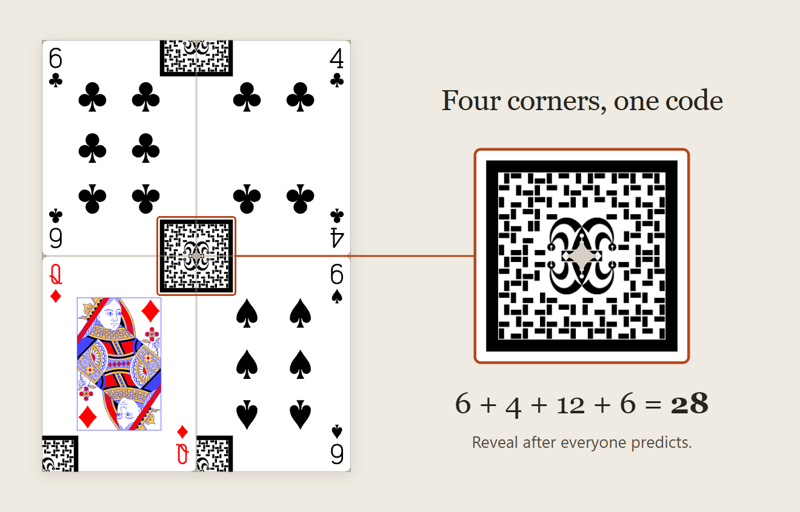

# QRoker

> Designed and iteratively verified with **Kiro** ([specs](https://github.com/goalan70-eng/qroker-kiroween/tree/kiroween-2026-final/.kiro/specs), [steering](https://github.com/goalan70-eng/qroker-kiroween/tree/kiroween-2026-final/.kiro/steering), [hooks](https://github.com/goalan70-eng/qroker-kiroween/tree/kiroween-2026-final/.kiro/hooks)) across the Optical V1 architecture, browser game foundation, and privacy/reveal checks.

## Elevator pitch
Four QRoker playing cards have a secret at the point where their marked corners meet. Place a card, complete the pattern, and predict the sum before anyone sees the answer.

## Category
Frankenstein

## What it does
QRoker connects a tabletop pattern, a browser strategy game, and an offline Android reader. Four players share a board. Each card has fragments of a custom optical marker printed in two corners. When four fragments meet, everyone privately guesses the sum of those cards. In Normal mode the table reveals the cards and scores together. In Blind mode you can see your hand, while cards on the board stay face down. You can play solo against three AI players or pass one screen between people.

## How we built it
The TypeScript engine tracks placement, orientation, guesses, and scores. It supplies a separate view for each seat so the shared display can hand off between players. The Android companion reads the joined marker from a single camera capture and locks the four card IDs. You can lower your phone before entering your guess. Two groups with the same sum are still distinct, and scanning the same four cards twice does not award points twice.

## How we used Kiro
Kiro drove QRoker’s spec-first architecture and core implementation across three specs, two steering files, and six command-only hooks, with Kiro’s task execution records preserved directly in `tasks.meta.json`:

- **Optical V1 & core game foundation (`qroker-game` & `qroker-playable-game`)**: The `qroker-game` spec (37 tasks with execution history in `tasks.meta.json`, 36 marked complete at `kiroween-2026-final`) defined the rules and built the frozen 52-card Optical V1 codebook, marker detection/decoding pipeline, and synthetic optical validation (including a 168,000-trial geometry sweep with zero false accepts and 63,024 bit-flip checks, with synthetic limits documented in `OPTICAL-STATUS.md`). The `qroker-playable-game` spec (58 tasks with execution history, 76 marked complete at the same tag) turned those rules into browser requirements and built the pure TypeScript engine, AI opponents, headless simulation harness, versioned offline save/resume persistence, localization, UI shell, placement interaction, Playwright E2E baseline, and CI workflow. A third spec (`qroker-optical-v2`) records the Optical V2 proposal. [Specs](https://github.com/goalan70-eng/qroker-kiroween/tree/kiroween-2026-final/.kiro/specs) · [Playable-game execution log (`tasks.meta.json`)](https://github.com/goalan70-eng/qroker-kiroween/blob/kiroween-2026-final/.kiro/specs/qroker-playable-game/tasks.meta.json) · [Optical status](https://github.com/goalan70-eng/qroker-kiroween/blob/kiroween-2026-final/docs/optical/OPTICAL-STATUS.md)
- **Ongoing specs, Android handoff & balance experiments**: Throughout later iterations, Kiro remained the specification and validation backbone—authoring the Android companion handoff design (sections 0–10), finalizing the Rules v4 three-card and deck-exhaustion specifications, designing and analyzing Blind-mode turn-order and AI code-completion experiments, and writing the ScreenCheck playtest checklist. [Android handoff](https://github.com/goalan70-eng/qroker-kiroween/blob/kiroween-2026-final/docs/optical-v2/android-prototype-handoff.en.md) · [Rules v4 verification](https://github.com/goalan70-eng/qroker-kiroween/blob/kiroween-2026-final/docs/validation/deck-exhaustion-rule-verification.md) · [AI completion study](https://github.com/goalan70-eng/qroker-kiroween/blob/kiroween-2026-final/docs/validation/kiro-ai-completion-opportunities-results.md)
- **Steering & architecture boundaries**: The project steering file requires screens to receive a seat-specific view of the game. A boundary test enforces the import rule that keeps screens from reading the full game state. Steering also keeps private predictions out of shared views and protects the frozen V1 codebook. A separate steering file guides Optical V2 work. [Steering files](https://github.com/goalan70-eng/qroker-kiroween/tree/kiroween-2026-final/.kiro/steering)
- **Hooks & verification**: The repository includes six configured hooks for recording task starts, guarding shell commands, checking TypeScript on save, sending optional turn notifications, checking completed tasks, and requesting an optional external review. The November 24 session verified save-time checks. On November 29 (KST), Kiro ran task 21.3 at revision `de5bcc570b32`. The local journal recorded the start at 00:17:55 and post-task verification at 00:19:27. The game typecheck passed and the full game test step failed, so the hook recorded `passed: false`. The post-task hook ran again after task 22.2 at 01:49:29 KST on November 29 (HEAD 226af239faae with local changes). The game typecheck passed and the game test step exited with code 1. In a separate terminal run, all 3,050 Vitest tests passed, alongside 59 Chromium tests on the development server and 48 on the production preview. After task 22.2 was rerun, Kiro's automatic post-task hook recorded `passed: true` at 02:21:06 KST on November 29 (HEAD `226af239faae` with local changes). Both the game typecheck and the game tests passed. Kiro also verified that the next player could not see the previous prediction and that four seats received their scores together after the final submission—covering all 24 submission orders at the engine level and verifying single- and two-code simultaneous reveals (10 + 5 = 15 points) in Chromium. [Hook configurations](https://github.com/goalan70-eng/qroker-kiroween/tree/kiroween-2026-final/.kiro/hooks) · [Kiro’s test record (English translation)](https://github.com/goalan70-eng/qroker-kiroween/blob/kiroween-2026-final/docs/validation/kiro-private-guess-reveal-en.md)

After Kiro established the specs and core optical/web foundation, Codex handled follow-up acceptance tests, approved rules v4 and UI refinements (including Blind mode), the offline Android scorekeeper, and release packaging, keeping Kiro and Codex contribution records distinct. [Development log](https://github.com/goalan70-eng/qroker-kiroween/blob/kiroween-2026-final/docs/kiroween-development-log.md)

## What we learned
A correct score is only half of a working turn. Showing it one action too soon gives the next player the answer. For the physical version, keeping a code locked after the phone moves matters just as much as recognizing it in the first place.

## Try it
Start with the default table to play against three AI opponents. Select a hand card, choose a marked square sharing an edge with a card already on the board, and press the check mark. To see a reveal in two placements, follow the seed-1 walkthrough. The Android download is for keeping one person’s score with QRoker-marked cards. [Play online](https://goalan70-eng.github.io/qroker-kiroween/) · [Two-move walkthrough](https://github.com/goalan70-eng/qroker-kiroween/blob/kiroween-2026-final/docs/practice-mode.md#make-your-first-code-in-two-moves) · [Offline HTML and Android downloads](https://github.com/goalan70-eng/qroker-kiroween/releases/tag/kiroween-2026-final)

## Built with
Kiro, TypeScript, Vite, Java, Android Camera2, Playwright, Vitest, fast-check.

## Pre-existing materials
The traditional playing-card faces are based on Adrian Kennard’s public-domain designs. Card-handling sounds include CC0 recordings. [Credits](https://github.com/goalan70-eng/qroker-kiroween/blob/kiroween-2026-final/docs/submission/credits.md)
